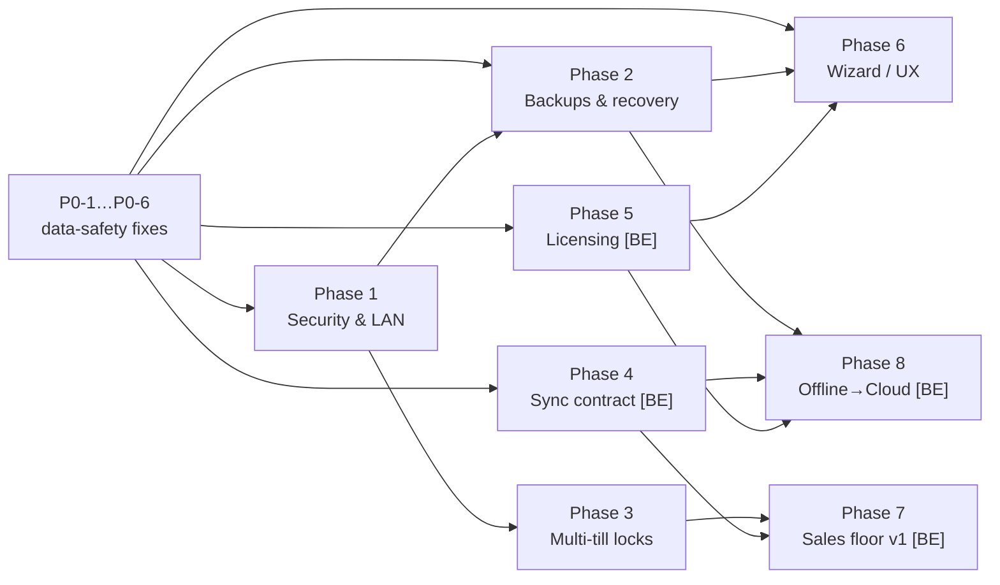

# 20 — Implementation roadmap: P0 data-safety fixes and Phases 1–8

**Written 2026-10-24.** Plan only; no code in this document. Inputs: the read-only discovery audit
(`docs/pos/discovery/`), the product-owner decision report (`XORDER_ARCHITECTURE_CASE_REPORT.md`,
ADR-001…009) and the approved engineering plan. The decisions behind each phase are recorded one per
file in [`docs/pos/adr/`](adr/README.md).

**Evidence boundary.** Every "today" statement is `[CODE]` (read, not run). Nothing in this document
has been executed: the planning sandbox had no Flutter, Dart or PostgreSQL. Backend (Laravel/Vue)
behaviour is UNKNOWN; items marked **[BE]** need `xorder-new` open in a session before that phase can
close.

## 1. Context

The POS sells against a local PostgreSQL on the primary cashier PC and, in cloud mode, uploads through
an outbox. The audit found that the design is sound but that a handful of code paths can lose or
strand money (restore discards unsent sales; a 2xx with a non-JSON body marks a sale delivered;
quarantined rows have no release path), that LAN security is below the accepted rules (plaintext
`secrets.json`, shared `pos_till` role, TLS off by default), and that several accepted product rules
have no implementation yet (daily backups, 10-minute ticket lock, offline `.xlic` import, Offline→Cloud
migration, kitchen output).

## 2. Decision summary

| Decision | Choice | Where recorded |
|---|---|---|
| Multi-till boundary | **Direct PostgreSQL, hardened**: per-till DB roles, TLS on by default, `LISTEN/NOTIFY` for invalidation, lease table for ticket locks. No local API layer. | ADR-004, ADR-006 |
| Phase organisation | **By capability, not by repository.** When a POS change needs a backend change (contract, endpoint, licence field), both halves sit in the **same phase** and ship together. Backend work is marked **[BE]**; the POS half is built against the agreed contract and verified with the fake API until the backend lands. | this document |
| Deployment modes | Two: `cloud` (Plan A) and `offline` (Plan B). Legacy wire values `branch_server`/`standalone` parse to `offline`. | ADR-001 |
| v1 sales-floor scope | **In:** kitchen ticket / KDS routing, table merge / transfer / split-bill, ETA signing + submission, business-day auto-open. **Out:** delivery (driver, zone, fee, status). | ADR-010 |
| Order of work | P0 fixes first (POS-only, no open product question), then Phases 1–8. | §3, §4 |
| Verification | `scripts/check.sh` locally (needs PostgreSQL); nothing runs in the planning sandbox. | §6 |

## 3. P0 data-safety fixes (POS-only; implement in this order)

Each item needs no backend change and no open product decision. Scenario IDs point to
`discovery/DATABASE_AND_SYNC.md` §10 and `discovery/GAPS_AND_OPEN_QUESTIONS.md` §7. One commit per
item; the message names the scenario ID. Migrations are additive, numbered entries in
`lib/data/postgres/migrations.dart`.

| # | Scenario | Fix | Files | Acceptance test |
|---|---|---|---|---|
| P0-1 | **D4** 2xx + non-JSON body marked delivered | `_send` returns `parsed: false` (or `CloudReply.malformed(status)`) when `response.data` is not a JSON object. Drain treats a 2xx with malformed body or missing required ack fields (`order_id`/`invoice_number` for orders; server id for lifecycle events) as **deferred** (`attempts+1`, `last_error='MALFORMED_ACK'`), never `delivered_at`. | `lib/data/cloud/cloud_api.dart:256-268`; `lib/data/cloud/outbox_drain.dart:372` (`if (reply.ok)`), `:520` (lifecycle branch) | `test/data/outbox_drain_test.dart`: 200 + HTML string, 200 + `{}`, 200 + valid → only the last sets `delivered_at`. |
| P0-2 | **D3** restore discards unsent sales | Restore-blocker query adds counts of `pos_outbox`/`pos_sync_outbox WHERE delivered_at IS NULL AND quarantined_at IS NULL` → new `RestoreBlockerKind.pendingSync` (hard block in `cloud`; warning + explicit confirmation in `offline`, where the outbox is empty anyway). Quarantined count surfaced as a warning. `restore()` takes a pre-restore `pg_dump` via `BackupService.backUp` (`trigger_kind='manual'`, label `pre-restore`) and records its path in the restore `BackupRecord`; snapshot failure refuses the restore. | `lib/data/backup/backup_service.dart:345-402` (blockers), `:424` (`restore()`); `lib/features/admin/presentation/management_backup_pane.dart`; `lib/core/l10n/app_strings.dart` (`EnStrings`/`ArStrings`) | `test/data/backup_restore_test.dart`: a pending outbox row blocks restore; the pre-restore file exists after a restore. |
| P0-3 | **D1 / D2 / D13** quarantined rows have no release path | Migration: grant `pos_till` column-scoped UPDATE on `pos_outbox.quarantined_at, quarantine_code` and the same on `pos_sync_outbox` (no schema change). Repository: `listQuarantined()` + `releaseQuarantined(id)` (`SET quarantined_at = NULL, quarantine_code = NULL, last_error = NULL`, kick `CloudSync.run()`, audited). Pending count excludes quarantined rows and reports them separately (`pendingSyncCountProvider` → `{pending, held}`). UI: "Held sync items" section (admin permission) with code, `last_error`, order ref, **Retry**; on cloud tills it lives on the main device's terminal pane. Support-only diagnostics stay out of the cashier UI. | `migrations.dart` (new entry); `lib/domain/repositories/repositories.dart`; `lib/data/postgres/postgres_orders_repository.dart:360-384` or new `postgres_sync_queue_repository.dart`; `lib/data/cloud/cloud_sync.dart:228-239`; `management_terminal_pane.dart` | `outbox_drain_test.dart`: release flips the flags and the next drain pass attempts the row; the pending count excludes held rows. |
| P0-4 | **R-DUP-1** offline terminal registration duplicates rows | New nullable `pos_terminals.install_id` + unique index per restaurant (migration). Registration becomes `INSERT … ON CONFLICT (restaurant_id, install_id) DO UPDATE SET name=…, claimed_at=now() RETURNING id`, keyed on the fingerprint UUID already in `config.json`. Offline wizard path persists progress to `SetupProgressStore` (including `terminalId`) as the cloud claim already does, so a kill mid-wizard resumes instead of re-registering. | `lib/data/postgres/postgres_directory_repositories.dart:50-57`; `lib/features/setup/application/setup_controller.dart` (cloud pattern at `:243-262`); `lib/data/config/setup_progress_store.dart` | `test/features/setup_persistence_test.dart` + repository test: registering twice yields one row. |
| P0-5 | **R-SALE-1** stale shift id on sales/refunds (suspected) | Repository constructors take `int? Function() shiftId` resolved at write time; the provider passes `() => ref.read(shiftProvider).valueOrNull?.id`. Keeps the "read, not watched" intent without staleness. | `lib/app/providers.dart:274, :442, :2979`; `PostgresOrdersRepository`, `PostgresRefundsRepository`, the third repository at `:2979` | `test/data/postgres_integration_test.dart` / `refund_history_test.dart`: open a shift after repository creation → the settled order carries the new shift id. | **Superseded 2026-10-25:** `main` fixed this first (commit `a1085cc`) by asking the database for the open shift inside the write's transaction (`openShiftIdFor`); this branch's resolver version was dropped in the merge.
| P0-6 | **R-SALE-2** parked ticket loses tax mode, groups, charges, customer | Codec persists tax mode, tax groups, service charges and customer; `TaxConfig ==`/`hashCode` extended. | `lib/data/postgres/parked_ticket_codec.dart` | `test/data/parked_ticket*_test.dart`: encode→decode equality on a full ticket. |

## 4. Phases

A phase with **[BE]** items closes only when both halves ship. "Open product questions" cite
`discovery/GAPS_AND_OPEN_QUESTIONS.md` §5 (Q1–Q25) and §7 (Q26–Q31); a phase can start before they are
answered only where the row says so.

### Phase 1 — Security and LAN hardening (ADR-006) — POS-only

| | |
|---|---|
| Goal | The accepted security rules hold at the database boundary, not only in Dart. |
| POS work | Secrets to the OS store (Windows DPAPI via existing `win32`/`ffi`; macOS Keychain) replacing `FileSecretStore` (`lib/data/config/file_secret_store.dart`), **no plaintext fallback** (fail safe when the vault is unavailable). Installer `provision.ps1` generates a self-signed certificate and writes `ssl=on` + `hostssl`; POS defaults to `SslMode.verifyFull`/`require` (`pos_database.dart:293`) with an explicit, audited technician override and **no silent downgrade**. Per-till DB roles (`pos_till_<id>`) created at registration, so a leaked till credential is revocable and `terminal_id` is tied to the connecting role. Staff **username + password** (reuse PBKDF2 from `pin_hash.dart`), one sign-in per session, **5-minute idle lock** in `lock_screen.dart`, lockout on repeated failures. Privileged writes (void, refund, discount, price override, payment removal, shift close, terminal reset) behind `SECURITY DEFINER` functions so Dart-only checks are no longer the boundary. `pos_admin` password removed from `secrets.json`; restore and other technician-only actions require it to be typed. |
| [BE] work | none (staff identity source for the cloud plan is Q-open; Phase 4 picks it up). |
| Dependencies / blockers | None for the offline plan. Cloud-plan staff authority (central vs local) is decided in Phase 4; Phase 1 implements local password verification that either authority can feed. |
| Acceptance criteria | OS-store round trip on Windows and macOS; vault-unavailable path refuses to start selling rather than writing JSON; LAN connect with TLS verifies, TLS failure shows an actionable error and never falls back to plaintext without the audited override; each till connects as its own role and a revoked role cannot write; every privileged write fails from a direct `psql` session holding only a till role; idle 5 minutes → lock screen; N failed passwords → lockout, audited; `pos_admin` password absent from disk after setup. Existing PIN-only staff migrate without locking out the owner. |
| Open product questions | Q17 (secrets store — accepted: OS store), Q18 (password/lockout policy, idle lock — accepted 5 min; lockout numbers open), Q19 (TLS default — accepted on), Q13 (per-till credential — accepted here), Q6/Q20 later. TLS-off exception recording and whether TLS-off is allowed on any LAN (case report P2) remain open; implement as technician-only, audited. |

### Phase 2 — Backups and recovery (ADR-007) — POS-only

| | |
|---|---|
| Goal | A restaurant that never closes its day still has a backup; a restore never silently drops money. |
| POS work | Daily timer in addition to day-close (`backup_service.dart`), with missed-day catch-up at next launch. External backup destination required and verified by the wizard (writable, checksum compare). Retention 14 days (exists; confirm behaviour when a day has several copies). Pre-restore snapshot + **outbox replay** (builds on P0-2): snapshot → extract unsent outbox rows and orders newer than the backup → restore → re-insert and replay. Backup failures visible to a local technician view; no cloud telemetry in offline plan. Restore remains technician-only (needs the typed `pos_admin` password from Phase 1). Encryption: design only until key custody is decided. |
| [BE] work | none |
| Dependencies / blockers | P0-2; Phase 1 for "technician-only" to be enforceable. |
| Acceptance criteria | Scheduled backup runs with no day close and after a missed day; wizard refuses to finish without a verified external destination; restore on a database with unsent rows produces a pre-restore snapshot and, after restore, the unsent rows are present and drained; verification failure never prunes the last known-good copy; disk-full and permission errors surface in the technician view. |
| Open product questions | Q15 (off-box policy — accepted: external destination at install; automatic vs technician export still open, case report P1), Q16 (restore with unsent sales — accepted: block in cloud, warn in offline), encryption and key custody (open). |

### Phase 3 — Multi-till live state and locks (ADR-004) — POS-only

| | |
|---|---|
| Goal | Two tills on one table cannot overwrite each other; every till sees the floor change; a till without its database stops selling visibly. |
| POS work | `pos_ticket_locks(table_id, terminal_id, staff_id, expires_at)` lease: 10 minutes, renewed while editing, force-release audited and permission-gated. Row `version` on `pos_parked_tickets` (`postgres_parked_tickets.dart`) with an optimistic check on write; settle deletes only the ticket it settled, not whatever is on the table. `LISTEN/NOTIFY` per restaurant for invalidation (the `postgres` package supports it); events are hints — reconnect reloads from the database. DB-unavailable blocking state on child tills (no pretend recording). |
| [BE] work | none |
| Dependencies / blockers | Phase 1 per-till roles (so `terminal_id` in the lock row is trustworthy). |
| Acceptance criteria | Two-till race tests: second editor sees busy state and editor identity; stale `version` write is refused; lock expires after 10 minutes idle and re-entry succeeds; force-unlock leaves an audit row; a till that missed notifications shows the correct floor after reconnect; no double-settlement of one ticket; sales disabled while the database is unreachable. |
| Open product questions | Q12 (exclusive tables, live refresh — accepted), Q11 (failover — accepted: none in first release), lock renewal vs fixed (case report P1 — implement renewable, confirm), force-unlock permission (open). |

### Phase 4 — Cloud sync contract and data authority (ADR-002 / ADR-003) — POS + [BE] together

| | |
|---|---|
| Goal | Every operating transaction reaches the cloud, every rejection is recoverable, and "cloud authoritative" is defined per entity. |
| POS work | 5-minute cadence (`SyncSchedule`, `cloud_sync.dart:55-59`), reconnection trigger. Upload voids (`postgres_orders_repository.dart:317`), stock movements and purchasing to the new endpoints. Bootstrap seeder **archives instead of deleting** catalogue rows (`bootstrap_seeder.dart:530-543`) so FK on `pos_stock_movements` / `pos_combo_options` cannot roll the seed back silently (D9). Display `totals_mismatch` (written, never read today). Staff/customer authority as decided. Per-row backoff/attempt cap; strict ack parser from P0-1 kept. |
| [BE] work | Audit Laravel/Vue. Confirm/implement idempotency on `client_transaction_id` and the ack schema the strict parser requires; define `totals_mismatch` semantics; define `MENU_ITEM_NOT_FOUND` / `CUSTOMER_NOT_FOUND` behaviour and the archive-not-delete rule for catalogue items referenced by orders; new endpoints for voids, stock movements, purchasing; terminal attribution for child-till sales. |
| Dependencies / blockers | P0-1, P0-3. Stock-movement parity is **blocked on inventory scope** (no BOM/stocktake/waste; refunds/voids do not restock) — upload what exists (`sale`, `receipt`, `opening`) and defer parity until Q7/Q31 are answered. |
| Acceptance criteria | Offline→online transition drains in order within 5 minutes; crash-after-send-before-ack does not duplicate (server idempotency test); 4xx/409/422/5xx matrix handled with no permanently invisible failure; reseed over stocked products succeeds and historical orders keep their references; `totals_mismatch` visible to the role decided; voids and stock movements appear on the platform with event ids. |
| Open product questions | Q5 (per-entity authority — accepted direction, matrix to sign off), Q7 (voids/stock — accepted upload; inventory owner open), Q8 (who clears held rows — support-only accepted; manager indicator open, case report P0), Q9 [BE], Q10 (multiple cloud tills on one DB), customer/staff authority (case report P1), old-catalogue rejection handling (P1). |

### Phase 5 — Licensing and device seats (ADR-005) — POS + [BE] together

| | |
|---|---|
| Goal | Air-gapped sites can install and replace a device; update rights are enforced from signed data, not the local clock. |
| POS work | `.xlic` **file-import UI** (controller param exists: `setup_controller.dart:1381`; `licence_screen.dart`) — required for device replacement in air-gapped sites. Update entitlement checked as **build date ≤ signed `updates_until`**, never the local clock. `max_terminals` enforced via DB constraint + retire-terminal action freeing the seat. Monotonic last-seen clock guard against rollback. Signed verdict cache replacing the editable `licence_check.json`. |
| [BE] work | Licence issuance with `updates_until`, major version and seat count; seat transfer on device replacement (support approval, audited); `/license/check` enforcement semantics; offline licence file download from the dashboard. |
| Dependencies / blockers | P0-4 (stable `install_id`). |
| Acceptance criteria | A signed file imports on a machine with no network and the wizard proceeds; an entitled build installs when `build_date ≤ updates_until`, a later build is refused with the reason, the last entitled build keeps working after the year; seat count cannot exceed `max_terminals` even by direct INSERT; retire frees a seat and is audited; clock rollback does not extend an expired file; edited verdict cache is rejected. |
| Open product questions | Q1 (air-gapped — accepted: file import), Q2 (`max_offline_days`), Q4 (licence selects vs permits), Q14 (retired seats — accepted free), Q21 (issuer: platform vs CLI; which claims enforced), Q22 (tamper strength), major-version treatment within the year (case report P1). |

### Phase 6 — Wizard and UX (ADR-009) — POS-only

| | |
|---|---|
| Goal | Technician-led setup matches the accepted flow: Arabic default, no language step, correct dynamic step count. |
| POS work | Drop the Language step; add **Settings → General → Language** (reuse `localeProvider` + `TerminalConfigStore`), available inside the wizard and after, persisting before a database exists. Fix bar toggle vs draft overwrite (`setup_controller.dart:301, :904`). Offline path reads installer credentials (`install-credentials.json`) like the cloud path. Dynamic step count per plan and role; resume from checkpoint (P0-4); failed DB initialisation explains and retries without destructive reset. |
| [BE] work | none |
| Dependencies / blockers | P0-4. Phase 2 for the external-destination step; Phase 5 for the file-import step. |
| Acceptance criteria | Fresh till opens RTL Arabic; language switch applies immediately and survives restart before `config.json` exists; a toggle made during the wizard is what `complete()` saves; step counts match the case matrix per plan/role; no duplicate owner/terminal rows on re-run; no credentials in diagnostics. |
| Open product questions | Q23 (where General Settings lives — accepted: Settings → General → Language), Q24 (digits, receipt language), Q25 (installer credentials — accepted here), auto-select plan when licence permits both (open). |

### Phase 7 — Sales floor v1 (ADR-010) — POS, with one [BE] item

| | |
|---|---|
| Goal | A seated "send round" produces something the kitchen receives; tables can be merged, transferred and split; a trading day exists; ETA receipts are signed and submitted. |
| POS work | Kitchen ticket / KDS: extend `pos_print_jobs.kind` CHECK (`migrations.dart:3191`) with `'kitchen'`, station routing per category, send-round persists lines (`ticket_engine.dart` `LineStage`) and a persisted open-order record. Merge / transfer / split-bill in `TicketEngine` (pure, unit-tested) and parked tickets (on the Phase 3 lock). Business-day **auto-open** at first shift or first sale (`BusinessDayRepository.open` has no caller today). ETA signing and submission in `lib/data/eta/eta_filer.dart` (certificate/SDK decision open); populate the slip QR. |
| [BE] work | Kitchen stations and split-bill shapes in the order upload contract, if the platform must see them. |
| Dependencies / blockers | Phase 3 (locks, live refresh) for merge/transfer; Phase 4 contract for the [BE] half. Delivery stays out. |
| Acceptance criteria | Send round creates a kitchen job routed by station and visible on KDS/kitchen printer; re-fire and void-after-send audited; merge/transfer/split preserve totals to the minor unit (engine tests); a shift opening with no business day opens one and day-close blockers count real unpaid orders; an ETA receipt moves pending → signed → accepted with the QR printed. |
| Open product questions | Q26 (KDS — accepted), Q27 (merge/transfer/split — accepted; delivery out), Q28 (auto-open — accepted), Q30 (ETA in this repo — accepted; card terminal out), Q29 (named discounts author). |

### Phase 8 — Offline→Cloud upgrade (ADR-008) — POS + [BE] together, last

| | |
|---|---|
| Goal | A technician moves an offline restaurant to the cloud plan with all history and no two-writer window. |
| POS work | Technician migration tool: preflight/schema inventory → lock writes, close shifts → verified full backup (Phase 2) → tenant/ID mapping → import immutable history → reconcile counts/checksums → activate cloud mode and outbox baseline → verify → reopen sales. Original DB stays recoverable until accepted cutover. Built on the backup service and the Phase 4 contract. |
| [BE] work | Historical-import API (old dates and prices, tenant-scoped ID mapping, idempotent reruns); menu and customer merge policy; failure handling by support. |
| Dependencies / blockers | Phases 2, 4, 5. **P0 product question**: does the offline catalogue become the initial cloud catalogue, or does another cloud catalogue win (case report P0). |
| Acceptance criteria | Dry-run reconciliation on a realistic dataset matches sale/payment/inventory totals and counts; partial-import failure leaves the original DB live and the cloud side inert; idempotent rerun; cutover rollback rehearsal; no live sales during maintenance. |
| Open product questions | Q3 (in-place switching — accepted: technician-managed, downtime), catalogue precedence (P0), customer/staff source of truth (P1), proof of reconciliation (open). |

## 5. Phase dependencies

Phases 1, 2 and 3 are POS-only and can proceed while the backend audit (Phase 4 [BE]) is under way.
Phase 8 is last by design.

## 6. Verification rule

- **Nothing in this plan ran in the sandbox.** No Flutter, Dart or PostgreSQL was available; every
  `[CODE]` claim is from reading source.
- After each P0 commit the user runs locally: `flutter analyze && scripts/check.sh` (needs a local
  PostgreSQL; integration suites self-skip without `POS_PG_HOST`). `flutter test` must stay green with
  no database.
- Per fix: the new tests listed in §3 fail before and pass after.
- P0-3 manual check on a cloud till: quarantine a row (existing test fixture codes), see it under
  "Held sync items", Retry → the row is attempted on the next drain.
- Docs: Mermaid blocks render in GitHub preview; links `discovery/README.md` → this file → `adr/`
  resolve.

## 7. Related

- Decisions: [`adr/README.md`](adr/README.md)
- Evidence: [`discovery/README.md`](discovery/README.md), especially `DATABASE_AND_SYNC.md` §10 and
  `GAPS_AND_OPEN_QUESTIONS.md` §5/§7
- Contract state: `docs/coordination/BACKEND_TO_POS.md`
