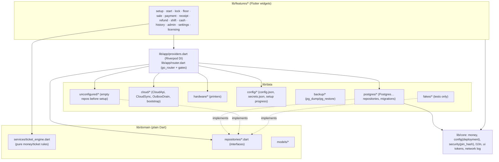
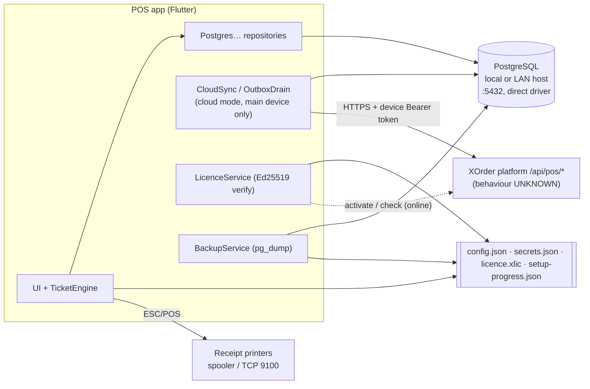

# Current architecture (as built)

Scope: what the code in `amerelsayed1/xorder-pos` does today. Evidence level is **[CODE]** throughout: nothing
was executed (no Flutter/Dart/PostgreSQL in the audit sandbox). Details and file:line evidence live in the topic
documents linked from each section.

## 1. Components: found vs. not found

| Component | Status | Evidence / note |
|---|---|---|
| Flutter POS desktop (Windows/macOS) | IMPLEMENTED | `lib/` (~214k lines incl. 12k-line `core/l10n/app_strings.dart` and 4.5k-line `data/postgres/migrations.dart`); `windows/`, `macos/` runners. `android/ios/linux/web` folders exist; the installer treats Android/iOS as "child" tablets (see MULTI_DEVICE.md §1.2) — mobile UX unverified. |
| In-app Management / back office (Admin Mode) | IMPLEMENTED (PARTIAL for cloud tills) | `lib/features/admin/**`. A claimed cloud terminal gets only a signpost to the dashboard (`lib/app/router.dart:138-160`). See FEATURE_INVENTORY.md (Part 2). |
| PostgreSQL (local, per branch) | IMPLEMENTED | Schema in `lib/data/postgres/migrations.dart`; installed by `installer/xorder-pos.iss` + `installer/provision.ps1`, or `bin/pos_migrate.dart`. No PostgreSQL server was reachable here, so the schema was read, never run. |
| Local sync queue | IMPLEMENTED | `pos_outbox` / `pos_sync_outbox` tables, `lib/data/cloud/outbox_drain.dart`. See DATABASE_AND_SYNC.md. |
| Cloud transport client (POS side) | IMPLEMENTED (client only) | `lib/data/cloud/cloud_api.dart`, `branch_sales_api.dart`, `cloud_sync.dart`. |
| Laravel backend / APIs (`xorder-new/apps/api`) | **UNKNOWN — inaccessible** | Not in the session scope. Only the *client calls* are observable (§3). `docs/coordination/*` are agreements, not evidence. |
| Vue admin panel / cloud dashboard | **UNKNOWN — inaccessible** | Referenced as "dashboard" (`/api/dashboard/pos/terminals/{id}/pairing-code`, `/api/auth/login` in POS code). |
| `Xorder-Menus` repository | Empty | Remote has no commits (`git ls-remote` returned nothing; local branch has no commits). Nothing to audit. |
| Licensing service | PARTIAL | POS-side verification and CLI issuer (`bin/pos_licence.dart`) exist; the platform side (`/api/pos/licence/activate`, `/api/pos/license/check`) is UNKNOWN. See LICENSING.md. |
| Hardware | PARTIAL | ESC/POS over Windows spooler (`lib/data/hardware/winspool.dart`, `spooler_printer_ports.dart`) and raw TCP 9100 (`network_printer_ports.dart`). No card-terminal, KDS or kitchen-routing integration found (FEATURE_INVENTORY.md Part 1); other peripherals (scale, customer display, drawer) were not specifically searched by the audit — treat as UNKNOWN. |
| CI | PARTIAL | Only `.github/workflows/windows-installer.yml`, manually triggered; tests are run locally via `scripts/check.sh`. |

## 2. Layering

* The DI seam is `lib/app/providers.dart` (3,164 lines). Repositories are chosen there; before setup completes the
  `Unconfigured…` implementations are bound, so an unconfigured till shows nothing and refuses to sell
  (`ordersRepositoryProvider`, `providers.dart:259-300`). [CODE]
* Order writes are decorated: `PostgresOrdersRepository` → `SyncingOrdersRepository` (kicks the drain, cloud mode only)
  → `FilingOrdersRepository` (ETA e-invoicing, when enabled) (`providers.dart:259-300`). [CODE]
* Fakes are not bound by the app (confirmed by the DI code path above; `lib/data/fakes` is referenced from tests).

## 3. Communication between components

POS → platform endpoints actually referenced in code (`grep` of `lib/`; payloads/semantics server-side are UNKNOWN):
`/api/pos/bootstrap`, `/api/pos/config`, `/api/pos/orders`, `/api/pos/refunds`, `/api/pos/shifts` (+ `/{id}/close`),
`/api/pos/cash-movements`, `/api/pos/customers`, `/api/pos/terminals/{register,claim,heartbeat}`,
`/api/pos/licence/activate`, `/api/pos/license/check`, `/api/pos/branch/sales` (+`/summary`),
`/api/dashboard/pos/terminals/{id}/pairing-code`, `/api/auth/login`.

Key architectural fact: **there is no local server process / local API.** The "server" in a multi-till site is
a PostgreSQL service that every till reaches directly over TCP with a shared database role (MULTI_DEVICE.md).

## 4. Data ownership and database topology

| Data | Authoritative store today | Notes |
|---|---|---|
| Orders, payments, shifts, cash movements, refunds, audit | Local PostgreSQL (the branch DB) | Written in one transaction with the outbox row (DATABASE_AND_SYNC.md). |
| Catalogue, tables, tenders, staff, money config | Cloud mode: cloud (re-applied from bootstrap bundle, delete-and-reinsert for catalogue). Offline mode: local DB (managed in-app). | Bootstrap never touches orders/outbox/shifts/refunds/stock. |
| Stock | Local DB only | Never uploaded or downloaded. |
| Terminal identity / DB creds / device token | `config.json` + plaintext `secrets.json` in app-support dir | Not an OS keystore (SECURITY_AND_RECOVERY.md). |
| Licence | `licence.xlic` file and/or site-licence row in PostgreSQL | LICENSING.md. |
| Backups | `pg_dump` files on the same disk by default | Taken at day close or manually. |

Database topology: one PostgreSQL database `xorder_pos` per branch; roles `pos_till` (runtime, no DDL),
`pos_admin` (schema owner), `pos_backup` (read-all). Deployment is one DB per site shared by N tills on the LAN, or
one DB per machine. There is no multi-site/central database in this repo.

## 5. Dependencies and deployment requirements

* Runtime: Flutter desktop binary; PostgreSQL reachable at the configured host (installer bundles it for the
  "server" install type; "till" type installs the app only) — `installer/xorder-pos.iss` `[Types]`.
* Backups require `pg_dump`/`pg_restore` client tools on the machine (`lib/data/backup/pg_tools.dart`).
* Internet: required only for cloud-mode setup/sync and for licence activation/renewal (OPERATING_MODELS.md §6).
* Windows installer + VC++ redistributable; macOS packaging script `scripts/package_macos.sh`.
* Build-time inputs: `--dart-define` public licence key for release builds (LICENSING.md).
* Notable packages: `postgres` (pure Dart), `dio`, `riverpod`, `go_router`, `cryptography` (Ed25519), `win32`/`ffi`, `excel`, `csv`.
* No native keystore, crash-reporting, telemetry, or auto-update package in `pubspec.yaml`.

## 6. Documentation vs. code disagreements found

| Claim in docs | Code reality | Source |
|---|---|---|
| Three deployment modes (cloud/branch-server/islanded) — `CLAUDE.md` | `DeploymentMode` has two: `cloud`, `offline` (old values are aliases) | `lib/core/config/deployment.dart` |
| Secrets in OS keystore / DPAPI / Keychain (comments) | Plaintext `secrets.json`, `chmod 600` on POSIX only | SECURITY_AND_RECOVERY.md §14 |
| Fingerprint is hardware-derived | Random UUID in `config.json` + constant salt | LICENSING.md |
| Docs say `hostssl` for LAN | Installer writes `host` entries, no `ssl=on` | DATABASE_AND_SYNC.md |
| Wizard language applies immediately (comment) | Applied at `complete()` | CURRENT_SETUP_WIZARD.md |
| Cloud tills have an in-app back office (pane logic/docs) | Router shows only a signpost for claimed cloud terminals | FEATURE_INVENTORY.md (Part 2) |
| `PlatformEndpoint`: operators can't repoint licence checks | Licence step has an editable licence-server URL | LICENSING.md |

## 7. Test assets (observed to exist; not executed)

252 `*_test.dart` files under `test/`, 6 files in `integration_test/`. PostgreSQL-backed suites are tagged `integration`
and self-skip when `POS_PG_HOST` is unset (`dart_test.yaml`). `PROJECT_REVIEW.md` (2026-08-28) reports 213 passed /
6 skipped — an author's claim, not re-verified. Verification is local (`scripts/check.sh`); no automatic CI test gate.
