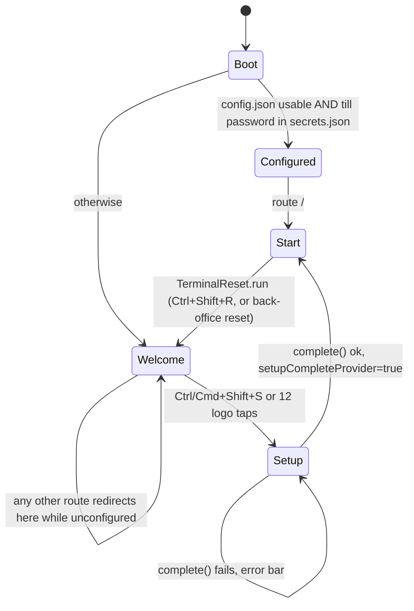
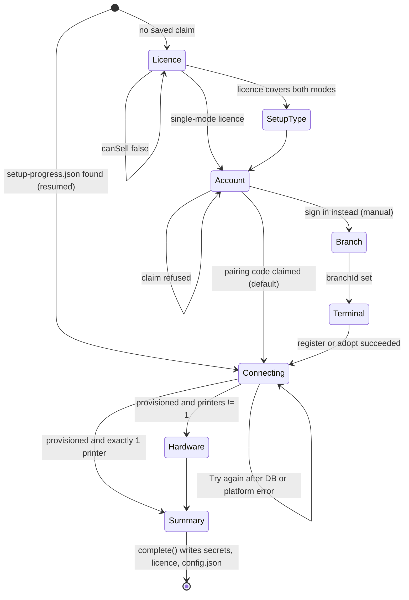
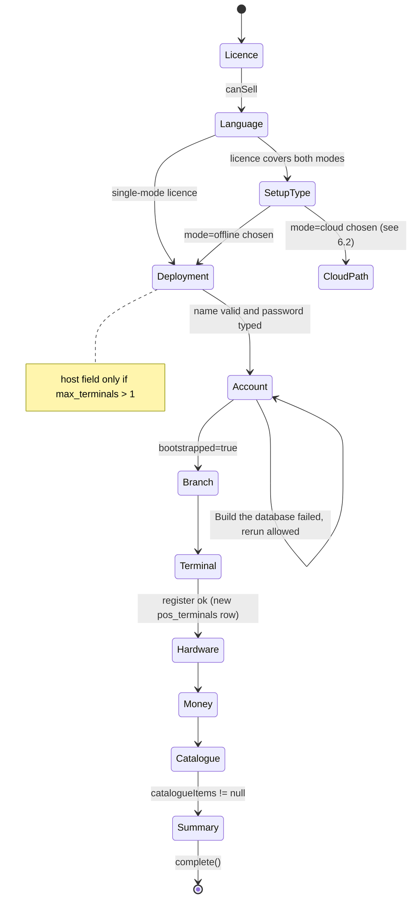
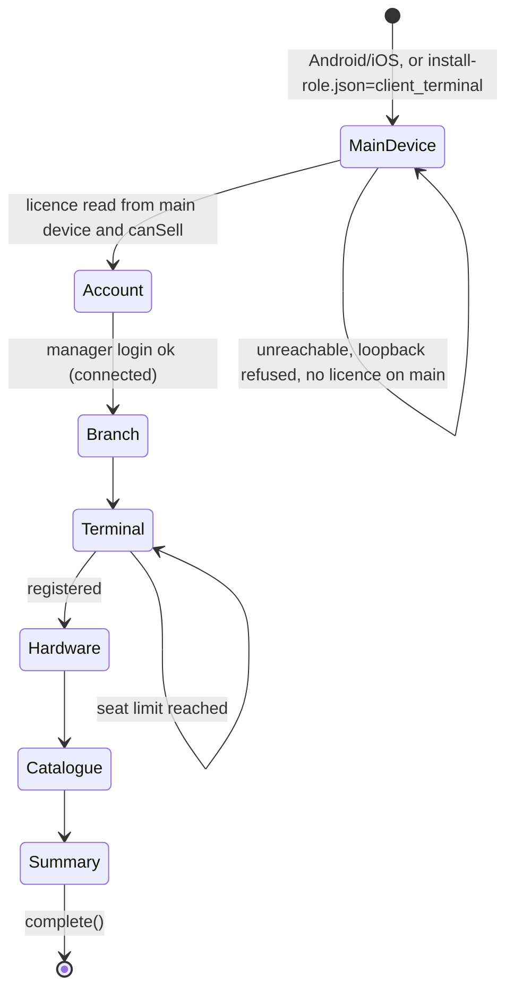

# Current setup wizard and localisation: discovery audit

Scope: read-only audit of the first-run setup wizard and of the Arabic/English localisation as the code stands today.
Date of audit: 2026-10-24. Repo: `/home/user/xorder-pos`.

Evidence levels used below:

- **[CODE]** supported by executable code that was read. Nothing here was executed.
- **[ASSUMED]** inference, or something that depends on code that is not in this repo (backend, Windows host, PostgreSQL server).
- **[OBSERVED]** is not used. No Flutter, Dart or PostgreSQL is available in this sandbox, so no test or run was possible.

Status labels: IMPLEMENTED | PARTIAL | NOT_IMPLEMENTED | UNKNOWN.

Tests are "test exists (not executed here)". `PROJECT_REVIEW.md` claims 213 passed and 6 skipped; that is the author's claim, not observed.

Backend behaviour is UNKNOWN. The Laravel API is not available. Only the HTTP paths the POS calls are known (section 3.4).

---

## 0. Headline findings

| # | Finding | Status | Evidence |
|---|---|---|---|
| 1 | The wizard is one `SetupStep` enum (12 members) and one `SetupController`. It walks **three different step lists**: cloud main device, offline main device, child terminal. `visibleSteps` picks the list. | IMPLEMENTED | [CODE] `lib/features/setup/domain/setup_state.dart:26,264,305,320,342` |
| 2 | **Default UI language is Arabic.** A machine with no saved config opens in `ar`. Both `localeProvider` and `SetupDraft.locale` default to `'ar'`. | IMPLEMENTED | [CODE] `lib/app/providers.dart:1859`, `setup_state.dart:85`; test `test/core/localisation_test.dart` "a terminal with no configuration yet opens in Arabic" and "and so does the wizard it opens" |
| 3 | A language switch exists in three places, **none is called "General Settings"**: (a) the Settings menu-bar toggle (visible in the wizard, hidden on the welcome screen), (b) a "Language" pane under back-office Settings, (c) a wizard Language step on the **offline path only**. | PARTIAL vs approved UX | [CODE] `lib/app/app.dart:386-398`, `management_appearance_pane.dart:62-89`, `setup_panes.dart:235-271` |
| 4 | **Wizard language step does not switch the screen.** `setLocale()` only writes `SetupDraft.locale`. The UI language changes only when `complete()` calls `localeProvider.apply`. A comment in `providers.dart` says the opposite. | PARTIAL (defect) | [CODE] `setup_controller.dart:301,904`; comment `providers.dart:1841-1846`. No test found. |
| 5 | **Menu-bar language toggle is not reflected in what the wizard saves.** The toggle calls `localeProvider.apply`, which does not touch `SetupDraft.locale`. `complete()` then writes `draft.locale` to `config.json` and re-applies it. An installer who switches to English via the bar and never visits the Language step can end up with Arabic saved. | PARTIAL (probable defect, [CODE] reading, not executed) | [CODE] `setup_controller.dart:106,889,904`; `app.dart:397`. No test found. |
| 6 | Wizard strings are fully localised through `AppStrings`. 1,904 members, each implemented in both `EnStrings` and `ArStrings`; the sealed class makes a missing key a compile error. Residual literals in setup files are placeholders and identifiers (section 6.4). | IMPLEMENTED | [CODE] `lib/core/l10n/app_strings.dart`; test `test/core/localisation_test.dart` "no operator-facing literal survives in the widget layer" |
| 7 | Server-originated refusal text is English and reaches the screen only when the wizard has no code mapping. Raw `'$error'` exceptions are shown verbatim in two places. | PARTIAL | [CODE] `labels.dart:234-264`, `setup_controller.dart:705,1587` |
| 8 | RTL is by `MaterialApp.locale`, not hand-rolled. The wizard has hard-coded physical left/right in places (7 `Alignment.centerLeft`, rail `Border(right:)`, spinner `EdgeInsets.only(right:)`, welcome toggle `Positioned(right:)`). Mono fields (URLs, codes, hosts) set no LTR text direction. | PARTIAL | [CODE] section 7.3 |
| 9 | Numbers, dates and currency are **always Western digits** with `,` grouping, `.` decimal, ISO code suffix (`EGP`), `dd/mm/yyyy`. `intl` is a dependency but is never imported in `lib/`. No Arabic-Indic digits anywhere. | IMPLEMENTED (as designed) | [CODE] `lib/core/money/money.dart:119-146`, `labels.dart:220` |
| 10 | Receipt language equals the terminal UI language and is printed right-to-left when `ar`. One language per slip. | IMPLEMENTED | [CODE] `lib/features/receipt/receipt_document.dart:174-190,425` |
| 11 | Offline licence activation has **no file-import UI**. The wizard offers only "Activate online". The `fileContents` parameter exists for tests and the cloud bundle. A licence already on disk is picked up by `_restoreInstalledLicence`. | PARTIAL | [CODE] `setup_panes.dart:631-676`, `setup_controller.dart:1096`; test `setup_wizard_test.dart:577` asserts "Activate from file" is absent |
| 12 | The offline path never reads the Windows installer's `install-credentials.json`. Only the cloud path's `provisionTerminal` does. The offline operator types database name, port, till password and admin password. The installer's closing message says "The setup wizard will ask for them". | PARTIAL | [CODE] `setup_controller.dart:1521,1678` (only caller of `installerCredentialsProvider`), `installer/xorder-pos.iss:90-91` (`DatabaseReady`) |
| 13 | `complete()` writes the **admin** database password in clear text to `secrets.json` (file store, `0600` on POSIX, per-user profile on Windows) whenever the wizard held one. Offline always holds one. Comments elsewhere say "OS keystore"; the code uses a file. | IMPLEMENTED (security-relevant) | [CODE] `setup_controller.dart:869-873`, `file_secret_store.dart`, `lib/main.dart:41-52` |
| 14 | Offline terminal registration is not idempotent: each run of `registerManually` inserts a fresh `pos_terminals` row with a new UUID. A kill and re-run leaves orphans. No unique constraint prevents it. | PARTIAL | [CODE] `postgres_directory_repositories.dart:240-254`, `migrations.dart:152-165` |
| 15 | Only the **cloud claim** is resumable (`setup-progress.json`). Offline has no progress file; its database is built in PostgreSQL at the account step and survives a kill, but the licence (held in memory) and all form input are lost. | PARTIAL | [CODE] `setup_controller.dart:207-299` |

Product-owner direction: "Arabic by default with language switching through General Settings". Gap summary in section 9.

---

## 1. How the wizard is launched

### 1.1 Routing and gates [CODE] `lib/app/router.dart:62-100`

| Condition | Result |
|---|---|
| `setupCompleteProvider == false` and path not `/setup` or `/welcome` | redirect to `/welcome` |
| `setupCompleteProvider == true` and path is `/setup` or `/welcome` | redirect to `/` (start) |
| initial location | `/` |

`setupCompleteProvider` is `terminalSeedProvider.isConfigured`, which is `config.isUsable && hasDatabaseCredential` (`terminal_config.dart` `TerminalBoot.isConfigured`; `providers.dart:2038`).

`isUsable` is `setupComplete && terminal.isSet && deployment.isConfigured`. A saved `config.json` without the till database password in `secrets.json` is **not configured**, so the wizard is shown again, seeded from the config.

The router uses `ref.read` and has no `refreshListenable`. Navigation after state changes is done explicitly with `context.go`.

### 1.2 Doors into `/setup`

| Door | Where | Code | Note |
|---|---|---|---|
| Ctrl+Shift+S or Cmd+Shift+S on the welcome screen | `WelcomeScreen` `CallbackShortcuts` | `welcome_screen.dart:91-99` | test `welcome_screen_test.dart` "Ctrl+Shift+S opens the setup wizard" |
| Twelve taps on the logo (2 s pause resets the count) | `WelcomeScreen._onLogoTap` | `welcome_screen.dart:42-62` | for tablets; test "twelve taps on the mark open setup" |
| Back-office "Reset terminal" then `onReconfigure` | `management_terminal_pane.dart:100-101` | runs `terminalResetProvider.run()`, then `context.go('/setup')` | refuses while a shift is open (`resetTerminalShiftOpen`) |
| Ctrl+Shift+R forced reset | `app.dart:79-89`, `force_reset_dialog.dart:40-90` | requires username+PIN with `terminal.manage` on a configured till; shows open-shift and queued-sync counts; then `terminalResetProvider.run()`, then `go('/')`, which the redirect turns into `/welcome` | test `force_reset_gate_test.dart` |

**Doc/code disagreement:** `CLAUDE.md` says "Ctrl+Shift+S opens the setup wizard". That is true only on the welcome screen of an unconfigured till. On a configured till the root binding of Ctrl+Shift+S opens Admin Mode (`app.dart:73-78`, `_openAdmin` returns early when setup is incomplete, `app.dart:~510`). The chord is configurable (`AdminShortcut`: ctrlShiftS, ctrlShiftA, ctrlAltS, ctrlShiftF12; `admin_shortcut.dart`).

The `start` feature (`lib/features/start/start_screen.dart`) does **not** launch the wizard (no reference to setup or reconfigure in it). It is the destination after the wizard.

The welcome screen shows the logo, the localised line `terminalNotSetUp` and a light/dark toggle. The Settings menu bar, including the language toggle, is **disabled on `/welcome`** (`_beforeTheTill`, `app.dart:~488-492`). A fresh till therefore opens in Arabic with no on-screen way to switch before entering the wizard.

### 1.3 What the wizard is seeded from [CODE] `SetupController.build()` `setup_controller.dart:61-125`

| Situation | Seed |
|---|---|
| No saved config (fresh or after reset) | `step = licence` (or `deployment` for a child), `deployment = unconfigured` (cloud) with `role` from `deviceRoleProvider`, `terminalId`/`installationId` from `terminalProfileProvider` (kept across reset so the licence pin survives), `locale = localeProvider.languageCode` |
| Saved config but keystore password missing | Draft refilled from config: deployment, branch, terminal name, ids, `claimed = terminal.provisioned`, `locale = saved.languageCode`. Passwords blank. |
| Child | `deviceRoleProvider`: Android and iOS are always child; desktop is child when `install-role.json` says `client_terminal`, otherwise main (`providers.dart:1738-1741`). |

Two microtasks start at build: `_restoreInstalledLicence` (all roles except child) and `_restoreProgress` (only when no saved config and not child).

---

## 2. Step inventory

### 2.1 `SetupStep` and the three paths [CODE] `setup_state.dart`

Enum order: `licence, language, setupType, deployment, account, branch, terminal, connecting, hardware, money, catalogue, summary`.

| Path | When | Steps in order |
|---|---|---|
| **Cloud main device** (`cloudSteps`, line 305) | `mode == cloud && !isChild` | licence, [setupType if `asksSetupType`], account (pairing code, or branch and terminal behind "sign in instead"), connecting, [hardware unless exactly one printer was detected], summary. Walks 4 to 6 screens on the pairing-code road. Manual road adds branch and terminal. |
| **Offline main device** (`offlineSteps`, line 320) | `mode == offline && !isChild` | licence, language, [setupType], deployment, account (first administrator and database build), branch, terminal, hardware, money, catalogue, summary. 11 screens, 10 when the licence is single-mode. |
| **Child terminal** (`childSteps`, line 342) | `deployment.isChild` | deployment (find main device), account (manager sign-in), branch, terminal, hardware, catalogue, summary. 7 screens. |

`asksSetupType` is `licensedModes.length > 1` (an empty `modes` claim means all modes). `DeploymentMode` has only `cloud` and `offline` today; legacy wire values `branch_server` and `standalone` parse to `offline` (`deployment.dart:12-26`). There is no separate "branch-server role": the server-role distinction is `TerminalRole.main` vs `TerminalRole.child` plus `allowsSharedDatabase` (`maxTerminals > 1`).

**Doc/code disagreement:** `CLAUDE.md` says "Three deployment modes: cloud, branch-server, islanded". The enum has two.

The wizard header counts steps from `visibleSteps` (`stepNumber`, `stepCount`). A step being stood on is always listed even if the path rule would drop it (`visibleSteps`, line 264).

### 2.2 Step table (all steps)

`canAdvance` is `setup_state.dart:468-543`. "Persisted" refers to durable storage; draft state is in memory only.

| # | Step (`SetupStep`) | Pane | Paths | Purpose | Inputs and validation | Needs before | Operations (SQL, HTTP) | Persisted, where, when | Errors (AppStrings keys) |
|---|---|---|---|---|---|---|---|---|---|
| 1 | `licence` | `_LicencePane` (`setup_panes.dart:617`) | cloud, offline | Install the licence that supplies tenant, modes, `max_terminals` | Licence key (any non-empty; trimmed), licence server URL (default `PlatformEndpoint.base`, editable, blank resets). Gate: `entitlement.canSell` | none | HTTP `POST {base}/api/pos/licence/activate` (`platform_licence_api.dart:90`) body: key, deployment_mode, fingerprint, optional tenant_slug. Then local Ed25519 verification. | **Held in memory** (`licenceFile`) until `complete()`. `persist: false`. Exception: a licence already on disk is only read. | `LicenceKeyNotRecognised`, `LicenceRevoked`, `TooManyLicenceAttempts`, `LicenceServerRefused`, `NoLicenceServer`, `NotALicenceFile`; verdict card plus notice bar |
| 2 | `language` | `_LanguagePane` (`setup_panes.dart:235`) | **offline only** | Choose en or ar | Two tiles. Gate: always true. | licence | none | Draft only. Written to `config.json` `language` by `complete()` | none |
| 3 | `setupType` | `_SetupTypePane` (`setup_panes.dart:279`) | cloud, offline, only when licence covers both modes | Choose cloud or offline | Tile per mode, disabled when not licensed. Gate: `licensedModes.contains(mode)` | licence | none | Draft only | `notLicensedBadge` |
| 4 | `deployment` | `_DeploymentPane` (`setup_panes.dart:319`) | offline main only (child gets `_MainDevicePane`) | Where is the database and which login | Host (only if `maxTerminals > 1`), TLS trust toggle, database name, port, till role, till password, sync policy (cloud only). Gate: `isConfigured && hasValidDatabaseName && databasePassword.isNotEmpty`. Name rule `^[A-Za-z_][A-Za-z0-9_]*$` (`deployment.dart:266`). Port 1..65535 else ignored. | licence | "Test connection": for offline, `SELECT 1`-style probe via `posDatabaseProvider.probe`. HTTP reachability probe only if `mode.needsBaseUrl`. | Password to `MutablePosDbCredentials` memory; durable only at `complete()` | `dnsFailure`, `tcpFailure`, `authFailure`, `roleMissing`, `tlsFailure`, `missingDatabase` (notice, not error), `permissionDenied`, `queryFailure`, `platformAddressRequired`, `couldNotReach`, `databaseNameInvalid` |
| 4c | `deployment` (child) | `_MainDevicePane` (`setup_panes.dart:524`) | child | Find the main device and read its shared licence | Host, TLS, db name, port, till password. Loopback refused. Gate: `mainDeviceLinked && !isLoopback && databasePassword.isNotEmpty && canSell` | none | Reads `SiteLicence` from the main device database (`PostgresSiteLicence`) | memory | `mainDeviceIsThisTablet`, `mainDeviceHasNoLicence`, plus the DB failure strings above |
| 5 | `account` (cloud, pairing) | `_AccountPane` + `_PairingCodeFields` | cloud | Redeem a pairing code | Code (trimmed, uppercased). Tenant slug read-only from licence. Gate: slug non-empty and `claimed` | licence | HTTP `POST /api/pos/terminals/claim` (tenant_slug, pairing_code, platform, app_version, fingerprint). Response: device token, terminal, bootstrap bundle. Then best-effort `PosMigrator.migrate` plus `BootstrapSeeder.seed(force: true)` | Device token to `secrets.json` **at claim**. `setup-progress.json` written. Licence from bundle held in memory. | `refusalPairingCodeInvalid/Spent/Expired`, `refusalTenantUnknown`, `refusalPlatformUnreachable`, `refusalWrongPlatform`, `refusalClaimUnreadable`, `claimOverTerminalCount` (notice) |
| 5m | `account` (cloud, manual) | `_ManualCredentialFields` | cloud ("sign in instead") and child | Staff login, pull branches and terminals | Username, password. Gate: `connected` | licence | HTTP `POST /api/auth/login`, `GET /api/dashboard/branches`, `GET /api/dashboard/pos/terminals`. Child: PostgreSQL `pos_staff`. | memory only (`operatorPassword` never persisted) | `refusalCredentialsRejected`, `refusalNoBranches`, `WRONG_PLATFORM`, `PLATFORM_UNREACHABLE` |
| 5o | `account` (offline) titled "First administrator" | `_FirstInstallFields` (`setup_panes.dart:2030`) | offline | Build the database and create the first owner | Admin role password, owner name, username (lowercased), PIN (digits only, exactly `PinRules.length`, enforced while typing). Gate: `bootstrapped` | deployment | See section 3.2 | PostgreSQL (everything built); admin password memory until `complete()` | `installLicenceFirst`, `pinIsExactlyDigits`, `firstPersonIncomplete`, `databaseNameInvalid`, `tillRoleRefused`, `ownerAlreadyExists`, `bootstrapAuthFailed`, `bootstrapUnreachable`, `bootstrapDatabaseMissing`, `bootstrapAdminRoleMissing`, `bootstrapRefused` |
| 6 | `branch` | `_BranchPane` (`setup_panes.dart:1109`) | offline, child, cloud manual | Pick branch | Tiles from `pulledBranches` or `branchesProvider` (SQL `pos_branches`). Gate: `branchId != null`. Single pulled branch is pre-picked. | account | `SELECT … FROM pos_branches WHERE restaurant_id AND is_active` | memory | error branch shows raw `'$error'` |
| 7 | `terminal` | `_TerminalPane` (`setup_panes.dart:1173`) | offline, child, cloud manual | Name and register this till | Name (non-empty). Optionally adopt an existing cloud terminal. Gate: `name.trim().isNotEmpty && claimed` | branch | Offline/child: `INSERT INTO pos_terminals`. Cloud manual: `POST /api/pos/terminals/register` (with `client_transaction_id`) or issue-and-redeem pairing code `POST /api/dashboard/pos/terminals/{id}/pairing-code` then claim. Child first checks seat count against `SiteLicence.terminalCount`. | Cloud: device token plus `setup-progress.json`. Offline: DB row. Terminal UUID generated in memory on first keystroke. | `allTerminalsTaken`, `refusalBranchUnknown`, `refusalAdoptUnsupported`, credentials errors |
| 8 | `connecting` | `_ConnectingPane` (`setup_panes.dart:1315`) | cloud only | Automatic: database, schema, menu, printer | None, except the fallback fields (`_InstalledDatabaseMissing`) when no installer credentials file. Gate: `provisioned`. | account (and terminal on manual) | Section 3.3 | DB built. Progress file read. Report text in memory. | `bootstrapAuthFailed`, `tillRoleRefused`, `catalogueAuthFailed`, `catalogueDownloadFailed`, `menuDownloadRefused`, `menuShapeNotUnderstood`, `noPlatformAddressInForce`, `terminalNotRegisteredYet`; `tryAgain` button |
| 9 | `hardware` | `_HardwarePane` (`setup_panes.dart:1567`) | offline, child, cloud when 0 or 2+ printers | Printer, paper width, drawer, scanner | Gate: always true (printing never blocks trade) | previous | `hardwarePortsProvider.discoverPrinters`, `testPrint` | memory, then `config.json` `printer` at `complete()` | `nothingPrinted` toast |
| 10 | `money` | `_MoneyPane` (`setup_panes.dart:1681`) | offline only | Read-only display of tax defaults | None. Currency shown as the literal `EGP`. Gate: true | hardware | none | nothing | `deviceTaxHelp` warning |
| 11 | `catalogue` | `_CataloguePane` (`setup_panes.dart:1748`) | offline, child | Read the menu | Button "Read menu". Gate: `catalogueItems != null` | money | `catalogRepositoryProvider.load()` (SELECT). Cloud would download, but cloud no longer shows this step. | nothing | `menuEmpty` warning, does not block |
| 12 | `summary` | `_SummaryPane` (`setup_panes.dart:1835`) | all | Review and "Open the till" | Cloud shows 4 rows, others 11. Test-print button. | previous | `complete()` | Section 4.1 | `setupIncomplete`, `couldNotSaveSetup` |

Language-aware titles come from `SetupStepLabel.title/blurb` (`lib/app/labels.dart:67-130`), which retitles `account` per mode, role and method.

---

## 3. Operations in detail

### 3.1 Licence step

`SetupController.activateLicence` (`setup_controller.dart:1096-1192`) pushes the licence server URL into `deploymentProvider`, then calls `LicenceService.activate(persist: false)` (`licence_service.dart:140-186`). The service fetches by key through `PlatformLicenceApi.fetchByKey`, then verifies the Ed25519 signature locally and evaluates tenant, mode, expiry and fingerprint pin. `_judgeOnCoveredMode` re-judges a `modeNotLicensed` verdict against the mode the licence itself grants. `_adopt` copies tenant slug, mode, platform URL and database host (`localhost` when `maxTerminals <= 1`) into the draft.

Dev builds can wire `FakeLicenceService`, which accepts any non-empty key (`licence_service.dart` `FakeLicenceService`, "wired only in debug builds" per its comment; the wiring in `providers.dart:1633-1665` as read uses `DefaultLicenceService` unconditionally. The comment and the wiring disagree; test `setup_wizard_test.dart` "a development key issues a licence that permits trade" injects its own service).

### 3.2 Offline build: `bootstrapDatabase` (`setup_controller.dart:531-711`)

Runs as the admin role over a throwaway `PosDatabase`, then closes it. In order:

| Order | Operation | Code | SQL or effect | Idempotent |
|---|---|---|---|---|
| 1 | `createDatabase` | `local_bootstrap.dart:88` | `SELECT 1 FROM pg_database WHERE datname`; `CREATE DATABASE "name"` if absent. Connects to database `postgres`. | yes |
| 2 | `ensureTillRole` | `:226,256` | `SELECT 1 FROM pg_roles`; `CREATE ROLE "pos_till" LOGIN PASSWORD '…'` if absent. `permission denied` becomes `TillRoleRefused`. | yes, but does **not** reset the password of an existing role |
| 3 | `migrate` | `PosMigrator` `migrations.dart:4478-4511` | One transaction: `pg_advisory_xact_lock`, `CREATE TABLE IF NOT EXISTS schema_migrations`, apply each missing version (52 `PosMigration` entries) | yes; each migration set is transactional with the version row |
| 4 | `seedRestaurant` | `:346` | `INSERT INTO pos_restaurants (slug, name) … ON CONFLICT (slug) DO UPDATE SET slug = EXCLUDED.slug` | yes (name not updated) |
| 5 | `seedBranch` | `:364` | `pos_branches` row `'Main'` / `'MAIN'`, order types `{dine_in,takeaway,delivery}`, `ON CONFLICT (restaurant_id, code)` | yes. Name and code are hard-coded, not asked. |
| 6 | `seedSystemRoles` | `:388` | `pos_roles` upsert per `SystemRoles.seeded` | yes |
| 7 | `seedReasonCodes`, `seedTaxGroup`, `seedTenderTypes`, `seedOrderTypes` | `:429,539,482,514` | upserts | yes |
| 8 | `seedOwner` | `:579` | One transaction. Locks the owner role row, refuses if a **different** active owner exists (`AnotherOwnerActive`), else `INSERT INTO pos_staff … ON CONFLICT (restaurant_id, username) DO NOTHING`. PIN stored as PBKDF2 salt and hash. | yes, but a re-run with a different PIN for the same username changes nothing (`OwnerAlreadyHere`). Test `installer_owner_test.dart` "the owner again, by username, changes nothing — PIN included" |
| 9 | `applyGrants` | `:1145`, `tillGrants` `:655`, `administrativeGrants` `:983` | Statement list run one by one: table-level GRANTs to the till role and the admin role | yes |

Steps 1 to 9 are separate statements and transactions. There is no outer transaction and no rollback. `provision.ps1` or the wizard can leave a partially built database; the next run completes it (section 5). The restaurant name comes from the licence claim `tenantName`; the slug from `tenantSlug`.

Tests: `test/data/local_bootstrap_test.dart` "builds a sellable database from nothing" and others are PostgreSQL-tagged and skip when `POS_PG_HOST` is unset (test exists, not executed here).

### 3.3 Cloud `provisionTerminal` (`setup_controller.dart:1513-1672`)

Runs automatically from `_ConnectingPaneState.initState` after the first frame (guards: not already `provisioned`, not `busy`, not `needsDatabase`).

1. `_adoptInstalledDatabase`: reads `%ProgramData%\XOrder POS\install-credentials.json` (`FileInstallerCredentials`). Missing or unreadable: sets `needsDatabase = true` and shows `_InstalledDatabaseMissing` (db name, port, till role and password, admin role and password). Non-Windows machines always take this fallback because `ProgramData` is unset.
2. `databaseBuilderProvider` (`providers.dart:2331-2404`): `createDatabase`, `ensureTillRole` (if till password present), `migrate`, `applyGrants` with `cloudSeeding: true`. No restaurant, branch or owner seeding.
3. `_seedFromPlatform`: `GET /api/pos/bootstrap` with the device token, `BootstrapBundle.tryParse`, `BootstrapSeeder.seed(bundle, force: true)` in **one transaction** (`runTx`, `bootstrap_seeder.dart:59`). It DELETEs and re-inserts catalogue and dining tables, upserts identity, branches, tender types, staff PIN verifiers, money config, receipt profiles. It does not touch orders, payments or the outbox. Failure is a **notice**, not a blocker.
4. `_seedLocalDefaults`: `seedReasonCodes`, `seedOrderTypes` via `cloudDefaultsSeederProvider`, only if step 3 had no notice, a restaurant id exists and an admin password is held.
5. Printer scan; exactly one printer is auto-selected (80 mm, drawer on, scanner off) and the hardware step is dropped.
6. Sets `provisioned = true`, which un-gates Continue.

Failures in steps 1 and 2 return without `provisioned`, so the wizard cannot finish over an unbuilt database.

### 3.4 HTTP endpoints called by the wizard

| Endpoint | Method | Caller | Purpose |
|---|---|---|---|
| `/api/pos/licence/activate` | POST | `PlatformLicenceApi.fetchByKey` | Licence by key |
| `/api/auth/login` | POST | `CloudProvisioningRepository.connect`, `adoptTerminal`, `registerManually` | Staff JWT |
| `/api/dashboard/branches` | GET | `connect` | Branch list |
| `/api/dashboard/pos/terminals` | GET | `connect` | Existing terminals (non-fatal if it fails) |
| `/api/dashboard/pos/terminals/{id}/pairing-code` | POST | `adoptTerminal` | Mint a code for an existing terminal |
| `/api/pos/terminals/claim` | POST | `claimByCode` | Redeem code; returns token, terminal, bundle |
| `/api/pos/terminals/register` | POST | `registerManually` | Create terminal (idempotency key `client_transaction_id` is a fresh UUID per call) |
| `/api/pos/bootstrap` | GET | `_seedFromPlatform` | Bundle (device token header) |

All paths are in `lib/data/cloud/cloud_api.dart:78-170` and `platform_licence_api.dart:90`. Backend behaviour for each is UNKNOWN. `docs/coordination/*` documents agreements (POS-BE-0xx) and is not evidence of implementation.

### 3.5 Error handling model

- Every refusal is `SetupDraft.error` (red bar) or `notice` (amber bar). The `state` setter overrides print `setup[<step>] refused: …` via `debugPrint` for every new error (`setup_controller.dart:44-51`).
- Provisioning refusals carry a machine code. `provisioningRefusal(s, code, fallback:)` (`labels.dart:234`) maps 15 codes to localised sentences; unmapped codes fall back to the **English** message built in the repository (`cloud_provisioning_repository.dart`, `postgres_directory_repositories.dart`).
- Database failures are classified by `PosDbFailure` (auth, dns, tcp, tls, permissionDenied, missingDatabase, missingRole, query, unknown) and mapped by `_describe` and `_bootstrapFailure`.
- Unclassified exceptions are shown as `'$error'` (`setup_controller.dart:705,1587`; `setup_panes.dart:1135`). These are driver or Dart text in English.
- Catalogue and seed failures during `connecting` are notices; they never block.

Tests: `setup_wizard_test.dart` groups "testing the connection", "step gating", "provisioning" assert these gates and messages (test exists, not executed here). `cloud_setup_collapsed_test.dart` group "a machine the installer never ran on" asserts the fallback screen and the sentence-not-driver error rule.

---

## 4. Persistence map

### 4.1 `complete()` (`setup_controller.dart:835-916`)

Order of writes:

| Order | Write | Where | Notes |
|---|---|---|---|
| 0 | Guard | `profile.isSet` | needs terminal name, restaurant id, branch id, branch code, terminal id; else `setupIncomplete(<missing list>)` |
| 1 | `publishCredentials` then `posDbCredentialsStoreProvider.save()` | `secrets.json` key `pos_till_database_password` | via `FileSecretStore` |
| 2 | Admin password, if the wizard held one | `secrets.json` key `pos_admin_database_password` | clear text in the file. Offline always; cloud when it came from the installer file or the fallback screen |
| 3 | Licence file, if `licenceFile != null` | `licenseStoreProvider` (file beside config) | skipped when the licence was restored from disk |
| 4 | `config.json` | `FileTerminalConfigStore.write` | deployment (no password), terminal profile, `language`, printer, brightness, admin_mode, `setup_complete: true`. Temp file then atomic rename. |
| 5 | `setup-progress.json` cleared | `FileSetupProgressStore.clear` | |
| 6 | In-memory publish | `localeProvider.apply(state.locale)`, `deploymentProvider`, `printerConfigProvider`, `terminalProfileProvider`, `setupCompleteProvider.markComplete()` | the route then goes to `/` |

If any of 1 to 5 throws `Exception`, `couldNotSaveSetup(error)` is shown and nothing is marked complete. Steps 1 to 3 are not rolled back (a password and licence may already be on disk). This is safe: `isConfigured` needs `config.json`, which is written after them. `Error` (not `Exception`) types escape the `on Exception` clause.

Test: `setup_persistence_test.dart` "finishing setup" group, including "writes the terminal to disk before reporting itself done", "a keystore write failure leaves setup incomplete", "activating a licence installs nothing until setup finishes" (test exists, not executed here).

### 4.2 Files and stores

| Item | Location | Contents | Written when |
|---|---|---|---|
| `config.json` | Application Support dir (`getApplicationSupportDirectory`) | deployment, terminal, language, printer, brightness, admin_mode. No passwords. | `complete()`; later `localeProvider.apply` and brightness rewrite it, only if it already exists |
| `secrets.json` | same dir | till DB password, cloud device token, backup password key, admin DB password. One JSON object, `0600` on POSIX. | token at claim; passwords at `complete()` |
| `setup-progress.json` | same dir | deployment, terminal id and name, locale, branch fields, restaurant id, branch code, signed licence string | after a cloud claim or manual register |
| Licence file | `FileLicenseStore` | signed licence | `complete()` (or a later renewal) |
| `install-credentials.json` | `%ProgramData%\XOrder POS\` | ports, roles, **all four generated passwords including the superuser** | by `provision.ps1`, ACL: Administrators and SYSTEM |
| `install-role.json` | same | `{"role": "client_terminal"}` | by the Inno script for "Till only" |
| PostgreSQL | branch machine | schema, seed rows, `pos_terminals` | offline: during the wizard; cloud: during `connecting` |

**Doc/code disagreement:** comments in `terminal_config_store.dart`, `setup_state.dart` and `setup_controller.dart` say the database password lives in the "OS keystore". The implementation in `main.dart:41-52` and `file_secret_store.dart` is a JSON file; a comment in that file records the owner decision of 2026-09-04.

---

## 5. Recovery after interruption (kill the app between steps)

Nothing below was run. It is derived from the code.

### 5.1 Cloud main device

| Killed at | What is on disk or in the database | On next launch |
|---|---|---|
| Licence step, before or after activation | Nothing. The licence is held in memory (`persist: false`). | Wizard from step 1; key must be entered again. A licence file that was already on disk is picked up by `_restoreInstalledLicence`. |
| Account step, before claim | Nothing | As above |
| Immediately after claim | Device token in `secrets.json`; `setup-progress.json` (via `_rememberProgress`); PostgreSQL schema possibly seeded (best effort) | `_restoreProgress` sets `step = connecting`, `claimed = true`, `resumed = true`, restores deployment, branch, terminal, locale, licence (re-verified). `provisionTerminal` runs automatically. `setupResumed` is the first line of the report. The spent pairing code is not needed again. |
| During `connecting` | Partial database build. Seed is one transaction (all or nothing). | Resume as above. All build steps are idempotent (section 3.2, 3.3). |
| After `connecting`, before "Open the till" | Same as above | Same resume. |
| During `complete()` | Possibly `secrets.json`, licence file written; `config.json` is atomic via temp file and rename | If `config.json` was not renamed, the till is not configured and resume applies. If it was, `setup-progress.json` may linger but is never read when a config exists. |
| Fallback fields (no installer file) | The admin and till passwords typed are memory-only | Fields are asked again. |

What a resume does not restore: tenant display name, printer choice and the admin or till passwords. The resume path needs `state.step == licence && !claimed` and `saved == null`.

No rollback exists. Abandoning a half-finished cloud setup leaves a claimed terminal on the platform and a device token in `secrets.json`. The reset path (section 5.4) clears the progress file and database credentials but not the device token (see 5.4).

### 5.2 Offline main device

| Killed at | State | On next launch |
|---|---|---|
| Before "Build the database" | Nothing durable | Wizard from step 1 |
| During or after build | Database, roles, restaurant, branch `MAIN`, system roles, owner exist in PostgreSQL. Grants may be partial if killed mid-list. | Wizard from step 1. Re-running the build skips what exists. The owner PIN re-entered is ignored if the username exists. A different username fails with `ownerAlreadyExists`. |
| After terminal register | One `pos_terminals` row | Re-running registers **another** row with a new UUID. Orphan rows are not cleaned up. [CODE] |
| During `complete()` | As in 5.1 | As in 5.1 |

No progress file for offline (`_rememberProgress` returns when `mode != cloud`). The licence must be re-activated online or must already be on disk.

### 5.3 Child terminal

Nothing durable until `complete()`, except the `pos_terminals` row inserted at registration in the main device's database. Re-running inserts another row and re-checks the seat count against `SiteLicence.terminalCount` (`registerTerminal`, `setup_controller.dart:1730-1749`).

### 5.4 Reset (`TerminalReset.run`, `providers.dart:2066-2090`)

Clears `config.json`, `setup-progress.json`, the till password store, the admin password store, the in-memory admin credential, and resets providers. It does **not** delete the licence file, the terminal id/installation id (intentional, pins the licence), the device token vault, or any PostgreSQL data. `grep -rn "forget\|vault" lib/app/providers.dart` finds no device-token clear in the reset path.

Protection of local transactions: reset touches no PostgreSQL table, so unsent orders, payments and the `pos_outbox` queue survive it. The forced reset dialog shows the open shift reference and the queued sync count and requires confirmation (`force_reset_dialog.dart:55-90`). The back-office reset is refused while a shift is open. After a reset the terminal needs a database credential again; the sales remain in the database. This is the only wizard-related protection found. A forced re-seed (`BootstrapSeeder.seed(force: true)`) deletes only catalogue, tables and related rows; it has no DELETE on orders or the outbox (grep of `bootstrap_seeder.dart`).

Tests: `setup_persistence_test.dart` groups "resetting a terminal" and "a claim made on an earlier run" (test exists, not executed here).

### 5.5 Idempotency summary

| Operation | Re-run safe | Caveat |
|---|---|---|
| Licence activate | POS side yes; server side UNKNOWN | server may bind or rate-limit (`TooManyLicenceAttempts` exists) |
| `claimByCode` (cloud) | no, the code is single-use | resume exists to avoid a second claim |
| `registerManually` cloud | likely (fresh `client_transaction_id` per call, so server-side dedupe does **not** apply across calls) [ASSUMED] | UNKNOWN |
| `registerManually` offline and child | no | new `pos_terminals` row each time |
| `bootstrapDatabase` | yes | PIN change ignored; till role password not updated if the role exists |
| `provisionTerminal` | yes | |
| `BootstrapSeeder.seed(force:true)` | yes | replaces catalogue |
| `complete()` | yes | |

---

## 6. State diagrams

### 6.1 Launch and gates

### 6.2 Cloud main device path

### 6.3 Offline main device path (single-machine and shared database)

### 6.4 Child terminal path

---

## 7. Localisation as it is today

### 7.1 Structure [CODE] `lib/core/l10n/app_strings.dart` (12,283 lines)

- `sealed class AppStrings` (line 36): abstract getters and methods only; the sole `=>` in the base is the static `of()` factory.
- `final class EnStrings` (line 2589) and `final class ArStrings` (line 7495). Both are hand-written.
- `AppStrings.of(Locale)`: `ar` returns `ArStrings`, **anything else returns `EnStrings`** (line 41).
- `AppLocalizations` delegate: `supportedLocales = [en, ar]` (line 12263). `BuildContext.strings` falls back to `EnStrings` when no delegate is above (line ~12278).
- No ARB files, no code generation. `direction` is a member (`ltr` for en, `rtl` for ar).

Counts (script over the file, not by eye): `EnStrings` and `ArStrings` each override 1,904 distinct names, and the base declares the same 1,904 (one signature, `refusalStockHeldInAnotherUnit`, spans several lines and was missed by the single-line count of the base, which gave 1,903). Missing keys per language: **0 en, 0 ar by construction** (Dart will not compile otherwise). What the compiler cannot show is an Arabic value that is still English; test `localisation_test.dart` "has no Arabic string left in English" scans a sample map for Arabic letters and exempts `licenceKeyHint`, `notSet`, `listSeparator`.

### 7.2 Which locale is chosen

| Question | Answer | Code |
|---|---|---|
| Default with no config | **Arabic** | `TerminalLocaleController._default = 'ar'` (`providers.dart:1859`) |
| Default wizard draft | **Arabic** | `SetupDraft.locale = 'ar'` (`setup_state.dart:85`) |
| Value when a saved config lacks the field | **English** | `SavedTerminalConfig.fromJson`: `json['language'] as String? ?? 'en'` (`terminal_config.dart`). This disagrees with the Arabic default. |
| Value for an unsupported language | English | `AppStrings.of` |
| Seed during a reset | the current `localeProvider` (the process boot snapshot), so the wizard keeps the language the till had | `setup_controller.dart:102-106` |
| Cloud claim | restaurant's `default_language` from the bundle (`en` or `ar`; anything else null) overrides the draft **and** applies immediately | `bootstrap_bundle.dart:96-100`, `setup_controller.dart:1476,1486` |
| Source for OS locale | not used. `Platform.localeName` is never read. | grep |

### 7.3 Can the language be switched, where, and does it persist

| Surface | Where | Persists | Note |
|---|---|---|---|
| Settings menu-bar item | `app.dart:386-398`, label shows the language you would switch to | `localeProvider.apply` rewrites `config.json` `language` **only if the file already exists**; during the wizard it persists nothing (`providers.dart:1895-1904`; test `localisation_test.dart` "writes nothing on a terminal still inside the wizard") | Bar is visible in the wizard and on a signed-in till. Hidden on welcome, start and lock screens (`_beforeTheTill`). |
| Back office, Settings, Language pane | `management_appearance_pane.dart:62-89`, `ManagementPane.language` | same `apply` | Admin Mode only; local (offline) tills. The cloud back-office screen has no language reference (grep). |
| Wizard Language step | `_LanguagePane` | `draft.locale` then `complete()` | **Offline path only.** Does not change the screen language (finding 4). |
| "General" | `settingsGeneral` is the title of the **receipt** pane (`management_screen.dart:952`); language is not there | n/a | |

Test: `localisation_test.dart` "outlives the process that chose it" asserts that `apply('ar')` updates state at once, later writes `config.json`, changes nothing else, and that the next boot reads it.

Finding 5 mechanics: `SetupDraft.locale` is read from `localeProvider` once at `build()`. The bar toggle then changes `localeProvider` only. `complete()` finally calls `localeProvider.apply(state.locale)` and writes `languageCode: state.locale`, so a toggle made during the wizard is lost unless the draft locale was also updated (offline Language step, or a cloud claim carrying `default_language`).

### 7.4 RTL handling

- **Direction** comes from `MaterialApp.router(locale: …)` plus `GlobalWidgetsLocalizations` etc. (`app.dart:41,123-130`). No hand-set `Directionality` at the app root. Test `arabic_screens_test.dart` "the setup wizard header is Arabic" asserts `إعداد الجهاز` is shown, English `TERMINAL SETUP` is absent and `Directionality` is `rtl`.
- **Direction-aware widgets** are used widely (151 occurrences of `EdgeInsetsDirectional`, `AlignmentDirectional`, `BorderDirectional`, `PositionedDirectional` in `lib/` excluding l10n).
- **Numbers stay LTR** through `MonoAmount`, which wraps its text in `Directionality(ltr)` (`mono_amount.dart:88,128`) and the cart panel does likewise (`cart_panel.dart:452,783`).
- **Hard-coded physical sides** [CODE]:
  - `setup_panes.dart:483,598,918,1003,1259,1762,2117`: `Alignment.centerLeft` for action buttons. The same file uses `AlignmentDirectional.centerStart` at lines 668, 841, 1404, 1543, 1990, so the choice is inconsistent. In RTL the `centerLeft` buttons sit on the trailing side.
  - `setup_wizard.dart:69`: step rail `Border(right: …)`. In RTL the rail is laid out on the right edge, and the divider border is then on the outer edge.
  - `setup_wizard.dart:340`: spinner `EdgeInsets.only(right: …)`.
  - `welcome_screen.dart:147`: brightness toggle `Positioned(right: …)`.
  - Repo-wide: 7 `Alignment.centerLeft/Right/…` literals, 63 `EdgeInsets.only/fromLTRB`, 3 `TextAlign.left/right`, 5 `Border(left/right)`, 1 `Positioned(`.
- **Mixed-script text**: `_bidi()` isolates (FSI/PDI) around operator data inside licence summary strings (`app_strings.dart:~33`). Test `localisation_test.dart` "isolates a name written in the other script" and "lays the isolated name out at the start of the line".
- **Wizard text fields**: `_Field` (`setup_panes.dart:110-233`) sets no `textDirection`. Hosts, URLs, slugs, codes and the `MAADI-7Q42` hint are rendered under the ambient direction, i.e. right-aligned and bidi-ordered in Arabic. Other screens do set `TextDirection.ltr` on specific fields (`refund_sheet.dart:416`, `cash_dialogs.dart:159`, `menu_editor_widgets.dart:466`, `management_screen.dart:1887`); the setup feature has none.
- **Fonts**: the app bundles **IBM Plex Sans Arabic** (also used for Latin) and **IBM Plex Mono** (all numbers) from `assets/fonts/` and declares them in `pubspec.yaml:82-107`; `PosFonts.ui` is `IBM Plex Sans Arabic` (`tokens.dart:378`). `CLAUDE.md` and `README.md:65` still say Archivo, IBM Plex Mono and Tajawal are "named but the platform substitutes". That is stale. `grep -rn Tajawal lib pubspec.yaml` finds nothing in code. A comment in `tokens.dart:363-365` also still describes the old substitution.

### 7.5 Are the wizard strings fully localised

Method: grep of caption-slot literals in the setup files and the start screen, plus the repo's own scanner test.

| File | Inline English literals found | Nature |
|---|---|---|
| `setup_panes.dart` | 12 `hint:`/`field:` literals (`https://xorder.io`, `xorder_pos`, `pos_till`, `pos_admin`, `mahsoub`, `MAADI-7Q42`, `manager`, `owner`, `192.168.1.20`, `5432`); `Text('$error')` at 1135; `'EGP'` at 1700 inside `currencyValue('EGP', 2)`; branch order types `join(' · ').replaceAll('_','-')` at 1152 | placeholders and data; the currency and order-type codes are not localised |
| `setup_controller.dart` | `error: '$error'` at 705 and 1587; branch seed name `'Main'` and code `'MAIN'` at 612-619 | raw exception text; seeded data |
| `setup_wizard.dart`, `welcome_screen.dart`, `force_reset_dialog.dart`, `setup_state.dart` | none | |
| `start_screen.dart` | `Text('$error')` at 97 | raw error |

`AppStrings` references: `setup_panes.dart` 155 distinct members, `setup_controller.dart` 54, `force_reset_dialog.dart` 12, `setup_wizard.dart` 6, `welcome_screen.dart` 4.

Repo scanner: `test/core/localisation_test.dart` "no operator-facing literal survives in the widget layer" walks `lib/features`, `lib/app`, `lib/core` for literals in caption slots (`Text(`, `label:`, `title:`, `hintText:` and others) and allows lowercase single tokens, glyph-only strings, `XOrder POS`, `EGP`, key names, URLs and `{placeholder}` holes. Test exists, not executed here. That is why the placeholders above pass.

Residual English that reaches an Arabic screen:

1. English repository messages (`cloud_provisioning_repository.dart`, `postgres_directory_repositories.dart`) for any code not in `provisioningRefusal` (15 mapped codes). Examples: `TERMINAL_SEAT_LIMIT` uses `reply.message` from the server, `SETUP_RATE_LIMITED`, `SETUP_SLUG_UNKNOWN`, the default `'… answered: …'`.
2. `menuDownloadRefused` appends the platform's `reply.message` untranslated (documented in code, `setup_controller.dart:1890`).
3. Raw `'$error'` exceptions.
4. The server-supplied branch and terminal names.

**Measured conclusion:** UI chrome and wizard prose are 100 percent keyed in both languages. The localisation gaps are in server and exception text, not in screen text.

### 7.6 Number, date and currency formatting in Arabic

| Item | Behaviour | Code |
|---|---|---|
| Digits | Western `0-9` in both languages, in prose and in data. A comment in `mono_amount.dart:25` mentions "Arabic-Indic digits in prose", but no code converts digits (grep for `0x0660`, `٠`, `indic` finds nothing). Tests assert Western digits in Arabic prose: `localisation_test.dart` expects `4 مقعد` and `6 أجهزة`. | |
| Money | `Money.format`: `,` thousands, `.` decimal, optional trailing ` EGP`; exponent 2 or 3 per currency | `money.dart:119-146`, `currency.dart` |
| Currency symbol | ISO code in both languages, never `ج.م` | `Money.currency` |
| Date | `dd/mm/yyyy` manual padding | `labels.dart:220` |
| Time | manual `padLeft` | `receipt_document.dart:459` |
| `intl` | listed in `pubspec.yaml:45`, **never imported under `lib/`** (`grep package:intl`) | |
| Plurals | Hand-written per string (Arabic one, two, few, many in `licenceCoverage`) | `app_strings.dart` |
| Flutter widgets | `GlobalMaterialLocalizations` is installed for `ar`, so any Material widget that formats numbers itself (date pickers, etc.) uses the framework's Arabic behaviour. Not audited per widget. | `app.dart:123-130` |

### 7.7 Receipt language

`ReceiptDocument` receives the terminal's `AppStrings` and sets `rightToLeft: strings.languageCode == 'ar'` (`receipt_document.dart:174-190,425`). The slip language is the terminal UI language. There is no per-customer or per-order language. Amounts use `Money.format` (Western digits). The provisional-tax line is `receiptTaxFromDevice`. Tests: `test/features/receipt_document_test.dart`, `receipt_print_test.dart`, `receipt_raster_test.dart` exist (not read in this audit; their contents were not inspected).

---

## 8. Installer interplay

| Item | Behaviour | Code |
|---|---|---|
| Installer languages | Inno Setup lists `arabic` first, then `english`; custom messages exist in both | `installer/xorder-pos.iss:71-95` |
| Types | "This machine keeps the database" (server) or "Till only" | `.iss:97-103` |
| Server install | Runs `provision.ps1` elevated after file copy. Transcript at `%ProgramData%\XOrder POS\logs\provision.log`. | `.iss:164-185` |
| `provision.ps1` | Fresh data dir: generates 24-character secrets for superuser, `pos_admin`, `pos_till`, `pos_backup`; writes `install-credentials.json` and locks it with `icacls` **before** `initdb`; `initdb` with `scram-sha-256`; picks a free port from 5432 to 5442; sets `listen_addresses` and `pg_hba.conf` (private ranges only with `-Lan`); firewall rule; registers the service `XOrderPOS-PostgreSQL`; runs `pos_migrate.exe` twice (create roles and database, then migrate and grant). Passwords reach the tool by environment variables. Re-running is the upgrade path. | `provision.ps1` |
| Till only | Writes `install-role.json` `{"role":"client_terminal"}`; app opens the child path | `.iss:152-160`, `installed_role.dart` |
| Cloud path | Reads `install-credentials.json` in `provisionTerminal`, so no database questions on Windows | `setup_controller.dart:1678-1707` |
| Offline path | **Does not read the file.** Defaults are `xorder_pos`, `pos_till`, `pos_admin`, port 5432 (`deployment.dart:153-156`). The installer may pick a different port and the passwords are random, so the operator must open the Administrators-only file. The closing dialog does say the wizard will ask for them. | `setup_controller.dart:1521`; `.iss` `DatabaseReady` |
| Failure | The installer shows `DatabaseFailed` with the exit code and log path; it does not roll back files | `.iss:178-181` |

Tests: `test/tool/installer_consistency_test.dart` (pos_migrate flags, `install-role.json` agreement, service name, credential permissions, no `trust` auth) and `test/data/install_provisioning_test.dart` (PostgreSQL-gated) exist, not executed here. I did not read the `.iss` into a rendered installer; whether Inno picks Arabic by default depends on the host locale and on the `[Setup]` section options not reviewed in full.

---

## 9. Gap versus the approved UX direction

Direction: **Arabic by default, with language switching through General Settings.**

| Requirement | Today | Status |
|---|---|---|
| Arabic by default | Yes on a fresh till (`'ar'`). Exception: a saved config with no `language` key reads as `en`. | IMPLEMENTED, one inconsistency |
| Switch through General Settings | No pane called General holds it. There is a Settings menu-bar toggle and a back-office Settings, Language pane. | NOT_IMPLEMENTED as specified |
| Persisted | Yes, in `config.json` `language`, once the till is configured. During the wizard the choice is held only in memory. | PARTIAL |
| Switch available at first run | The Settings bar is available inside the wizard but not on the welcome screen. The Language step exists only on the offline path. The step does not switch the screen. | PARTIAL |
| Wizard fully localised | Chrome and prose yes. Server and exception text no. | PARTIAL |
| RTL correct in the wizard | Direction is right. Several physical-side layout choices and unset LTR on mono fields. | PARTIAL |
| Arabic numerals | Western digits throughout. Whether the design wants Arabic-Indic digits is a product decision. | by design |
| Receipt follows language | Yes (terminal language only) | IMPLEMENTED |

---

## 10. Tests cited (test exists, not executed here)

| File | What it asserts |
|---|---|
| `test/core/localisation_test.dart` | catalogue selection; `fr` falls back to English; `rtl` for Arabic; language names in themselves; bidi isolates; plural forms; no Arabic value without Arabic letters; a widget renders Arabic RTL; `apply` persists to config and next boot reads it; no write when no config; scanner sees the literal shapes; no operator-facing literals in `lib/features`, `lib/app`, `lib/core`; fresh terminal opens in `ar`; `SetupDraft().locale == 'ar'` |
| `test/features/arabic_screens_test.dart` | start screen identity grid and CTA are Arabic; no Latin script on the Arabic start screen; wizard header is Arabic and RTL |
| `test/features/setup_wizard_test.dart` | probe messages and notice-vs-refusal rules; step gating per step; scheme-less URL completion; mode re-selection keeps input; licence supplies tenant and mode; a mode the licence does not cover is refused; the "STEP 1 OF 6" screen with `LICENCE SERVER` shown and no "Activate from file"; offline registers as the administrator just created; database defaults are the restricted ones; password never in persisted config; finishing hands the password to the store; pairing-code fill-in; spent vs wrong code; manual credentials gating; failed manual registration cannot open the till; empty catalogue behaviour |
| `test/features/setup_persistence_test.dart` | config round trip; printer remembered; no password in the file; reset clears; next launch decisions (configured, keystore lost, empty keystore, fresh); finishing writes disk before reporting done; licence held until finish; bundle licence waits; keystore failure leaves setup incomplete; claim written when the code is spent; resume at connecting; progress cleared at finish and on reset; installed licence adopted and replaceable |
| `test/features/cloud_setup_collapsed_test.dart` | the 4, 5, 6 screen cloud shapes; restart between claim and open; installer-less fallback; build failure sentences; role-not-found vs bad password; administrator password kept for back office; "sign in instead" brings its screens |
| `test/features/setup_input_rules_test.dart` | database name regex; PIN exact length and digits; errors reach the console |
| `test/features/setup_typing_test.dart` | PIN and database name keep every typed character |
| `test/features/welcome_screen_test.dart` | official mark; no hint of the way in; toggle cannot open setup; Ctrl+Shift+S and twelve taps open setup; plain key does nothing |
| `test/features/child_terminal_test.dart` | tablet opens on main device; child registers by sign-in; licence adoption from main device; seat limit check; role survives restart |
| `test/features/licence_decides_mode_test.dart` | offline-only licence not refused; mode step offers only what was bought; single-mode licence removes the mode screen |
| `test/features/force_reset_gate_test.dart` | forced reset asks who; wrong PIN and cashier refused; cancel wipes nothing |
| `test/data/local_bootstrap_test.dart`, `installer_owner_test.dart`, `install_provisioning_test.dart` | PostgreSQL-tagged; they self-skip without `POS_PG_HOST` |
| `test/tool/installer_consistency_test.dart` | the installer script and `pos_migrate` agree |

**No test found** for: the bar language toggle versus `SetupDraft.locale` at `complete()`; the Language step switching the screen; duplicate `pos_terminals` rows on re-register; LTR text direction of mono fields; the offline path reading `install-credentials.json`.

---

## 11. Searches performed

- Setup files: read in full `setup_state.dart`, `setup_controller.dart`, `setup_wizard.dart`, `welcome_screen.dart`, `setup_panes.dart` (all 2,129 lines), `setup_progress_store.dart`, `terminal_config_store.dart`, `file_secret_store.dart`, `installer_credentials.dart`, `installed_role.dart`, `cloud_provisioning_repository.dart`, `router.dart`; key parts of `local_bootstrap.dart`, `postgres_directory_repositories.dart`, `providers.dart`, `app.dart`, `licence_service.dart`, `platform_licence_api.dart`, `migrations.dart` (`PosMigrator` and the `pos_terminals` DDL), `provision.ps1`, `xorder-pos.iss`.
- Not read: the body of `app_strings.dart` (searched by `grep` and a member-counting script), `force_reset_dialog.dart` beyond the first 100 lines, `start_screen.dart` beyond grep, most receipt files and tests, `docs/pos/10-setup-architecture.md` (deliberately not used as evidence).
- Greps for missing items, with variants: `file_picker|FilePicker|fileContents|importLicence|pickFiles` (no file-import UI), `Tajawal`, `package:intl|DateFormat|NumberFormat` (none), `0x0660|u0660|indic` (none), `textDirection|Directionality` under `lib/features/setup` (none), `setLocale|\.locale\b` (only the draft), `installerCredentialsProvider` (one caller), `deviceTokenVaultProvider).forget|vault.forget` (none in reset), `Accept-Language|locale` in `cloud_api.dart` (none; the platform is not told the UI language).
