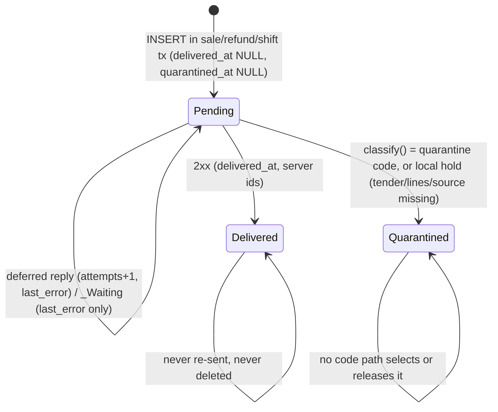

# XOrder POS — Database, Offline Persistence, Outbox/Sync, Backup & Crash Recovery

Read-only discovery audit. Scope: `/home/user/xorder-pos` only. The Laravel backend, Vue admin and cloud services are **not available**; everything about server behaviour is UNKNOWN except what this client sends and how it reacts to replies.

Evidence levels: **[CODE]** read in executable code or SQL; **[DOC]** claimed only in docs/comments (not evidence); **[UNVERIFIED]** inference. **[OBSERVED]** is not used anywhere: nothing could be executed (no Flutter/Dart/PostgreSQL in the sandbox). "test exists (not executed here)" means the test file was read, not run.

Status labels: IMPLEMENTED | PARTIAL | NOT_IMPLEMENTED | UNKNOWN.

---

## 0. Executive summary

| # | Fact | Status | Evidence |
|---|------|--------|----------|
| 1 | Every till writes sales to a local PostgreSQL first; the sale, its lines, payments, stock issue and its outbox claim commit in **one transaction**. | IMPLEMENTED | `lib/data/postgres/postgres_orders_repository.dart:73-193` |
| 2 | Upload is an outbox pattern: `pos_outbox` (orders) + `pos_sync_outbox` (customer, shift open/close, cash movement, refund). Rows are never deleted; `delivered_at` / `quarantined_at` mark them. | IMPLEMENTED | `lib/data/cloud/outbox_drain.dart`, migrations 4, 6, 49 |
| 3 | Idempotency key = the order's `client_transaction_id` (body + `Idempotency-Key` header); payment keys are deterministic UUIDv5. Duplicate prevention beyond the client key depends on the server (UNKNOWN). | IMPLEMENTED (client) / UNKNOWN (server) | `outbox_drain.dart:105-111`, `cloud_api.dart:174-178,243-254` |
| 4 | There is **no row lease / "claimed" state, no per-row backoff, no attempt cap**. A crash between HTTP send and the local `UPDATE` just re-sends the same key on the next pass. | IMPLEMENTED (by omission) | `outbox_drain.dart:307-456`; migrations 4/6/49 columns |
| 5 | **Conflict detection/resolution as such does not exist.** Rejections are classified by the server's `code` only: 6 codes quarantine, everything else (incl. any 409/422/5xx without a known code) defers forever. Nothing in the app releases a quarantined row. | PARTIAL | `outbox_drain.dart:119-131`; grep for `quarantined_at = NULL`/release: none |
| 6 | Bootstrap re-apply (`BootstrapSeeder.seed`) does **not touch** `pos_orders`, `pos_order_*`, `pos_outbox`, `pos_sync_outbox`, `pos_shifts`, `pos_stock_*`. It does DELETE+reinsert the catalog (`pos_products`, categories, modifiers, tables) and upserts staff/tenders/customers/money config. | IMPLEMENTED | `bootstrap_seeder.dart:53-104,509-676` |
| 7 | Latent hazard: `DELETE FROM pos_products` is blocked by `pos_stock_movements.product_id … ON DELETE RESTRICT` (and `pos_combo_options` RESTRICT); on violation the whole seed tx rolls back and is silently retried each pass. Reachable only if a cloud till has stock movements, which the cloud UI hides (see §6.4). | PARTIAL | `migrations.dart:2620,1909`; `cloud_sync.dart:162-177`; `test/features/cloud_purchasing_hidden_test.dart` |
| 8 | **Stock/inventory is never uploaded or downloaded.** No `/api/pos/*` call mentions stock; bundle parser has no stock field. Stock is local-only. | NOT_IMPLEMENTED (sync) | grep of all HTTP paths (§5.1); `bootstrap_bundle.dart` |
| 9 | Backups: `pg_dump -Fc` at **day close only** (default on) + manual button in Management (not present on cloud back office). Verified by `pg_restore --list` + read-through, SHA-256 recorded. **Restore ignores the outbox**: it guards only open shift/business day, not unsent sales. | PARTIAL | `backup_service.dart:150-300,345-517`, `day_close_dialog.dart:55-76` |
| 10 | DB passwords and the cloud device token are stored in a **plaintext JSON file** (`secrets.json`, `chmod 600` on macOS/Linux, nothing on Windows) — not an OS keystore, despite comments saying so. Installer writes all DB role passwords to `install-credentials.json` (ACL-restricted). | IMPLEMENTED (weak) | `lib/data/config/file_secret_store.dart`, `provision.ps1:114-133` |
| 11 | LAN access: installer writes `host … scram-sha-256` (not `hostssl`) and never enables `ssl`; client uses `SslMode.disable` whenever the host is loopback or a trusted private address. `docs/pos/08-postgres-lan.md` shows `hostssl`/`ssl = on` — doc and installer disagree. | IMPLEMENTED (plaintext LAN) | `provision.ps1:158-168`, `pos_database.dart:293-295` |
| 12 | A 2xx reply with an unparseable/empty body (e.g. captive-portal HTML) is treated as **delivered**. | IMPLEMENTED (defect) | `cloud_api.dart:256-270`, `outbox_drain.dart:372-426` |

---

## 1. PostgreSQL install / initialisation

### 1.1 Windows installer path

| Item | Detail | Status |
|---|---|---|
| Inno Setup bundles `pgsql\` (PostgreSQL binaries), `tools\pos_migrate.exe`, `tools\provision.ps1`, VC++ redist | `installer/xorder-pos.iss:80-84` | IMPLEMENTED |
| `provision.ps1` (elevated, re-runnable) | `installer/provision.ps1` | IMPLEMENTED |
| First run (`PG_VERSION` absent): picks first free port 5432–5442, generates 24-char random passwords for `postgres`, `pos_admin`, `pos_till`, `pos_backup` (crypto RNG), writes them to `%ProgramData%\XOrder POS\install-credentials.json` **before** `initdb`, locks it to Administrators+SYSTEM via `icacls` | `provision.ps1:114-134` | IMPLEMENTED |
| `initdb -A scram-sha-256 -E UTF8 --locale=C`, superuser password via temp `--pwfile` (deleted in `finally`) | `provision.ps1:139-146` | IMPLEMENTED |
| `postgresql.conf` / `pg_hba.conf` edited in a managed marker block: `listen_addresses` = `localhost` or `*` (with `-Lan`); LAN adds `host all all <10/8,172.16/12,192.168/16> scram-sha-256`; firewall rule only with `-Lan`, Private/Domain profiles | `provision.ps1:158-176` | IMPLEMENTED |
| Service `XOrderPOS-PostgreSQL` registered with `pg_ctl register -S auto -U NT AUTHORITY\NetworkService`, restarted, `pg_isready` wait (60 s) | `provision.ps1:178-190` | IMPLEMENTED |
| Then `pos_migrate --create-roles --create-database --owner pos_admin --no-migrate` as `postgres`, then `pos_migrate --user pos_admin --grant-to pos_till` (runs all migrations as owner, then grants) | `provision.ps1:192-208` | IMPLEMENTED |
| Passwords passed through env vars, removed in `finally`; never logged | `provision.ps1:197-211` | IMPLEMENTED |
| Uninstall removes the service and **keeps the data dir** | `provision.ps1:96-107` | IMPLEMENTED |
| Upgrade re-runs provision (idempotent; applies new migrations) | `provision.ps1` header; `xorder-pos.iss:134-140` | IMPLEMENTED |
| No tuning of `fsync`, `synchronous_commit`, `full_page_writes`, WAL, `ssl`, `log_*` | grep `fsync|synchronous|ssl|wal` over `installer/`: no hits | NOT_IMPLEMENTED (defaults used) |

Tests: `test/data/install_provisioning_test.dart`, `install_roles_test.dart`, `local_bootstrap_test.dart`, `migration_cli_test.dart` exist (not executed here).

### 1.2 macOS / non-installer path

`scripts/package_macos.sh` contains no PostgreSQL/`initdb` reference (grep). There is no macOS installer for the database: the operator must supply a PostgreSQL and use the setup wizard (`LocalBootstrap`) or `dart bin/pos_migrate.dart`. Status: PARTIAL for macOS (documented runbook `docs/pos/10-offline-install-runbook.md` only).

### 1.3 `bin/pos_migrate.dart` and `LocalBootstrap`

* `pos_migrate` flags: `--create-roles`, `--create-database`, `--owner`, `--no-migrate`, `--status`, `--seed`, `--seed-catalogue`, `--grant-to`, `--grant-admin-to`, `--cloud-till` (`bin/pos_migrate.dart:33-108,160-195,593-698`). Password from `POS_PG_PASSWORD` env (or `--password`). `--seed-catalogue` puts a demo menu on a DB (explicitly separate from `--seed`).
* Role creation SQL (`local_bootstrap.dart:283-306`): `pos_admin` = `LOGIN CREATEDB` (no superuser/CREATEROLE); `pos_till` = `LOGIN` only, then table-by-table grants; `pos_backup` = `LOGIN` + `GRANT pg_read_all_data`. Password is inlined as a quoted literal (CREATE ROLE takes no bind params).
* Wizard and CLI share `LocalBootstrap.tillGrants` / `administrativeGrants` (`local_bootstrap.dart:655+`), so there is one grant list. Test: `test/data/till_grants_test.dart`, `admin_grants_enforced_test.dart`, `grants_cover_usage_test.dart` (exist; not executed).
* **The app does not run migrations at launch.** `PosMigrator` is invoked only from `local_bootstrap.dart:318` (wizard), `cloud_provisioning_repository.dart:440` (claim) and `pos_migrate.dart:74`. The doc comment on `PosMigrator` ("safe to call from every till on every launch", `migrations.dart:4473-4475`) describes capability, not behaviour. grep `schema_migrations` in `lib/` outside migrations/CLI: none, so there is no startup schema-version check either. An app update on a machine where provisioning is not re-run (macOS, child tablets, manual installs) runs new code against an old schema. Status: PARTIAL.

---

## 2. Schema and migrations

### 2.1 Mechanism (`lib/data/postgres/migrations.dart`)

| Aspect | Behaviour | Evidence |
|---|---|---|
| Registry | const list `posMigrations`, **52 versions** (1…52), append-only by convention | `migrations.dart:33-4469` |
| Tracking | table `schema_migrations(version int PK, applied_at timestamptz)` created `IF NOT EXISTS` | `:4491-4495` |
| Concurrency | `pg_advisory_xact_lock(727101)` at tx start; released at commit/crash | `:23,4488` |
| Atomicity | **all pending migrations run inside ONE transaction** (`_db.runTx`); a failure rolls back every pending step, nothing half-applied | `:4483-4513` |
| Idempotency | statements use `IF NOT EXISTS` / `ADD COLUMN IF NOT EXISTS` / `DROP CONSTRAINT IF EXISTS` + the version table | e.g. `:36,4335` |
| Rollback / down migrations | **NOT_IMPLEMENTED** (grep `down|rollback` in migrations: only a comment about config_version). Recovery path is restore-from-backup | — |
| Integrity of applied history | No checksum of applied migration text; editing an applied migration silently desynchronises tills (comment-level convention only) | `:8-9`, `:4491-4495` |
| Applying as owner | tables are owned by `pos_admin`; `pos_till` has DML only, no DDL | `provision.ps1:203-208`, `local_bootstrap.dart` grants |

Tests: `test/data/postgres_integration_test.dart:87` "migrations are idempotent and run once" (integration-tagged, self-skips without `POS_PG_HOST`; not executed here).

### 2.2 Versions

1 orders/lines/payments/invoice sequence · 2 restaurants, branches, terminals, staff, menu, floor · 3 shifts · 4 outbound sync queue (`pos_outbox`) · 5 roles/audit/catalogue revisions · 6 cloud drain bookkeeping + `pos_cloud_state` · 7 parked tickets · 8 money config · 9 order lifecycle/void/reason codes · 10 discounts · 11 served_by · 12 refunds · 13 owner role caps · 14 settings, cash movements, business day · 15 owner caps · 16 tax groups/`pos_order_taxes` · 17 per-branch/channel prices · 18 combos · 19 receipt profiles · 20 e-receipt (ETA) queue · 21 QR · 22 multiple roles/overrides/ceilings · 23 payment methods as data (`pos_tender_types`) · 24 service charges · 25 order types · 26 tax-inclusive pricing · 27 suppliers · 28 purchase orders · 29 receiving + `pos_stock_movements`/`pos_stock_levels` · 30 supplier invoices/payments · 31 cancel/reversal reasons · 32 parked ticket without table · 33 supplier paid from till · 34 print queue · 35–36 trading-day stamping · 37 `pos_backups` · 38 one receipt per sale · 39 units · 40 bought-not-sold items · 41 `pos_tender_types.platform_id` · 42 single owner · 43 `pos_site_licence` · 44 PO forward-only, stock unit guard · 45 shared option groups · 46–48 owner capabilities · 49 cloud lifecycle ids + `pos_sync_outbox` + `server_invoice_number` · 50 `server_credit_note_number` · 51 `pos_customers` + `pos_orders.customer_id` · 52 opening-cost movement.

### 2.3 Main tables by domain (`CREATE TABLE` grep, `migrations.dart`)

| Domain | Tables |
|---|---|
| Sales | `pos_orders`, `pos_order_lines`, `pos_order_payments`, `pos_order_discounts`, `pos_order_line_events`, `pos_order_taxes`, `pos_order_line_items`, `pos_invoice_sequences`, `pos_customers` |
| Refunds | `pos_refunds`, `pos_refund_lines`, `pos_refund_payments` |
| Shifts / cash | `pos_shifts`, `pos_cash_drawers`, `pos_business_days`, `pos_cash_movements` |
| Sync | `pos_outbox`, `pos_sync_outbox`, `pos_cloud_state` |
| Floor / open tickets | `pos_dining_tables`, `pos_parked_tickets` |
| Catalogue | `pos_categories`, `pos_products`, `pos_modifier_groups`, `pos_modifiers`, `pos_product_modifier_groups`, `pos_modifier_group_categories`, `pos_product_prices`, `pos_combos`/`_groups`/`_options`, `pos_discounts`, `pos_discount_targets`, `pos_tax_groups`, `pos_service_charges`, `pos_order_types`, `pos_tender_types`, `pos_units`, `pos_money_config` |
| Inventory / purchasing | `pos_stock_movements`, `pos_stock_levels`, `pos_suppliers`, `pos_purchase_orders`/`_lines`/`pos_purchase_sequences`, `pos_supplier_invoices`, `pos_supplier_payments` |
| Identity / admin | `pos_restaurants`, `pos_branches`, `pos_terminals`, `pos_staff`, `pos_roles`, `pos_staff_roles`, `pos_staff_permission_overrides`, `pos_permission_limits`, `pos_audit_events`, `pos_reason_codes`, `pos_settings`, `pos_site_licence` |
| Ops | `pos_print_jobs`, `pos_eta_receipts`, `pos_eta_chains`, `pos_receipt_profiles`, `pos_backups` |

Integrity features seen in SQL (`[CODE]`): money is `bigint` minor units; `UNIQUE (restaurant_id, client_transaction_id)` on orders (`:55-56`); `UNIQUE (restaurant_id, branch_id, invoice_number)` (`:57-58`); `pos_outbox_one_per_order` unique index (`:372-374`); partial unique index one open shift per terminal (`:324`); audit ledger and `pos_backups` append-only via triggers (per grant comments `local_bootstrap.dart` and `test/data/backup_restore_test.dart:518`); refund-vs-sold trigger (`:1248`).

Note: `pos_order_lines.menu_item_id` has **no FK** to `pos_products` (`:77-92`), and `pos_order_payments.tender_type_id` has no FK (`:100-110`), so catalogue/tender replacement cannot break historical rows.

---

## 3. Connections, credentials, roles, TLS

| Topic | Behaviour | Evidence | Status |
|---|---|---|---|
| Pool | `Pool.withEndpoints`, `maxConnectionCount: 4`, `connectTimeout 5 s`, `queryTimeout 10 s`; pool keyed on host/port/db/user/password-hash and rebuilt on change | `pos_database.dart:244-300` | IMPLEMENTED |
| Transactions | `runTx` → package `postgres` `runTx`; **no isolation level or retry** set anywhere (grep `SERIALIZABLE|isolation`: none) → PostgreSQL default READ COMMITTED; errors mapped to `PosDbException` | `pos_database.dart:320-332` | IMPLEMENTED |
| Failure taxonomy | dns / tcp / auth / tls / missingDatabase / missingRole / permissionDenied / query / unknown by **string matching** the driver error | `pos_database.dart:14-105` | IMPLEMENTED (heuristic). test: `test/data/pos_db_failure_test.dart` |
| TLS | `sslMode = allowsInsecureTransport ? disable : verifyFull`; `allowsInsecureTransport = isLoopback || (!verifyTls && isPrivateHost)`. Never `require`. Public host always verifyFull. | `pos_database.dart:293-295`, `deployment.dart:350-351` | IMPLEMENTED |
| LAN server TLS | installer never sets `ssl=on`, writes `host` (not `hostssl`) lines. LAN verifyFull would fail unless operator configures certs; trusted-private mode sends scram-authenticated but unencrypted traffic. `docs/pos/08-postgres-lan.md:246,260` shows `ssl = on`/`hostssl` — **docs ≠ installer** | `provision.ps1:158-168` | PARTIAL |
| Till DB password storage | `MutablePosDbCredentials` in memory; persisted via `FileSecretStore` (`secrets.json`, key `pos_till_database_password`) under `getApplicationSupportDirectory`. Written to `.tmp` empty → `chmod 600` → content → rename (non-Windows). **On Windows `_restrict` returns immediately: no ACL hardening**. Comments in `pos_database.dart:156-157` ("backed by the OS keystore") are wrong: no keystore package (grep `flutter_secure|keychain` in `pubspec.yaml`/`main.dart`: none) | `file_secret_store.dart:31-149`, `main.dart:42,50` | IMPLEMENTED (plaintext) |
| Other secrets in same file | device token (`pos_cloud_device_token`), backup role password, admin password keys | `file_secret_store.dart:42-52`, `providers.dart:3056,3076` | IMPLEMENTED |
| Installer credentials | `install-credentials.json` holds superuser + admin + till + backup passwords in plaintext JSON; reader accepts only admin+till; `FileInstallerCredentials` returns null on permission failure | `installer_credentials.dart`, `provision.ps1:121-133` | IMPLEMENTED |
| Role | `install-role.json` (`main`/`child`) read from ProgramData | `installed_role.dart` | IMPLEMENTED |
| Role model | `pos_admin` owner/DDL; `pos_till` DML only: SELECT+INSERT on orders/lines/payments (UPDATE only column-scoped on orders), SELECT/INSERT/UPDATE on `pos_outbox`, `pos_sync_outbox`, `pos_shifts`, `pos_stock_levels`; INSERT/SELECT only on `pos_stock_movements`, `pos_audit_events`, `pos_backups`; **no DELETE except `pos_parked_tickets`**; cloud tills additionally get INSERT/UPDATE/DELETE on catalogue tables for the seeder; offline tills have those REVOKEd | `local_bootstrap.dart:663-700,797,839-840,964-970`, `:860-962` | IMPLEMENTED |
| `pos_backup` | `pg_read_all_data`, no writes | `local_bootstrap.dart:300-302` | IMPLEMENTED |
| Admin password | held in memory while Management is open; restore uses it | `providers.dart:3124-3136` | IMPLEMENTED |

Dev key: the licence public key is compiled into the binary (CLAUDE.md); not inspected, not reproduced here (licensing is outside this file's scope).

---

## 4. Transactions & concurrency

| Mechanism | Where | Behaviour | Status | Tests |
|---|---|---|---|---|
| Idempotent local order | `postgres_orders_repository.dart:81-96,100-171` | Look up `(restaurant_id, client_transaction_id)` first; INSERT … `ON CONFLICT DO NOTHING RETURNING`; if empty, re-select the winner and return it (`queued:false`). A replay returns the original id and invoice, issues no second sale | IMPLEMENTED | `test/data/postgres_integration_test.dart:126` (replay), `:152` (concurrent settlements never share an invoice number) — exist, not executed |
| Invoice number | `:391-437` | `INSERT … ON CONFLICT DO NOTHING` the `(restaurant,branch,period)` row, then `SELECT … FOR UPDATE`, then `next_value+1`, inside the order tx. Format `PREFIX-YYYY-000001`. A lost insert race burns a number (gap tolerated per comment) | IMPLEMENTED | same |
| Period = **UTC** year of `occurredAt` | `:392` | Orders between 00:00–02:00 Cairo time on 1 Jan get the previous year's period. Minor, concrete | IMPLEMENTED (quirk) | no test found |
| Local number provisional | `outbox_drain.dart:403-420`, mig 49 | Platform invoice stored separately in `pos_orders.server_invoice_number` because two offline tills can legitimately issue the same local number. The number printed at sale time is the local one | IMPLEMENTED | — |
| Stock issue | `:725-829` | Only for `is_stocked` products; `FOR SHARE` on product, `FOR UPDATE` on `pos_stock_levels` row; writes `pos_stock_movements` (kind `sale`) + upserts level; negative stock allowed. **If no level row exists, there is nothing to lock**; two concurrent first sales both read 0 and the second `ON CONFLICT DO UPDATE` overwrites the first (lost update) | IMPLEMENTED (small race) | no test found for that race |
| Double-submit (UI) | `payment_screen.dart:121,169,178-190` | `_busy` guard; on exception the pre-tender ticket is restored so the cashier can retry with the same `ticket.id` → replays safely against the unique key | IMPLEMENTED | — |
| Void | `postgres_orders_repository.dart:196-327` | Writes `status='VOIDED'` order with real totals, **no payments, not enqueued** ("what a voided one looks like on the wire is not decided") | IMPLEMENTED; voids are never uploaded | `postgres_integration_test.dart:576` |
| Shift | `postgres_shift_repository.dart:60-110,355-415` | One open shift per terminal via partial unique index; open/close enqueue in same tx; close uses `WHERE closed_at IS NULL` | IMPLEMENTED | `test/data/postgres_shift_test.dart` |
| Refund | `postgres_refunds_repository.dart:205-236` | Row + outbox claim in same tx; DB trigger on refund vs sold (`migrations.dart:1248`) | IMPLEMENTED | `test/data/cloud_refunds_test.dart:341,652` |
| Customer create | `postgres_customers_repository.dart:85-143` | Upsert **then** a separate `_enqueue` query — **two statements, not one tx** | PARTIAL | `test/data/customers_repository_test.dart` |
| Migrations | advisory xact lock | see §2.1 | IMPLEMENTED | — |
| Advisory locks elsewhere | grep `pg_advisory`: only migrations | — | — | — |
| `FOR UPDATE` on admin paths | catalogue/PO/receiving/supplier invoices | see grep in `postgres_*_repository.dart` | IMPLEMENTED | schema tests |

Multi-till on one database (LAN branch server): sequence row lock serialises invoices; no other cross-till coordination. `CloudSync._pass` is serialised only **per process** (`cloud_sync.dart:120-122`); two main tills pointing at one PostgreSQL would each drain the same `pos_outbox` (query has no terminal filter, `outbox_drain.dart:309-321`; no `SKIP LOCKED`). Duplicates are then deduped only by server idempotency (UNKNOWN). Whether such a topology is supported in cloud mode is a product question (child tablets hold no token and do not sync: `setup_controller.dart:1877`).

---

## 5. Offline persistence & the outbox

### 5.1 What is sent, and where

Every HTTP path the POS calls (grep of `lib/`): `POST /api/pos/terminals/claim`, `/terminals/register`, `/terminals/heartbeat`, `GET /api/pos/bootstrap`, `POST /api/pos/orders`, `/customers`, `/shifts`, `/shifts/{client_id}/close`, `/cash-movements`, `/refunds`, `/license/check`, `/licence/activate`, `POST /api/auth/login`, `GET /api/dashboard/{branches,pos/terminals,pulse}`, `POST /api/dashboard/pos/terminals/{id}/pairing-code`, `GET /api/pos/branch/sales[/summary]` (read model; file header says "Filed, not built" — endpoints may not exist, `branch_sales_api.dart:6-9`).

| Record | Queue | Enqueued by (same tx as the record) | Endpoint | Idempotency key | Status |
|---|---|---|---|---|---|
| Sale (settled order, with lines, payments, order-level + line discounts, price overrides) | `pos_outbox` | `PostgresOrdersRepository._enqueueForSync` `:337-358` — only if `mode.syncsSalesToPlatform` (= cloud) | `POST /api/pos/orders` | `client_transaction_id` (body + header) | IMPLEMENTED |
| Payments | inside the order body | `_paymentsFor` `outbox_drain.dart:1064-1100` | (with order) | `paymentClientId` = UUIDv5(`xorder-pos:payment:<order>:<paymentRowId>`) `:105-111` | IMPLEMENTED |
| Customer created at counter | `pos_sync_outbox` (`customer`) | `postgres_customers_repository.dart:129-143` (**separate query**) | `POST /api/pos/customers` | row uuid | PARTIAL |
| Shift open / close | `pos_sync_outbox` | `postgres_shift_repository.dart:96,400` (same tx) | `POST /api/pos/shifts`, `…/{id}/close` | `client_transaction_id` / `close_client_transaction_id` | IMPLEMENTED |
| Cash movement (pay-in/out/float; also supplier paid from till) | `pos_sync_outbox` (`cash_movement`) | `postgres_cash_movements_repository.dart:162-187`, `postgres_supplier_invoices_repository.dart:826-848,1009-1029,1125` | `POST /api/pos/cash-movements` | `client_transaction_id` | IMPLEMENTED |
| Refund | `pos_sync_outbox` (`refund`) | `postgres_refunds_repository.dart:216-233` (same tx) | `POST /api/pos/refunds` | `client_refund_id` | IMPLEMENTED (lines-based only) |
| Voided order | — | not enqueued (`postgres_orders_repository.dart:317-319`) | — | — | NOT_IMPLEMENTED |
| Stock movements, PO receipts, supplier invoices/payments (as such) | — | no queue, no endpoint | — | — | NOT_IMPLEMENTED |
| Parked/unsettled tickets | — | local only | — | — | NOT_IMPLEMENTED (by design) |
| Business-day close, audit events, print jobs, ETA receipts | — | local (ETA has its own filer, out of scope here) | — | — | NOT_IMPLEMENTED (to cloud) |

Payload shape (pure function, `outbox_drain.dart:139-180`): `client_transaction_id, branch_id, order_type, table_id, acting_user_id, shift_client_id, created_at (client UTC clock), priced_offline:true, catalog_synced_at, lines[] (client_line_id = local pos_order_lines.id, menu_item_id, option_ids, quantity, unit_price_minor, name_snapshot, discount, price_override), order_discount, asserted_totals{subtotal,discount,charges,tax,total}, payments[], currency, exponent`. No floats (tests: `test/data/outbox_drain_test.dart:56,100,195`, exist; not executed).

Offline-mode tills (`DeploymentMode.offline`) enqueue **nothing** and `OutboxDrain.run` returns immediately (`deployment.dart:67`, `outbox_drain.dart:277`, `postgres_orders_repository.dart:340`). Test: `test/data/cloud_refunds_test.dart:355`.

### 5.2 Drain trigger, order, retry

* **Triggers**: `SyncingOrdersRepository.submit/voidOrder` → `kick()` after every settle (`outbox_drain.dart:1181-1220`); first pass 5 s after boot; then self-rescheduling timer; manual "sync now" pill / Management (`pos_top_bar.dart:74`, `management_screen.dart:1924`). `syncPolicy == manual` disables the timer (`providers.dart:720-738`).
* **Cadence** (`SyncSchedule`, `cloud_sync.dart:72-82`): 4 h when `settled`, 30 min otherwise. `settled` = heartbeat OK ∧ token not rejected ∧ not offline ∧ `deferred == 0`. **Quarantined rows deliberately do not force the fast cadence.** Test: `test/data/sync_schedule_test.dart` (exists; not executed).
* **Pass** (`cloud_sync.dart:124-160`): heartbeat → if `config_version` > local, re-bootstrap → `OutboxDrain.run`. Serialised via `_running` future. Heartbeat 401 ⇒ `deviceTokenRejected`, drain skipped, queue untouched.
* **Ordering** (`outbox_drain.dart:276-296`): phases `customer` → `shift_open` → `order` → `cash_movement`+`refund` → `shift_close`; within a phase `ORDER BY enqueued_at`, `LIMIT 25` per phase per pass (`passLimit`). A refund whose sale is not yet delivered returns `_Waiting` (kept, `attempts` untouched); `SALE_NEVER_QUEUED`, `REFUND_HAS_NO_LINES`, `TENDER_NOT_FROM_PLATFORM`, `LOCAL_SOURCE_MISSING` are quarantined locally *before* any send (`:783-904,1102-1125`). Tests: `cloud_refunds_test.dart:485,513,534,583,605,627`.
* **Backoff**: none per row. `attempts`/`last_attempt_at`/`last_error` are written but never read to delay or cap (grep: only the 30-min global cadence). **No attempt ceiling** — a deferred row retries forever.
* **Offline detection**: any `DioException` ⇒ `CloudReply.offline()` (`cloud_api.dart:267-269`); the pass stops at the first offline reply. Timeouts: connect 10 s / send 15 s / receive 30 s (`:56-58`). A receive-timeout after the server committed is indistinguishable from offline ⇒ resend with same key.
* **After success** (`outbox_drain.dart:372-426`): one tx: `UPDATE pos_outbox SET delivered_at, attempts+1, server_order_id, server_invoice_number, totals_mismatch` + `UPDATE pos_orders SET server_invoice_number`. Rows are never deleted (till role has no DELETE; no pruning ⇒ unbounded growth). `totals_mismatch` is **written but read nowhere** in `lib/` (grep): the "reconciliation view" the comment mentions does not exist.
* **Pending count** = `delivered_at IS NULL`, so **quarantined rows are counted as pending forever** (`postgres_orders_repository.dart:360-384`, heartbeat `cloud_sync.dart:228-239`).

### 5.3 Outbox row states (derived from columns, no explicit state column)


Source: `outbox_drain.dart:307-456,458-568`; migrations 4, 6, 49. There is no "in flight/claimed" state: the select at `:309-321` takes no lock and writes nothing before the HTTP call.

### 5.4 Sale → outbox → cloud sequence

```mermaid
sequenceDiagram
    participant UI as PaymentScreen
    participant Repo as PostgresOrdersRepository
    participant PG as Local PostgreSQL
    participant Sync as CloudSync / OutboxDrain
    participant API as PosCloudApi (/api/pos/*)
    UI->>Repo: submit(ticket) [_busy=true]
    Repo->>PG: BEGIN
    Repo->>PG: SELECT order by client_transaction_id (replay check)
    Repo->>PG: invoice seq FOR UPDATE, next_value+1
    Repo->>PG: INSERT pos_orders ON CONFLICT DO NOTHING
    Repo->>PG: INSERT lines, events, discounts, taxes, payments (applied amount only)
    Repo->>PG: stock issue (stocked items only)
    Repo->>PG: INSERT pos_outbox (cloud mode only)
    Repo->>PG: COMMIT
    Repo-->>UI: SubmitOrderResult(local invoice)
    Repo->>Sync: kick() (unawaited)
    Sync->>API: POST /terminals/heartbeat (pending_count)
    API-->>Sync: config_version (maybe re-bootstrap)
    Sync->>PG: SELECT pending outbox rows ORDER BY enqueued_at LIMIT 25
    Sync->>API: POST /api/pos/orders (Idempotency-Key = client_transaction_id)
    alt no answer (DioException)
        API--xSync: offline
        Sync-->>Sync: stop pass, retry in 30 min
    else 2xx
        API-->>Sync: id, invoice_number, totals_mismatch
        Sync->>PG: UPDATE pos_outbox delivered_at; pos_orders.server_invoice_number (1 tx)
    else error code
        API-->>Sync: status + code
        Sync->>PG: attempts+1,last_error; quarantine only for 6 known codes
    end
```
Source: `payment_screen.dart:169-204`, `postgres_orders_repository.dart:73-193`, `outbox_drain.dart:1181-1220`, `cloud_sync.dart:124-160`, `outbox_drain.dart:307-456`.

### 5.5 Reaction to server replies (conflict handling)

`OutboxDrain.classify` (`:119-131`): **quarantine** for `VALIDATION_FAILED`, `IDEMPOTENCY_PAYLOAD_MISMATCH`, `MENU_ITEM_NOT_FOUND`, `BRANCH_NOT_IN_TENANT`, `CUSTOMER_NOT_FOUND`, `REFUND_EXCEEDS_SOLD`; **defer** for everything else, including no code at all. HTTP status is never consulted for the decision (only recorded in `last_error`).

| Reply | Client reaction | Consequence |
|---|---|---|
| 2xx (incl. a 200 replay) | delivered | test `cloud_refunds_test.dart:684` |
| 409 / 422 / 4xx / 5xx **without a known `code`** | defer, retry every 30 min forever | a permanently bad record blocks the "settled" state and retries indefinitely |
| 401/`DEVICE_TOKEN_INVALID` on heartbeat | stop drain, UI says re-pair | queue untouched |
| 401 on an order POST | defer | — |
| Quarantine codes | row held, never retried, no release path in code | needs a person/DB access; see scenarios |
| `totals_mismatch:true` in a 2xx | flag stored | not surfaced anywhere (no reader) |
| 2xx but body not a JSON map (e.g. HTML from a captive portal/proxy) | `body = {}` → `ok` → **marked delivered** with null server ids | false delivery (scenario D5) |

What the server does on a price/total disagreement, a duplicate key with different payload, or an unknown tender is **UNKNOWN**; `docs/coordination/*` claim behaviours (e.g. 409/idempotency replay returns same invoice) but are not evidence.

Real conflict detection between two tills/branches' local data (e.g. two isolated tills, same product stock, same table) — NOT_IMPLEMENTED. There is no versioning of sales, no merge, no vector clock. The only conflict-like logic: `config_version` ordering for downloads (§6.1) and unique keys.

---

## 6. Download side: bootstrap bundle

### 6.1 When it is applied

* Claim/setup: `CloudProvisioningRepository._trySeed` → `seed(force:true)` (`cloud_provisioning_repository.dart:437-449`); setup "Download menu" → `seed(force:true)` (`setup_controller.dart:1871-1914`).
* Sync: heartbeat `config_version` > `pos_cloud_state.config_version` ⇒ `GET /api/pos/bootstrap` ⇒ `seed(bundle)` (`cloud_sync.dart:141-143,162-177`). Failure (any exception) ⇒ returns `false`, local catalogue "keeps selling", retried next pass.
* Precedence: version only. `bundle.configVersion < cached` ⇒ `stale` (refused); `==` ⇒ `unchanged`; `force` skips both (`bootstrap_seeder.dart:71-76`). Whole apply is **one transaction** (`:59-103`) so a failure leaves the previous state intact.
* Bundle content (parser `bootstrap_bundle.dart`): restaurant, terminal, branches, categories, option groups/options, products (incl. price, discounted price, sku, barcode, availability), tables, receipt profiles, staff (+PIN verifiers + capabilities), customers, `money` (tax/charges/tenders), licence embed. **No stock, no orders, no shifts, no inventory quantities.** Test: `test/data/cloud_bootstrap_test.dart` (parser; exists, not executed).

### 6.2 Exactly what happens to local data on re-apply

| Local table | Action on re-apply | Evidence |
|---|---|---|
| `pos_orders`, `pos_order_lines`, `pos_order_payments`, discounts/taxes/events, `pos_refunds*`, `pos_shifts`, `pos_cash_movements`, **`pos_outbox`, `pos_sync_outbox`**, `pos_invoice_sequences`, `pos_stock_movements`, `pos_stock_levels`, `pos_audit_events`, `pos_backups` | **untouched** (not referenced by seeder) | `bootstrap_seeder.dart` (full read) |
| `pos_restaurants`, `pos_branches` | upsert; branches not in bundle → `is_active=false` (not deleted) | `:106-157` |
| `pos_terminals` | upsert (`claimed_at` kept) | `:159-177` |
| `pos_staff` | upsert by platform id incl. PIN hash/capabilities; absent staff → `is_active=false` (never deleted: shifts reference them) | `:459-507` |
| `pos_tender_types` | upsert by `(restaurant_id, platform_id)`; everything not in bundle (incl. the till's own 4) set `is_active=false`; empty list ⇒ untouched | `:329-413` |
| `pos_customers` | upsert by phone (`platform_id` filled); never cleared; empty list untouched | `:429-457` |
| `pos_money_config` | overwritten with new JSON payload | `:298-311` |
| `pos_receipt_profiles` | upsert per branch; empty ⇒ untouched | `:207-292` |
| **Catalogue**: `pos_product_modifier_groups`, `pos_modifiers`, `pos_products`, `pos_modifier_groups`, `pos_categories` | **DELETE all rows for the restaurant, then re-insert platform rows with platform ids**. Product dropped if its category is missing from the bundle | `:509-646` |
| `pos_dining_tables` | DELETE all for restaurant, re-insert | `:648-676` |
| Cascades from product delete | `pos_product_prices` (CASCADE, `migrations.dart:1768`), `pos_stock_levels` (CASCADE, `:2678`); `pos_purchase_order_lines.product_id` SET NULL (`:2558`) | migrations |
| Blockers from product delete | `pos_stock_movements.product_id` RESTRICT (`:2620`), `pos_combo_options.product_id` RESTRICT (`:1909`) → FK violation → whole seed rolls back | migrations |
| `pos_parked_tickets` | untouched; on hydrate, a parked line whose product vanished is rebuilt **from its stored snapshot**, so it still prices and settles | `parked_ticket_codec.dart:351-373`, `postgres_parked_tickets.dart:load` |
| Pending/queued sales | **unaffected**: lines carry `name_snapshot`, `unit_price_minor`, `menu_item_id` as sold. Note they are *re-priced by the server* on upload (`priced_offline:true`, `asserted_totals`) — outcome UNKNOWN | `outbox_drain.dart:139-218` |
| `pos_cloud_state` | `config_version`, `bootstrap_synced_at` updated | `:88-100` |

So: **"cloud authoritative" is implemented as authoritative over configuration only (catalogue, staff, floor, tenders, tax rules, receipt profile).** No code path lets the download delete, overwrite or re-state any pending sale, payment, refund, shift, outbox row or stock quantity. Tenders retire instead of delete precisely so queued payments keep meaning (`:313-328`; migration 41). One side effect to note: a payment taken on a tender that has since been retired still drains (`test/data/cloud_tenders_test.dart:463`), while a payment on a tender with no `platform_id` is held (`:420,479,494`).

Seed also needs the till role to hold DELETE on catalogue tables — granted only for cloud tills (`local_bootstrap.dart:860-962`); an offline till has them REVOKEd and the seeder never runs there.

Tests touching the seeder: `cloud_tenders_test.dart`, `cloud_defaults_seed_test.dart`, `cloud_receipt_profile_test.dart` (all integration-tagged). **No test found** that re-seeds while `pos_outbox` has pending rows, nor one that seeds over stock movements.

### 6.3 Stale / rollback behaviour

Equal-or-lower `config_version` is refused (`stale`/`unchanged`) except when `force` (setup/claim). Heartbeat only triggers a download when the platform's version is strictly greater. A restored-from-backup database carries an older `config_version`, so the next heartbeat will pull a fresh bundle (consistent behaviour; [UNVERIFIED] no test).

### 6.4 Inventory / stock offline

* `_issueStock` records a `sale` movement and decrements `pos_stock_levels` **only** for `pos_products.is_stocked = true` (`postgres_orders_repository.dart:725-829`; migration 29 `is_stocked DEFAULT false`). Bundle seeding never writes `is_stocked`/`stock_unit` (`bootstrap_seeder.dart:606-627`), so seeded products are not stocked.
* On a cloud tenant the Management app is replaced by `CloudBackOfficeScreen` (`router.dart:155-160`), and `test/features/cloud_purchasing_hidden_test.dart:90,125` asserts purchasing/inventory panes are hidden for cloud (exists; not executed). Net: in cloud mode stock tracking is effectively off; in offline/branch mode it is local and complete (receiving with moving-average cost, PO, supplier invoices) but **never leaves the branch DB** except via backup.
* Negative stock is allowed (no oversell protection by design, `:716-724`).
* Refund/void do not restock (grep `stock` in refunds repo: none; void writes no stock) — not verified against UI; treat as NOT_IMPLEMENTED.

---

## 7. How pending offline sales/payments/inventory are protected today

| Risk | Protection in code | Gap | Evidence |
|---|---|---|---|
| Sale lost between "paid" and "queued" | Order + payments + stock + outbox claim in **one DB transaction** | none in the happy path; shift/refund same | `postgres_orders_repository.dart:73-193`, `postgres_refunds_repository.dart:205-236` |
| Sale sent twice | Local UNIQUE `(restaurant_id, client_transaction_id)` on `pos_orders` and `pos_outbox`; `delivered_at` never cleared; deterministic payment keys; same key reused on every retry; `Idempotency-Key` header + body field | Server-side dedupe unverifiable; no cross-process lock between two drains | migrations `:55,372`; `cloud_api.dart:243-254` |
| Sale deleted by "cloud authoritative" | Seeder never touches order/outbox/shift/stock tables; till role has **no DELETE** on them (only on catalogue for cloud seeding and `pos_parked_tickets`) | `pos_outbox` has `ON DELETE CASCADE` from `pos_orders` (migration 4) but nothing deletes orders; DB owner/admin could | grants `local_bootstrap.dart:663-700,839-840`; seeder |
| Payment on unknown tender sent as wrong method | Held locally before any send (`TENDER_NOT_FROM_PLATFORM`), money never guessed | Held row has no release path (§5.5) | `outbox_drain.dart:335-339,1102-1125` |
| Rejected record blocking others | Quarantine is per-record; queue continues; refunds wait for their sale | Quarantined rows only visible via pending count (counts them forever) and in-memory last-pass counters | `outbox_drain.dart:458-568`; `management_sync_pane.dart:59,183` |
| Platform unreachable | Offline reply stops the pass; local sales continue (local DB is the till's store) | Retry only every 30 min; no per-row visibility | `cloud_sync.dart:72-82` |
| Device token revoked | Queue untouched, UI shows re-pair | — | `cloud_sync.dart:133-134`, `test/app/terminal_rejected_test.dart` |
| Crash mid-sale | Postgres tx atomicity; ticket restored on exception; parked tickets persisted | Unparked in-progress ticket lives in memory only | `payment_screen.dart:178-190`; §9 |
| Stale device clock | none | `occurred_at`/`created_at` are the till clock | `postgres_orders_repository.dart:75` |
| Disk loss / corruption | Daily-ish `pg_dump` at day close, verified | Same disk by default; none if the day is never closed; restore ignores unsent sales | §8 |
| Stock lost on catalogue replace | seed does not touch stock tables | RESTRICT FK blocks seed instead (loud failure, silent in UI) | §6.2 |

---

## 8. Backup & restore

| Aspect | Behaviour | Status | Evidence |
|---|---|---|---|
| Tool | `pg_dump --format=custom` as read-only `pos_backup` (`pg_read_all_data`); tools located beside app (`pgsql\`) or on PATH | IMPLEMENTED | `pg_archive.dart:157-195`, `backup_service.dart:79-90`, `xorder-pos.iss:80-82` |
| Scheduling | **No scheduler.** Automatic copy runs only inside the day-close dialog (`BackupTrigger.dayClose`), default `onDayClose=true`; manual button in Management → Backup (owner, `backup.manage`) | PARTIAL | `day_close_dialog.dart:55-76`, `backup.dart:186-208`; dialog comment admits "a restaurant that never closes its day never gets a copy" |
| Cloud tills | Day-close copy applies; the Backup pane is not in `CloudBackOfficeScreen` (no `backup` hit) so no manual copy/restore UI on a claimed cloud tenant | PARTIAL | `cloud_back_office_screen.dart` grep |
| Destination | Default `%LOCALAPPDATA%\XOrder POS\backups` (Win), `~/Library/Application Support/XOrder POS/backups` (macOS) — **same disk as the database** (comment concedes it); configurable; "copy to USB" with checksum compare | PARTIAL | `backup_service.dart:654-689,531-561` |
| Retention | newest 14 `.dump` files (`keep=14`), pruned only after a restorable new copy | IMPLEMENTED | `:49,285-298`, `pg_archive.dart:268` |
| Verification | After dump: `pg_restore --list` must contain `TABLE DATA`, then full read to `/dev/null`/`NUL`; check 8 essential tables are in the TOC; SHA-256 recorded; outcome `verified`/`unverified`/`failed` row in append-only `pos_backups` + audit event. **No test restore into a scratch database**; verification proves readability, not completeness of data | IMPLEMENTED | `pg_archive.dart:197-220`, `backup_service.dart:123-132,254-283` |
| Atomic file | written to `.part`, renamed only after readback | IMPLEMENTED | `pg_archive.dart:157-195` |
| Restore guard | requires `backup.manage`; **blocks only if an open shift or open business day exists** for this branch; counts orders (by `received_at`) and their value since the copy and shows them in the confirmation; refuses non-restorable or checksum-changed file; reads archive fully before touching DB | PARTIAL | `backup_service.dart:345-402,424-480` |
| Restore execution | `pg_restore --clean --if-exists --no-owner --single-transaction` as the admin role after closing pools; failure leaves old DB intact; audit row written *after* into the restored DB | IMPLEMENTED | `pg_archive.dart:230-262`, `backup_service.dart:486-514` |
| Restore vs outbox | **Not considered** (grep `outbox|pending` in `lib/data/backup` and the pane: none). `pos_outbox`, `pos_sync_outbox`, invoice sequences and `config_version` all revert to the dump | NOT_IMPLEMENTED | see scenario D3 |
| Tests | `test/data/backup_restore_test.dart` (copy, verify, ledger append-only, blockers, orders-since counts, checksum refusal, restore round trip, USB copy, retention), `pg_archive_restore_test.dart` (damaged DB, part-way failure atomic), `backup_tools_test.dart` — exist; integration-tagged; not executed here | — | — |

---

## 9. Crash recovery

| Scenario | What the code does | Status |
|---|---|---|
| Power loss during `submit` | PostgreSQL tx not committed ⇒ nothing persisted (order, payments, stock, outbox row all absent). Durability relies on PostgreSQL defaults (`fsync`, `synchronous_commit` not changed by installer). Cashier restarts, ticket was in memory only unless parked ⇒ must re-ring; the customer may have paid | IMPLEMENTED (atomic), depends on PG defaults |
| Power loss just after COMMIT, before UI reaction | Order + outbox row exist; parked row may remain; `PostgresParkedTickets.load` excludes parked tickets whose `client_transaction_id` already has an order ("the committed order is the authoritative fact") | IMPLEMENTED (`postgres_parked_tickets.dart:load`) |
| Exception/timeout during `submit` (e.g. 10 s `queryTimeout`) | UI restores the pre-tender ticket and shows error; retry uses same `ticket.id` ⇒ replay returns the existing order if the first attempt had actually committed | IMPLEMENTED (`payment_screen.dart:178-190`) |
| Parked tickets | `pos_parked_tickets` write-through on park; hydrate on boot (merge, not replace); `park()` returns false if the durable copy failed; settle removes row; products missing from catalogue are rebuilt from snapshot | IMPLEMENTED (`providers.dart:864-1000`). Test: `test/data/parked_ticket_codec_test.dart`, `parked_tickets_schema_test.dart` |
| Un-parked live cart | In memory (`ticketProvider`) only; lost on crash | NOT_IMPLEMENTED |
| Crash mid-drain, after HTTP send, before `UPDATE delivered_at` | Row still pending ⇒ re-sent with same key next pass; correctness depends on server idempotency (UNKNOWN) | IMPLEMENTED (client side) |
| "Claimed-but-unsent" rows | Concept does not exist: no lease/claim column, nothing written before send | NOT_IMPLEMENTED |
| Crash mid-seed | Single tx ⇒ rolls back; previous catalogue stays | IMPLEMENTED |
| Crash mid-migration | Single tx + advisory lock ⇒ all-or-nothing, lock released | IMPLEMENTED |
| Crash during restore | `--single-transaction` ⇒ old DB remains; but audit row may be lost if crash occurs after restore and before audit write (documented in code) | IMPLEMENTED |
| DB unreachable at launch | Parked hydrate returns empty (swallowed); sale refused ("unconfigured/PosDbException"); `unconfigured` binds refuse to take money | IMPLEMENTED |
| `CloudSync.run()` exception | `kick()` is `unawaited(run())`; an exception inside `_drain.run()` (e.g. the post-2xx tx failing, `outbox_drain.dart:375`) propagates as an unhandled async error and, in the auto timer, the `await sync.run()` throws before `schedule(...)` is called again (`providers.dart:728-733`) ⇒ **the auto-reschedule chain can stop** until the provider is rebuilt. No try/catch found around it | PARTIAL ([CODE]; consequence [UNVERIFIED]) |

---

## 10. Data-loss / duplication scenarios (code-based)

| ID | Scenario | Mechanism in code | Outcome | Severity | Test |
|---|---|---|---|---|---|
| D1 | Product removed in dashboard while a sale of it is queued | Sale still has `menu_item_id`; server answer `MENU_ITEM_NOT_FOUND` is a quarantine code (`outbox_drain.dart:121-123`). Nothing releases it | Paid sale never reaches cloud; counted as pending forever; needs DB-level intervention. Whether the server really returns that code: UNKNOWN | High | `outbox_drain_test.dart:246` (classification only) |
| D2 | Tender retired/replaced between sale and upload | Retired tender still drains; payment on a tender without `platform_id` is quarantined `TENDER_NOT_FROM_PLATFORM` (e.g. sale rung up before first successful bootstrap using fallback tenders) | Held sale, no release path | High | `cloud_tenders_test.dart:420-494` |
| D3 | Restore older backup on a cloud till | Restore guard checks only open shift/day (`backup_service.dart:345-402`). Sales made after the dump and not yet uploaded vanish with the database; sales delivered after the dump reappear as `delivered_at NULL` ⇒ re-sent (idempotent). Invoice sequences revert ⇒ local invoice numbers already printed can be issued again | Silent loss of unsent sales (UI warns of "orders since" count but does not distinguish unsent ones) | High | `backup_restore_test.dart:537,577` (guards), no outbox test |
| D4 | Captive-portal / proxy returns 2xx non-JSON | `_send` maps non-map body to `{}` (`cloud_api.dart:259-266`); drain treats any 2xx as success (`outbox_drain.dart:372`), writes `delivered_at` with null server ids | Sale marked delivered without cloud ever receiving it; never retried | High (needs hostile network) | no test found |
| D5 | Same row resent after crash/timeout | No lease; same key | Duplicate only if server fails idempotency (UNKNOWN) | Medium | `cloud_refunds_test.dart:652,684` (refunds) |
| D6 | Two main tills sharing one PostgreSQL in cloud mode | Both drain all rows (no terminal filter, no `SKIP LOCKED`) | Concurrent duplicate POSTs with same key; relies on server; also rows delivered under the wrong terminal's token | Medium ([UNVERIFIED] topology) | no test found |
| D7 | Server rejects with 409/422/5xx and no known code | Defer forever, 30-min loop, `settled` never true | Queue never "settles"; one poison row keeps the fast cadence; no cap/alarm except pending count | Medium | `outbox_drain_test.dart:272` |
| D8 | Quarantined row | `delivered_at IS NULL` ⇒ included in pending count and heartbeat `pending_count`/`oldest_pending_at` | Permanent "owed" money visible to Super Admin but un-actionable on the till; held counter is in-memory (`management_sync_pane.dart:59`) so after restart only the raw pending count remains | Medium | `sync_schedule_test.dart:69` |
| D9 | Catalogue replace vs stocked product with movements | `DELETE FROM pos_products` hits RESTRICT FK ⇒ seed tx fails ⇒ swallowed (`cloud_sync.dart:173-176`) ⇒ till never takes a new menu while `config_version` stays old | Stale menu/prices indefinitely, silently | Medium; requires stock on a cloud till (hidden by UI) | no test found |
| D10 | Stocked product deleted by seed with no movements | `pos_stock_levels` CASCADE-deleted | Local quantity silently lost | Low (cloud UI hides stock) | no test found |
| D11 | Customer created offline, crash between upsert and enqueue | Not one tx (`postgres_customers_repository.dart:85-143`) | Customer never uploaded; later sale naming it can be sent with a local id `CUSTOMER_NOT_FOUND` ⇒ quarantine | Low | no test found |
| D12 | Voids never uploaded | `postgres_orders_repository.dart:317-319` | Cloud never sees voided orders / waste | Low–Medium | `postgres_integration_test.dart:576` |
| D13 | Flat-amount refund | `REFUND_HAS_NO_LINES` held (`outbox_drain.dart:839-847`) | Cash left the drawer, cloud has no refund until a person acts | Medium | `cloud_refunds_test.dart:583` |
| D14 | Cloud authoritative tax/prices change before upload | Order totals already fixed at sale; server re-prices (`priced_offline:true`); mismatch flagged only | `totals_mismatch` stored, never displayed; resolution UNKNOWN | Medium | none |
| D15 | Local clock wrong | `occurred_at`, `created_at` use device clock; invoice year uses UTC | Wrong period/ordering | Low | no test found |
| D16 | Stock first-sale race | no row to lock before first level row exists | lost decrement of one sale | Low | no test found |
| D17 | Backups on same disk, only at day close | `BackupPaths.defaultDirectory` | Disk failure loses DB and backups; no day close = no backup | High (operational) | `backup_restore_test.dart:815` (retention only) |
| D18 | Credential exposure | plaintext `secrets.json`, `install-credentials.json`, DB traffic unencrypted on LAN by installer defaults | Local attacker/LAN sniffer obtains `pos_till`/token | Medium | `file_secret_store_test.dart` (permissions on POSIX only) |
| D19 | Unupdated schema | no launch-time migration or version check | New code vs old schema errors at runtime | Medium | none |
| D20 | Delivered outbox rows never pruned | no DELETE grant, no archive job | Table growth | Low | none |

---

## 11. Docs vs code disagreements found

1. `pos_database.dart:156-157` / CLAUDE.md-style claims of OS keystore — code uses a plaintext JSON file (`file_secret_store.dart`).
2. `docs/pos/08-postgres-lan.md:246,260` (`ssl = on`, `hostssl`) vs installer (`host`, no `ssl`) — `provision.ps1:158-168`.
3. `PosMigrator` doc "every launch" vs no launch call (`migrations.dart:4473` vs grep).
4. `totals_mismatch` "marks it for the reconciliation view" (`outbox_drain.dart:397-399`) — no such view/reader exists.
5. `branch_sales_api.dart:6-9` states endpoints do not exist yet, while `branch_sales_providers.dart` wires it for cloud tills.
6. `CLAUDE.md` lists `lib/data/cloud/` as including "outbox drain" and says POS-BE-006/007 `READY` — only a documented claim; server behaviour not verifiable here.

## 12. Searches performed (for the "missing" claims)

`isolation|SERIALIZABLE|SKIP LOCKED|pg_advisory` (lib, bin); `quarantined_at|quarantine` outside drain/migrations; `totals_mismatch`; `stock|inventory` in `lib/data/cloud`; `outbox|pending` in `lib/data/backup` and backup pane; `fsync|synchronous|ssl|hostssl` in installer/lib; `keychain|flutter_secure|keystore`; `PosMigrator(`; `schema_migrations`; `DeploymentMode.cloud|syncsSalesToPlatform` in features; `Timer.periodic|SyncSchedule`; every `'/api/` literal in `lib/`; tests: `BootstrapSeeder`, `OutboxDrain(`, `pos_outbox`, `SyncSchedule` in `test/` and `integration_test/`.

## 13. Not verified (UNKNOWN)

Backend idempotency/replay semantics, server re-pricing and mismatch handling, which error codes the server really emits, `config_version` semantics, whether `/api/pos/branch/sales*` exists, any test result (none executed), PostgreSQL runtime defaults on customer machines, behaviour of `postgres` package `runTx` on connection drop beyond what the code shows, macOS DB provisioning in practice.
