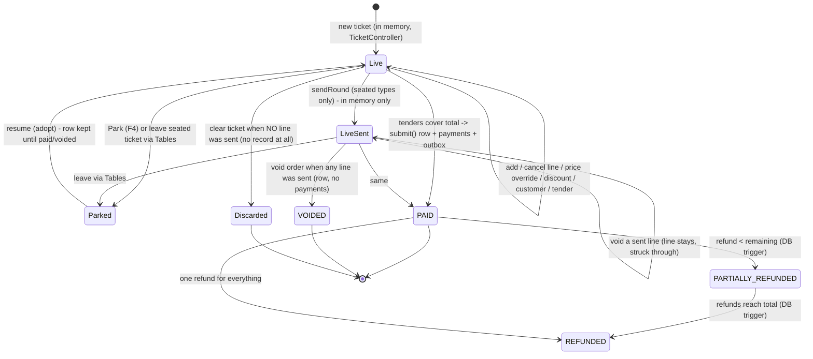
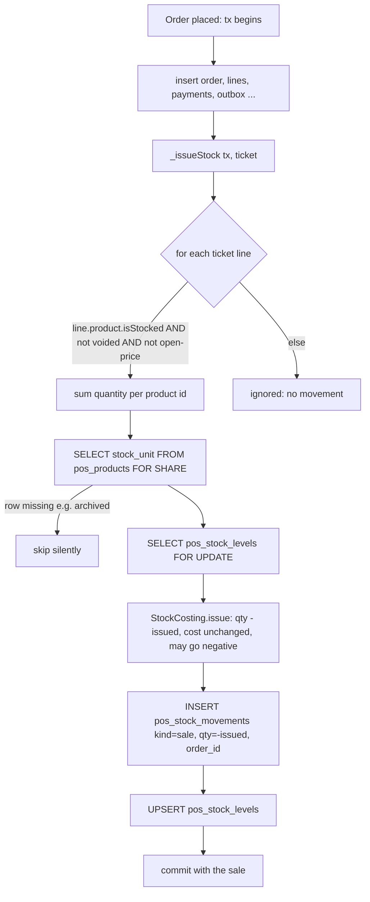

# Feature inventory

Evidence level **[CODE]** (static reading; nothing executed, tests are "exists, not executed here"). Backend/Vue features are UNKNOWN.
Status labels: IMPLEMENTED | PARTIAL | NOT_IMPLEMENTED | UNKNOWN.

* **Part 1 — Sales floor** (order types, lifecycle, payments, refunds, shifts, printing, ETA)
* **Part 2 — Management / back office** (catalogue, inventory, staff, settings, reports, diagnostics)

## Headline findings

| Area | Status | Key point |
|---|---|---|
| Sale, split payment, money/tax engine | IMPLEMENTED | Integer minor units, half-up once per tax rate; settlement is one transaction with idempotency key |
| Order lifecycle | PARTIAL | `pos_orders` written only as PAID or VOIDED (+ refund-derived states); no persisted open/sent/ready states; clearing an unsent ticket leaves no record |
| Dine-in tables / park | PARTIAL | Park/resume works; merge, transfer, split-bill NOT_IMPLEMENTED; parked state last-writer-wins |
| Takeaway / pickup | PARTIAL | Order types exist as config |
| Delivery | NOT_IMPLEMENTED beyond an enum | No driver, zone, fee, status; customer/address requirement flags never enforced |
| Kitchen ticket / KDS / station routing | NOT_IMPLEMENTED | "Send round" only changes in-memory line stage; print queue kinds are receipt/reprint only |
| Card/wallet payments | PARTIAL | Recorded label + reference only; no terminal integration |
| Discounts / refunds / voids | IMPLEMENTED (with gaps) | Limits, supervisor approval, reasons, idempotency, triggers; no restock on refund; dead flags (`refundAllowed`, `requiresManager`) |
| Shifts & cash movements | IMPLEMENTED | Business day is never *opened* by the app (no caller of `BusinessDayRepository.open` in `lib/`, re-verified by grep) |
| Inventory | PARTIAL | Stock decrements 1:1 for `is_stocked` products at sale; no recipes/BOM, stocktake, waste, adjustments; suppliers/PO/receiving/invoices IMPLEMENTED |
| Users/roles/permissions | PARTIAL | Enforced in Dart on writes only; shared DB credential |
| Reports | PARTIAL | Local per-branch; profit is an upper bound; cloud reporting client unused by any screen |
| ETA e-invoicing | PARTIAL | Compile-time flag off by default; builds/hash-chains pending documents; no signer or submission |
| Diagnostics / crash reporting | NOT_IMPLEMENTED | Only dev-build HTTP console log |
| Language switch (en/ar) | IMPLEMENTED | In 3 places; no screen named "General Settings" as the single home |

Suspected defects flagged by the audit (runtime unverified): shift id captured with `ref.read` and never invalidated on shift
open/close (orders/refunds could carry a stale/NULL shift id → missing from Z report); parked tickets restored after restart lose
tax mode/groups/service charges/customer; `TicketEngine.setLineNote` drops combo/free-allowance snapshot; order upload carries no
customer reference.

---

# Part 1 — Sales floor

# Feature inventory, part 1: sales, money, shifts, printing

Scope: order types and lifecycle, dine-in, takeaway, delivery, customers, discounts, tax and service, refunds, voids, payments, shifts and cash, catalog read side, receipts, kitchen and printing, history, ETA, sale-screen hotkeys.
Out of scope (other agents): back-office admin screens, sync drain internals, licensing, setup wizard. They appear only where a sales feature depends on them.

## 0. Method and evidence conventions

- Read-only audit of `/home/user/xorder-pos`. No flutter, dart or PostgreSQL in the sandbox. Nothing was executed.
- `[CODE]` means supported by executable code I read. `[ASSUMED/UNVERIFIED]` means inference or runtime behaviour I could not confirm. `[OBSERVED]` is not used (nothing could be run).
- "test exists (not executed here)" means I read the test and can say what it would assert. It does not mean it passes. Suites tagged `integration` self-skip without `POS_PG_HOST` (CLAUDE.md, `dart_test.yaml`), so even on the author's machine the DB-level tests only count when a database is configured.
- Status labels: IMPLEMENTED, PARTIAL, NOT_IMPLEMENTED, UNKNOWN.
- Docs and comments disagree with code in several places. Those are called out as **DOC vs CODE**.
- The Laravel backend is not available. What the server does with a POS upload is UNKNOWN. Only the HTTP shapes the till sends are visible (`lib/data/cloud/outbox_drain.dart`, `cloud_api.dart`).

### Headline findings (details in the sections)

1. **There is no persistent "open order".** `pos_orders` is written only at settlement (PAID) or whole-order void (VOIDED). Of the 10 statuses the schema allows, the app writes `PAID`, `VOIDED`, and (by DB trigger) `PARTIALLY_REFUNDED`/`REFUNDED`. `DRAFT, OPEN, SENT_TO_KITCHEN, READY, CLOSED, CANCELLED` are never written by any code in `lib/`. An in-progress ticket exists in memory plus, if parked, as a JSON blob in `pos_parked_tickets`.
2. **No kitchen output of any kind.** "Send round" flips line stages in memory and shows a toast. No kitchen ticket, no KDS, no station routing, no second printer. The print queue only accepts `receipt` and `reprint`.
3. **Delivery is an enum value plus two configuration flags nobody enforces.** No address on the order, no driver, zone, fee or status.
4. **Merge, transfer and split-bill do not exist.** Split *payment* (several tenders on one bill) does.
5. **Card payments are recorded, not processed.** A card tender is a label plus a typed reference. No terminal integration.
6. **Business days are never opened by the app.** `BusinessDayRepository.open()` has no caller in `lib/`. The "Close day" button only appears if a day is open. Day-close and per-day gross/net therefore depend on rows nothing creates.
7. **ETA e-invoicing only builds and queues a local document** behind a compile-time flag (default off). No signing implementation, no submission code, and the receipt QR payload is never populated outside tests.
8. **Suspected defects** worth a runtime check: shift attribution may be cached in a provider (section 13, R1); parked tickets restored after restart lose tax mode, tax groups, service charges and customer (section 15, R2); `TicketEngine.setLineNote` drops a line's combo and free-allowance snapshot (section 3, R3).

---

## 1. Order types and order lifecycle

| Item | Evidence |
|---|---|
| Module | `lib/domain/models/ticket.dart` (`OrderType`, `Ticket`, `TicketLine`, `LineStage`), `lib/domain/models/order_record.dart` (`OrderStatus`), `lib/domain/models/order_type_config.dart` (`OrderTypeConfig`, `OrderTypeRules`), `lib/app/providers.dart` (`branchOrderTypesProvider` :1173, `TicketController` :1323, `OpenTicketsController` :867) |
| Tables | `pos_orders` (migration 1, extended by 9, 10, 12, 14, 51), `pos_order_lines`, `pos_order_line_events`, `pos_order_types` (migration ~25), `pos_parked_tickets` (7, 32) |
| Status | **PARTIAL** (selling lifecycle yes; persisted multi-step order lifecycle no) |

### Order types [CODE]

`OrderType` has four members: `dineIn`, `takeaway`, `delivery`, `driveThru` (`ticket.dart:14`). Wire synonyms `pickup`, `take_away`, `dinein`, `drivethru`, `drive_through` are mapped (`ticket.dart:35`). So **"pickup" is takeaway under another name**, not a separate flow.

Which types a till offers is the intersection of (a) active rows in `pos_order_types` (`OrderTypeRules.active`) and (b) the branch's `supportedOrderTypes` (`branchOrderTypesProvider`, `providers.dart:1173`). If the intersection is empty, the branch list wins. Per-type flags are `requiresTable`, `requiresCustomer`, `requiresAddress`, `isActive`, `sortOrder` (`order_type_config.dart:20`).

Enforced: only `requiresTable` is enforced anywhere in selling (`sale_screen.dart:139` `_charge` refuses and sends the cashier to the floor; `TicketEngine.setOrderType` drops the table when switching to an unseated type, `ticket_engine.dart:526`; the router skips the floor when nothing seats, `router.dart:96`). `requiresCustomer` and `requiresAddress` are stored, edited in admin and read back, but **no selling code reads them** (grep over `lib/`: only `order_type_dialog.dart`, `management_order_types_pane.dart`, the catalog-admin repo, `local_bootstrap.dart`, `postgres_order_types_repository.dart`). The model's own comment says "Nothing reads this yet".

### Lifecycle: what the code actually does

`OrderStatus` (`order_record.dart:28`) lists ten states mirroring the CHECK constraint (`migrations.dart:709`). Writers found by grep over `lib/`:

| Status | Written by | Notes |
|---|---|---|
| `PAID` | `PostgresOrdersRepository.submit` (column default, `migrations.dart:701`) | the only "sale" row |
| `VOIDED` | `PostgresOrdersRepository.voidOrder` (`postgres_orders_repository.dart:252`) | inserted directly as VOIDED, with real totals |
| `PARTIALLY_REFUNDED`, `REFUNDED` | DB trigger `pos_refund_applied` (`migrations.dart:1241`) | derived from `refunded_minor`; no Dart code writes status |
| `DRAFT, OPEN, SENT_TO_KITCHEN, READY, CLOSED, CANCELLED` | **nothing** | read in `PostgresBusinessDayRepository.check` (`:148`) to count "unpaid orders" blocking a day close, but no writer can produce them, so that blocker is always 0 |

`UNPAID` and `PARTIALLY_PAID` exist only as a *derived* payment status in SQL/Dart (`order_history_repository.dart:67`, `payment_status.dart`); they are unreachable for orders written by `submit`, which requires a settled ticket and caps payments at the total.



Diagram sources: `Live/LiveSent/Parked`: `ticket_engine.dart:494` (`sendRound`), `sale_screen.dart:482-527` (`_hold`, `_park`), `router.dart:240` (leave via Tables); `Discarded` vs `VOIDED`: `line_void_dialog.dart:218` (`_clear`) vs `:241` (`_void`); `PAID`: `payment_screen.dart:120` (`_take`); refund transitions: trigger at `migrations.dart:1241`.

Consequences [CODE]:
- A "sent" line only exists for **seated** tickets. `TicketHoldAction.forTicket` (`cart_panel.dart:89`) maps seated-with-table to "send round" and everything else to "park". A takeaway/delivery ticket therefore never reaches `LineStage.sent`, so "void after send" cannot occur for it; all its line removals are plain cancels.
- Sending a round is **not persisted**. `_sendRound` (`sale_screen.dart:496`) calls `TicketController.sendRound` and toasts. The sent state reaches disk only if the ticket is later parked (leaving via Tables, `router.dart:240`, or F4 on an unseated ticket). A crash between rounds loses the stage changes and any lines added since the last park [CODE; runtime effect UNVERIFIED].
- Clearing a ticket with no sent lines leaves **no trace** (no CANCELLED row, no audit event). Removed-before-send line events live on the in-memory ticket (`lineEvents`) and are only written when the ticket settles or is voided (`_insertLineEvents`, `postgres_orders_repository.dart:538`).
- Order number is allocated only at settlement (`_nextInvoiceNumber` :391, `pos_invoice_sequences`, row lock). A void also consumes a number.

Tests (not executed here): `test/domain/ticket_engine_test.dart` (add/merge/send/stage rules, order-type switch detaches table, `pickup` synonym), `test/domain/order_type_rules_test.dart` (only dine-in seeded `requiresTable`; delivery flags exist; unconfigured type unseated), `test/data/order_lifecycle_test.dart` (DB: default PAID, status CHECK, void attribution; skips without DB), `test/data/order_types_schema_test.dart`, `test/features/branch_order_types_test.dart`, `test/features/order_type_enable_test.dart`, `test/features/park_ticket_test.dart`.

**Limitations**: no way to see "open orders" across tills (parked tickets are hydrated per branch only at boot, `OpenTicketsController._hydrate` :883); no pre-bill/check printing (`TableState.billAsked` is just "has tenders", `floor_overlay.dart`); guest count is set to the table's seat count (`providers.dart:1429` `attachTable(... guests: table.seats)`), never entered by the cashier.

---

## 2. Dine-in: floor, tables, merge, transfer, split

| Item | Evidence |
|---|---|
| Files | `lib/features/floor/floor_screen.dart`, `lib/domain/models/dining_table.dart`, `lib/domain/services/floor_overlay.dart`, `lib/data/postgres/postgres_floor_repository.dart`, `lib/data/postgres/postgres_parked_tickets.dart`, `lib/app/router.dart:200-230` |
| Tables | `pos_dining_tables` (migration 2), `pos_parked_tickets` |
| Permission | `pos.operate` to reach the floor/sale screens; no per-table permission |
| Status | floor and seat/resume: **IMPLEMENTED**. Merge, transfer, split bill: **NOT_IMPLEMENTED** |

[CODE] Floor behaviour: `floorTablesProvider` overlays this till's parked tickets on the plan (`providers.dart:1005`, `floor_overlay.dart`). Table state is `free` (no parked ticket), `open` (parked, no tenders), `billAsked` (parked with tenders). Picking a busy table adopts the parked ticket (same `client_transaction_id`), a free one attaches the table to the live ticket (`router.dart:216-228`). Leaving the sale screen via Tables parks a seated non-empty ticket (`router.dart:240`).

Persistence: parked tickets are rows in `pos_parked_tickets` (JSON payload via `ParkedTicketCodec`), upserted on park, deleted on settle/void, hydrated at boot with `NOT EXISTS (SELECT 1 FROM pos_orders ...)` so a committed sale never resurrects (`postgres_parked_tickets.dart:44-69`). One parked ticket per (restaurant, table) is enforced by a unique index (`migrations.dart` migration 32); tickets with no table are unique per transaction id.

Searches for the absent features (all with zero hits in `lib/` outside comments): `transfer table`, `moveTable`, `merge table/ticket/bill/check`, `split bill/check/by/equal/item`, `separate check`. The only matches were line-key merging (same product merges into one line) and "split bill" meaning several tenders.

Multi-till seating: the code says outright that the floor is single-terminal truth (`floor_overlay.dart` header): the overlay uses *this till's* in-memory `OpenTickets`; other tills' parked tickets are only loaded at boot. Two tills on one branch DB can seat the same table; the second `save` replaces the first's row (`ON CONFLICT (restaurant_id, table_id) DO UPDATE`, `postgres_parked_tickets.dart:88-97`). [CODE]. Whether this loses the first till's ticket on a live system is UNVERIFIED (depends on whether the first till later settles from its in-memory copy, which it can: settlement uses the in-memory ticket).

Tests (not executed): `test/features/sale_flow_test.dart` (floor lists tables with live state; dine-in with no table goes to floor), `test/features/open_tickets_test.dart`, `test/data/parked_tickets_schema_test.dart` (one ticket per table, held key, branch scope, day-close blocker; skips without DB), `test/domain/floor_overlay_test.dart`.

---

## 3. Sale-screen mechanics (read side of menu, lines, modifiers, combos)

| Item | Evidence |
|---|---|
| Files | `lib/features/sale/sale_screen.dart`, `widgets/cart_panel.dart`, `widgets/modifier_sheet.dart`, `widgets/combo_sheet.dart`, `widgets/open_item_dialog.dart`, `widgets/line_note_dialog.dart`, `lib/domain/models/catalog.dart`, `combo.dart`, `option_group.dart`, `lib/data/postgres/postgres_catalog_repository.dart` |
| Tables read | `pos_categories, pos_products, pos_modifier_groups, pos_modifiers, pos_product_modifier_groups, pos_product_prices (branch overrides, LEFT JOIN at `postgres_catalog_repository.dart:81`), pos_combos, pos_combo_groups, pos_combo_options, pos_tax_groups` |
| Permission | `pos.operate`; open-item uses `price.override` (`open_item_dialog.dart:307`) |
| Status | **IMPLEMENTED** (with caveats below) |

[CODE] Features in the engine (`ticket_engine.dart`):
- Modifier validation: required groups, `minSelect`, `maxSelect` (`validateSelection` :221); single-select replace, multi-select cap (`toggleModifier` :272); default selections incl. first available size (`defaultSelection` :253).
- Size variants: a variant modifier *replaces* the base price, others add (`priceWithOptions`, `catalog.dart:349`).
- Free allowance per group (`freeOptions`), snapshotted onto the line as `includedAllowance` (`addLine` :298-330).
- Lines merge only if draft, same product+modifier key and same note (`addLine` :333). Sent lines never merge.
- Combos: `addComboLine` (:658) validates each group's min/max, stores a snapshot (`ComboSelection`) and a synthetic negative-id product; price is the combo price, not the sum of parts.
- Open-price line: `addOpenPriceLine` (:758), requires a name, non-negative price, uses synthetic negative id; gated by `price.override`.
- Out of stock = `Product.isAvailable == false` only (`addLine` :306). `isStocked` items decrement `pos_stock_levels` at settlement and **may go negative by design** (`_issueStock`, `postgres_orders_repository.dart:725`, comment lines 716-724). Combos and dishes never consume stock (no recipe model).
- Per-line note: `setLineNote` (:790).
- Scanner: `Catalog.search` matches name, SKU (exact) and barcode (exact) (`catalog.dart:406`), so typing/scanning a barcode filters the grid. `Catalog.byBarcode` (:420) exists but has **no caller** in `lib/`, and the search field has no `onSubmitted`, so a scan does not auto-add the item. [CODE, grep for `byBarcode`/`onSubmitted`]
- Branch pricing: read via `pos_product_prices` join; the admin side is another agent's.

Defects [CODE]:
- **R3: `TicketEngine.setLineNote` rebuilds the line through the `TicketLine` constructor without `combo` and `includedAllowance`** (`ticket_engine.dart:795-811`; the constructor call lists product, quantity, modifiers, note, stage, roundNumber, voided, priceOverride only). Setting a note on a combo line would turn it back into a synthetic open-price product at `product.price` (the combo's price, so the figure may survive) but lose `combo` (components, ETA/tax group via `combo?.taxGroupId`, `pos_order_line_items` rows). On a line with a modifier free allowance it would remove the allowance and raise the price. No test calls `setLineNote` except `test/features/cart_density_test.dart` (UI). Runtime impact UNVERIFIED.
- Live ticket currency is hard-wired: `TicketController.build()` constructs `Ticket(...)` without currency/exponent (`providers.dart:1351`), defaulting to `'EGP'`, 2. The three-decimal path is only exercised in domain tests (`test/domain/ticket_totals_golden_test.dart`). The comment at `providers.dart:174` says currency is not yet configurable. Refund, cash-movement and business-day repositories also default `'EGP'`/2 (`postgres_refunds_repository.dart` ctor; the provider at `providers.dart:431` does not pass a currency).

Tests (not executed): `test/domain/ticket_engine_test.dart`, `option_group_rules_test.dart`, `size_pricing_test.dart`, `modifier_economics_test.dart`, `combo_test.dart`, `open_item_test.dart`, `price_override_test.dart`, `test/features/sale_flow_test.dart`, `combos_ui_test.dart`, `option_groups_ui_test.dart`, `cart_density_test.dart`, `test/data/combo_schema_test.dart`, `branch_pricing_test.dart`, `size_price_derivation_test.dart`.

### Price override (related)
`TicketEngine.overridePrice` (:834) replaces the whole unit price, measured against the menu price (not the previous override), allowed on sent lines, treated as a discount against the same `DiscountLimit`, writes a `price_overridden` line event with before/after (`PriceOverride` snapshot, reason, approver). Permission `price.override` (high risk, lendable). Persisted at settlement into the line's price and `pos_order_line_events`. Tests: `test/domain/price_override_test.dart`, `test/features/price_override_ui_test.dart`. Status IMPLEMENTED.

---

## 4. Takeaway and pickup

| Item | Evidence |
|---|---|
| Files | same as order types; `TaxConfig.appliesServiceTo` (`ticket.dart:448`) |
| Status | **IMPLEMENTED** as a plain unseated order type |

[CODE] Takeaway = order type with no table. No pickup time, no ready notification, no customer name requirement. A takeaway ticket parks (not sends) from the cart button (`cart_panel.dart:89`), so the "Held" list is the only way to keep several in flight (`HeldTicketsDialog`, `held_tickets_dialog.dart`). Service charge is not applied by default (legacy config is dine-in only; `serviceDineInOnly` default true, `ticket.dart:381`). Tests: `test/features/park_ticket_test.dart` ("an unseated takeaway parks"; "a takeaway the restaurant seats, at a table, sends a round"), `sale_flow_test.dart` ("a takeaway ticket needs no table").

---

## 5. Delivery

| Item | Evidence |
|---|---|
| Status | **NOT_IMPLEMENTED** as a workflow. **PARTIAL** as configuration only |

Searched (case-insensitive, all of `lib/`): `driver`, `delivery zone/fee`, `courier`, `dispatch`, `aggregator`, `pickup time`, `scheduled for`, `prep time`, `estimated time`. Nothing in selling code. Hits were only comments (the open-item doc mentions "a delivery fee"; `service_charge.dart` mentions a fee collected for an aggregator).

What exists [CODE]:
- Enum member `OrderType.delivery` (wire `delivery`), seeded in `pos_order_types` with `requires_customer=true, requires_address=true` (`order_type_config.dart:71-79`). Those two flags are **not enforced**: a delivery ticket can be charged with no customer and no address.
- `PosCustomer.address` and `canTakeDelivery` (`customer.dart:40`). `canTakeDelivery` has no caller.
- A delivery fee can only be modelled as (a) an open-price line the cashier types (`addOpenPriceLine`) or (b) an automatic `pos_service_charges` row scoped to delivery (`service_charge.dart`), configured in back office.
- The customer can be attached to a delivery order (section 6). `pos_orders.customer_id` stores the link. The **address is not copied onto the order**; it lives only on the customer record. The receipt has no delivery block (`receipt_data.dart` fields listed: invoice, type, table label, lines, totals, payments).
- No delivery state (out for delivery, delivered), no driver assignment, no cash-on-delivery reconciliation, no zone pricing, no kitchen-to-dispatch flow.

Tests: `test/domain/order_type_rules_test.dart` ("delivery wants a customer and an address") checks only the seeded flags.

---

## 6. Customer creation and lookup at checkout

| Item | Evidence |
|---|---|
| Files | `lib/features/payment/customer_dialog.dart`, `lib/data/postgres/postgres_customers_repository.dart`, `postgres_customer_directory_repository.dart`, `lib/domain/models/customer.dart`, `customer_summary.dart`, `lib/features/admin/presentation/management_customers_pane.dart` (directory, read-only view) |
| Tables | `pos_customers` (migration 51, `migrations.dart:4412`), `pos_orders.customer_id`, `pos_sync_outbox` event `customer` |
| Permission | none beyond reaching the payment screen (no capability gates create/attach) |
| Status | **IMPLEMENTED** (create, find, attach); **PARTIAL** (order-to-customer link not uploaded; not persisted on restart; not required for delivery) |

[CODE]
- Entry point is the payment dialog header button "who is this for" (`payment_screen.dart` `_chooseCustomer`). Not available from the sale screen.
- `upsert` conflicts on `(restaurant_id, phone)`; phone normalised (Arabic-Indic and Persian digits mapped to ASCII, `customer.dart` `normalisePhone`). Name overwrites on conflict; email/address/note use COALESCE so a blank does not erase. A customer without a usable number is refused (`ArgumentError`).
- Search: name `LIKE` or phone `LIKE`, ordered by `updated_at DESC`, empty query returns most recent (`postgres_customers_repository.dart` `search`).
- Created customers are queued as `customer` events in `pos_sync_outbox` only when the deployment syncs to the platform and the row has no `platform_id` (`upsert`, `_enqueue`). The drain sends them ahead of orders (`outbox_drain.dart:281-285`) and writes back `platform_id` (:657).
- `pos_orders.customer_id` is written by `submit` (`postgres_orders_repository.dart` insert column `customer_id`).

Gaps [CODE]:
- **The upload of the order does not carry the customer.** `OutboxDrain.buildOrderRequest` (`outbox_drain.dart:139`) has no `customer` parameter and the request map (:156-184) has no customer key. Customer records are uploaded as standalone `/api/pos/customers` posts, but the sale-to-customer link stays local. Whether the backend can learn it otherwise is UNKNOWN. (The drain treats `CUSTOMER_NOT_FOUND` as a quarantining error at :124, which suggests the contract expects a customer reference, so this may be a gap relative to the agreed contract; UNVERIFIED.)
- **Parked tickets drop the customer.** `ParkedTicketCodec.encode/decode` contain no customer field (grep for `customer` in `parked_ticket_codec.dart`: none). A ticket parked and restored loses its customer.
- Delivery requirement not enforced (section 5).
- No customer loyalty, credit, or "on account" balance. "On account" tender is hidden at payment (section 11).

Tests (not executed): `test/data/customers_repository_test.dart` (phone identity, refusal without number, search, cloud till queues, offline queues nothing, bundle customer never sent back; DB), `test/data/customer_directory_test.dart`, `test/data/order_customer_test.dart`, `test/domain/customer_test.dart`, `customer_summary_test.dart`, `test/features/customers_ui_test.dart`.

---

## 7. Discounts

| Item | Evidence |
|---|---|
| Files | `lib/domain/models/discount.dart`, `ticket_engine.dart:947-1202`, `lib/features/sale/widgets/discount_sheet.dart`, `lib/data/postgres/postgres_discounts_repository.dart`, `lib/features/admin/presentation/supervisor_override.dart`, `lib/domain/services/authorization.dart` |
| Tables | `pos_discounts`, `pos_discount_targets`, `pos_order_discounts` (migration 10, `migrations.dart:889-1030`), `pos_orders.discount_minor`, `pos_roles.max_discount_bp/max_discount_minor`, `pos_reason_codes` |
| Permission | `discount.apply` (medium, lendable); limit key `discount.max` (also governs price override); reasons scope `discount` |
| Status | custom (typed) discount and the cap/approval machinery: **IMPLEMENTED**. Configured named discounts: **PARTIAL** (read-only on the till; no in-app source found). Several configured flags: **NOT_IMPLEMENTED** |

[CODE] Behaviour
- Three entry points in the engine: configured line discount (`applyLineDiscount` :947), configured order discount (`applyOrderDiscount` :993), typed discount (`applyCustomDiscount` :1038, percentage or fixed). All end in `_apply` (:1153).
- Rules: at most **one discount per line and one per order** (`AlreadyDiscounted`); an order discount's base is goods minus line discounts (`_orderDiscountBase`); amounts are capped at the base; liveness checks `isLiveAt` (active flag, date range, weekday, time window incl. wrap past midnight), order-type targets, product/category targets, `minOrder`, `requiresCustomer`.
- Cap enforcement: `DiscountLimit.permits` (`discount.dart` class `DiscountLimit`) applies both a percentage ceiling (cross-multiplied, no rounding) and a cash ceiling to every discount kind, so a fixed amount cannot walk around a percentage cap. Over the cap the engine returns `DiscountAboveLimit`; the sheet opens the supervisor dialog, the approver's own limit then binds the retry (`discount_sheet.dart:165-195`), and an audit row `discount.above_limit` is recorded.
- Capability gate in `SaleScreen._discount`: a person lacking `discount.apply` is prompted for a supervisor via `requestPermission` and then works inside the sheet with the approver recorded (`sale_screen.dart:412-430`).
- Reasons: seeded per restaurant for scopes void, refund, discount, price_override (10 codes; `other` requires a note; `migrations.dart` migration 9 seed). Whether a reason is required is `SystemReasons.defaultRequirement(ReasonScope.discount)`.
- Persisted at settlement into `pos_order_discounts` with snapshot name, kind, `value_bp`/`value_minor`, amount, reason, note, `applied_by`, `approved_by_id` (`_insertDiscounts`, `postgres_orders_repository.dart:620`).
- Default roles: **cashier has no `discount.apply`**; supervisor, manager, owner do (`permissions.dart:575-625`). Per-role `max_discount_bp/minor` is read by `PostgresDiscountsRepository.limitFor` (:153) and tightened by per-staff limits.
- Discounts reduce the base for service and tax (`Ticket.totals`, `ticket.dart:679`; test "a fully comped meal costs nothing at all").

Gaps / dead settings [CODE]
- `Discount.requiresManager` and `Discount.isRestricted` are loaded (`postgres_discounts_repository.dart:78-79`) and never read afterwards. A configured discount marked "requires manager" does not demand one.
- `Discount.maxDiscount` is honoured only inside `amountOn`; fine.
- **No in-app writer for `pos_discounts` rows.** grep for `INSERT INTO pos_discounts` finds only SQL in tests; `local_bootstrap.dart:1053` grants INSERT/UPDATE on it to a role, but no repository or screen uses it. `bootstrap_bundle/seeder` contain no discount handling (grep). So named discounts must be inserted out-of-band or arrive via a mechanism I did not find; the discount sheet says "nothing configured" otherwise (`discount_sheet_test.dart`: "says so plainly when nothing is configured"). Typed discounts always work. Status of configured discounts therefore: PARTIAL / UNKNOWN as to origin.
- The discount-limit check is client-side only. The DB protects `pos_orders` money columns by column-scoped grants and check constraints (migration 10 `pos_orders_discount_sane`), not the limit itself.
- Loyalty/coupon/voucher-code discounts: NOT_IMPLEMENTED (grep `loyalty|coupon|promo|gift`: only config comments and `TenderKind.voucher`).

Tests (not executed): `test/domain/ticket_discount_test.dart` (comp, footing, one-per-line, limit within/above/at-limit/cash ceiling, liveness, typed vs configured parity), `test/domain/discount_test.dart`, `test/features/discount_sheet_test.dart`, `cart_discount_test.dart`, `manager_approval_test.dart`, `test/data/discount_schema_test.dart` (DB).

---

## 8. Service charge and tax engine

| Item | Evidence |
|---|---|
| Files | `ticket.dart` (`TaxConfig` :375, `Ticket.totals` :679), `lib/domain/models/tax.dart` (`TaxGroup`, `TaxEngine.linesFor` :194), `service_charge.dart`, `lib/core/money/money.dart`, `rounding.dart`, `lib/data/postgres/money_config_codec.dart`, `providers.dart` (`moneyConfigProvider` :1288, `taxConfigProvider` :1203, `taxGroupsProvider` :1230) |
| Tables | `pos_money_config` (migration 8: one JSON payload per restaurant), `pos_tax_groups` (16), `pos_products.tax_group_id`, `pos_service_charges` (~23), `pos_order_taxes` (16) |
| Permission | read by all; edit is back office (`settings.manage`), other agent |
| Status | **IMPLEMENTED** |

### Computation [CODE] (`Ticket.totals`, `ticket.dart:679-776`)

```
subtotal   = sum(lineTotal of non-voided lines)
discount   = sum(applied discounts, minus those on voided lines)
net        = max(subtotal - discount, 0)
service    = TaxConfig.serviceFor(orderType, base: net)   // taxable part + untaxed part
tax bases  = per tax group: each line's total less its value-proportional share of discount
             (last line takes the remainder so bases sum to net exactly)
           + taxable service charge, taxed at the DEFAULT group's rate
tax lines  = TaxEngine.linesFor(bases, inclusive)          // ONE rounding per rate
vat        = sum(tax lines)
total      = exclusive: net + service + vat
             inclusive: net + service            (tax already inside)
```

- **Rounding is half-up, applied once per charge line**: `percentBp` = `roundHalfUp(minor * bp, 10000)` (`money.dart:86`, `rounding.dart:10`, away from zero for negatives so a refund mirrors a sale). All arithmetic is integer minor units; no `double` in the path.
- Tax is rounded once **per rate**, not per line (test "rounding is per rate, not per line": 3 lines of 33.33 at 14% give 14.00, not 14.01).
- Inclusive mode extracts tax with `taxWithinBp` = `roundHalfUp(minor * bp, 10000 + bp)` and reports base = gross - tax (`tax.dart:194`).
- Service charges: legacy single `serviceBp` (default 1200, applied to dine-in only unless config says otherwise) or, if any `pos_service_charges` rows exist, each active automatic charge scoped to the order type, percentage or fixed, taxable or not, each rounded separately (`ticket.dart:489`). `isOptional` and non-automatic charges exist only as configuration: **no till control adds or waives them** (grep `isAutomatic|isOptional`: only the admin dialog, repository, and the model).
- Service charge is computed on `net` (after discount) and its taxable part is taxed at the default group, ignoring per-product groups.

### Where rates come from [CODE]

- Defaults: `TaxConfig` constructor `serviceBp = 1200`, `vatBp = 1400`, `source = deviceConfig` (`ticket.dart:376-383`).
- `moneyConfigProvider` reads `pos_money_config.payload` for the restaurant; on any exception or no row it returns null, and `taxConfigProvider` then falls back to the `TaxConfig()` defaults (12%/14%, `source: deviceConfig`) (`providers.dart:1203-1223`, `:1288-1315`).
- `MoneyConfigCodec.toTaxConfig` (`money_config_codec.dart:21`): takes the **first** `percent` charge and the **first** tax rule with a rate. If the payload exists but lacks them, rates become **0%** (test "a tenant with no rules charges NOTHING, not the old default"). It marks `source: server`.
- Writers of `pos_money_config`: the cloud bootstrap seeder (`bootstrap_seeder.dart:301`) and the offline admin pane (`postgres_catalog_admin_repository.dart:567`, `management_taxes_pane.dart`). So **DOC vs CODE**: CLAUDE.md says tax is "provisional device config, read-only on the device"; in code the offline back office *can write* it, and the slip's `TaxSource.server` label then means "stored in `pos_money_config`", not necessarily "authored by the server".
- A slip says "from device config" when `taxConfig.source == deviceConfig` (`receipt_data.dart:167`; `receipt_document.dart:417`).
- Named groups (`pos_tax_groups`) and `taxMode` (exclusive/inclusive) are folded in by `taxConfigProvider`.

Status of the "Egypt" assumptions: ETA tax codes `T1`/`V009`/`V003` are constants (`tax.dart` `EtaTaxCode`); other ETA codes are deliberately not modelled.

### Risks [CODE]

- **R2a: `TaxConfig.operator ==` compares only `serviceBp`, `vatBp`, `serviceDineInOnly`, `source`** (`ticket.dart:518`). It ignores `taxMode`, `taxGroups` and `serviceCharges`. Consequences: (1) `TicketController` listens to `taxConfigProvider` and returns early `if (previous == next)` (`providers.dart:1334-1337`); if groups, charges or mode arrive/change without a rate/source change, the live ticket may keep stale config. (2) `Provider` change notification also uses `==`, so such updates may not propagate at all. Test `live_ticket_survives_config_test` / `tax_groups_wiring_test` check provider values and the "unchanged config is a no-op", not a late-arriving group on an existing ticket. Runtime effect UNVERIFIED; plausible after a mid-session back-office change or a slow first load.
- Provisional-disclosure risk: if `pos_money_config` cannot be read, the till silently sells at 12%/14% (`providers.dart:1313` comment says "keeps the device default and says so on the slip"). A cashier does not see it at sale time.
- Server-side agreement: the order upload sends `asserted_totals` (subtotal, discount, charges, tax, total) and `priced_offline: true` (`outbox_drain.dart:166-176`), no tax lines or per-charge breakdown. The comment at `providers.dart:1203` / migration 8 records a past mismatch ("27.68% more than the ledger recorded") caught only by `totals_mismatch`. How the backend resolves a mismatch is UNKNOWN; the outbox has a `totals_mismatch` column (`migrations.dart:624`).

Tests (not executed): `test/domain/ticket_engine_test.dart` ("applies service to dine-in and VAT on subtotal + service"), `ticket_totals_golden_test.dart`, `tax_lines_test.dart`, `tax_mode_test.dart`, `service_charge_test.dart`, `money_test.dart` (`test/core`), `test/data/money_config_codec_test.dart`, `tax_lines_schema_test.dart`, `service_charges_schema_test.dart`, `tax_groups_admin_test.dart`, `test/features/tax_groups_wiring_test.dart`, `service_charge_ui_test.dart`.

---

## 9. Voids and cancellations

| Item | Evidence |
|---|---|
| Files | `ticket_engine.dart:398` (`cancelLine`), `:443` (`voidLine`), `sale_screen.dart:175` (`_void`), `widgets/line_void_dialog.dart` (`LineVoidFlow`, `OrderVoidFlow`, `_clear` :218, `_void` :241), `postgres_orders_repository.dart:196` (`voidOrder`), `lib/core/ui/widgets/reason_picker.dart` |
| Tables | `pos_orders` (status, voided_by/at, void_reason_id, void_note), `pos_order_lines` (voided_*), `pos_order_line_events`, `pos_reason_codes`, `pos_audit_events` |
| Permissions | cancel an unsent line: `order.item.delete_before_send` (low; **not lendable**, a role without it cannot be overridden); void a sent line: `order.item.delete_after_send` (medium; lendable); void whole order: `order.void` (high; lendable). Cashier role holds only the first (`permissions.dart:629`) |
| Status | **IMPLEMENTED** |

[CODE] Three distinct acts, kept apart in engine, schema and permission model:
1. **Cancel line** (unsent): line removed, its discount removed, event `removed_before_send` appended to the in-memory ticket. No reason requested (`ReasonRequirement.disabled`, `line_void_dialog.dart` `_cancel`). If the role lacks the capability the user is shown a refusal and nothing happens (no supervisor path).
2. **Void line** (sent): line stays on the ticket with a `LineVoid` record (who, when, reason, note, approver); excluded from totals; event `voided_after_send`. Needs reason (default requirement for scope `void`) and, without the capability, a supervisor PIN. Written to `pos_order_lines.voided_at/voided_by/void_reason_id` and `pos_order_line_events` at settlement.
3. **Void order**: if no line was ever sent, `_clear` discards the ticket with **no record**. If any sent line exists, `_void` records an order row `status='VOIDED'` with real totals, reason, note, `voided_by`, `served_by`, line rows, discounts, tax lines, line events, and **no payments**, in one transaction (`voidOrder` :196-326). The repository re-checks `order.void` with `Authorization.require` before the transaction (:208). A void is not enqueued for the platform ("what a voided one looks like on the wire is not decided", :317-320); a void is not ETA-filed (`test/data/filing_orders_test.dart` "a void is not filed").
4. A void **consumes an invoice number** and counts in shift totals as `voids` (`_summarise` :433-440). Stock is not issued for voided order rows (`voidOrder` omits `_issueStock`). A voided sent-line on a settled order also does not decrement stock (`_issueStock` skips `line.isVoided`).

Audit: when a supervisor lends the permission, `requestPermission` records a `pos_audit_events` row (`auditAction: 'order.void'` etc.). When the signed-in person holds the capability themselves, no audit event is written by these flows; the order row itself carries `voided_by/reason` [CODE].

Limitations: after a void the parked ticket row is deleted via `OpenTicketsController.settle` (best-effort, `sale_screen.dart:196`); a failed write keeps the ticket on screen. There is no "cancel a settled order" other than refund. `OrderStatus.cancelled` is unused.

Tests (not executed): `test/domain/ticket_void_test.dart`, `test/domain/authorization_test.dart`, `permission_resolver_test.dart`, `test/data/order_lifecycle_test.dart` (void attribution, line events), `test/features/manager_approval_test.dart`, `reason_picker_test.dart` (`test/core`).

---

## 10. Refunds

| Item | Evidence |
|---|---|
| Files | `lib/domain/services/refund_engine.dart`, `lib/domain/models/refund.dart` (`RefundPolicy` :61), `lib/features/refund/presentation/refund_sheet.dart`, `lib/features/history/presentation/refunds_screen.dart`, `lib/data/postgres/postgres_refunds_repository.dart`, `lib/data/eta/filing_refunds_repository.dart` |
| Tables | `pos_refunds`, `pos_refund_lines`, `pos_refund_payments` (migration 12), `pos_orders.refunded_minor`, `pos_order_lines.refunded_quantity`, `pos_sync_outbox` event `refund` |
| Permission | `order.refund` (high; lendable); limit key `refund.max`; policy settings `refund.*` |
| Status | **IMPLEMENTED** (partial by lines, partial by amount, full), with specific gaps |

[CODE]
- Two quoting paths: by line quantities (`quoteForLines` :146) and by free amount (`quoteForAmount` :243). Service/VAT/discount are **pro-rated** from the original order, and the closing refund takes exactly what remains (`_remainder`) so shares foot. Amount refunds put any rounding drift into VAT.
- Guards (`_guard`): policy enabled, order status `tookMoney` (PAID, CLOSED, PARTIALLY_REFUNDED), something left, within window (`sameShift | sameDay | 7d | 30d | unlimited`, default 7d). Optional ceiling `refund.max_value_minor` (`policy.permits`, "which nobody can approve away") and approval threshold (`needsApproval`, requires a second person).
- UI (`refund_sheet.dart:617` `_issue`): reason required by default; allocation of tenders (`_refundTenders` :124) returns money through the **original payments' tender types only**, preferred tender first, never more than each tender received net of earlier refunds; so card sales are refunded to card and a refund cannot exceed what was paid in any tender. `requestPermission(order.refund)`; above threshold a `SupervisorOverrideDialog` forces a second person, and the repository refuses self-approval (`Authorization.require(... approvalRequired: quote.requiresApproval)` in `PostgresRefundsRepository.issue` :58).
- Idempotent: `client_refund_id` unique per restaurant; a retry returns the same refund (`issue` :58-110).
- DB integrity (trigger functions in migration 12, `migrations.dart:1241+`): `pos_refund_applied` locks the order row, rejects non-refundable statuses, adds to `refunded_minor` and derives `REFUNDED`/`PARTIALLY_REFUNDED`; `pos_refund_line_applied` checks the line belongs to the order and bumps `refunded_quantity` within sold quantity; a tender-balance trigger requires the refund payments to sum exactly to `total_minor`.
- Cash-out: refund payments carry `counts_as_cash` copied from `pos_tender_types` at issue time; shift summary subtracts cash refunds from expected cash (`_summarise` :395-400, `shift.dart:328`); the refund is stamped with the shift open when the repository was built (see R1).
- Cloud: refunds are queued in `pos_sync_outbox` and uploaded via `/api/pos/refunds`; the drain quarantines `REFUND_EXCEEDS_SOLD` (`outbox_drain.dart:124-128`). A refund against an order not yet uploaded references the order's `client_transaction_id`.
- ETA: a credit-note receipt is built for refunds when filing is enabled (`filing_refunds_repository.dart`, `EtaFiler._fileRefund`).

Gaps [CODE]
- **Stock is not returned** on refund (grep: no stock movement of kind return/refund; `pos_stock_movements` kinds written elsewhere are sale, receipt, opening...). A refunded stocked item stays decremented.
- `TenderMethod.refundAllowed` is stored and editable but **never read** by the refund flow (grep `refundAllowed`: admin dialog, repos, model).
- `refund.receipt_required` only displays a note (`refund_sheet.dart:325-333`); it does not require anything.
- `RefundWindow.sameShift` uses "sold at or after the open shift's opened_at" (`_sameShift` :218), which is the current shift only.
- A refund is a standalone act against a settled order; there is no exchange flow and no refund-to-store-credit.
- Currency defaults to EGP/2 in the repository (see section 3).

Tests (not executed): `test/domain/refund_engine_test.dart` (exact part-for-part give-back, pro-rata, remainder closes, window/ceiling/disabled refusals), `test/data/refund_schema_test.dart` (DB triggers: quantity, total, tender balance; skips without DB), `refund_history_test.dart`, `cloud_refunds_test.dart`, `filing_refunds_test.dart`, `test/features/refund_sheet_test.dart`.

---

## 11. Payment methods, split payments, change, card/wallet

| Item | Evidence |
|---|---|
| Files | `lib/features/payment/payment_screen.dart`, `lib/domain/models/tender_method.dart`, `lib/data/postgres/postgres_tender_types_repository.dart`, `ticket_engine.dart:565` (`addTender`), `:608` (`removeTenderAt`), `postgres_orders_repository.dart:679` (`_insertPayments`) |
| Tables | `pos_tender_types` (migration ~26/27; `platform_id` added later), `pos_order_payments` (`tender_type_id, label, amount_minor, reference, counts_as_cash`) |
| Permission | taking payment: `pos.operate`; removing a tender: `payment.remove` (high, lendable; engine + screen both check, `ticket_engine.dart:608`) |
| Status | **IMPLEMENTED** for recording; **NOT_IMPLEMENTED** for any card-terminal integration |

[CODE]
- Tender kinds: cash, card, wallet, account, voucher, other (`tender_method.dart`). Platform kinds `cash|card|external|other` map to till kinds (`external` is treated as card, with a comment explaining the bank-terminal slip reasoning).
- Seeded methods (id 1-4): Cash (counts as cash, opens drawer), Card (reference required), "Wallet · InstaPay" (reference required), "On account". In cloud mode the list comes only from the platform tender types; if not loaded, none (`payment_screen.dart:97-106`), so a cloud till cannot take payment until tender types load [CODE].
- **"On account" is filtered out** of the payment screen ("Customer receivables are not modelled yet... fail closed", `payment_screen.dart:102-105`), and `_take` refuses it again. So credit/house accounts: NOT_IMPLEMENTED.
- **Card = label + typed reference.** `requiresReference` forces the cashier to type an auth code; the comment on `Tender.reference` says "The POS is not a payment processor and stores no card data" (`ticket.dart:337`). No terminal protocol, no amount push, no reconciliation with a bank. No wallet/QR integration either.
- Split payments: n tenders accumulate on `Ticket.tenders`; each tender defaults to the whole remaining due when the entry is empty; overpayment yields `change`. Settlement happens automatically once `due` is zero (`_take`, `payment_screen.dart:150-153`).
- **The ledger stores applied amounts, not tendered.** `_insertPayments` caps each tender at the remaining total in order and skips tenders with nothing left; change is a till-side figure only (`postgres_orders_repository.dart:661-714`). The cited incident (`BR8-2026-000007`, 380.00 uploaded against a 360.00 bill) is the origin of this rule. The cash counted for the drawer uses the capped amount, which equals cash tendered minus change.
- `counts_as_cash` is snapshotted per payment, so later edits to a tender type do not move past cash-ups (tests below).
- Partial tenders are **in-memory only** unless the ticket is parked from the payment state; nothing writes a "partially paid" order. Failure of the submit restores the pre-tender ticket (`applyEdit(ticket)` :180) so a retry reuses the same transaction id.
- No tips field, no rounding to nearest 0.25/0.5 (cash rounding), no currency exchange, no foreign-currency tender. Quick-cash buttons exist (`_quickCash` :90).
- No keyboard shortcuts in the payment dialog (grep `SingleActivator` in `payment_screen.dart`: none; it uses an on-screen keypad).

Tests (not executed): `test/domain/ticket_engine_test.dart` (null amount tenders remaining; split leaves balance; overpay = change; zero refused; payment-removal authorisation), `test/domain/tender_cash_test.dart`, `tender_types_test.dart`, `test/features/payment_removal_test.dart`, `tender_types_ui_test.dart`, `test/data/tender_types_schema_test.dart`, `cloud_tenders_test.dart`, `payment_remove_migration_test.dart`, `test/domain/payment_status_test.dart`.

---

## 12. Cashier shifts, cash management, Z/X report, business day

| Item | Evidence |
|---|---|
| Files | `lib/features/shift/presentation/shift_dialogs.dart`, `lib/features/cash/presentation/cash_dialogs.dart`, `day_close_dialog.dart`, `lib/data/postgres/postgres_shift_repository.dart`, `postgres_cash_movements_repository.dart`, `postgres_business_day_repository.dart`, `lib/domain/models/shift.dart`, `business_day.dart` |
| Tables | `pos_shifts` (migration 2; unique open shift per terminal), `pos_cash_movements` and `pos_cash_drawers` and `pos_business_days` (migration 14), `pos_settings`, `pos_sync_outbox` (shift_open, shift_close, cash_movement) |
| Permissions | `shift.open`, `shift.close` (lendable: closing someone else's drawer needs a handover), `cash.movement` (lendable), `cash.open_without_sale` (lendable), `shift.view_expected_cash`, `cash.variance.view` (not lendable), `day.close`, `day.force_close` (lendable) |
| Status | shift open/close, Z report with variance, pay-in/out, drawer-open: **IMPLEMENTED**. X (mid-shift) report: **NOT_IMPLEMENTED**. Business day: **PARTIAL** (close exists; nothing opens one) |

### Shift [CODE]
- Open: `PostgresShiftRepository.open` (`postgres_shift_repository.dart:55`): returns the existing open shift if any; otherwise inserts with the opening float; the partial unique index `pos_shifts_one_open_per_terminal` is the DB guarantee. Enqueues `shift_open` in the same transaction when syncing. Opening float is typed (default empty); the cashier whose PIN is entered becomes `opened_by` and is signed in.
- The router forces `/lock` when a shift is open but nobody signed in (`router.dart:47-52`); the till does not remember the signed-in staff across restarts (`providers.dart` `SignedInStaffController`).
- Close: `close` (:337) requires `shift.close`; if the closer is not the opener an approval is required (`approvalRequired: !shift.openedBy(by.id)`). It computes the summary in the same transaction, stores counted, expected and variance, and refuses a double close (`StateError` "already closed"). Blind close: setting `cash.blind_close` plus lack of `shift.view_expected_cash` hides the expected figure while counting (`shift_dialogs.dart:260-266`); the variance is revealed after commit only to holders of `cash.variance.view`.
- Closing the shift requires an empty on-screen ticket (`sale_screen.dart:214`). It does **not** check parked tickets (that is the business-day close's job).
- **Z report** = `ShiftSummary`/`ZReportView`, built by `_summarise` (:425): counts and sums over `pos_orders WHERE shift_id = @shift` (excluding VOIDED), voids separately, tender breakdown from `pos_order_payments` joined by `shift_id`, refunds and cash refunds from `pos_refunds.shift_id`, pay-in/out/drawer-opens from `pos_cash_movements`. `expectedCash = openingFloat + cashTaken + cashIn - cashOut - cashRefunded` (`shift.dart:328`). Past shifts can be viewed (`ShiftReportDialog`, back-office shifts/settlements panes) using stored counted/expected/variance.
- **X report**: grep `x.?report|xReport` finds nothing. There is no read-without-closing shift report on the till. The back-office "open drawers" view (`openDrawers()` :95, `OpenDrawer.expectedCash`) shows an expected figure per open drawer, which approximates an X report for managers (permission-gated by `shift.view_expected_cash`/reports).
- Printing: no Z report print path found (`ZReportView` is an on-screen widget; the only printer path is `ReceiptPrinter.printReceipt` for sale slips). [CODE; grep of `ZReport`/`printReceipt` call sites]

### Cash movements [CODE]
Pay-in, pay-out, drawer-open (F11, F12, F10 in `sale_screen.dart`). `CashMovementWrite.sql` inserts with `shift_id` NOT NULL; amount always positive with `kind` carrying direction; drawer-open has amount 0 (CHECK in migration 14). Requires reason (scope pay_in/pay_out seeded), optional note, optional supervisor approval; a pay-out ceiling `cash.pay_out_max_minor` is enforced in the dialog (`cash_dialogs.dart:292`). Drawer open has its own capability and confirmation, audit row `drawer.opened`. Physical drawer kick: ESC/POS `ESC p` pulse sent via the receipt printer when the settling tender's method has `opensDrawer` (`receipt_dialog.dart:218-231`), or via F10 (`receipt_printing.dart:153`). Kick is sent through the same printer connection; there is no separate drawer port.

### Business day [CODE]
- Table and repository exist. `check()` (`postgres_business_day_repository.dart:119`) returns blockers: open shifts, any parked tickets in the branch, unpaid orders in statuses that nothing writes. `close()` totals `pos_orders` for the day (gross, and net of refunds) in the same transaction; a forced close needs a reason (DB CHECK) and `day.force_close`. A DB trigger stamps `business_day_id` on new orders, refunds and shifts from the currently open day (migration 35, `migrations.dart:3246`).
- **Nothing opens a day.** `BusinessDayRepository.open` (:86) is not called anywhere in `lib/` (searched `.open(` callers: only the shift `open(by:, openingFloat:)`; `INSERT INTO pos_business_days` appears only in this repository method). The start screen shows "Close day" only when `businessDayProvider` returns a day (`start_screen.dart:~286`). So on a fresh install, `business_day_id` stays NULL, the Close-day button never appears, and readers that "fall back to the day's window" (trigger comment) have no day to fall back on, using the `day.start_time` setting instead (`PostgresOrderHistoryRepository.businessDateRange`/`tradingDayJoin`). The backup-on-day-close hook (`BackupTrigger.dayClose`) can therefore never fire from the till. Tests create days directly with SQL. [CODE; UNVERIFIED whether the cloud bundle or an installer step creates a day; grep of `bootstrap_seeder.dart`/`local_bootstrap.dart` finds no insert]

### R1: shift attribution is captured when a repository is built [CODE; runtime UNVERIFIED]
`ordersRepositoryProvider` (`providers.dart:260`) and `refundsRepositoryProvider` (:431) pass `shiftId: ref.read(shiftProvider).valueOrNull?.id` when the provider body runs. `ref.read` creates no dependency. Neither provider is invalidated when a shift opens or closes (`shift_dialogs.dart:129-131` invalidates only `shiftProvider`; grep for `invalidate(ordersRepositoryProvider)`: none). If the repository is first built before the shift exists (for instance `pendingSyncCountProvider` watches it on the start screen, `start_screen.dart:320`), or built during shift A and still used in shift B without a rebuild trigger, a sale would be stamped with `shift_id = NULL` or with the previous, closed shift. `_summarise` selects `WHERE shift_id = @shift`, so such sales would be absent from the correct Z report and from expected cash. The integration test `integration_test/sale_to_settle_test.dart:357` asserts the first sale in a fresh process is attributed; it does not exercise a second shift in one process. Needs a runtime check before relying on Z-report totals.

Tests (not executed): `test/data/postgres_shift_test.dart` (one open shift per terminal, totals only this shift, expected cash, split payment, variance, second cash-up refused, sale stamped; DB), `shift_history_test.dart`, `test/domain/shift_ownership_test.dart`, `tender_cash_test.dart`, `cash_movement_test.dart`, `test/data/business_day_schema_test.dart`, `business_day_stamping_test.dart`, `test/features/cash_dialogs_test.dart` (pay-in/out, ceiling, day-close blockers), `shift_history_panes_test.dart`.

---

## 13. Receipts

| Item | Evidence |
|---|---|
| Files | `lib/features/receipt/receipt_data.dart`, `receipt_document.dart`, `receipt_raster.dart`, `receipt_paper.dart`, `receipt_printing.dart`, `receipt_dialog.dart`, `reprint_dialog.dart`, `receipt_qr.dart`, `slip_style.dart`; `lib/domain/models/receipt_profile.dart`; `lib/data/postgres/postgres_receipt_profile_repository.dart` |
| Tables | `pos_receipt_profiles` (migration ~19), `pos_print_jobs` (migration 34) |
| Permission | reprint: `receipt.reprint` (low, lendable; cashier holds it); reprint writes an audit row |
| Status | **IMPLEMENTED** |

[CODE]
- The slip is rendered to a **bitmap** (`ReceiptRaster.render`) and sent as an ESC/POS raster image (`EscPos.raster`, `GS v 0`) with initialise, feed 3, optional drawer pulse, partial cut (`buildJob`, `receipt_printing.dart:163`). Arabic therefore needs no printer code page. `EscPos.text` (Latin-1, `?` for other chars) is used only for the test receipt.
- Paper width 80 mm = 576 dots or 58 mm = 384 dots, selectable (`printer_config.dart`).
- Content: header from `pos_receipt_profiles`, invoice number, type, table, lines with struck-through voided lines and a repriced marker, subtotal/discount/service/VAT (per-rate lines from `pos_order_taxes`), tender lines with change, a "tax from device config" disclosure, sync note, REPRINT/REFUNDED banners, refund summary on reprint.
- **Printing is manual at the sale**: the receipt dialog offers "New sale" (no print) and "Print & new" (`receipt_dialog.dart` `_actions`). There is no auto-print setting that I found.
- ETA QR block (`SlipQr`) exists, but `ReceiptData.etaQrPayload` is never passed in production code (only tests set it: `receipt_raster_test.dart:38`, `receipt_profile_ui_test.dart:440`). Production slips therefore never carry the ETA QR.
- Reprint: `ReprintFlow` requires `receipt.reprint` (supervisor lend possible), records an audit event, prints a stamped copy via the same queue; a failed ledger write means nothing prints.
- Customer name/address and delivery data do not appear on the slip.

Tests (not executed): `test/features/receipt_document_test.dart`, `receipt_raster_test.dart`, `receipt_print_test.dart` (ESC/POS job reaches printer; cash kicks drawer; offline printer queues; queue retried first), `reprint_test.dart`, `receipt_profile_ui_test.dart`, `test/domain/receipt_profile_test.dart`, `test/data/receipt_profile_schema_test.dart`, `cloud_receipt_profile_test.dart`.

---

## 14. Kitchen tickets, KDS and printing infrastructure

| Item | Evidence |
|---|---|
| Files | `lib/data/hardware/network_printer_ports.dart`, `spooler_printer_ports.dart`, `winspool.dart`, `lib/core/config/printer_config.dart`, `lib/data/postgres/postgres_print_queue_repository.dart`, `lib/features/settings/printer_settings_dialog.dart` |
| Tables | `pos_print_jobs` (migration 34; kind CHECK `('receipt','reprint')`, status, attempts, payload bytea, print-once trigger) |
| Status | receipt printing and queue: **IMPLEMENTED**. Kitchen ticket printing, KDS, per-station routing: **NOT_IMPLEMENTED** |

### What exists [CODE]
- **One printer per terminal**: `PrinterConfig` holds a single `name` and a paper width (`printer_config.dart`). The name encodes the transport: IPv4 or `host:port` means network, anything else means an OS spooler queue (`PrinterConfig.transportOf`).
- Network: raw TCP, default port 9100, 5 s connect timeout, bytes written then `flush` then socket destroyed; success = socket accepted the bytes (`NetworkPrinterPorts.send`). It cannot tell paper-out or offline-after-accept. Discovery probes `/24` subnets (254 hosts per interface at 300 ms).
- Spooler: `SpoolerPrinterPorts` picks a backend: **Windows** `WinspoolBackend` → FFI `OpenPrinter/StartDocPrinter(RAW)/WritePrinter/EnumPrinters` (`winspool.dart:28-73`); **macOS/Linux** `CupsBackend` → `lpstat -p` and `lp -d NAME -o raw` (`spooler_printer_ports.dart:121-160`). `CompositeHardwarePorts` routes by name shape.
- Queue: if `sendJob` fails, the receipt bytes are inserted in `pos_print_jobs`; before each print the terminal's pending jobs (oldest first, limit 5) are retried; success marks `printed`; a trigger prevents printing twice. Queue is scoped to the terminal. A cash drawer pulse is deliberately not queued with a job (`receipt_dialog.dart:170-174`).
- Drawer: ESC/POS pulse bytes `ESC p 0 0x25 0xFA`.

### What does not exist [CODE]
- `sendRound` has no output side effect (`ticket_engine.dart:494`, `sale_screen.dart:496`). Searches over `lib/` for `kitchen`, `kds`, `station`: hits are only strings ("Round sent to kitchen"), the void dialogs' consequence text, the `kitchen` role template (catalog-view only), a fake printer name in fakes, and unrelated words. The `pos_print_jobs.kind` CHECK forbids any other kind.
- No routing of items to stations/printers, no course firing, no re-fire, no kitchen reprint, no order-ready (`READY` status unused).
- Status of the toast: "Round sent to kitchen" tells the cashier something that is only true if a human reads the screen or is told verbally. This is a product-risk if kitchens are assumed to receive tickets.

Tests (not executed): `test/data/network_printer_test.dart` (ESC/POS test receipt, port parsing, subnet discovery, cut and drawer bytes), `spooler_printer_test.dart` (backend routing, failures), `print_queue_schema_test.dart` (DB queue semantics), `test/features/printer_settings_test.dart`, `printer_pane_test.dart`, `receipt_print_test.dart`.

---

## 15. Parked / held tickets

Covered partly in sections 1-2. Specifics:

| Item | Evidence |
|---|---|
| Files | `OpenTicketsController` (`providers.dart:867`), `postgres_parked_tickets.dart`, `parked_ticket_codec.dart`, `widgets/held_tickets_dialog.dart` |
| Tables | `pos_parked_tickets (restaurant_id, table_id NULL, branch_id, client_transaction_id, payload jsonb, parked_at)` |
| Status | **IMPLEMENTED**, with restore-fidelity gaps |

[CODE]
- Park writes the DB first and only changes the UI on success (`park` :~935); on failure the cashier keeps the live ticket and sees "cash could not be recorded" (a reused string).
- Resuming a held ticket first parks whatever is on screen (`_showHeld`, `sale_screen.dart:~527`). A resumed hold keeps its row until paid/voided.
- Day-close counts every parked ticket in the branch as a blocker (`check()`).
- `POST` to `/api` never carries parked tickets: they are local branch-DB state only. They are not synced, not backed up separately from the DB backup, and not mentioned by the forced-reset warning (`force_reset_dialog.dart:57-72` names only the open shift and queued sales).

**R2: restore fidelity.** `ParkedTicketCodec.encode` stores `tax: {service_bp, vat_bp, service_dine_in_only, source}` only (`parked_ticket_codec.dart:36-41`, decode at :212-221). `taxMode`, `taxGroups`, `serviceCharges` and `customer` are not stored. After a restart, hydrated tickets are rebuilt with the exclusive default mode, the default group only, no named charges and no customer, and `TicketController.adopt` (`providers.dart:1481`) takes the ticket as-is without reapplying the current `taxConfigProvider`. For an inclusive-tax restaurant this could price a resumed ticket as exclusive (tax added on top); for one with zero-rated products or named service charges it would re-price them. In-session park/resume keeps the original `Ticket` object (not the JSON), so the issue is specific to restart/hydration. Codec test "the bill is the same after a round trip" uses the default config. Runtime effect UNVERIFIED.

Tests (not executed): `test/features/park_ticket_test.dart`, `open_tickets_test.dart`, `test/data/parked_ticket_codec_test.dart` (round trips money/stages/discounts/overrides/combos/tenders/events), `parked_tickets_schema_test.dart`.

---

## 16. Order history

| Item | Evidence |
|---|---|
| Files | `lib/features/history/presentation/order_history_screen.dart`, `order_detail_pane.dart`, `refunds_screen.dart`, `history_scope.dart`, `sales_export.dart`; `lib/data/postgres/postgres_order_history_repository.dart` |
| Permissions | open history: `pos.operate` (`sale_screen.dart:379`); see all staff's sales: `order.view_all`, else restricted to own sales (`HistoryScope.scope`); reprint `receipt.reprint`; refund `order.refund`; export `report.export` |
| Status | **IMPLEMENTED** |

[CODE] Filters by date range (default today), status, order type, seller, tender, terminal, free-text search (invoice tail, table label, customer name/phone); paged; summary strip; detail pane with lines, payments, discounts, line events timeline (printed, reprinted, voided, refunded), refunds; payment status computed in SQL (`paymentStatusSql`, twin of `payment_status.dart`); invoice shown as `coalesce(server_invoice_number, invoice_number)` once the platform has assigned one (`_orderColumns`). A cashier without `order.view_all` cannot open another person's sale (`HistoryScope.mayOpen`). Export to Excel via `app/excel_export.dart`. Scoped to the branch.

Tests (not executed): `test/features/order_history_test.dart`, `history_scope_test.dart`, `sales_views_test.dart`, `test/data/order_history_test.dart`, `order_history_paging_test.dart`, `sales_history_test.dart` (SQL status rule equals Dart rule; DB), `excel_export_test.dart`.

---

## 17. ETA e-invoicing

| Item | Evidence |
|---|---|
| Files | `lib/data/eta/eta_filer.dart` (`EtaFiler` :49, `EtaReconciler`), `filing_orders_repository.dart`, `filing_refunds_repository.dart`, `lib/domain/services/eta_filing.dart` (`etaFilingEnabled` :34), `eta_receipt.dart`, `eta_serialization.dart`, `eta_signer.dart` (`UnconfiguredEtaSigner` :107), `lib/domain/models/eta_submission.dart`, `lib/data/postgres/postgres_eta_queue_repository.dart` |
| Tables | `pos_eta_receipts`, `pos_eta_chains` (migration ~20-21), `pos_receipt_profiles` |
| Status | **PARTIAL**: local document building + queue only. Signing: **NOT_IMPLEMENTED**. Submission to ETA: **NOT_IMPLEMENTED** in this repo |

[CODE] What it does when enabled:
- Compile-time gate `bool.fromEnvironment('XORDER_ETA_FILING')`, default false (`eta_filing.dart:34`); when off, `etaQueueRepositoryProvider` is null so no filer, reconciler or UI pane exists (`test/features/eta_filing_off_test.dart`).
- At settlement `FilingOrdersRepository.submit` calls the inner repository first, then files by order id; a filer error never fails the sale (`test/data/filing_orders_test.dart`: "a filer that throws does not lose the sale"; void not filed). A reconciler runs 10 s after start and every 5 minutes, files unfiled settled sales of this terminal oldest first, and files refunds only after their sale is filed (`providers.dart:2787`).
- `EtaFiler._fileOrder` reads the sale from the DB (header, lines, tax lines, cash flags), `EtaFiling.inputFrom` maps it (needs a complete receipt profile: registration number, activity code, device serial, etc.; blank profile = not filing, half-typed = reported), `EtaReceiptBuilder.build` creates the Receipt v1.2 JSON with `uuid` computed and hash-chained to the previous receipt per terminal in `pos_eta_chains`, inserted into `pos_eta_receipts` with status `pending` under a queue lock (`_enqueue` :426).
- `EtaQueueRepository` has `markSigned`, `markAccepted`, `markRejected`, but **no code in `lib/` calls them** (grep `.markSigned|.markAccepted|.markRejected`: none outside the repository itself). The only `EtaReceiptSigner` implementation is `UnconfiguredEtaSigner` (always "no seal"). There is no HTTP client for the ETA API in `lib/data/eta` or `lib/domain/services/eta_*.dart` (grep for http clients, endpoints: none).
- Result: receipts accumulate as `pending` with a visible age/deadline summary (`summary()` counts outstanding and oldest). Nothing moves them to `signed/submitted/accepted`. The ETA QR on the slip is never populated (section 13).
- **DOC vs CODE**: any statement that the till "files e-receipts with ETA" is not supported; it prepares and queues them. Whether an external service or a later build signs and submits is UNKNOWN.

Tests (not executed): `test/domain/eta_filing_test.dart`, `eta_receipt_test.dart`, `eta_serialization_test.dart`, `eta_submission_test.dart`, `test/data/eta_filer_test.dart` (queue behaviour; DB), `eta_queue_schema_test.dart`, `filing_orders_test.dart`, `filing_refunds_test.dart`, `test/features/eta_queue_ui_test.dart`, `eta_filing_off_test.dart`.

---

## 18. Keyboard and hotkeys

Evidence: `SaleScreen._shortcuts` (`sale_screen.dart:620-651`), `app.dart:78-90`, `start_screen.dart:101`, `lock_screen.dart:100`, dialogs' Esc/Enter bindings.

| Key | Action | Gate |
|---|---|---|
| F2 | focus product search | none |
| F4 | cart secondary action: send round (seated with table) or park (otherwise) | needs draft lines / non-empty |
| F5 | override price of selected line | `price.override` (supervisor lend) |
| F6 | discount (selected line, else whole order) | `discount.apply` (supervisor lend) |
| F7 | order history | `pos.operate` |
| Delete | cancel/void selected line | per-act capability |
| F9 | charge (opens payment, or floor if table needed) | none beyond non-empty |
| F10 | open drawer, no sale | `cash.open_without_sale` + confirm + audit |
| F11 / F12 | pay-in / pay-out | `cash.movement` |
| Esc | clear search text | none |
| Ctrl/Cmd+Shift+S | setup wizard (unconfigured) / Admin chord (`adminShortcutActivators`) | see other agents |
| Ctrl/Cmd+Shift+R | forced reset | `terminal.manage` + PIN |
| Enter | start screen "Start shift" | none |

[CODE] Not bound: F1, F3, F8, arrow-key line selection, quantity keys (`+`/`-`), void-order shortcut, payment-dialog keys, barcode scan Enter (section 3). Line selection and quantity changes are mouse/touch. A shortcut-handling gate note: F7 is checked in the handler (`_openOrders`) as well as the button, so a key cannot bypass it.

Tests (not executed): `test/features/sale_flow_test.dart` (F7 gates), `park_ticket_test.dart` (F4 behaviours), `discount_sheet_test.dart`, `cash_dialogs_test.dart`.

---

## 19. How pending local sales are protected (sales-side view)

Sync internals belong to another report; this is what the sales path itself guarantees.

[CODE]
- A sale is committed to the branch PostgreSQL first, in one transaction: invoice number (row-locked sequence), order, lines, line events, discounts, tax lines, payments (capped), stock issues, **and the outbox row** (`submit` :73-193, `_enqueueForSync` :337 inserts `pos_outbox` in the same transaction). A crash cannot leave a committed sale without its outbox claim. In offline mode no outbox row is written (`syncsSalesToPlatform` false) because nothing will drain it.
- Idempotency: `UNIQUE (restaurant_id, client_transaction_id)`; the ticket id is generated at ticket creation and survives park/resume; a retry returns the original order and invoice number (`submit` :81-96, and race fallback :156-171).
- On failure to commit, the ticket is restored with its previous tenders (`payment_screen.dart:180`). The parked row is deleted only after the order commits, and hydration excludes parked rows whose transaction already has an order.
- Refunds, shifts and cash movements go to `pos_sync_outbox` in their own transactions.
- A voided order is not queued; therefore voids are invisible to the platform.
- The invoice number is local (`BRANCH-YEAR-NNNNNN`); once the platform assigns `server_invoice_number` the history shows that (`migrations.dart` migration 51 area, `order_history_repository.dart` `_orderColumns`). Whether the platform honours the local number is UNKNOWN.
- Not protected: in-memory tickets (live cart, un-parked sent rounds), partial tenders on an un-parked ticket, parked tickets in a terminal reset (the reset warns about unsent sales and the open shift only), and sales whose `shift_id` could be NULL (R1).
- "Cloud authoritative" does not appear as a rule in the sales path: nothing in `submit` or the repositories deletes or rewrites a local order from a server reply; `server_order_id`/`server_invoice_number` are annotations on outbox/orders (`migrations.dart:622-626`, `:4356`). Whether the bootstrap/seeder can overwrite local catalog or money config while sales are pending is for the sync/bootstrap report.

---

## 20. Permissions summary for the sales surface

Source: `permissions.dart` (capabilities :18-130, lendable set :176, default role sets :564-643), `authorization.dart` (check/approve/authorize).

- Enforcement is **client-side**: `Authorization.require` is called in repositories (`voidOrder`, `issue`, `close`, `record`) and `Authorization.check` in screens. The database enforces data integrity (checks, triggers, column-scoped grants, `local_bootstrap.dart`), not who may call. A modified client with the till DB credentials could write what the grants allow. Hardening beyond grants is UNKNOWN.
- Approval objects are single-use, bound to a capability and a subject (ticket id, order id), and cannot be self-approved when `approvalRequired` (`authorize` :~190-215).
- Default cashier: operate, catalog view, cancel unsent line, reprint, open/close shift. No discount, no price override, no void, no refund, no pay-in/out, no drawer-open, no history of others (`permissions.dart:629`).

---

## 21. Coverage table

| # | Feature | Status | Key evidence | Tests (not executed) | Main limitation |
|---|---|---|---|---|---|
| 1 | Order types (4) and per-branch offering | IMPLEMENTED | `ticket.dart:14`, `providers.dart:1173` | `order_type_rules_test`, `branch_order_types_test` | only `requiresTable` enforced |
| 2 | Order lifecycle as persisted states | PARTIAL | `postgres_orders_repository.dart` writes PAID/VOIDED only | `order_lifecycle_test` (DB) | 6 of 10 statuses never written |
| 3 | Dine-in floor, seat, resume | IMPLEMENTED | `router.dart:200-250`, `floor_overlay.dart` | `sale_flow_test`, `open_tickets_test` | single-till truth; guests = seats |
| 4 | Table merge / transfer / split bill | NOT_IMPLEMENTED | grep, no hits | none | n/a |
| 5 | Takeaway / pickup | IMPLEMENTED | `ticket.dart:35` | `park_ticket_test` | no pickup time/status |
| 6 | Delivery (address, driver, zone, fee) | NOT_IMPLEMENTED (config flags only) | `order_type_config.dart:71-79` | `order_type_rules_test` | flags not enforced |
| 7 | Drive-thru | PARTIAL | enum member only | none specific | no lane/vehicle concept |
| 8 | Customer create/lookup/attach | IMPLEMENTED | `customer_dialog.dart`, `postgres_customers_repository.dart` | `customers_repository_test` (DB) | not uploaded with order; lost on park restore |
| 9 | Discounts (typed, caps, approval, reasons) | IMPLEMENTED | `ticket_engine.dart:947-1202` | `ticket_discount_test`, `discount_sheet_test` | one per line/order |
| 10 | Configured named discounts | PARTIAL | `postgres_discounts_repository.dart` read-only | `discount_schema_test` (DB) | no in-app source; `requiresManager`/`isRestricted` dead |
| 11 | Service charge | IMPLEMENTED | `ticket.dart:489` | `service_charge_test` | optional/manual charges not usable at till |
| 12 | Tax engine (exclusive/inclusive, per-rate rounding) | IMPLEMENTED | `ticket.dart:679`, `tax.dart:194` | `tax_lines_test`, `tax_mode_test`, golden | config equality ignores mode/groups/charges (R2a) |
| 13 | Currency other than EGP in live sale | NOT_IMPLEMENTED (domain-only) | `providers.dart:1351` | `ticket_totals_golden_test` (domain) | live ticket fixed EGP/2 |
| 14 | Line cancel / line void / order void | IMPLEMENTED | `ticket_engine.dart:398,443`, `line_void_dialog.dart` | `ticket_void_test` | discard path leaves no record; void not synced |
| 15 | Refunds (line, amount, full, partial) | IMPLEMENTED | `refund_engine.dart`, `postgres_refunds_repository.dart` | `refund_engine_test`, `refund_schema_test` (DB) | no restock; `refundAllowed` unused |
| 16 | Refund approval / supervisor override | IMPLEMENTED | `refund_sheet.dart:617` | `refund_sheet_test`, `manager_approval_test` | client-side checks |
| 17 | Split payment, change, cash/card/wallet recording | IMPLEMENTED | `payment_screen.dart:120`, `_insertPayments` | `ticket_engine_test`, `tender_cash_test` | applied amount capped at total |
| 18 | Card terminal / wallet integration | NOT_IMPLEMENTED | `ticket.dart:337` | none | reference typed by hand |
| 19 | On-account / receivables | NOT_IMPLEMENTED | `payment_screen.dart:97-106` | none | hidden fail-closed |
| 20 | Shift open/close, Z report, variance, blind close | IMPLEMENTED | `postgres_shift_repository.dart:55,337,425` | `postgres_shift_test` (DB) | shift id capture risk R1; Z not printable |
| 21 | X report (mid-shift) | NOT_IMPLEMENTED | grep | none | only back-office open-drawer view |
| 22 | Pay-in / pay-out / drawer-open | IMPLEMENTED | `cash_dialogs.dart`, `postgres_cash_movements_repository.dart` | `cash_dialogs_test`, `business_day_schema_test` | none notable |
| 23 | Business day open/close | PARTIAL | `postgres_business_day_repository.dart` | `business_day_stamping_test` (DB) | nothing opens a day |
| 24 | Catalog read side: modifiers, sizes, free options, combos, open item, notes | IMPLEMENTED | `ticket_engine.dart:221-780` | multiple domain tests | `setLineNote` drops combo/allowance (R3); no barcode auto-add |
| 25 | Price override | IMPLEMENTED | `ticket_engine.dart:834` | `price_override_test` | none notable |
| 26 | Receipts (raster ESC/POS, reprint, profile) | IMPLEMENTED | `receipt_printing.dart`, `receipt_raster.dart` | `receipt_print_test`, `reprint_test` | manual print; no ETA QR |
| 27 | Printer transport: network 9100, Windows winspool RAW, CUPS | IMPLEMENTED | `network_printer_ports.dart`, `spooler_printer_ports.dart` | `network_printer_test`, `spooler_printer_test` | "sent" = accepted by socket; one printer |
| 28 | Print queue with retry | IMPLEMENTED | `postgres_print_queue_repository.dart` | `print_queue_schema_test` (DB) | receipts/reprints only |
| 29 | Kitchen tickets / KDS / station routing | NOT_IMPLEMENTED | `sale_screen.dart:496` | none | "send round" is state + toast |
| 30 | Parked / held tickets | IMPLEMENTED | `providers.dart:867`, `postgres_parked_tickets.dart` | `park_ticket_test`, `parked_ticket_codec_test` | restart fidelity R2 |
| 31 | Order history and search | IMPLEMENTED | `order_history_screen.dart` | `order_history_test`, `history_scope_test` | branch-scoped |
| 32 | ETA e-invoicing | PARTIAL | `eta_filer.dart` | `eta_filer_test` (DB), `eta_filing_test` | queue only, flag off, no signer/submit |
| 33 | Hotkeys | IMPLEMENTED (bounded set) | `sale_screen.dart:620` | `sale_flow_test`, `park_ticket_test` | no line navigation/qty keys |
| 34 | Local-sale protection (atomic outbox, idempotency) | IMPLEMENTED | `postgres_orders_repository.dart:73-193` | `outbox_drain_test`, `offline_end_to_end_test` (other agent) | in-memory carts not protected |

## 22. Open questions for the product owner

1. Is kitchen/bar ticket printing or a KDS expected? Today a seated "send round" produces nothing physical.
2. Is delivery meant to be a supported order type? If yes: address on the order, driver, zones, fee, status, dispatch, COD.
3. Are table merge/transfer/split-bill required before pilot?
4. Should a business day be opened automatically (at first shift open or first sale)? Today the Close-day control never appears.
5. Should `requiresCustomer`/`requiresAddress`, discount `requiresManager`/`isRestricted`, tender `refundAllowed` and `refund.receipt_required` be enforced, or removed from the UI to avoid implying control?
6. Who populates named discounts and optional service charges in practice, and where do cashiers apply them?
7. Is ETA signing/submission planned inside this repo or in another service, and should the flag be on for the pilot?
8. Should a refund restore stock for stocked items?
9. Will any non-EGP currency be sold on a live till? The live ticket is EGP/2.
10. Should an order's customer travel with the order upload (contract with the backend)?


---

# Part 2 — Management / back office

# FEATURE_INVENTORY part 2 — Management / back office

Scope: `lib/features/admin/**`, `lib/features/settings`, `lib/features/history`, `lib/domain/repositories/admin_repositories.dart`,
`lib/data/postgres/postgres_*admin*`, catalog admin, purchasing/stock repositories, reports, backup (summary), diagnostics, audit.
Method: read-only audit of code and SQL in `lib/data/postgres/migrations.dart`. Nothing was executed (no Flutter/Dart/PostgreSQL in the sandbox).

Evidence levels: **[CODE]** read in source; **[ASSUMED]** inferred, not verified; **[OBSERVED]** none (nothing could be run).
Test statements are "test exists (not executed here)". `docs/` and code comments are never used as proof; where they disagree with code this is flagged **DOC≠CODE**.
Status labels: IMPLEMENTED | PARTIAL | NOT_IMPLEMENTED | UNKNOWN.

---

## 0. The five facts that shape everything below

1. **A cloud terminal has no back office at all.** `lib/app/router.dart:138-160` (CB-07): if `mode == cloud` and a `tenantSlug` is set, the `/management` route returns `CloudBackOfficeScreen` — a signpost with the dashboard address (`cloud_back_office_screen.dart:90-107`, `<slug>.<host>/admin`) and a copy button. No pane is reachable. All "on a cloud till this pane is hidden/read-only" logic inside `ManagementScreen` (`_authoringPanes`, `platformAuthoredPointer`, `hiddenBecausePlatformAuthors`, cloud branches of the Sync/Customers/Receipt panes) is therefore only reachable in tests that mount `ManagementScreen` directly, or on a cloud-mode machine with no tenant slug. **DOC≠CODE**: pane doc-comments and `docs/pos/16`/`19` describe cloud-till panes as present-but-restricted; the router makes the whole back office absent for a claimed cloud till. [CODE]
2. **Authorisation is application-level.** Every admin write checks `Authorization.check(by, capability)` inside the Dart repository, but all Admin-Mode users share ONE database credential (the `adminDatabaseUser` role). PostgreSQL itself does not know which person is acting; it only separates "till role" (limited grants) from "admin role". Capability gates in Dart can be bypassed by anything with the admin password (which is stored on disk, see §9). [CODE]
3. **Stock is only decremented at sale for products flagged `is_stocked`, one whole unit per quantity. There is no recipe/BOM, no stocktake, no waste, no adjustment writer, no transfer, and refunds/voids do not restock.** (§3.)
4. **Many "settings" keys have readers but no UI writer** (`pos_settings`: day start, refund policy, cash policy). Only backup keys are written from the UI. No currency picker exists; currency defaults to `EGP`/exponent 2 in code. (§7.)
5. **No crash reporting, no telemetry, no log files, no support bundle, no diagnostics screen.** Only a dev-build HTTP console log. (§10.)

---

## 1. Shell, navigation and Admin Mode (door)

| Feature | Where | Status | Behaviour / limitations | Tests (not executed here) |
|---|---|---|---|---|
| Back-office shell with 10 tabs (Home, Sales, Reports, Menu, Inventory, Purchasing, Finance, People, System, Settings) | `management_screen.dart:262` `BackOfficeTab`; `tabOf` (:296); `ManagementPane` enum :1118; `managementPanesFor` (:~125) | IMPLEMENTED (offline mode) | Nav is the window menu bar (`app.dart` `_managementMenus`), only shown inside Admin Mode. 40-odd panes. Panes filtered by `_paneRequires` (:999) via `admin.can`. | `test/features/back_office_shell_test.dart` (ten tabs in order; every Settings pane under a Settings item; all pages lay out in en/ar; a table-driven check that bar == `managementPanesFor`) |
| Admin Mode door: username + 4-digit PIN + capability `admin.enter` | `admin_session.dart:267` `AdminSessionController.signIn`; `checkStaffPin` :139; UI `admin_sign_in.dart`; shortcut `admin_shortcut.dart` | IMPLEMENTED | Hidden shortcut (default chord; configurable per till via `AdminModeSettings`). Same refusal for wrong PIN / wrong username / no permission. Owner is let in before migration 46 grants `admin.enter` (`_ownerBeforeTheGrant`). Entry, exit, timeout, refusal and lockout each write an audit row. If the audit row cannot be written, entry is refused. | `test/features/admin_session_test.dart`, `admin_entry_test.dart`, `management_gate_test.dart`, `data/admin_enter_migration_test.dart` |
| Lockout | `admin_session.dart:203-212` | PARTIAL | 5 wrong tries -> 30 s, doubling per lockout to 15 min cap; counted per terminal, **in memory only** (restart clears it). Lockout audited only if the username names a real person. | `admin_session_test.dart` groups "too many wrong PINs" |
| Inactivity timeout | `admin_session.dart` `locksAt/isIdle`, `admin_activity_watch.dart`; setting in terminal `config.json` (`AdminModeSettings`) | IMPLEMENTED | Ends session, forgets admin DB credential. Locking the till also ends Admin Mode. | `admin_session_test.dart` "the end of it"; `admin_entry_test.dart` "the timeout" |
| Admin DB credential per session | `providers.dart:2226` `adminDbCredentialProvider`; `adminPosDatabaseProvider` :2242; `adminPasswordProbeProvider` | IMPLEMENTED | Second connection pool as `adminDatabaseUser`; credential held in memory only during session. Loaded from `adminDbSecretStoreProvider` (`providers.dart:3075`, `FileSecretStore` in `secrets.json`). Door also runs pending schema migrations (`schemaUpgraderProvider`). | `admin_session_test.dart` "the back-office database password" |
| Manager gate on the *till* (not Admin Mode) | `supervisor_override.dart:249,293` `SupervisorOverrideDialog`; `Authorization.approve/authorize` (`authorization.dart:~190-300`) | PARTIAL | PIN-only (no username) matched against all active staff (`byPin`, `postgres_admin_repositories.dart:407`). Approval is an in-process `Approval` object, single use, bound to capability and optional subject; approver re-checked at write time. **The "five attempts then the keypad stops" is NOT enforced**: `_used` only changes the message (`supervisor_override.dart:249,272,328-333`); `_canApprove` ignores it; closing/reopening the dialog resets it. No test asserts exhaustion. | `test/features/manager_approval_test.dart` (counts down to "one attempt left"; no lock test), `domain/authorization_test.dart` |
| Cloud-tenant back office | `router.dart:138-160`, `cloud_back_office_screen.dart` | PARTIAL by design | Signpost only (see §0.1). | `test/features/cloud_back_office_test.dart` (only `dashboardAddress()` string building) |

Till-level (non-admin) PIN checks: `PostgresSessionRepository._match` (`postgres_directory_repositories.dart:428`) hashes every active staff row (PBKDF2-HMAC-SHA256, 120 000 iterations, `lib/core/security/pin_hash.dart`) and compares in constant time. **No lockout or rate limit on the lock screen / shift-open sign-in** (searched `lockout|attempts|failed` in `lib/features/lock`, `shift_dialogs.dart`: none). PIN length is fixed at 4 digits (`PinRules`).

---

## 2. Menu / catalogue administration

All catalogue writes are in `PostgresCatalogAdminRepository` (`postgres_catalog_admin_repository.dart`, 2 409 lines), bound only when `mode == offline` and a DB exists (`providers.dart:2458`; returns null otherwise -> panes disappear). Guard `_blocked()` (:70-82): offline only, admin credential held, `catalog.manage` (money/tax/tender/order-type/tables use `settings.manage`). All writes run in a transaction, audited to `pos_audit_events`, and use optimistic `revision` columns (`EditedElsewhere`).

| Feature | Where | DB tables | Permission | Status | Notes | Tests |
|---|---|---|---|---|---|---|
| Categories (create/rename/archive/restore) | `saveCategory`, `archiveCategory`; pane `management_menu_pane.dart` (1 252 lines) | `pos_categories` | `catalog.manage` | IMPLEMENTED | Never deleted. | `data/postgres_catalog_admin_test.dart`, `features/catalog_refusals_test.dart` |
| Items/products (name EN/AR, price, discounted price, SKU, barcode, availability, tax group, stocked flag + stock unit) | `saveProduct` :369, `archiveProduct`; price change audited as `product.repriced` | `pos_products` | `catalog.manage` | IMPLEMENTED | Discount > price refused in Dart only (no SQL check). No images, no cost-price field on a product (cost comes from the stock ledger). | `postgres_catalog_admin_test.dart`, `features/product_tax_group_ui_test.dart` |
| Modifiers / option groups ("Extras" library; size groups, free options, min/max, defaults, scopes: item / category / all) | `saveOptionGroup` :1195, `setProductOptionGroups`, `deleteOptionGroup`, `optionLibrary`; panes `management_extras_pane.dart`, `menu_editor_widgets.dart` | `pos_modifier_groups`, `pos_modifiers`, `pos_product_modifier_groups`, `pos_modifier_group_categories` (+ triggers keeping scope consistent, migration ~4143-4253) | `catalog.manage` | IMPLEMENTED | Rules in `domain/option_group` (`OptionGroupRules`). | `data/option_groups_admin_test.dart`, `domain/option_group_rules_test.dart`, `features/option_groups_ui_test.dart` |
| Combos (groups of real products, price delta per option) | `saveCombo` :2161; `management_combos_pane.dart` | `pos_combos`, `pos_combo_groups`, `pos_combo_options`, `pos_order_line_items` | `catalog.manage` | IMPLEMENTED | Retire by availability, no delete. Combo components are not stock-decremented (§3). | `data/combos_admin_test.dart`, `data/combo_schema_test.dart`, `domain/combo_*_test.dart`, `features/combos_ui_test.dart` |
| Pricing: base + discounted price | in `saveProduct` | `pos_products.price_minor`, `discounted_price_minor` | `catalog.manage` | IMPLEMENTED | Integer minor units. | as above |
| **Per-branch / per-order-type price overrides ("price lists")** | table `pos_product_prices` (migration 17); **read only** in `postgres_catalog_repository.dart:81` (LEFT JOIN) | `pos_product_prices` | n/a | **PARTIAL (read path only)** | Searched `pos_product_prices` across `lib/` and `bin/`: the only non-migration/grant reference is the till's catalogue read. **No writer in the app**, not in the cloud seeder either. Overrides can only be inserted by hand in SQL. No named price lists exist (searched `price.?list`: only migrations text). | `test/data/branch_pricing_test.dart` (tests the read; not executed) |
| Menu import from spreadsheet | `lib/data/import/spreadsheet_reader.dart:21` (`.csv .tsv .txt .xlsx .xlsm`; `.xls` refused with message), pure planner `lib/domain/services/menu_import.dart:184` `MenuImport.read`, writer `importMenu` :198, UI `menu_import_dialog.dart` | `pos_categories`, `pos_products` | `catalog.manage` | IMPLEMENTED | Columns: category, name_en, name_ar, price, sku, barcode, available. Match by SKU, fallback exact name; preview plan; one transaction, one bad row blocks all; never deletes; new categories auto-created; price parsed without `double`. Does not import modifiers, tax group, stock flag, combos. Audit rows tagged `source: import`. | `domain/menu_import_test.dart` (many cases), `features/menu_import_ui_test.dart` |
| Tables / floor plan | `saveTable`, `archiveTable`; `management_floor_pane.dart` | `pos_dining_tables` | `settings.manage` | IMPLEMENTED | Unique label per branch. | `postgres_catalog_admin_test.dart` (assumed; floor overlay in `domain/floor_overlay_test.dart`) [ASSUMED for table writes] |
| Tax groups, default tax config | `saveTaxGroup`, `saveMoneyConfig`; `management_taxes_pane.dart`, `tax_group_dialog.dart` | `pos_tax_groups`, `pos_money_config`, `pos_order_taxes` | `settings.manage` | IMPLEMENTED | Default group cannot be retired; groups not deletable. | `data/tax_groups_admin_test.dart`, `features/tax_group_ui_test.dart`, `tax_groups_wiring_test.dart` |
| Payment methods (tender types) | `saveTenderType`; `management_tenders_pane.dart` | `pos_tender_types` | `settings.manage` | IMPLEMENTED | Retire with `isActive`. | `data/tender_types_schema_test.dart`, `features/tender_types_ui_test.dart` |
| Service charges | `postgres_service_charges_repository.dart`; `management_charges_pane.dart` | `pos_service_charges` | `settings.manage` | IMPLEMENTED | | `data/service_charges_schema_test.dart`, `features/service_charge_ui_test.dart` |
| Order types (4 fixed enum values; rename, requirements, enable) | `saveOrderType`; `management_order_types_pane.dart` | `pos_order_types` | `settings.manage` | PARTIAL | No create/delete by design. | `features/order_types_ui_test.dart` |
| Discounts admin (pos_discounts) | repository `postgres_discounts_repository.dart` (till side) | `pos_discounts`, `pos_discount_targets` | n/a | UNKNOWN | Searched admin panes for a discount-authoring pane: none found. Discounts are read for the sale screen; authoring path not located. [ASSUMED not implemented in back office] | `test/data/discount_schema_test.dart` |

---

## 3. Inventory (verified in SQL and code)

### 3.1 What exists

| Feature | Where | DB tables | Permission | Status | Behaviour / limitations | Tests |
|---|---|---|---|---|---|---|
| Stock items ("stocked rows of `pos_products`") | `postgres_stock_items_repository.dart:21,69`; pane `management_items_pane.dart`, `stock_item_dialog.dart` | `pos_products` (`is_stocked`, `stock_unit`, `category_id` NULL for bought-only) | `purchase.manage` | IMPLEMENTED | A "stock item" is a product row; bought-only items have no category and price 0 so they never appear on the sale grid. A menu product can also be flagged stocked. There is no separate ingredient entity. | `data/stock_items_test.dart` (bought-only item never on menu; unit lock when stock held; DB refuses relabel; audited) |
| Units of measure | `postgres_units_repository.dart`; `management_units_pane.dart`, `unit_dialog.dart`; domain `core/money/quantity.dart` | `pos_units` (seeded per restaurant by trigger `pos_seed_units`) | `purchase.manage` | IMPLEMENTED | Quantities in milli-units (integer). Unit change blocked while stock is held (trigger `pos_stock_level_keeps_unit`, migration 44; `StockUnitGuard`). | `data/units_test.dart`, `features/units_pane_test.dart`, `core/quantity_test.dart` |
| Stock levels view (on hand, unit, average cost, value) | `postgres_stock_levels_repository.dart:30`; pane `management_stock_pane.dart` | `pos_stock_levels` | pane gated `purchase.manage`; **repository read has no check** | IMPLEMENTED (read-only) | Pane is read-only by design. One action: set an *opening cost* for an item with stock but no cost (`OpeningCostDialog`, `setOpeningCost` -> ledger row kind `opening`, qty 0). | `data/stock_levels_test.dart`, `data/opening_cost_test.dart`, `features/stock_pane_test.dart`, `domain/stock_valuation_test.dart` |
| Stock ledger | table `pos_stock_movements` (migration 29, constraints: kind in receipt/sale/waste/adjustment/opening/transfer_in/transfer_out; qty<>0 except `opening`, migration 52) | | | IMPLEMENTED | Each row stores resulting balance and average cost. **Append-only by GRANT only** (till role has SELECT, INSERT; `local_bootstrap.dart:698,1123`). There is **no trigger** (unlike `pos_audit_events` and `pos_backups`). The admin role (schema owner) can UPDATE/DELETE. | `receiving_schema_test.dart` "a movement cannot be edited or deleted": **the test body only counts rows (`count == 1`); it does not attempt an UPDATE/DELETE** — the title overstates what is asserted. |
| Weighted-average costing | `domain/services/stock_costing.dart:44` `StockCosting.receive/issue/costOfGoods` | | | IMPLEMENTED | Issue leaves average unchanged; quantity may go negative. Half-up rounding in `Quantity.costAt`. | `domain/stock_costing_test.dart`, `receiving_schema_test.dart` "the cost after a delivery" |
| Receiving against a purchase order | `postgres_receiving_repository.dart:39` `receive` | `pos_purchase_order_lines.received_milli`, `pos_stock_movements`, `pos_stock_levels`, `pos_purchase_orders.status` | `purchase.manage` | IMPLEMENTED | One transaction, `FOR UPDATE` on position; status derived from lines (partial/received/over-delivery closes); refused on draft/cancelled; unit mismatch refused; lines with no product move no stock. Audited (`stock.received`). | `data/receiving_schema_test.dart` (cost, ledger, order follows goods, unit, refusals incl. cashier, branch isolation, audit) |
| Suppliers | `postgres_suppliers_repository.dart:18,74`; `management_purchasing_pane.dart` (1 044 lines), `supplier_dialog.dart` | `pos_suppliers` | `purchase.manage` | IMPLEMENTED | Retire rather than delete (FK RESTRICT). | `data/suppliers_schema_test.dart`, `domain/supplier_test.dart` |
| Purchase orders | `postgres_purchase_orders_repository.dart:16,165,329`; `purchase_order_dialog.dart` | `pos_purchase_orders`, `pos_purchase_order_lines`, `pos_purchase_sequences` | `purchase.manage` | IMPLEMENTED | Draft -> sent -> partially_received -> received / cancelled, enforced by trigger `pos_purchase_order_moves_forward` (migration ~3965) incl. "no lines, can't send". Numbering per period sequence. | `data/purchase_orders_schema_test.dart`, `domain/purchase_order_test.dart`, `features/purchasing_*_test.dart` |
| Supplier invoices (single total, no lines) | `postgres_supplier_invoices_repository.dart:361 save, :523 voidInvoice` | `pos_supplier_invoices` | `purchase.manage` | IMPLEMENTED | Balance is derived (total - allocated payments), not stored. Void blocked while payments are allocated (trigger `pos_supplier_invoice_void_is_clear`). | `data/supplier_invoices_schema_test.dart`, `domain/supplier_invoice_test.dart`, `features/supplier_ledger_ui_test.dart` |
| Supplier payments (+ link to drawer pay-out) | `:634 pay`, `:908 voidPayment`; `supplier_payment_dialog.dart` | `pos_supplier_payments`, `pos_cash_movements` (via trigger `pos_supplier_payment_drawer_link`), `pos_sync_outbox` (`_enqueueCashMovement`) | `purchase.manage` | IMPLEMENTED | Allocation trigger `pos_supplier_payment_allocation`. | same as above |
| Supplier balances / bills due | `balances`, `unpaid`; `FinanceBillsPane` | derived | `reports.view` + `purchase.manage` | IMPLEMENTED | | `features/finance_bo10_panes_test.dart` |

### 3.2 What does NOT exist (searched)

Searched `lib/` and `bin/` for: `recipe`, `ingredient`, `bill of material`/`bom`, `stocktake`, `stock take`, `'waste'`, `'adjustment'`, `transfer_in`, `reorder`, `par level`. Results:

| Capability | Status | Evidence |
|---|---|---|
| Recipes / BOM / ingredient consumption on sale | **NOT_IMPLEMENTED** | The only hit for "recipe/ingredient" in the orders repository is the doc comment in `_issueStock` itself: "there is no recipe model here, so inferring that a burger consumes one of every component would manufacture stock facts" (`postgres_orders_repository.dart:~716-723`). No table. |
| Stocktake / stock count | **NOT_IMPLEMENTED** | No writer. `management_stock_pane.dart` header says counts/waste/adjustments are "the next wave". |
| Waste / adjustment movements | **NOT_IMPLEMENTED** (schema allows the kinds) | `kind IN (... 'waste','adjustment','transfer_in','transfer_out')` is allowed by the CHECK; the only INSERTs into `pos_stock_movements` are `sale` (orders repo :787), `receipt` (receiving :196) and `opening` (receiving :361). A `waste` reason-code scope exists (`reason_code.dart:47`) but is not tied to stock. |
| Inter-branch transfer | NOT_IMPLEMENTED | same |
| Reorder levels / low-stock alerts | NOT_IMPLEMENTED | no column/query |
| Stock restore on refund / void | **NOT_IMPLEMENTED** | `pos_stock_*` is referenced only by receiving, orders (sale issue), reports, levels read, unit guard. `postgres_refunds_repository.dart` has no stock reference. Refunded/voided sales therefore leave stock decremented. |

### 3.3 What actually decrements stock when an order is sold

`PostgresOrdersRepository._issueStock` (`postgres_orders_repository.dart:725-830`), called from the same transaction that writes the sale (:179). [CODE]



Rules verified in code:
- Quantity decremented = `line.quantity` whole sellable units, in the item's stock unit. A stocked item sold as "1 each" decrements 1 000 milli. There is no conversion from "portion" to a purchase unit.
- Only `line.product` is considered. Modifiers, combo component lines (`pos_order_line_items`) and option groups never move stock.
- **Negative stock is allowed** (no check, comment says deliberately). A sale is never declined for stock reasons.
- Atomic with the sale: a stock failure rolls the sale back [CODE: same `tx`]. Mitigation: a missing product row is skipped to avoid an FK failure killing a legitimate sale.
- Only on the repository that has the stock tables (the local DB). The cloud bundle does not mark products `is_stocked` (seeder `INSERT INTO pos_products` list at `bootstrap_seeder.dart:608` does not include `is_stocked`) [CODE], and stock movements are not sent to the platform (no reference to stock in `lib/data/cloud/*`; searched `stock`).
- Tests: **no test found** that places an order and asserts the `sale` movement (tests insert `sale` movements by hand: `profit_report_test.dart:221-259`; `grep pos_stock_movements test/` -> opening_cost, receiving, profit_report, stock_levels only).

---

## 4. Finance panes

All read-only except supplier payments (Purchasing). Gate `reports.view` (and `purchase.manage` for Bills due). Gating is applied in providers (`reportsAllowedProvider`, `reports_providers.dart:52`; `finance_providers.dart`), **not in the repository** — `PostgresReportsRepository` has no capability check and reads on the till's DB credential. [CODE]

| Pane | Where | Source / basis | Status | Notes | Tests |
|---|---|---|---|---|---|
| Overview, Revenue, Payments, Taxes | `management_finance_panes.dart:138,205,282,410` | `salesReportProvider`, `taxReportProvider`, `paymentLedgerProvider` -> `PostgresReportsRepository` | IMPLEMENTED | Same provider as Reports so figures agree. | `features/finance_panes_test.dart`, `data/finance_reports_test.dart` |
| Expenses | `:1247` `FinanceExpensesPane`; `expenseReportProvider` | = drawer **pay-outs** (`pos_cash_movements`) + **supplier payments** | PARTIAL | **No expense entry entity**: nothing records rent, salaries, utilities (confirmed in `profit_and_loss.dart` header: "Rent and salaries have no entity"). Supplier figures omitted (with explanatory label) when not authoring purchasing / lacking `purchase.manage`. | `data/finance_expenses_test.dart`, `domain/finance_expenses_model_test.dart`, `features/finance_bo10_panes_test.dart` |
| Drawers | `:1357`; `ShiftRepository.openDrawers` | open drawers now | IMPLEMENTED | | `finance_bo10_panes_test.dart` |
| Bills due | `:1452` | supplier ledger | IMPLEMENTED (offline only) | | same |
| Transactions | `:1551` | order history rows + expenses | IMPLEMENTED | Rows scoped by `HistoryScope` (see §5). | same |
| Profit & loss | `:1076`; `domain/profit_and_loss.dart` | sales - tax = revenue; COGS from stock ledger `sale` movements with cost > 0; minus drawer expenses | PARTIAL | COGS only for stocked items with a recorded cost, so gross profit is an **upper bound** (`itemsWithNoCost` caveat); supplier purchases deliberately excluded (counted as stock); caveats printed. | `domain/profit_and_loss_test.dart`, `features/profit_loss_ui_test.dart`, `data/profit_report_test.dart` |
| Settlements (cash-ups) | `management_settlements_pane.dart` | stored shift close counts | IMPLEMENTED (read-only) | | `features/shift_history_panes_test.dart` |

Supplier invoice/payment *entry* is in Purchasing (§3), not Finance.

---

## 5. People: staff, roles, permissions

| Feature | Where | DB | Status | Behaviour | Tests |
|---|---|---|---|---|---|
| Staff directory: create, edit, disable/enable, reset PIN, assign role(s), direct grants/denies | `PostgresStaffDirectoryRepository` (`postgres_admin_repositories.dart:334`), pane `management_staff_pane.dart` (1 574 lines), `staff_grants_dialog.dart` | `pos_staff`, `pos_staff_roles`, `pos_staff_permission_overrides`, `pos_permission_limits` | IMPLEMENTED (offline) | All writes need `staff.manage`. PIN stored as salt+PBKDF2 hash, PIN never audited. Licence seat limit (`UserSeatsExhausted`). Duplicate username refused. Cannot disable/demote the last `staff.manage` holder (`WouldLockEveryoneOut`). Exactly one owner (DB triggers `pos_staff_one_owner_*`, `pos_staff_roles_not_owner`, `pos_staff_overrides_not_owner`). Owner PIN only by owner. On a cloud tenant these writes return `ManagedByPlatform`. No self-service PIN change (stated in `management_user_pane.dart`). | `data/postgres_admin_test.dart` (cashier refused; last manager; ledger records changes; cloud-till refusals), `data/permission_grants_test.dart`, `features/owner_rule_test.dart` |
| Roles CRUD | `PostgresRolesRepository` :116; `management_roles_pane.dart` | `pos_roles` | IMPLEMENTED | System roles owner/manager/supervisor/cashier (`permissions.dart:564-770`) cannot be deleted; owner keeps every capability; cashier role cannot hold any `PosCapability.backOffice` key (`Authorization.validateRole`, `authorization.dart:340`); **no-escalation**: an editor cannot add a capability they lack. | `postgres_admin_test.dart` "roles", `domain/permissions_test.dart` |
| Capability catalogue (28 keys) with risk levels | `lib/domain/models/permissions.dart` | `pos_roles.capabilities text[]` | IMPLEMENTED | `critical` keys (`staff.manage`, `terminal.manage`, `settings.manage`, `backup.manage`, `admin.enter`, `report.export`) are never lendable. | `domain/permissions_test.dart` (asserts every key classified) |
| Numeric limits (discount %, refund ceiling, pay-out ceiling) | `PermissionLimit`, `Authorization.checkWithin` | `pos_permission_limits` | IMPLEMENTED | The approver's ceiling binds an overridden act. | `domain/authorization_test.dart`, `permission_resolver_test.dart` |
| Supervisor override ("lend a permission once") | §1 | none (in-process `Approval`; approver recorded in audit/order events) | PARTIAL | See §1 attempt-limit gap. | `manager_approval_test.dart` |
| Shifts view (read-only) | `management_shifts_pane.dart` | `pos_shifts` | IMPLEMENTED | | `shift_history_test.dart`, `shift_history_panes_test.dart` |
| Customers directory (read-only) | `management_customers_pane.dart` | `pos_customers` | IMPLEMENTED | Gated `reports.view`. | `customers_ui_test.dart`, `customer_directory_test.dart` |

### Is permission enforcement below the UI?
- **Repository layer: yes, for writes.** `Authorization.check(...)` appears in the roles/staff/catalog/units/stock-items/suppliers/PO/receiving/supplier-invoice/receipt-profile/service-charge/backup repositories (grep of `Authorization.(check|authorize)` in `lib/data`: 36 call sites). Tests such as `receiving_schema_test.dart` "a cashier" and `postgres_admin_test.dart` "a cashier cannot edit a role" exercise this.
- **Not enforced in the data layer:** all *reads* in Finance/Reports/Stock levels/Customers/Audit (providers gate `reports.view`; `AuditRepository.recent` has no check); `terminal.manage` (terminal reset and printer pane are UI gates only — `management_screen.dart:1014-1021` comment admits "nothing in the database refuses it"); `report.export` (UI button only).
- **Database level:** no row-level security, no per-user DB role. Admin credential is shared, and its password is on disk (§9). The audit and backup tables have triggers; most others do not.

---

## 6. Reports (local)

Source: `PostgresReportsRepository` (`postgres_reports_repository.dart`, 860 lines), providers `reports_providers.dart`, panes `management_reports_pane.dart` (1 178), `report_breakdown_panes.dart` (1 111), charts `report_charts.dart`.

| Report | Method | Basis | Status | Tests |
|---|---|---|---|---|
| Business summary (tiles, trend, by terminal) | `sales()` :170 | `pos_orders` rows filtered by the **same WHERE as the Sales list** (`PostgresOrderHistoryRepository.filterFor`), filed by business day (`tradingDayJoin`), calendar-day fallback when no business day covers the row; refunds filed by the day/terminal that **issued** them; one REPEATABLE READ, READ ONLY snapshot; throws `StateError` if a row is filed outside the range | IMPLEMENTED | `data/reports_test.dart`, `domain/sales_report_test.dart`, `features/back_office_reports_test.dart` |
| Sales / Items (top-N or full) | `topProducts()` :351 | `pos_order_lines`, kept quantity = quantity - refunded, voided lines excluded | IMPLEMENTED | `data/reports_test.dart`, `back_office_report_breakdowns_test.dart` |
| Payments | `payments()` :785 + `PostgresBranchSalesRepository.paymentTotalsCte` | `pos_order_payments` | IMPLEMENTED | `finance_reports_test.dart` |
| Branches/devices | derived from `terminals` table inside `sales()` | local branch only | PARTIAL | "Branches" is only this branch's terminals (data is one branch DB). |
| Employees | `staffSales()` :552 | `served_by` | IMPLEMENTED | `reports_test.dart` |
| Taxes | `taxes()` :665 | `pos_order_taxes` | IMPLEMENTED | `finance_reports_test.dart`, `domain/tax_lines_test.dart` |
| Profit / COGS | `profit()` :405 | revenue ex-tax per line (pro-rated by order tax ratio, exact for single-rate orders, estimate for mixed) vs `pos_stock_movements` kind=`sale` cost>0 | PARTIAL | Upper-bound caveat; coverage % shown. `data/profit_report_test.dart`, `features/profit_section_test.dart` |
| Home (day vs previous day at the same cut) | `back_office_home.dart:readHomeSales` | local DB, every deployment | IMPLEMENTED | `data/home_sales_test.dart`, `features/back_office_home_test.dart` |
| Z / shift report | in shift feature (other inventory part) | | n/a here | |

Excel export: `lib/core/export/workbook.dart`, `report_export.dart` (529), `history/sales_export.dart`, button `excel_export.dart` (shown only with `report.export`, owner-only by default; Windows/macOS save dialog via `file_picker`). `test/features/excel_export_test.dart`, `profit_export_test.dart`, `data/report_export_migration_test.dart`.

Cloud reporting: **NOT_IMPLEMENTED in the UI.** `BranchSalesApi` (`lib/data/cloud/branch_sales_api.dart:55,66` -> `/api/pos/branch/sales/summary`, `/api/pos/branch/sales`) and `branchSalesSourceProvider` (`branch_sales_providers.dart:57`) exist, but grep shows nothing consumes `branchSalesSourceProvider`/`branchSalesProvider` outside its own file (`management_home_pane.dart:73` only mentions `branchSalesAllowedProvider`; `back_office_home.dart` explicitly reads the local DB instead). Server behaviour: UNKNOWN. Reports are per-branch, single database; no multi-branch consolidation.

---

## 7. Settings

| Setting | Where it lives | Persisted? | Editable in UI? | Status | Evidence / tests |
|---|---|---|---|---|---|
| **Language (en/ar) - a screen exists** | Settings tab > Language pane (`ManagementPane.language`), also inside "General" pane card, also the till's own Settings menu toggle (reachable outside Admin Mode) | Terminal `config.json` via `FileTerminalConfigStore` (`TerminalLocaleController.apply`, `providers.dart:~1860-1904`), per machine, not per restaurant | Yes, no permission gate | IMPLEMENTED | `management_appearance_pane.dart`; `test/app/terminal_preference_persistence_test.dart` (survives a store throwing `Error`), `features/settings_general_test.dart` ("the language is the one the Settings menu switches"). Only `en` and `ar` (`AppStrings.supportedLocales`, `app_strings.dart:12263`). |
| Theme (system/light/dark) | same card | `config.json` | Yes | IMPLEMENTED | `BrightnessController` `providers.dart:~1913-1945` |
| "General" screen | `ManagementPane.receipt` (label General) = company/receipt profile + Appearance card + Backup summary card (`management_screen.dart:1633`) | profile in `pos_receipt_profiles` (branch scoped); appearance in config file | Profile: yes (`settings.manage`, `postgres_receipt_profile_repository.dart`) | IMPLEMENTED | `features/settings_general_test.dart` |
| Receipt profile (trade name, address, phone, tax/commercial registration, activity code, header/footer, ETA fields) | `management_receipt_pane.dart`, `pos_receipt_profiles` | DB | Yes (saves incomplete forms) | IMPLEMENTED | `settings_general_test.dart`, `receipt_print_test.dart` |
| Currency | `Money` defaults `EGP`/2; tables default `'EGP'` (`migrations.dart:57,2512,...`) | n/a | **No picker** (`providers.dart:174` comment: "When currency becomes configurable (SRS §93, Wave D)") | NOT_IMPLEMENTED | Searched `currency` in `lib/features`: display only. |
| Tax | `pos_money_config`, `pos_tax_groups` | DB | Yes offline (`settings.manage`) | IMPLEMENTED | §2. Without a saved config the till falls back to built-in 12% service / 14% VAT and labels slips `deviceConfig` (per `management_taxes_pane.dart` header; not re-verified in `TaxConfig`). |
| Printer & cash drawer | `printer_settings_dialog.dart` (till Settings menu) and `management_printer_pane.dart`; `core/config/printer_config.dart` | `config.json` (name or `host:port`, paper 80 mm = 576 / 58 mm = 384 dots) | Yes, `terminal.manage` (UI gate) | IMPLEMENTED | Transport inferred from name: IP/host:port -> network, otherwise OS printer name (USB/spooler). `features/printer_settings_test.dart`, `printer_pane_test.dart`, `data/network_printer_test.dart`, `spooler_printer_test.dart`. Print queue table `pos_print_jobs` with print-once trigger. |
| Admin Mode chord + timeout | `management_terminal_pane.dart:152+` | `config.json` | Yes | IMPLEMENTED | `admin_session_test.dart` |
| `pos_settings` table keys (day start, refund enabled/window/max/approval threshold/receipt/reason, cash blind close, drawer-open reason, pay-out ceiling) | `domain/models/pos_settings.dart:65-86`; `PostgresSettingsRepository` | DB | **Only `backup.directory` and `backup.on_day_close` have a UI writer** (`management_backup_pane.dart:92,~937`). Others: readers exist (`DayPolicy`, `CashPolicy`, refund policy), no writer found (searched callers of `settingsRepositoryProvider`: one file) | PARTIAL | `test/domain/pos_settings_test.dart`; "the day-close switch writes the policy the pane writes" in `settings_general_test.dart` |
| Numbering (invoice) configurable | `pos_invoice_sequences` | | No | NOT_IMPLEMENTED | doc 16 says the same. |
| About / version | `settings/about_dialog.dart`, `management_about_pane.dart` | | | IMPLEMENTED | |

---

## 8. Device / terminal management

| Feature | Where | Status | Notes |
|---|---|---|---|
| Terminal pane: reset this till (wipes local config, DB address, secrets, setup state; refused while a shift is open; confirmation dialog) | `management_terminal_pane.dart:60-130`, `TerminalReset` (`providers.dart:~2050-2096`) | IMPLEMENTED | `terminal.manage`; UI gate only. A "forced reset" chord exists when the DB is unreachable and requires username+PIN with `terminal.manage` (`app.dart:581`, `showForceResetDialog`). Tests: `features/terminal_pane_test.dart`, `terminal_adoption_test.dart`, `app/terminal_rejected_test.dart`. |
| Terminal registry (list, rename, revoke other tills) | table `pos_terminals` | NOT_IMPLEMENTED in app | No pane lists terminals or can deactivate one. On cloud, pairing codes come from the platform (`/api/dashboard/pos/terminals/{id}/pairing-code`, `cloud_api.dart:146`); platform side UNKNOWN. |
| Sync pane (queue count, last sync, "sync now", problem summary) | `management_sync_pane.dart` | PARTIAL | Cloud half only reachable on a cloud till, which cannot open the back office (§0.1); the offline half just says "no cloud". |
| Licence screen / seats | `lib/features/licensing/**` (other inventory part); `licenceClaimsProvider` used for `max_users` | n/a | |

---

## 9. Backup pane (summary only)

`management_backup_pane.dart` (1 176 lines), `lib/data/backup/backup_service.dart`, `pg_archive.dart`, table `pos_backups` (append-only by trigger `pos_backups_append_only`, migration 37). Take-now, scheduled copy at day close (`backup.on_day_close`), verify, restore (with pre-check), copy-out; `pg_dump`/`pg_restore` binaries must be present (pane lists where it looked). Gate `backup.manage` (owner only), checked in `BackupService` (`backup_service.dart:154,428`) as well as the pane. Banner says a same-disk copy is not off-machine; off-site copying NOT_IMPLEMENTED. Tests: `data/backup_restore_test.dart`, `backup_tools_test.dart`, `domain/backup_test.dart`, `features/backup_pane_test.dart`. Depth: other agent.

Credential note (no secret reproduced): the admin DB password and a backup-role password are kept in `secrets.json` (key names in `FileSecretStore`; `adminDbSecretStoreProvider` doc-comment `providers.dart:3059-3074` states that anyone with the OS account's files has admin DB rights without a PIN). The till DB password and the cloud device token are in the same file. Whether the file is encrypted: not verified here ([ASSUMED] plain JSON; `file_secret_store.dart` writes `jsonEncode(secrets)` at :98).

---

## 10. Error reporting and diagnostics

Searched `lib/` for `FlutterError.onError`, `runZonedGuarded`, `PlatformDispatcher`, `ErrorWidget`, `Sentry`, `crashlytics`, `firebase`, `telemetry`, `package:logging`, `dart:developer`, `.log`, `support bundle`, `diagnos`; and `pubspec.yaml` for logging/crash packages.

| Item | Status | Evidence |
|---|---|---|
| HTTP debug log | PARTIAL | `core/network/network_log.dart:16` `posHttpClient`: adds `NetworkLog` interceptor **only when `!kReleaseMode`**; prints via `debugPrint` (console); masks bearer tokens/PIN/password/token fields; truncates bodies at 2 000 chars. Release builds log nothing. `test/core/network_log_test.dart` (masking, truncation, release = bare client). Pairing code and licence key print in full in dev builds by design. |
| Global error handler / crash reporting | NOT_IMPLEMENTED | `lib/main.dart` has no `runZonedGuarded`/`FlutterError.onError`; no crash package in `pubspec.yaml`. |
| Telemetry / analytics | NOT_IMPLEMENTED | none found. |
| Log files | NOT_IMPLEMENTED | only `writeAsString` calls are config/secret/licence stores. One stray `debugPrint('site licence not shared: ...')` at `providers.dart:1832`. |
| Support bundle / diagnostics screen | NOT_IMPLEMENTED | no such pane; closest are Sync pane problem line, Backup pane tool locator, About dialog, and the schema-upgrade failure banner (`schemaUpgradeFailureProvider`, `providers.dart:2420`). |
| Failed-sync visibility | PARTIAL | outbox `last_error`, `quarantined_at`, `totals_mismatch` columns (`migrations.dart:622-625`); surfaced as a count/"held" in the Sync pane only. |

---

## 11. Audit log

| Aspect | Detail |
|---|---|
| Table | `pos_audit_events` (`migrations.dart:465`): actor id+name, optional `approved_by_*`, action, entity type/id, `before_value`/`after_value` jsonb, reason, `occurred_at`, terminal/shift ids. |
| Append-only | Triggers `pos_audit_events_no_rewrite` (BEFORE UPDATE OR DELETE) and `pos_audit_events_no_truncate` (BEFORE TRUNCATE) raise `restrict_violation` (`migrations.dart:519-538`); till role granted SELECT, INSERT only (`local_bootstrap.dart:845`). Limits: a superuser/table owner can `DROP TRIGGER` or `ALTER TABLE ... DISABLE TRIGGER`; the table is never sent to the cloud (no `audit` reference in the outbox/sync write paths of `lib/data/cloud`; grep hits there are English "auditor" comments). So tamper-evidence = trigger + grants only; no hash chain or off-box copy. [CODE] |
| What is audited | `AuditAction` list (`admin_repositories.dart:371-553`): staff/role/grant changes, PIN reset (no PIN value), admin entered/exited/timed-out/refused/locked-out, catalogue/option/combo/tax/tender/order-type/table saves (price changes as `product.repriced` with old/new), money config, receipt profile, units/stock items/suppliers/PO status/stock received/cost set/supplier invoice+payment, backup taken/restored, shift opened/closed, receipt reprinted. **Sales-side acts (void, refund, discount, line delete) are recorded in their own tables** (`pos_order_line_events`, `pos_refunds`, `pos_order_discounts`) and are not all in `pos_audit_events`. |
| UI | `management_activity_pane.dart`: read-only list of `recent()` = latest 100 rows (default `limit: 100`, `postgres_admin_repositories.dart:1155`); the pane exposes no filter, search or paging although the repository supports `entityType/entityId/staffId`. |
| Tests | `features/management_gate_test.dart` ("Activity pane reads as sentences", money formatting, before/after), `data/postgres_admin_test.dart` ("the ledger": role change records both sides; PIN reset has no PIN; supervisor names both people; refused write leaves no trace), `receiving_schema_test.dart` audit. No test attempts `UPDATE`/`DELETE`/`TRUNCATE` on `pos_audit_events` (searched `append-only` in test/: only titles/comments) — [ASSUMED] covered by DB trigger text. |

---

## 12. Admin functionality the POS expects a separate platform (Vue/Laravel) to own

**All items here are UNKNOWN / not verifiable in this repository.** Source of the expectation: code comments and `docs/pos/16-back-office-scope.md`, `19-back-office-redesign.md`, `docs/coordination/*` (documentation of agreements, not evidence). The sibling repo `xorder-new` and the Vue panel were not available.

| Expected platform-owned area | POS evidence of the expectation | Status here |
|---|---|---|
| Menu/catalogue authoring on cloud (categories, products, modifiers, tables) | `BootstrapSeeder` deletes and re-inserts these tables (`bootstrap_seeder.dart:517-539`, `:654`); POS panes disabled on cloud; `ExtrasView.vue`, `OptionGroupController`, `MenuItemController::syncOptionGroups` cited in comments | UNKNOWN (platform side) |
| Staff identity (names, usernames, PIN hashes, base capabilities, active) on cloud | seeder `INSERT INTO pos_staff` / `UPDATE ... is_active=false` (:465,498); POS staff writes return `ManagedByPlatform` | UNKNOWN |
| Tender types and tax/money config on cloud | seeder :301, :362; `POS-BE-013` | UNKNOWN |
| Suppliers, purchase orders, receiving, supplier invoices/payments, units, stock items on cloud (CB-09 / POS-BE-030: "the platform is the only author", "none of it comes down to the till") | comment block above `_authoringPanes` (`management_screen.dart:137-167`) | UNKNOWN; also note: on cloud the till's stock never reaches the platform |
| Receipt profile authoring on cloud (CB-08) | `ManagementReceiptPane` read-only on cloud; seeder :223 | UNKNOWN |
| Customer records (shared) | `/api/pos/customers` (`cloud_api.dart:186`), seeder :436 | UNKNOWN |
| Terminal pairing/registration, licence activation/renewal, heartbeat | `/api/pos/terminals/claim|register|heartbeat`, `/api/dashboard/pos/terminals/.../pairing-code`, `/api/pos/license/check`, `/api/pos/licence/activate` | The POS call sites exist [CODE]; server behaviour UNKNOWN |
| Branch-level and cross-branch sales reporting | `/api/pos/branch/sales[/summary]` client exists; unused by UI; doc 19 notes cloud Insights is menu analytics, "platform's C3 is unbuilt" | UNKNOWN |
| Accounting, expenses (rent/salaries), payables beyond supplier invoices | doc 16 §3-4 | NOT_IMPLEMENTED locally; platform status UNKNOWN |
| Cost price on products / inventory valuation across branches | doc 16 | local ledger only; platform UNKNOWN |
| User/device management at tenant level (revoking a till, seats) | none in POS beyond local licence claims | UNKNOWN |

---

## 13. Coverage table

| # | Feature | Status | Key evidence | Tested? (exists, not executed) |
|---|---|---|---|---|
| 1 | Admin Mode door (user+PIN+`admin.enter`) | IMPLEMENTED | `admin_session.dart:267` | yes |
| 2 | Admin lockout (5 tries, backoff, 15 min cap) | PARTIAL (memory only, per terminal) | `admin_session.dart:203` | yes |
| 3 | Admin inactivity timeout / exit | IMPLEMENTED | `admin_session.dart` | yes |
| 4 | Supervisor PIN override | PARTIAL (attempt cap not enforced) | `supervisor_override.dart:249-333` | partial (no exhaustion test) |
| 5 | Till PIN sign-in lockout | NOT_IMPLEMENTED | `postgres_directory_repositories.dart:428` | no |
| 6 | Roles/permissions (28 keys, risk, no-escalation) | IMPLEMENTED | `permissions.dart`, `authorization.dart` | yes |
| 7 | Staff CRUD / PIN reset / grants | IMPLEMENTED (offline) | `postgres_admin_repositories.dart:334` | yes (DB tests skip without `POS_PG_HOST`) |
| 8 | Capability enforcement in data layer | PARTIAL (writes yes; reads/terminal/export UI-only; shared DB credential) | grep Authorization in `lib/data` | partial |
| 9 | Categories/products/pricing | IMPLEMENTED (offline) | `postgres_catalog_admin_repository.dart:369` | yes |
| 10 | Option groups / modifiers | IMPLEMENTED | `:1195` | yes |
| 11 | Combos | IMPLEMENTED | `:2161` | yes |
| 12 | Per-branch/per-channel price overrides | PARTIAL (read only, no writer) | `postgres_catalog_repository.dart:81` | read test only |
| 13 | Named price lists | NOT_IMPLEMENTED | grep | no |
| 14 | Spreadsheet menu import | IMPLEMENTED | `spreadsheet_reader.dart`, `menu_import.dart` | yes |
| 15 | Tax groups / money config | IMPLEMENTED (offline) | `management_taxes_pane.dart` | yes |
| 16 | Tenders, service charges, order types, tables | IMPLEMENTED | panes | yes |
| 17 | Stock items + units | IMPLEMENTED | `postgres_stock_items_repository.dart` | yes |
| 18 | Stock levels view + opening cost | IMPLEMENTED (read-only otherwise) | `management_stock_pane.dart` | yes |
| 19 | Stock decrement on sale | PARTIAL (stocked products only, 1:1, no BOM, negative allowed) | `postgres_orders_repository.dart:725` | **no test found** |
| 20 | Recipes / BOM | NOT_IMPLEMENTED | grep | no |
| 21 | Stocktake / waste / adjustment / transfer | NOT_IMPLEMENTED | grep | no |
| 22 | Restock on refund/void | NOT_IMPLEMENTED | grep | no |
| 23 | Suppliers / POs / receiving | IMPLEMENTED (offline) | repos | yes |
| 24 | Supplier invoices / payments / balances | IMPLEMENTED (offline) | repo | yes |
| 25 | Expense entry (rent, salary, etc.) | NOT_IMPLEMENTED (derived expenses only) | `FinanceExpensesPane` | yes |
| 26 | Finance panes (overview, revenue, payments, taxes, drawers, bills, transactions) | IMPLEMENTED | `management_finance_panes.dart` | yes |
| 27 | Profit & loss / COGS | PARTIAL (upper bound) | `profit_and_loss.dart` | yes |
| 28 | Local reports (sales, items, payments, employees, taxes) | IMPLEMENTED | `postgres_reports_repository.dart` | yes |
| 29 | Excel export (`report.export`) | IMPLEMENTED | `excel_export.dart` | yes |
| 30 | Cloud / multi-branch reporting in POS | NOT_IMPLEMENTED (client exists, unused) | `branch_sales_providers.dart:57` | no |
| 31 | Language switch (en/ar) | IMPLEMENTED | Settings > Language / General / till menu | yes |
| 32 | General settings screen (company profile + appearance + backup card) | IMPLEMENTED | `management_screen.dart:1633` | yes |
| 33 | Currency setting | NOT_IMPLEMENTED | `providers.dart:174` | no |
| 34 | Printer settings | IMPLEMENTED | `printer_config.dart` | yes |
| 35 | Policy settings in `pos_settings` (day start, refund, cash) | PARTIAL (readers, no UI writer) | `pos_settings.dart` | read tests |
| 36 | Terminal reset | IMPLEMENTED | `management_terminal_pane.dart` | yes |
| 37 | Terminal registry / revoke | NOT_IMPLEMENTED | - | no |
| 38 | Backup pane | IMPLEMENTED (local only; summary) | `backup_service.dart` | yes |
| 39 | Audit ledger (append-only trigger) | IMPLEMENTED | `migrations.dart:519` | partial |
| 40 | Audit viewer (filter/paging) | PARTIAL (latest 100, no filters) | `management_activity_pane.dart` | partial |
| 41 | Crash reporting / telemetry / log files / diagnostics / support bundle | NOT_IMPLEMENTED | §10 | no |
| 42 | Dev-only HTTP log | PARTIAL | `network_log.dart` | yes |
| 43 | Cloud-till back office | PARTIAL (signpost only) | `router.dart:138-160` | address helper only |
| 44 | Platform-owned admin (Vue/Laravel) | UNKNOWN | §12 | n/a |

---

## 14. Docs-vs-code disagreements found

1. Cloud-till panes (Menu hidden, Receipt read-only, Sync pane cloud half, Customers "same on cloud") are described as live in comments/`docs/pos/16,19`; the router (CB-07) replaces the whole back office with a signpost for a claimed cloud tenant.
2. `supervisor_override.dart:245-248` comment says the keypad stops after five tries; code only changes the message.
3. `receiving_schema_test.dart:223` test name claims a movement "cannot be edited or deleted"; body only counts rows. Append-only for stock is by grants alone, no trigger.
4. `docs/pos/16` §2 scores Settings "no backup settings"; backup settings now exist (`backup.directory`, `backup.on_day_close`). Not otherwise re-verified.
5. `pos_product_prices` is described in migration 17 as per-branch / per-channel pricing and in doc 16 as "per-branch prices ... Done"; no authoring path exists in the app.
