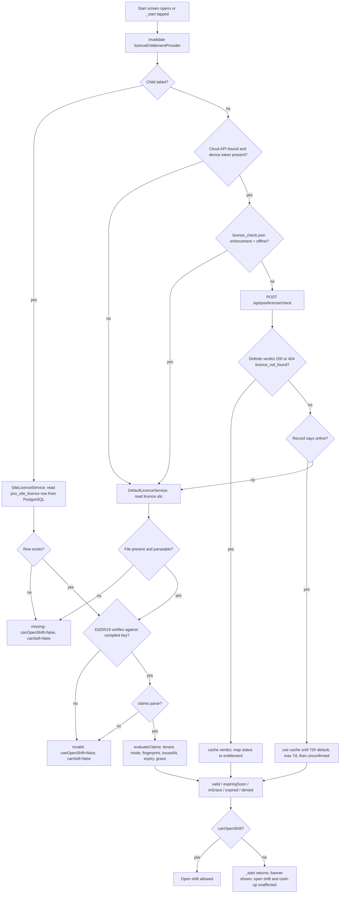

# Licensing — discovery audit (code-level)

Scope: `lib/features/licensing/**`, `bin/pos_licence.dart`, `lib/data/postgres/postgres_site_licence.dart`,
`lib/core/security/*`, licence calls in `lib/data/cloud/*`, licence providers in `lib/app/providers.dart`,
the licence step in `lib/features/setup/**`, and `test/**/licen*`.

Evidence labels: **[CODE]** read in source; **[ASSUMED]** inferred / not verifiable here; **[OBSERVED]** none
(no Dart/Flutter/PostgreSQL in the sandbox; nothing was executed). Tests are "exists (not executed here)".
Comments, UI strings and `docs/pos/09-licensing.md` were not treated as proof.
No key material is reproduced in this file.

## 1. Executive answers

| Question | Answer | Status | Evidence |
|---|---|---|---|
| Are offline licence **files** (`.xlic`) supported? | The parse, verify, evaluate and store path exists and is reachable only from the cloud bootstrap bundle and tests. **No UI entry point imports a file.** Strings still say "Activate from file", but no such control exists (see 5.2). | PARTIAL | [CODE] `licence_service.dart:140-185` (`activate(fileContents:)`); only caller with `fileContents` is `providers.dart:623`; `setup_controller.dart:1096,1136` takes the param but `setup_panes.dart:674` calls `activateLicence()` with none; no `FilePicker` use in `lib/features/licensing/` or setup |
| Are offline **activation keys** supported (a key verified locally, no network)? | No. A typed key is only ever exchanged at the platform (`POST /api/pos/licence/activate`). Nothing verifies a key offline. | NOT_IMPLEMENTED | [CODE] `licence_service.dart:213-225`, `platform_licence_api.dart:74-160`; grep `activationKey\|offlineKey\|challenge\|response code` found nothing |
| Offline **renewal**? | No offline renewal flow. Renewal = re-run key activation (needs the platform) or replace `licence.xlic` on disk by hand. A Check for renewal button re-posts the typed key. | NOT_IMPLEMENTED (file path PARTIAL, see above) | [CODE] `licence_screen.dart:75-105` |
| Signature scheme | Ed25519 detached signature over the exact decoded payload bytes. No canonicalisation step. Algorithm fixed in code, not selectable by the file. | IMPLEMENTED | [CODE] `license_verifier.dart:116-147` |
| Public key | Release builds: injected via `--dart-define=XORDER_LICENSE_PUBLIC_KEY_B64` + `XORDER_LICENSE_KEY_ID`; build fails closed if absent. Debug/profile: an embedded **development** public key (confirmed present, not reproduced). | IMPLEMENTED | [CODE] `license_keys.dart` |
| Private key in repo? | Not found. Only references to env var names (`POS_LICENCE_KEY`). `keygen` prints, never writes to disk. Caveat: grep by variable name, not an entropy scan of every file. | IMPLEMENTED | [CODE] `bin/pos_licence.dart` `_keygen`; grep of repo |
| Device binding | Optional fingerprint pin; SHA-256 of a constant salt + a random UUID kept in `config.json`. Not hardware-derived. Copyable. | PARTIAL | [CODE] `file_license_store.dart` `TerminalIdFingerprint` |
| Terminal-count enforcement | Only for **child tablets** joining a shared DB at setup, counting `pos_terminals`. Main device and cloud path: not enforced by the POS. | PARTIAL | [CODE] `setup_controller.dart:1742`; `providers.dart:1825` |
| Feature flags / plan / `branch_ids` / `max_offline_days` | Parsed, **not enforced** anywhere. `plan` is display only. | NOT_IMPLEMENTED (parse only) | [CODE] grep over `lib/` (only `max_users` and `max_terminals` are read outside `license.dart`) |
| `max_users` | Enforced in the staff-management **UI** only (active staff count at "add user"). No repository or DB-level check. | PARTIAL | [CODE] `management_staff_pane.dart:277` |
| Revocation | Online only: HTTP 403 on activate maps to `LicenceRevoked`; `/license/check` returns `suspended`/`expired` etc. An offline file has no revocation. | PARTIAL | [CODE] `platform_licence_api.dart:119`, `online_verdict.dart` |
| Clock-rollback protection | None for the file path. | NOT_IMPLEMENTED | [CODE] `DateTime.now` injected as `clock`; no stored high-water mark (grep) |

## 2. Licence file format

**Container** (`LicenseFile`, `license_verifier.dart:13-61`), JSON text, conventional extension `.xlic`, stored as `licence.xlic`
in the application-support directory (`file_license_store.dart:25-28`):

| Field | Meaning | Signed? |
|---|---|---|
| `payload` | base64url (padding optional) of UTF-8 JSON claims | yes (it is the signed message) |
| `signature` | base64url Ed25519 signature (64 bytes) | n/a |
| `key_id` | defaults `v1`; used only to word the error ("other key" vs "edited") | **no** |
| `issuer_public_key` | optional base64; used only by non-release builds | **no** |

Shaped like a JWS but there is no `alg` field, so "alg: none" does not apply [CODE]. `key_id` is **not** used to select
the key: verification always tries the single compiled-in key (plus, in non-release builds, `issuer_public_key`).

**Claims** (`LicenseClaims.fromJson`, `license.dart:143-170`):

| JSON key | Default if absent | Enforced where |
|---|---|---|
| `license_id` (required), `tenant_slug` (required), `tenant_name` | `''` | tenant compared in `evaluateClaims` |
| `issued_at`, `expires_at` (required, ISO-8601) | throws -> `LicenceFileDamaged` | state machine, section 8 |
| `grace_days` | 14 | grace end = expiry + N days |
| `warn_days` | 30 | `expiringSoon` banner |
| `max_terminals` | 1 | child-join count, DB-host choice, publish gate (section 9) |
| `max_users` | null = unlimited | staff UI only |
| `features` (list) | empty | **not enforced** |
| `modes` (list of wire names) | `{cloud}` in the constructor; but `fromJson` builds an **empty set** when absent, and empty means "every mode" | `evaluateClaims`, setup wizard |
| `fingerprints` | empty = unpinned | `evaluateClaims` |
| `branch_ids` | empty = all | **not enforced** |
| `plan` | null | display |
| `max_offline_days` | null = unlimited | **not enforced** (code comment says so) |
| `license_version` | 1 | newer than 1 is evaluated, not denied |

Mode names: `cloud`, `offline`; legacy `branch_server` and `standalone` map to `offline` (`deployment.dart:44-56`) because
already-signed licences carry them. "Lifetime": no lifetime claim exists in the signed file. `lifetime` exists only in the online
verdict (`online_verdict.dart:44`). A "never expires" file would simply need a far-future `expires_at`.

Doc/code note: in `LicenseClaims` the constructor default `modes = {cloud}` differs from `fromJson`'s empty-set-when-absent
result; for parsed files, absent `modes` therefore means all modes [CODE].

## 3. Generation (`bin/pos_licence.dart`)

Commands: `keygen`, `issue`, `inspect` [CODE].

- `keygen`: new Ed25519 pair, **printed to stdout**, not written to disk. No key file in the repo.
- `issue`: private key from `POS_LICENCE_KEY` (or `--private-key`); builds `LicenseClaims`, `payload = base64url(utf8(jsonEncode(claims.toJson())))`,
  signs `base64url-decode(payload)` with Ed25519, writes `LicenseFile.serialize()`. Options map to tenant, name, days, issued, expires,
  grace, warn, max-terminals, modes, features, fingerprints, plan, id, key-id.
  **Gaps vs the parser:** it cannot set `max_users`, `max_offline_days`, `branch_ids` or `license_version`. A CLI-issued file therefore
  always has `max_users: null` (unlimited). `toJson` still emits those keys as null/default.
- `inspect`: prints claims; verifies only when a public key is passed.
- The production issuer is stated to be the Laravel platform (`LicenceIssuer::mint`, `LICENCE_SIGNING_KEY`). That code is **not available** here: UNKNOWN. The
  CLI is a dev/offline tool; whether it is used for production issuance is not determinable from this repo.
- `integration_test/support/e2e_licence.dart` signs real fixtures using the `POS_LICENCE_KEY` environment variable (no key committed) [CODE].

## 4. Signature and verification

- Algorithm: `cryptography` package `Ed25519().verify(message, signature)` where message = base64url-decoded `payload` bytes. The claims are then
  parsed from the **same bytes** (`claimsOf`). There is no re-serialisation, so no canonical-JSON requirement and no parse differential between signed
  and used bytes [CODE: `license_verifier.dart:116-161`].
- Code path: `DefaultLicenceService.current/evaluate` -> `LicenseVerifier.evaluate` -> `verifySignature` -> `claimsOf` -> `evaluateClaims(now = clock())`.
- Key source: `LicenseKeys.current` (`license_keys.dart`). `XORDER_LICENSE_PUBLIC_KEY_B64` (and `XORDER_LICENSE_KEY_ID`) are `String.fromEnvironment`; if
  empty and `dart.vm.product` is true, a `StateError` is thrown (the licence provider fails to build) [CODE]. If empty in a non-product build, the embedded
  development key and id `development-v1` are used. **Confirmed: a development verification key is embedded** (reviewed, not reproduced). It is the public half of the platform's dev signing key per the
  comment; that provenance is [ASSUMED]. The release workflows require the two defines (`.github/workflows/windows-installer.yml:72-76`, `scripts/package_macos.sh:47-56`).
  Production key injection = set repo variables `XORDER_LICENSE_PUBLIC_KEY_B64` / `XORDER_LICENSE_KEY_ID`, passed as `--dart-define` at build.
- **Issuer-key trust in non-release builds:** `LicenseVerifier.trustIssuerKey = !dart.vm.product`. In such builds, a file failing against the compiled key is
  re-verified against the **unsigned** `issuer_public_key` field in the file itself. This means any dev/debug build accepts a self-signed licence. Release builds
  never read that field. Risk: if a build intended for customers is ever produced without `dart.vm.product` (e.g. a profile build; not verified whether `dart.vm.product` is false in profile mode), the licence is trivially forgeable. Test: `licence_signing_test.dart:104` (exists, not executed here).
- Child tablets verify with the same verifier (`SiteLicenceService`).
- `FakeLicenceService` (accepts any key, placeholder zero signature) exists in `licence_service.dart:259` but `licenceServiceProvider` (`providers.dart:1633`) does not bind it; searched for other uses: tests only [CODE].

## 5. Activation

### 5.1 Online activation by key [IMPLEMENTED, CODE]

`POST {base}/api/pos/licence/activate` body `{key, deployment_mode, fingerprint, tenant_slug?}`, Accept JSON (`platform_licence_api.dart:89-103`). `{base}` resolution order
(`providers.dart:1688-1704`): operator-typed `licenceServerUrl` -> terminal `baseUrl` -> `PlatformEndpoint.base` (`--dart-define=XORDER_PLATFORM`, else
`http://localhost:8080` in debug, `https://xorder.io` otherwise; `platform_endpoint.dart`). **Doc/code mismatch:** the `PlatformEndpoint` doc says the operator must not be able
to repoint licence checking; the licence step exposes an editable "licence server" address in every build (`setup_panes.dart` ~655, `setLicenceServer`). In a release build the signature still has to verify against the compiled key, so redirecting the fetch cannot mint a valid licence; it can only deliver a genuine file from another server or deny service.

Reply mapping: 200 -> parse as `LicenseFile`; 404 -> not recognised (names address); 403 -> revoked; 429 -> throttled; other -> refused; network -> unreachable.
Claimed vs implemented: the platform side of `/licence/activate` is UNKNOWN here (documented in `docs/coordination/BACKEND_TO_POS.md` under POS-BE-015 as READY; not evidence).
Activation response `enforcement` is not read from the activation body by `LicenseFile.tryParse`; only the bootstrap bundle path records it (`providers.dart:631-640`).

### 5.2 File import [PARTIAL]

`activate(fileContents:)` parses -> `evaluate` -> optionally `store`. Reached by the cloud bootstrap bundle's `licence` block (`cloud_provisioning_repository.dart:368-375` -> `providers.dart:617`).
No screen offers file import. `licence_screen.dart` has key entry + "Check for renewal"; the setup pane has "Activate online" only and, when no transport exists,
shows text that says to ask the supplier for a different build (`licenceOfflineHelp`). Strings `noLicenceServer`/`notALicenceFile` and a comment in `deployment.dart:182` mention "Activate from file"; no such widget exists
(grep `activateFromFile|importLicence|FilePicker` in licensing/setup). `file_picker` is a dependency, used elsewhere (backup, menu import). So an air-gapped site today cannot install a licence through the UI. A hand-copied
`licence.xlic` into the app-support dir would be read at boot (`FileLicenseStore.read`) [CODE]; but the setup wizard (step 1 is the licence) cannot be passed without activating, since `canAdvance` for the licence step needs an entitlement (`setup_state.dart:488`), unless the licence was restored from disk (`restore`) [CODE, partially inferred].
Test coverage: `licence_renewal_test.dart:123` (garbage file rejected, via the service); `:183` asserts no "Import licence file" control when no transport.

### 5.3 Offline activation keys / offline renewal [NOT_IMPLEMENTED]

No challenge/response, no key-embedded licence, no offline verification of a typed string. Offline-mode tills (`DeploymentMode.offline`) still activate and renew against the hosted platform; `LicenceService.canActivateOnline` doc says as much.

### 5.4 Persistence timing

Wizard activation uses `persist: false`; the file is held in `SetupDraft.licenceFile` and written by `SetupController.complete()` **before** the config file (`setup_controller.dart:879-881`). Renewal from the licence screen persists immediately, then calls `SiteLicencePublisher.publish()`.

## 6. Diagrams

### 6.1 Validate-on-start



### 6.2 Online activation (setup wizard)

```mermaid
sequenceDiagram
    participant Op as Installer
    participant W as SetupController
    participant L as LicenceActivation.activate
    participant API as PlatformLicenceApi
    participant P as Platform (not in repo)
    participant V as LicenseVerifier
    participant FS as licence.xlic
    participant DB as pos_site_licence
    Op->>W: type key, press Activate online
    W->>L: activate(key, persist=false)
    L->>API: fetchByKey(key, fingerprint)
    API->>P: POST /api/pos/licence/activate {key, deployment_mode, fingerprint, tenant_slug?}
    P-->>API: 200 {payload, signature, key_id, issuer_public_key?}
    API-->>L: LicenseFile
    L->>V: evaluate (signature, tenant, mode, fingerprint, dates)
    V-->>L: LicenseEntitlement
    L-->>W: claims, entitlement, file (held in SetupDraft)
    W->>W: adopt tenant and mode from claims; mode screen offers only licensed modes
    Note over W: further wizard steps, then complete()
    W->>FS: store(file) before writing config.json
    Note over FS,DB: Later, start screen: SiteLicencePublisher.publish()
    FS-->>DB: INSERT/UPDATE pos_site_licence (only if max_terminals > 1)
```

## 7. Device binding

- `TerminalIdFingerprint.value()` = `sha256("xorder-pos-terminal:" + installationId)` hex; empty string when no id (`file_license_store.dart`). [CODE]
- `installationId` is a UUID v4 generated on first run (`providers.dart:2123`), persisted in `config.json` via the terminal profile, preserved by `TerminalProfileController.reset()`.
  Old builds used `terminal_id` as the identity (`terminal_profile.dart:87`).
- No hardware identifiers are read, although comments in `license_store.dart` say "derived from hardware identifiers" (**comment/code disagreement**).
- Spoofing: copy `config.json` (or edit `installation_id`) to another machine and the fingerprint matches; the salt is a public constant in the binary. Also, deleting the config
  produces a new fingerprint (a pinned licence then fails, `terminalNotLicensed`). Test: `licensing_test.dart:265` pin honoured (exists, not executed here).
- Scope: pin is per machine (set of fingerprints), but `fingerprints` is empty unless the issuer sets it. Whether the platform sets it on activation (the POS sends `fingerprint` "to bind") is UNKNOWN. Child tablets skip the pin (`viaMainDevice`).
- The same fingerprint is sent to the cloud provisioning and `/license/check` calls (`online_licence_service.dart:127`).

## 8. Expiry, grace, renewal, tamper states

`evaluateClaims` order [CODE: `license_verifier.dart:207-297`]: tenant -> mode -> fingerprint -> `now < issuedAt` (notYetValid, deny) -> before expiry (valid or expiringSoon within `warn_days`) -> before `expiry + grace_days` (inGrace: sell and open shift allowed, configuration frozen) -> expired (`canOpenShift=false`, `canSell=true`). Deny states set `canSell=false`.
Cash-up, reprint, export are hard-coded true (`license.dart:246-250`).

| State | canOpenShift | canSell | canChangeConfiguration |
|---|---|---|---|
| valid / expiringSoon | yes | yes | yes |
| inGrace | yes | yes | no |
| expired | no | yes | no |
| missing, invalid, tenantMismatch, modeNotLicensed, terminalNotLicensed, notYetValid | no | no (by flag) | no |
| online: suspended, expired, not_yet_valid, licence_not_found, unconfirmed | no | yes | no |

**Where the flags are enforced:** only `StartScreen._start` and the banner (`start_screen.dart:67-68,150`). `canSell` and `canChangeConfiguration` are not read by any sales, payment or settings code (grep `canSell|canChangeConfiguration` outside licensing/setup: no hits); a till already past the start screen keeps selling regardless. Router has only the `/licence` route, no guard (`router.dart:173`). The start screen also treats a still-loading entitlement as permitted (`start_screen.dart:149-150`). So the real gate is "cannot open a **new** shift", and a pre-opened shift never ends.
Online verdict cache: default 72h, hard cap 7d (`online_verdict.dart:27-31`); backwards clock treated as inside the window (`:211-216`). Test: `online_licence_test.dart:188-222` (exists, not executed here).
Renewal: key re-activation or "check for renewal" (the same call), then `invalidate` and re-publish to children. Grace and warn windows come from the signed claims.

## 9. Mode selection, multi-device, site licence

- **Licence selects mode:** licence is wizard step 1; `_adopt` takes `tenant_slug` and moves the draft to a mode the licence covers (`_coveredMode`); the mode screen shows only `licensedModes`, and is skipped when only one is covered (`setup_state.dart:166,245,483`; `setup_controller.dart:311-317`). `max_terminals > 1` is what permits a non-local database host (`setup_controller.dart:1249`, `setup_state.dart:182`). Tests: `licence_decides_mode_test.dart` (exists, not executed here).
- **Site licence in PostgreSQL:** table `pos_site_licence` (migration 43, `migrations.dart:3906`): `restaurant_id PK`, `payload`, `signature`, `key_id`, `mode` (CHECK in `cloud`,`offline`), `published_at`. Written by the main device (`PostgresSiteLicence.publish`, upsert) from `StartScreen` and after renewal, **only if `max_terminals > 1`**. Children read it, verify the signature with their own compiled key, judge it with `viaMainDevice=true` (fingerprint pin skipped). The `pos_till` role has SELECT/INSERT/UPDATE (`migrations.dart:3926`, `local_bootstrap.dart:827`). Child tablets cannot activate (`canActivateOnline=false`).
  Local file `licence.xlic` is the main device's store; the DB row is a copy for children. Tests: `site_licence_postgres_test.dart` (integration, self-skips without `POS_PG_HOST`; not executed here).
- **Terminal counting:** only in `registerTerminal` for a child (`setup_controller.dart:1742`: `site.terminalCount >= maxTerminals` where `terminalCount` = `count(*)` of `pos_terminals` rows for the restaurant, `postgres_site_licence.dart:46`). Main device not counted; cloud path relies on the platform's `MAX_TERMINALS_EXCEEDED` warning, shown as a notice (`cloud_provisioning_repository.dart:429`), not a block. Bypass: insert a `pos_terminals` row directly, or run a second main device against its own DB. Enforced once, at join time, not at sale time.
- **max_users** (staff UI only) counts active staff from the DB on the "add" button; direct DB inserts bypass it.

## 10. Tamper-resistance analysis

| Attack | Result | Notes |
|---|---|---|
| Edit `pos_site_licence` row (change expiry/payload) | Fails: signature over payload no longer verifies on children | [CODE]. Editing the `mode` column is **not signed**: a child takes its mode from the row (`site.mode`, `setup_controller.dart:1749`), though the licence's `modes` claim is still checked against it by `evaluateClaims`. Deleting the row stops children (missing). Replaying an older valid row (longer remaining term is not possible; an old row has an earlier expiry) is possible but only restores an earlier term |
| Edit `licence.xlic` claims | Fails verification | [CODE] `licence_signing_test.dart:215` |
| Delete `licence.xlic` / `licence_check.json` | File: till reads "missing" and cannot open shifts. Cache deleted: loses fallback verdict, no bypass | [CODE] |
| Set `licence_check.json` `enforcement` to `offline` | The till then uses the signed file and never calls `/license/check`, so a server-side suspension is never heard. Defeats online revocation. File is a plain JSON, unsigned | [CODE] `online_licence_service.dart:73` |
| Edit cached `licence_check.json` verdict to `valid` with large `cache_seconds` | Capped at 7 days from `checked_at`, but `checked_at` is also in the file: editable, so the cached "valid" can be extended indefinitely while offline | [CODE]; plausible, not exercised |
| Change system clock backwards | Extends an expired file licence indefinitely; no high-water mark or monotonic check. Online cache explicitly tolerates backward clock | [CODE] |
| Replace the public key in the binary | Defeats all checks. Release builds fail closed only when the define is missing, not when the binary is patched | [CODE]; acknowledged by the code's own comments ("commercial hygiene, not security") |
| Debug/profile build with self-signed licence | Accepted via `issuer_public_key` (non-release) | [CODE] |
| Copy `licence.xlic` to another machine | Works when the licence is unpinned (`fingerprints` empty). If pinned, copy `config.json` too (UUID, constant salt) | [CODE] |
| Wizard / DB admin: raise `max_terminals`? | Not possible without the key; but `terminalCount` is just a DB count | [CODE] |
| Admin sets own `licenceServerUrl` | Cannot forge a licence (signature), can deny service or deliver a genuine file | [CODE] |
| Revoked licence while offline | Not detectable; only the signed `expires_at` bounds use | [CODE] |

Net: DB/file edits cannot extend a signed term except through the clock, the unsigned verdict cache, or the binary. Server-side enforcement (cloud) is the stated backstop and is UNKNOWN in this repo.

## 11. What the POS calls vs what the backend must provide

| Endpoint | POS side | Status of POS code | Backend status |
|---|---|---|---|
| `POST /api/pos/licence/activate` | `platform_licence_api.dart:90` | IMPLEMENTED | UNKNOWN (documented as shipped in `BACKEND_TO_POS.md`) |
| `POST /api/pos/license/check` (device bearer) | `cloud_api.dart:224`, `online_licence_service.dart` | IMPLEMENTED, called on start screen | UNKNOWN; the doc says POS-BE-031, with the POS tolerating 404s |
| bootstrap bundle `licence` block | `bootstrap_bundle.dart:694`, `cloud_provisioning_repository.dart:368` | IMPLEMENTED | UNKNOWN |
| `GET /api/pos/licence/current` | none in `lib/` (grep) | NOT_IMPLEMENTED on POS | documented only |
| heartbeat (`/api/pos/terminals/heartbeat`) | `cloud_api.dart:219` | IMPLEMENTED; no licence use found | UNKNOWN |

## 12. Test inventory (exists, not executed here)

`licensing_test.dart` (signature, expiry, scope, legacy modes, claims version), `licence_signing_test.dart` (real Ed25519 fixtures, dev-issuer-key, key-id wording, edited term, unsigned file),
`offline_licence_activation_test.dart` (HTTP request shape, endpoint resolution, failure taxonomy, user cap), `licence_renewal_test.dart`, `licence_decides_mode_test.dart`, `online_licence_test.dart` (verdict mapping, cache window),
`test/data/site_licence_postgres_test.dart` (needs PostgreSQL). **No test found** for: clock rollback, tampered `licence_check.json`, `max_users` at a repository level, `features` enforcement (none exists), file-import UI (none exists). Note the file name `offline_licence_activation_test.dart` is misleading; it tests key activation via HTTP.

## 13. Open questions for the product owner

1. Is an air-gapped site a requirement? If so, file import UI and a clear offline renewal (file or short code) are missing.
2. Should an unsigned `enforcement: offline` or a hand-edited verdict cache be able to switch off online revocation?
3. Is `max_terminals` meant to be enforced for main devices and cloud tills?
4. Should `features`, `branch_ids`, `max_offline_days` be enforced or removed from the claim set?
5. Is `bin/pos_licence.dart` used for production issuance, or only the platform? (Its output cannot set `max_users`.)
