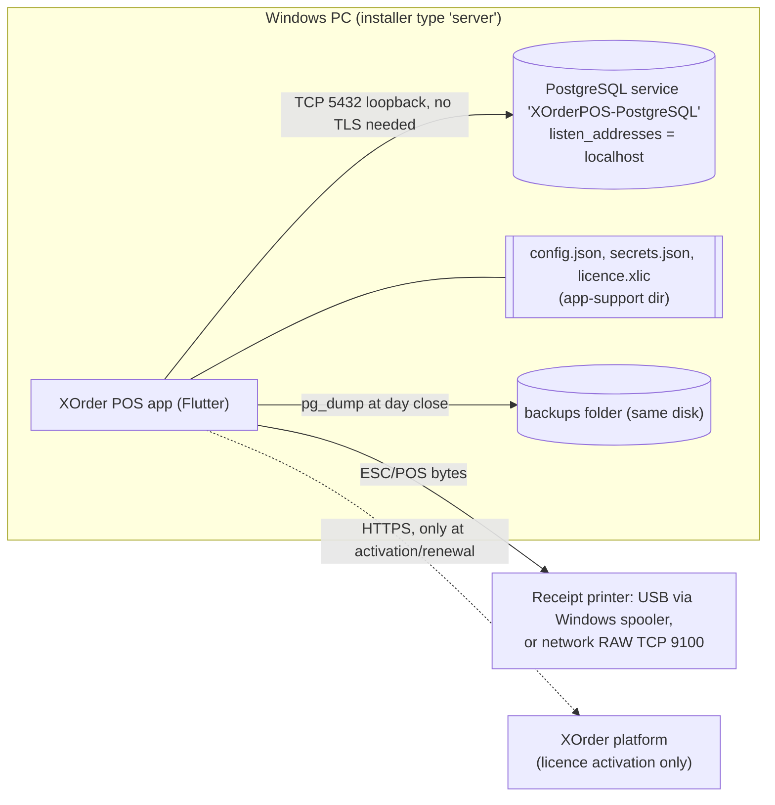
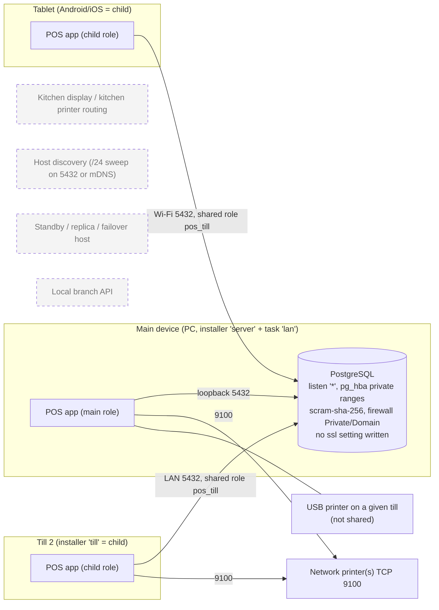
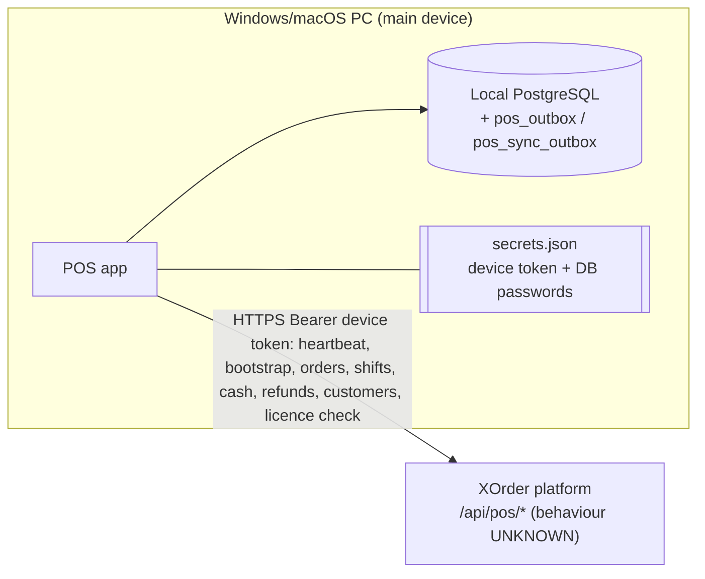
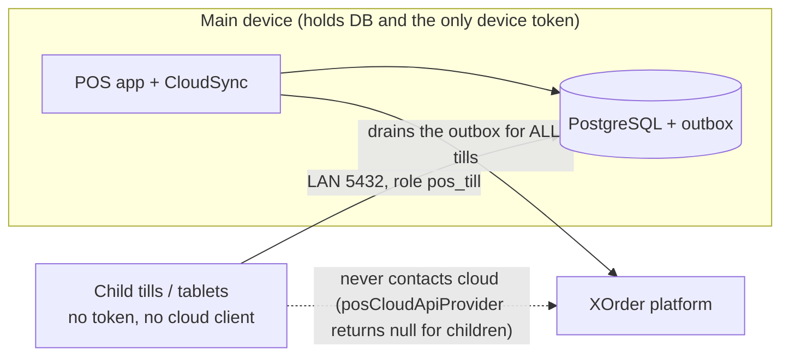

# Multi-device behaviour: local server, shared database, pairing, concurrency, device limits

Evidence levels: **[CODE]** read in source; **[ASSUMED]** inferred; **[OBSERVED]** none (no Flutter, Dart or PostgreSQL in the audit sandbox; no test was run). "Test exists (not executed here)" means the file was read, not run.
Status labels: IMPLEMENTED | PARTIAL | NOT_IMPLEMENTED | UNKNOWN.
Backend (Laravel API, admin panel, cloud) is not available: anything about it is UNKNOWN except the HTTP paths this client calls.

## 0. Summary

| Question | Answer | Status | Evidence |
|---|---|---|---|
| Does one device act as a local server? | Yes, as a role, not a process. A "main device" is the normal POS app plus a PostgreSQL service on the same machine. There is no separate API or server application. | IMPLEMENTED (as PostgreSQL host) | `deployment.dart:104-141`, `installer/xorder-pos.iss:97-102,150-173`, `installer/provision.ps1` |
| Do tills share one PostgreSQL directly, with no API? | Yes. Every till opens its own connection pool (max 4) to the main device's PostgreSQL using the Dart `postgres` driver. No HTTP layer between tills and the DB. | IMPLEMENTED | `pos_database.dart:273-296` |
| Discovery? | None. Manual host + port + password entry. No mDNS, no broadcast, no subnet sweep for the database. The docs plan a `/24` sweep on 5432 ("Find the main device"); it is not coded. Only printers are found by a sweep. | NOT_IMPLEMENTED | `setup_panes.dart:575-612`; `grep -rin "mdns\|nsd\|bonsoir\|multicast\|RawDatagramSocket\|DiscoveredSite" lib bin pubspec.yaml` finds nothing relevant; `network_printer_ports.dart:51` is the only sweep |
| Pairing? | Child: type host/port/password, then sign in as an existing manager (username + PIN) and register as one more terminal row. Cloud main: pairing code from dashboard, or platform sign-in. | IMPLEMENTED (manual) | `setup_controller.dart:1310-1370,1725-1790` |
| Authentication between devices? | There is none device-to-device. Device-to-DB: one shared PostgreSQL role `pos_till` (password in `secrets.json`) used by every till. Device identity (`terminal_id`) is a value the client writes itself. Device token (`device_token_vault`) exists only for main-device-to-cloud. | PARTIAL | Section 3 |
| If the DB host is down? | The till cannot sell, park, open a shift or read the catalogue. No local queue, no degraded mode. The payment screen restores the ticket and says it could not be recorded. | By design; no degradation | `payment_screen.dart:175-195`, Section 4 |
| Can secondary tills trade independently? | Not of the main device's database. They can trade independently of the internet, and of each other (own shift, own cashbox, own printer) while the main device and LAN are up. | PARTIAL | Section 5 |
| Device limit enforced by licence? | Checked once, in the wizard of the machine being added, by counting rows in `pos_terminals`. No database constraint, no runtime check, no server check in the offline path. Bypassable by anyone holding the till DB credential. | PARTIAL | Section 7 |
| Installed role concept? | Yes: `TerminalRole.main` / `child`, plus the Windows installer's `install-role.json` marker. | IMPLEMENTED | Section 8 |

## 1. Network topology as built

Legend. Solid box = coded and reachable from the UI. Dashed box (class `doc`) = mentioned in docs/comments, **not coded**. Every dashed box is also listed in the table after the diagrams.

### 1.1 Mode `offline`, one machine (default install)

### 1.2 Mode `offline`, shared LAN database (licence `max_terminals > 1`)

### 1.3 Mode `cloud`, one machine

### 1.4 Mode `cloud`, shared LAN database

[CODE] `providers.dart:655-664` (`config.isChild` returns null), `providers.dart:597-599` comment, `cloud_sync.dart:73-75`.
Consequences: the platform never sees child terminals (UNKNOWN how it attributes their sales; the order payload has no terminal field, `outbox_drain.dart:140-170`); the main device must be on for any sync to happen.

### 1.5 Things drawn dashed above, and why

| Box | Where it is documented | Code status |
|---|---|---|
| Host discovery (sweep or mDNS) | `docs/pos/10-setup-architecture.md` §10 plans a "Find the main device" TCP sweep on 5432; `08-postgres-lan.md` §9 discusses mDNS and rejects it as the only path | NOT_IMPLEMENTED. Searched `mdns`, `nsd`, `bonsoir`, `multicast`, `RawDatagramSocket`, `DiscoveredSite`, `findMainDevice`, `sweep` in `lib`, `bin`, `pubspec.yaml`. Only `network_printer_ports.dart` sweeps, and only for printers |
| Standby / failover DB host | `08-postgres-lan.md:55` says there is "no selling when the branch box is down" as a known limit | NOT_IMPLEMENTED: no replica, failover or second host setting exists in `DeploymentConfig` |
| Local branch API | `08-deployment-modes.md` (earlier idea: Laravel in docker as a branch box) | NOT_IMPLEMENTED in this repo; superseded by direct PostgreSQL (`deployment.dart` header text still mentions it, now stale) |
| KDS / kitchen display | `order_history_screen.dart:482` comment "until the KDS"; `10-setup-architecture.md:371` lists a `kds` module | NOT_IMPLEMENTED: `grep -rIn -i "kds\|kitchen display" lib` finds one comment only |
| Kitchen printer routing | none found in code | NOT_IMPLEMENTED: a "sent to kitchen" status exists on tickets (`sale_screen.dart:498`), but the only print path is the till's single configured printer (`PrinterConfig`, one `name`) and receipts. Not traced beyond that |

## 2. Hardware network links (`lib/data/hardware`)

| Link | Status | Behaviour | Evidence |
|---|---|---|---|
| Network thermal printer, RAW TCP 9100 | IMPLEMENTED | `Socket.connect(host, 9100, 5 s)`, write bytes, flush, destroy. Return `false` on socket error or timeout. No printer status read-back, so "sent" is not "printed". | `network_printer_ports.dart:75-120` |
| Printer discovery | IMPLEMENTED | Sweeps every host `1..254` of each local interface's /24 on port 9100 with a 300 ms timeout. Only a /24. | `network_printer_ports.dart:51-70` |
| USB printer via OS spooler | IMPLEMENTED (Windows `winspool` RAW; other OS backend per `SpoolerBackend.forThisPlatform()`) | Printer is local to the till that owns it; another till cannot use it. | `spooler_printer_ports.dart`, `winspool.dart` |
| Transport choice | IMPLEMENTED | Name shaped like `ip` or `host:port` means network, else USB. | `printer_config.dart` `transportOf` |
| Printer config scope | per terminal | Stored in that till's `config.json` (`SavedTerminalConfig.printer`), not in the shared database. Each till names its own printer. | `terminal_config.dart:60` |
| Cash drawer | IMPLEMENTED via printer | Drawer kick is an ESC/POS command inside the print job. `pos_cash_drawers` table exists with a nullable `terminal_id`, but **no repository reads or writes it** (`grep pos_cash_drawers lib` finds migrations and grants only). | `migrations.dart:1440`, `local_bootstrap.dart:749,1061` |
| Failed print | PARTIAL | Receipt jobs are queued in `pos_print_jobs` (bytes stored; status pending/printed; a trigger forbids re-queueing a printed job). The drain is **per terminal** (`terminal_id`), so a receipt stays with the till that took the money. Test exists (not executed here): `print_queue_schema_test.dart`. | `migrations.dart:3163-3245`, `postgres_print_queue_repository.dart` |
| Barcode scanner | UNKNOWN | `scannerAttached` flag in setup draft; no network link. | `setup_state.dart` |

## 3. Authentication and transport

### 3.1 Device to database

| Item | Finding | Evidence |
|---|---|---|
| DB roles | `pos_admin` (owns DB, CREATEDB; used by Management), `pos_till` (column-scoped grants; no DELETE on orders/outbox/shifts), `pos_backup` (member of `pg_read_all_data`; read-only), `postgres` superuser (installer only). | `local_bootstrap.dart:296-306`, `provision.ps1:123-130` |
| One role for all tills | **Every till uses the same `pos_till` role and password.** A single till cannot be revoked at database level; a leaked `secrets.json` on any till is a credential for the entire shared DB. | `deployment.dart:211`, `providers.dart:2146-2163` |
| Where passwords live | `secrets.json` in app-support, JSON, plaintext, `chmod 600` on POSIX, per-user-profile ACL on Windows. Keys: `pos_till_database_password`, `pos_cloud_device_token`, `pos_backup_database_password`, `pos_admin_database_password`. Documented owner decision to avoid the macOS keychain prompt; the code comments elsewhere still say "OS keystore". Not reproduced here. | `file_secret_store.dart` header and constants |
| Admin password on child tills | The `pos_admin` password is stored too (`adminDbSecretStoreProvider`), so any till that has been used for Management holds the schema owner's password in `secrets.json`. | `file_secret_store.dart` (adminPasswordKey), `providers.dart:3075` |
| Terminal identity to DB | `terminal_id` is read from the till's own `config.json` and written into every row by the client (`PosWriteContext`). The DB does not tie `terminal_id` to the connecting role. `pos_till` can INSERT into `pos_terminals`. Any till can write rows labelled as another terminal. | `providers.dart:2178-2201`, `postgres_orders_repository.dart:21-41`, `local_bootstrap.dart:821` |
| Cashier auth | PIN checked **client-side**: the till reads `pin_salt`/`pin_hash` from `pos_staff` (till has SELECT) and compares. PINs are exactly 4 digits, PBKDF2-HMAC-SHA256, 120,000 iterations. With read access to the hashes (the till credential), 10,000 candidates is a trivial offline search. [CODE] for design; exploitation [ASSUMED]. | `pin_hash.dart:25,38`, `postgres_directory_repositories.dart:151-178` |
| TLS | `sslMode` is `disable` when the host is loopback, or when the host is a private address AND the operator ticked "trust" (`verifyTls = false`); otherwise `verifyFull`. The Windows installer's `-Lan` option writes `listen_addresses='*'`, `pg_hba` private ranges and a firewall rule but **no `ssl = on` and no certificate**. So the default LAN deployment is plaintext (the operator must tick the trust box, else the connection fails verification against a server with ssl off). Passwords are hashed by scram-sha-256 on the wire; order data is not encrypted. | `pos_database.dart:293-295`, `deployment.dart:350-351`, `provision.ps1:159-176` |
| Network exposure | Firewall rule limited to Private/Domain profiles; `pg_hba` lines allow `10/8`, `172.16/12`, `192.168/16`. Not limited to known till IPs. | `provision.ps1:161-176` |
| Test | `test/data/till_grants_enforced_test.dart`, `admin_grants_enforced_test.dart`, `deployment_transport_test.dart` (not executed here). |  |

### 3.2 Device to cloud (main device only)

| Item | Finding | Evidence |
|---|---|---|
| Device token | Obtained by claim (`POST /api/pos/terminals/claim`) or register; stored in `DeviceTokenVault` (memory) and `secrets.json`; sent as `Authorization: Bearer`. | `cloud_api.dart:84,160,246`, `device_token_vault.dart` |
| Revocation | HTTP 401 on heartbeat sets `terminalRejectedProvider`; drain stops; sales continue. | `cloud_sync.dart:96-101`, `providers.dart:1064` |
| Reset does not clear the token | `TerminalReset.run()` clears config, wizard progress, DB and admin secrets; it does not call `DeviceTokenVault.forget()`. [CODE: `providers.dart:2066-2094`] | |
| Platform URL scheme | HTTPS required unless the host is private (`isPermittedPlatformUrl`). | `deployment.dart:273-279` |
| `device_token_vault` for children | Not used. Children hold no token. | `providers.dart:655-664` |

### 3.3 Device to device

None. No peer socket, no shared secret, no message passing between tills. All coordination is through rows in the shared PostgreSQL. [CODE: searched `ServerSocket`, `RawDatagramSocket`, `LISTEN`, `NOTIFY` in `lib`; only `Timer.periodic` found is the ETA reconciler at `providers.dart:2804`.]

## 4. When the DB host is unavailable

| Component | Behaviour | Evidence |
|---|---|---|
| Sale settlement | Fails. The ticket is restored to its pre-payment state and the cashier sees "payment could not be recorded". | `payment_screen.dart:175-195` |
| Parking a table ticket | `park()` returns `false`, the live ticket stays in memory; the floor does not change. | `providers.dart:933-945` |
| Floor/catalogue/session reads | Providers are `FutureProvider`s over repositories; failure becomes an error state; parked-ticket load swallows errors and returns an empty floor (`PostgresParkedTickets.load` catch). | `postgres_parked_tickets.dart:~40-60` |
| Status indicator | A pill driven by `SELECT 1` probe; refreshed only by tap (no timer). Cloud mode shows the sync pill instead. | `providers.dart:475-483`, `pos_top_bar.dart:60-90` |
| Pool settings | 5 s connect, 10 s query, 4 connections, no retry loop. | `pos_database.dart:283-292` |
| Outbox | Lives in the same DB, so it is also unreachable; the main device's cloud drain also stops. | |
| Backup | Needs the DB to run `pg_dump`; fails and records a failure row (which also needs the DB). | `backup_service.dart` |
| Local fallback store | None. There is no SQLite, no write-ahead log, no second store (`grep sqflite lib` empty, per CLAUDE.md; `08-postgres-lan.md:55` acknowledges this). | |
| Failover | None. | Section 1.5 |

So on the main device, "main device off" equals "branch cannot trade", for every till including the main one if the PostgreSQL service is stopped. A secondary till does **not** degrade into an offline mode of its own.

## 5. Can secondary tills trade independently?

Independently of the cloud: yes (the DB is local to the LAN). Independently of the main device: no. Among themselves they are independent in the following ways [CODE]:

| Resource | Per till? | Mechanism |
|---|---|---|
| Shift | yes | `pos_shifts_one_open_per_terminal` partial unique index on `terminal_id WHERE closed_at IS NULL` (`migrations.dart:323-324`); a shift query is by terminal id (`postgres_shift_repository.dart:52`) |
| Cash drawer and cash-up | yes via shift | `expected_cash` etc. stored per shift; `pos_cash_movements.terminal_id NOT NULL` (`migrations.dart:1503`). The separate `pos_cash_drawers` table is unused by code |
| Receipt printing | yes | printer name per till, print jobs keyed by `terminal_id` |
| Invoice numbers | no, shared | one sequence per `(restaurant, branch, year)`, row lock (Section 6) |
| Business (trading) day | no, shared | `pos_business_days_one_open` allows one open day per branch (`migrations.dart:1486-1488`); closing the day is a branch-wide act and day close blocks on open shifts unless forced with a reason |
| Parked table tickets | shared table, no live refresh | Section 6 |
| Catalogue, staff, settings | shared | read from the one DB |
| Backup | per machine that closes the day | Section 6.4 |

## 6. Concurrency

### 6.1 Order numbers

[CODE] `_nextInvoiceNumber` (`postgres_orders_repository.dart:391-440`): inside the sale transaction, `INSERT ... ON CONFLICT DO NOTHING` the sequence row, `SELECT ... FOR UPDATE`, increment, format `prefix-period-value`. All tills of a branch serialize on that one row, which is correct and adequate at restaurant volumes. A replay with the same `client_transaction_id` finds the existing order first and consumes no number (`:62-85`). Test exists (not executed here): `test/data/postgres_integration_test.dart:152` "concurrent settlements never share an invoice number".

Caveat: in cloud mode with **each till on its own local PostgreSQL** (the single-machine shape), each DB has its own sequence with the same branch prefix, so two tills can issue the same local number. The code accepts this and stores the platform's number separately in `server_invoice_number` (`outbox_drain.dart:402-415`). Under the offline mode with separate DBs per till, the numbers can duplicate within a branch with no reconciliation. [CODE]

### 6.2 Tables and open tickets

| Aspect | Finding | Evidence |
|---|---|---|
| Where open tickets live | In-memory per app, plus a persisted copy in `pos_parked_tickets` (jsonb payload, one row per `(restaurant, table)` via unique index). | `migrations.dart:650-662,3049-3056` |
| Locking | None. No advisory lock, no `FOR UPDATE`, no version column on parked tickets. | `postgres_parked_tickets.dart` |
| Write rule | `INSERT ... ON CONFLICT (restaurant_id, table_id) DO UPDATE` : **last writer wins**. If till A and till B both park table 5, B's payload replaces A's silently. | `postgres_parked_tickets.dart:~75-95` |
| Visibility to other tills | Hydrated once when `OpenTicketsController` is first built (`_hydrate`, `providers.dart:900-925`), merged into local memory. No polling, no LISTEN/NOTIFY, no timer. Another till's newly seated table does not appear until this till restarts. [CODE: searched `LISTEN`, `NOTIFY`, `Timer.periodic`, `Stream.periodic` in `lib`] | |
| Delete on settle | `DELETE ... WHERE restaurant_id=@r AND (client_transaction_id=@txn OR (@table IS NOT NULL AND table_id=@table))`. So when till A settles its own ticket on table 5, it also deletes whatever ticket is parked on table 5 at that moment, including one till B parked after A. Order commit is unaffected; B's unpaid ticket row is lost from the database (B still holds it in memory until restart). | `postgres_parked_tickets.dart:~110-125`, `providers.dart:970-990` |
| Double-seating | Possible: nothing prevents two tills selling the same table concurrently; both settlements succeed as separate orders. | `postgres_orders_repository.dart` has no table-occupancy check |
| Test | `test/data/parked_tickets_schema_test.dart`, `test/features/park_ticket_test.dart`, `open_tickets_test.dart` (not executed here). No test found for two tills on one table. |  |

### 6.3 Inventory

[CODE] `postgres_orders_repository.dart:716-830`: stock issue is written in the same transaction as the sale. `SELECT ... FROM pos_stock_levels WHERE branch_id AND product_id FOR UPDATE` (`:764-765`), then an INSERT into `pos_stock_movements` and an upsert of the level. Two tills selling the same stocked item serialize on that row. Negative stock is explicitly allowed ("declining a paid sale because receiving is late makes the financial ledger less truthful", `:722-724`). Only products flagged as stocked move stock; there is no recipe/BOM deduction. Test exists (not executed here): `stock_levels_test.dart`, `stock_items_test.dart`. Stock is not synced to the cloud in either mode.

Other shared-row guards [CODE]: refunds lock the order (`FOR UPDATE` in trigger `pos_refund_applied`, `migrations.dart:1246-1248`); supplier payments lock the invoice (`:2871`); one owner per restaurant by trigger (`:3743`); audit and backup tables append-only by trigger.
Management edits by two managers on two tills: a test file exists (`postgres_catalog_admin_test.dart:36` mentions it); the mechanism (revision numbers) was not traced here.

### 6.4 Backups in multi-till

`DayCloseDialog` calls `BackupService.take(trigger: dayClose)` on whichever till closes the day (`day_close_dialog.dart:67-72`). `pg_dump` runs on that machine through the read-only `pos_backup` connection (`providers.dart:3093-3140`) and writes to that machine's folder (default under `%LOCALAPPDATA%` / app-support, `backup_service.dart:654-675`). The dump needs the PostgreSQL client tools on that machine; the installer places them under `{app}\pgsql` only for the `database` component (`xorder-pos.iss:107-109`). Whether a "Till only" install can back up over the LAN is UNKNOWN [ASSUMED it cannot without tools; `PgTools.locate()` result decides].

## 7. Device limit via licence

| Where | What it checks | Enforced at | Bypass | Evidence |
|---|---|---|---|---|
| Licence claim `max_terminals` | integer, default 1 | n/a, data | forging requires the licence private key | `license.dart:87,151` |
| Wizard, main device | `max_terminals > 1` unlocks a non-local DB host field; otherwise host forced to `localhost` | UI only | hand-edit `config.json` (`database_host`) | `setup_controller.dart:332-336,1249`, `deployment.dart:432` |
| Wizard, child registration | `site.terminalCount >= maxTerminals` refuses with "all terminals taken" | client of the registering machine, before INSERT | no DB constraint or trigger (searched `migrations.dart` for triggers on `pos_terminals`: none); race between read and insert; direct SQL with `pos_till` credential; edited wizard | `setup_controller.dart:1742-1748`, `postgres_site_licence.dart:42-46` |
| Seat count query | `count(*) FROM pos_terminals WHERE restaurant_id = …`: counts **every** row, including never-claimed and retired ones. There is no deactivate or delete (no `is_active` column; till and admin roles have no DELETE grant on `pos_terminals`). A replaced or lost till permanently uses a seat unless an operator deletes the row as superuser. | | | `migrations.dart:152-165`, `local_bootstrap.dart:821` |
| Children's licence | A child reads the main device's `pos_site_licence` row; signature, tenant and dates are verified; fingerprint pin is skipped (`viaMainDevice`). | runtime | none needed: a child with a valid DB connection is licensed | `site_licence.dart:209-214`, `license_verifier.dart:234` |
| Fingerprint pinning | If the licence lists `fingerprints`, only terminals whose fingerprint matches pass (main device only). Fingerprint = SHA-256 of `"xorder-pos-terminal:" + installationId`, where `installationId` is a random id kept in `config.json`; **not hardware-bound**, so copying `config.json` clones identity. | runtime, at shift open | copy `config.json` + `secrets.json` | `file_license_store.dart:78-91`, `terminal_profile.dart:165-174` |
| One-open-shift-per-terminal | A cloned identity cannot open a second concurrent shift under the same `terminal_id` (unique index); different `terminal_id` values avoid that. | DB | | `migrations.dart:323` |
| Single-terminal licence (`max_terminals = 1`) | The main device does not publish its licence (`providers.dart:1825`), so a child cannot adopt one (`mainDeviceHasNoLicence`). A hand-configured second main-role install can still point at the same DB. | UI | edit `config.json`; a valid licence on that second machine is a separate matter | `child_terminal_test.dart:158`, `providers.dart:1825` |
| Runtime enforcement of terminal count on every start or sale | NOT_IMPLEMENTED (searched `maxTerminals`, `terminalCount`, `max_terminals` across `lib`, `bin`) | | | |
| Cloud mode | A cloud main device registers/claims on the platform; any seat limit there is UNKNOWN. Child seats in cloud mode are counted only locally (the platform does not know them). | | | `providers.dart:597-599` |
| Binary patching | Public key is compiled in; anyone willing to patch the app defeats all checks (stated by the vendor tool header). | | | `bin/pos_licence.dart:17-21` |

Verdict: device limit is **a soft, client-side check at pairing time**. It is not enforced by licence at runtime, by the database, or (for offline) by any server. Tests (not executed here): `child_terminal_test.dart:218` ("a tablet that would exceed the licence is refused before it..."), `site_licence_postgres_test.dart:109` (terminals are counted).

## 8. Installed role concept (`installed_role.dart`)

| Item | Finding | Evidence |
|---|---|---|
| Values | `TerminalRole.main` (`main_device`) and `child` (`client_terminal`). Not "server" vs "till": the machine that holds the database is still a full till. | `deployment.dart:123-141` |
| Installer marker | Windows installer, component `database` unselected ("Till only"): writes `%ProgramData%\XOrder POS\install-role.json` = `{"role": "client_terminal"}`. Selecting `database` deletes a stale marker. | `xorder-pos.iss:150-165` |
| Reading | `FileInstalledRole.read()` at startup, injected as `installedRoleProvider`. Absent file or unreadable JSON gives null, which means main. Only `ProgramData` on Windows is read; macOS/Linux never have a marker. | `installed_role.dart:56-78`, `main.dart` |
| Role for a fresh install | Android/iOS: always child. Desktop: marker if present, else main. A saved `config.json` role outranks the marker. | `providers.dart:1738-1741` |
| Installer types | `server` = app + database (+ optional `-Lan` task, unchecked by default); `till` = app only. | `xorder-pos.iss:97-102` |
| Child behaviour | No licence step, no DB build, no first owner, no device token. Enters main device host/port/password, signs in as an existing manager, is checked against `pos_site_licence`, registers a `pos_terminals` row. Mode copied from the main device. | `setup_controller.dart:1310-1370` |
| A Mac cannot be a child | `deviceRoleProvider` has no marker path on macOS; a Mac is always a main device. [CODE] | `providers.dart:1738-1741` |
| Loopback guard | A child whose DB host is loopback is refused ("the tablet cannot be its own main device"). | `setup_controller.dart:1322-1325` |
| Tests | `test/data/installed_role_test.dart`, `test/data/install_roles_test.dart`, `test/features/child_terminal_test.dart` (not executed here). |  |

## 9. Findings ranked for the product owner

| # | Risk | Severity | Basis |
|---|---|---|---|
| 1 | Main device or LAN down means no trading on any till; no standby | High for restaurants | [CODE] |
| 2 | Same DB credential on every till; terminal identity self-asserted; LAN traffic plaintext by default; `pos_admin` password stored on any till used for Management | High (security) | [CODE] |
| 3 | Parked-ticket last-writer-wins with no refresh; settle deletes the table's current parked row regardless of owner | Medium (data loss of unpaid tickets, double seating) | [CODE] |
| 4 | Device limit enforced only in the pairing wizard, counts every terminal row forever, no retire path | Medium (commercial and operational) | [CODE] |
| 5 | No discovery: installer must type IP and know the till DB password; DHCP changes break tills | Medium | [CODE] |
| 6 | 4-digit PIN verified client-side against hashes readable by the shared role | Medium (security) | [CODE] design; exploit [ASSUMED] |
| 7 | Backups are per closing machine, same-disk by default, only at day close | Medium | [CODE] |
| 8 | Cloud + LAN children are invisible to the platform; main device must be on for sync | Medium | [CODE], server side UNKNOWN |

## 10. Open questions

1. Is a hot-standby or "any till can become the server" capability required for the LAN plan? Today it does not exist.
2. Should each till have its own DB credential or certificate, with revocation?
3. Is automatic discovery required, or is a printed pairing sheet (host, port, password) acceptable?
4. Must a table be exclusive to one till at a time (needs locking and live refresh)?
5. Should retired terminals free their licence seat, and who may do that?
