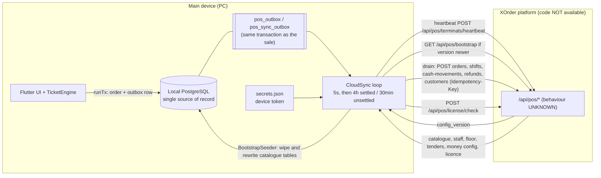
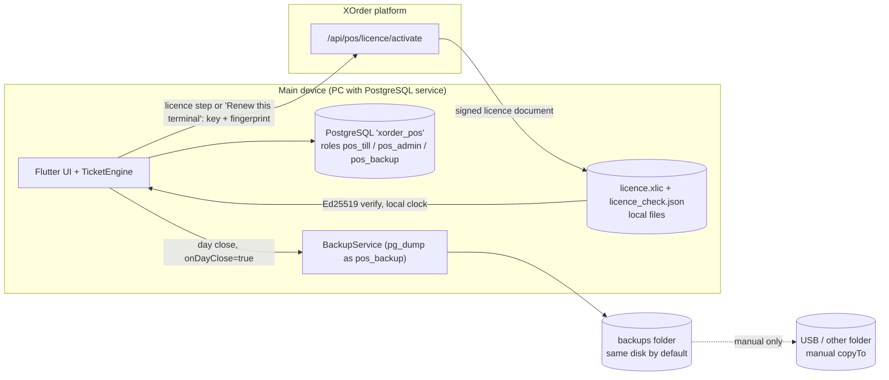

# Operating models: Plan A (Cloud + offline-first) and Plan B (offline-only, LAN)

Scope: what the POS repo's executable code does today. The Laravel backend, Vue admin and cloud services are not available; anything about them is UNKNOWN except what this client calls (`lib/data/cloud/cloud_api.dart`).
Evidence levels: **[CODE]** read in source; **[ASSUMED]** inferred, not verified; **[OBSERVED]** none (no Flutter, Dart or PostgreSQL in the audit sandbox, so no test was executed). "Test exists (not executed here)" means the test file was read, not run.
Status labels: IMPLEMENTED | PARTIAL | NOT_IMPLEMENTED | UNKNOWN.

## 0. Headline findings

| # | Finding | Evidence |
|---|---|---|
| 1 | The code has **two** deployment modes, `cloud` and `offline`. The three modes in `CLAUDE.md` (cloud / branch / islanded) are stale. `branch_server` and `standalone` survive only as legacy wire strings that parse to `offline`. "Islanded" appears only in a comment. | [CODE] `lib/core/config/deployment.dart:10-57`, `grep -rn islanded lib` |
| 2 | Plan A = `DeploymentMode.cloud`. Plan B = `DeploymentMode.offline`. Both are IMPLEMENTED as modes. The licence's `modes[]` claim decides which the wizard offers; the operator's wizard tile picks one when the licence covers both. | [CODE] `setup_state.dart:166-169`, `setup_controller.dart:311-353` |
| 3 | Plan B does NOT mean "no internet ever". Activation and renewal go to `{platform}/api/pos/licence/activate`. The signature check is offline, but **no UI can import a signed `.xlic` file**; the file-import path exists only as a controller parameter used by tests. | [CODE] `platform_licence_api.dart:89-90`, `setup_panes.dart:674`, `licence_screen.dart:78-103` |
| 4 | `max_offline_days` is parsed from the licence and **never read** by any enforcement code. | [CODE] `license.dart:126,168`; `grep -rn maxOfflineDays lib` returns only license.dart |
| 5 | Licence enforcement is one gate: **opening a shift**. It never stops a sale already in progress. An expired-past-grace licence has `canSell: true`. | [CODE] `license_verifier.dart:290-296`, `start_screen.dart:67-68,150` |
| 6 | There is **no way to switch plans in place**. The only route is "Reset terminal" (wipes `config.json`, secrets, wizard progress; leaves the database) and re-running the wizard. There is no data migration or backfill either way. | [CODE] `providers.dart:2061-2094`, `management_terminal_pane.dart:60-102` |
| 7 | Automatic backups exist but only as "after the trading day is closed", written to a folder on the machine that closed the day (default: same disk as the database). There is no timer-based schedule and no off-box destination unless the operator copies by hand. | [CODE] `day_close_dialog.dart:67-72`, `backup_service.dart:654-675` |
| 8 | LAN multi-POS is a shared PostgreSQL reached directly by every till. No local API, no discovery, no live cross-till refresh. See `MULTI_DEVICE.md`. | [CODE] |
| 9 | If the database is unreachable the till refuses the sale. There is no second local store to fall back to. | [CODE] `payment_screen.dart:165-195` |

## 1. Table of the deployment modes as coded

`DeploymentMode` has exactly two values (`deployment.dart:10-27`).

| Aspect | `cloud` (Plan A) | `offline` (Plan B) | Where in code |
|---|---|---|---|
| Wire value | `cloud` | `offline` (also reads legacy `branch_server`, `standalone`) | `deployment.dart:14,27,46-49` |
| Needs `baseUrl` | yes, unless the terminal is a child | no (forced to `null` on parse) | `deployment.dart:60,304-308,421` |
| Sends sales to the platform | yes | no | `deployment.dart:67` |
| Enqueues to `pos_outbox` / `pos_sync_outbox` | yes, in the same DB transaction as the sale | no, `_enqueueForSync` returns false; `pendingSyncCount` returns 0 | `postgres_orders_repository.dart:337-340,361-362`; shift/cash/refund repos use the same flag |
| `CloudSync` (heartbeat, bootstrap refresh, drain) | runs on the main device, needs device token | `posCloudApiProvider` returns null, so no `CloudSync` | `providers.dart:655-664,688-755` |
| Sync policy `automatic`/`manual` | meaningful | ignored | `deployment.dart:236-241` |
| Catalogue authority | platform; `BootstrapSeeder` wipes and rewrites catalogue, floor, tenders, money config | local; Management (admin DB role) authors the menu | `bootstrap_seeder.dart:42-47,530-543`; `local_bootstrap.dart:875` and the comment above it |
| Till DB grants | gets `cloudSeeding` grants (INSERT/UPDATE/DELETE on catalogue tables) | does not; catalogue is SELECT-only for the till role | `setup_controller.dart:671-678`, `local_bootstrap.dart:655,875` |
| Provisioning | pairing code or sign-in against the platform, device token, bootstrap bundle with licence embed | owner PIN registered locally in `pos_staff`; terminal row inserted into local `pos_terminals` | `providers.dart:589-651`, `postgres_directory_repositories.dart:225-290` |
| Licence verdict | file, plus `OnlineLicenceService` asks `/api/pos/license/check` and caches; if the platform says `enforcement: offline` it falls back to the file | file only | `providers.dart:1633-1676`, `online_licence_service.dart:230-279` |
| Check-in cadence | heartbeat after 5 s, then every 4 h when settled, 30 min when not | **none**: `requiresPeriodicCheckIn` is declared but no code reads it | `providers.dart:735-752`, `cloud_sync.dart:55-59`; `grep requiresPeriodicCheckIn lib` finds only the declaration |
| DB location | `databaseHost` (default `localhost`; LAN host if licence `max_terminals > 1`) | same | `deployment.dart:199-204`, `setup_controller.dart:306-340,1249` |

What a "branch" or "islanded" mode would mean now: "branch" = `offline` with `databaseHost` set to a LAN address; "islanded" = `offline` or a cloud till that cannot reach the platform. Neither is a stored value. `docs/pos/08-deployment-modes.md:19` says the same ("There used to be three").

## 2. The ten questions

### Q1. Capabilities that exist today, per plan

| Capability | Plan A (cloud) | Plan B (offline) | Evidence / tests |
|---|---|---|---|
| Sell, park tickets, pay, refund, shifts, cash movements, business day | IMPLEMENTED (PostgreSQL first) | IMPLEMENTED | `postgres_orders_repository.dart`, `postgres_shift_repository.dart`, `postgres_business_day_repository.dart`. Tests exist (not executed here): `test/data/offline_end_to_end_test.dart`, `postgres_integration_test.dart`, `postgres_shift_test.dart` |
| Local PostgreSQL as source of record | IMPLEMENTED | IMPLEMENTED | `pos_database.dart`, `migrations.dart` |
| Outbound queue with idempotency | IMPLEMENTED | n/a | `migrations.dart:345-372,4358-4383`, `outbox_drain.dart`; `test/data/outbox_drain_test.dart` (not executed) |
| Catalogue/staff/floor pulled from platform | IMPLEMENTED | n/a | `bootstrap_seeder.dart`; `test/data/cloud_bootstrap_test.dart` (not executed) |
| Pairing code / device token | IMPLEMENTED client side | n/a | `cloud_provisioning_repository.dart`, `device_token_vault.dart`. Server side UNKNOWN |
| Licence: signature verify (Ed25519), expiry, grace, tenant, mode, fingerprint | IMPLEMENTED | IMPLEMENTED | `license_verifier.dart:116-297`; `test/features/licence_signing_test.dart`, `licensing_test.dart` (not executed) |
| Licence online activation by key | IMPLEMENTED (client) | IMPLEMENTED (client; needs internet) | `platform_licence_api.dart`; `test/features/offline_licence_activation_test.dart` |
| Licence activation by signed file, no internet | PARTIAL: verifier and controller param exist, **no UI entry point** | PARTIAL, same | see Q10 |
| Licence renewal without internet | NOT_IMPLEMENTED in UI (same gap) | NOT_IMPLEMENTED in UI | see Q10 |
| Offline licence issuing tool | IMPLEMENTED (vendor tool `bin/pos_licence.dart issue`) | same | `bin/pos_licence.dart:88-151` |
| Multiple tills on a LAN | PARTIAL (shared DB; main device drains for all) | PARTIAL (shared DB) | `MULTI_DEVICE.md` |
| Automatic local backup | PARTIAL (at day close only) | PARTIAL | Q10 |
| Cloud sync of stock, purchasing, suppliers | NOT_IMPLEMENTED: no stock/purchase endpoint in `lib/data/cloud/*` (grep `stock` in that folder returns nothing) | n/a | [CODE] |

### Q2. How the operating mode is determined and where it is persisted

Chain, in order of authority at boot:

1. **Persisted `config.json`** (`FileTerminalConfigStore`, `terminal_config_store.dart:37-81`, in the app-support directory; written atomically by temp file and rename). `DeploymentConfig.fromJson` reads `deployment.mode`; absent or unknown reads as `cloud` (`deployment.dart:411-414`). `main()` loads it and seeds `terminalBootProvider` (`main.dart`), then `DeploymentController.build()` returns `config.deployment` or `DeploymentConfig.unconfigured`, which is **cloud with nothing set** (`deployment.dart:164`, `providers.dart:2014-2022`). A saved config is only used if `isUsable` (`terminal_config_store.dart:59`); a half-written file reads as "no config" and the wizard reopens.
2. **First install, wizard** (`SetupController`): licence step runs first (`setup_state.dart:23-60`). `licensedModes` = the licence's `modes[]`, or all modes if empty (`setup_state.dart:166-169`). If more than one mode is licensed, the wizard asks (`asksSetupType`, `setup_state.dart:245`); if one, the choice is made for the operator (`_adopt`/`_coveredMode`, `setup_controller.dart:1232-1290`). `setMode` refuses a mode the licence does not cover (`setup_controller.dart:317`).
3. **Role** (main or child) is separate from mode: `TerminalRole` (`deployment.dart:123-141`). A fresh install's role comes from `deviceRoleProvider` (`providers.dart:1738-1741`): Android/iOS is always child; a Windows desktop is child only if the installer wrote `%ProgramData%\XOrder POS\install-role.json` (`installed_role.dart:56-78`); otherwise main. A child takes its mode from the main device's `pos_site_licence.mode` row (`setup_controller.dart:1349`, `postgres_site_licence.dart`).
4. **Re-check at every boot**: `LicenseVerifier.evaluateClaims` denies with `modeNotLicensed` if the licence's `modes[]` is non-empty and does not contain the persisted mode (`license_verifier.dart:227-232`). That denial blocks opening a shift (not sales in progress).

Persistence summary: mode lives in `config.json` per terminal; a child's mode copy comes from the shared DB row `pos_site_licence.mode` (CHECK `IN ('cloud','offline')`, `migrations.dart:3906-3920`). It is not stored in the database for a main device, and not derived from the licence at each boot (the licence only vetoes).

Tests (not executed here): `test/features/licence_decides_mode_test.dart`, `test/features/child_terminal_test.dart`, `test/features/setup_persistence_test.dart`.

### Q3. Does the licence control the model?

Status: **PARTIAL (restricts, does not select).**

- The licence **gates which modes the wizard offers** and **vetoes opening a shift** in a mode it does not cover. [CODE] above.
- The licence does **not** set the mode at runtime. If it covers both, nothing but `config.json` says which one runs.
- It also controls the shape of the LAN: `max_terminals > 1` is the only thing that unlocks a non-local `databaseHost` in the wizard (`setup_state.dart:182`, `setup_controller.dart:332-336,1249`) and the only thing that makes the main device publish its licence to children (`providers.dart:1825`).
- Everything the licence says is checked only against the local clock (`license_verifier.dart:244-253`, `now: clock()` with `DateTime.now`). No monotonic or last-seen-time check was found (searched: `rollback`, `lastSeen`, `monotonic`, `clock` in `lib/features/licensing`). Setting the system clock back extends a licence. [CODE]/[ASSUMED] on exploitability.
- The licence signing key is injected at build time for release builds. A **development public key is embedded in source** (`license_keys.dart:50`), used only when the release define is absent. A release build without the define throws at startup (`license_keys.dart:56-60`). Not reproduced here.
- A licence file can carry its own `issuer_public_key`. It is trusted **only in non-release builds** (`LicenseVerifier.trustIssuerKey = !_release`, `license_verifier.dart:86,112`). [CODE]

### Q4. Can the system switch plans after install? What happens to data?

Status: **NOT_IMPLEMENTED as a feature.** Only a destructive-to-config reset exists.

Path: Management > System > Terminal > "Reset terminal" (`management_terminal_pane.dart:60-102`) or the forced reset `Ctrl/Cmd+Shift+R` (`force_reset_dialog.dart`). `TerminalReset.run()` (`providers.dart:2066-2094`) clears `config.json`, the wizard progress file, the DB password secret, the admin secret, and in-memory providers. The device token (`secrets.json` key `pos_cloud_device_token`) is **not** in that list [CODE: `terminalResetProvider` clears only the db and admin password stores; `deviceTokenVaultProvider` is not touched].

Data consequences [CODE unless marked]:

| Switch | Effect on existing PostgreSQL data | Risk |
|---|---|---|
| Cloud to Offline | Rows stay. `pos_outbox`/`pos_sync_outbox` rows with `delivered_at IS NULL` stay forever; offline mode reports `pendingSyncCount = 0` (`postgres_orders_repository.dart:361-362`) so the debt becomes invisible. Reset is refused only for an open shift, not for a non-empty outbox (`management_terminal_pane.dart:79-86`). | Unsent sales silently stranded unless the terminal later returns to cloud on the same DB. |
| Offline to Cloud | Sales made while offline were never enqueued, and no backfill exists (`grep -i backfill lib` shows only schema backfills). They never reach the platform. A claim then runs `BootstrapSeeder`, which deletes and rewrites catalogue tables (`bootstrap_seeder.dart:530-543`). Local product ids are replaced by the platform's. | History is local only; catalogue identity changes. Whether a platform accepts historical orders is UNKNOWN. |
| Either way | Not a "switch": the wizard re-runs from the licence step; the DB can be reused ("database already there", `setup_controller.dart:1557`). Staff and PINs in the DB persist for offline; for cloud the staff table is rewritten from the bundle. | |

Reset does not protect a terminal that is a main device with children: children keep pointing at the same host with the old mode copied from `pos_site_licence.mode` (`mode` there is overwritten only when the main device republishes, `providers.dart:1814-1843`). [CODE]
No test found for a mode switch with pending outbox rows.

### Q5. Actual data flow per model

#### Plan A (cloud), as coded

Downward (platform authoritative): catalogue, modifiers, floor, staff, tender types, money/tax config, receipt profile, embedded licence (`bootstrap_seeder.dart`, `cloud_provisioning_repository.dart`). Only applied if `config_version` is newer (stale/unchanged are skipped, `bootstrap_seeder.dart:62-75`).
Upward (device authoritative until delivered): orders (with `priced_offline: true` and `asserted_totals`), shifts, cash movements, refunds, customers (`outbox_drain.dart:140-170`, `cloud_api.dart:173-213`).
Not synced either way [CODE]: stock levels/movements, purchase orders, suppliers, audit events, parked tickets, print jobs.

Conflict rules as implemented (answers the "cloud authoritative must not discard local transactions" requirement):

| Local data | Protection in code | Gaps |
|---|---|---|
| Settled sale | Row in `pos_orders` plus `pos_outbox` row written in one transaction (`postgres_orders_repository.dart:329-345`). Till role has no DELETE on orders or outbox (`local_bootstrap.dart` comments at outbox grant). Idempotency key = `client_transaction_id`, replayed on retry. | A UI `submit` failure leaves no row (sale refused, Q8). |
| Platform rejects a sale | Codes `VALIDATION_FAILED`, `IDEMPOTENCY_PAYLOAD_MISMATCH`, `MENU_ITEM_NOT_FOUND`, `BRANCH_NOT_IN_TENANT`, `CUSTOMER_NOT_FOUND`, `REFUND_EXCEEDS_SOLD` quarantine the record locally (kept, never deleted); every other code defers and retries (`outbox_drain.dart:107-124`). UI: `management_sync_pane.dart` lists quarantine (file mentions it; contents not fully read). | No automatic resolution. A quarantined sale is local money the platform does not have until a person acts. |
| Platform re-prices differently | Order stays on both sides; `totals_mismatch` flag set locally (`outbox_drain.dart:~385-400`). Platform invoice number stored in separate `server_invoice_number`. | What the platform's own books say is UNKNOWN. |
| Reseed from bundle | Touches catalogue, floor, staff (deactivate, never delete), tenders, money config. Does not touch orders, payments, shifts, outbox. Order lines snapshot name and price (`bootstrap_seeder.dart:42-47`). | A reseed while a ticket is parked: `pos_parked_tickets` holds a jsonb ticket that references product ids; ids change after the wipe-and-rewrite. Whether `ParkedTicketCodec.decode` tolerates that was not traced. [ASSUMED risk] |
| Revoked device token (HTTP 401) | `deviceTokenRejected` set; drain skipped; banner shown; sales continue locally (`cloud_sync.dart:96-101`, `providers.dart:1064`). | Pending count climbs until re-pair. |
| Unpaid local stock/purchasing changes | Local only. | Never reach the cloud; conflict undefined. |

Tests (not executed here): `outbox_drain_test.dart`, `cloud_bootstrap_test.dart`, `cloud_refunds_test.dart`, `test/app/terminal_rejected_test.dart`.

#### Plan B (offline), as coded

No sale, stock, staff or catalogue data leaves the machine. Outbound traffic is the licence request only (`platform_licence_api.dart:89-103`: key, `deployment_mode`, fingerprint, optional `tenant_slug`).
Offline-mode `OnlineLicenceService` is not used (needs `posCloudApiProvider`, which is null), so no periodic contact happens at all. The comment "an offline terminal reaches the platform to renew within the window" (`deployment.dart:18-23`) has **no code behind it** for the periodic part.

### Q6. Features that need internet

| Feature | Mode | Needs internet | Evidence |
|---|---|---|---|
| First-time licence activation by key | both | yes (`POST {platform}/api/pos/licence/activate`, 10 s connect timeout) | `platform_licence_api.dart:89,34` |
| Licence renewal ("Check for renewal", "Activate key") | both | yes, and requires the key to be typed again (the button passes `_keyController.text`) | `licence_screen.dart:91-106` |
| Cloud claim by pairing code / sign-in | cloud | yes | `cloud_provisioning_repository.dart` |
| Bootstrap pull, heartbeat, drain | cloud | yes (but failure is non-fatal, `cloud_sync.dart:90-93`) | |
| Online licence verdict (`/api/pos/license/check`) | cloud | yes, cache otherwise | `online_licence_service.dart` |
| Back-office branch sales view across tills | cloud | yes (`/api/pos/branch/sales*`) | `branch_sales_api.dart:55,66` |
| Tax authority (ETA) filing | optional | yes; flag-gated (`etaFilingEnabled`) | `providers.dart:2732-2790` |
| Currency, language, printing, shifts, selling | both | no | |

The cloud-mode wizard needs the platform for provisioning (pairing code or credentials). The offline wizard needs it only for licence activation, because the file route has no UI.

### Q7. What works fully offline

After setup, both modes can: take orders, split payments, park and resume tickets (to PostgreSQL), open/close shifts, cash movements, refunds, day close, local reports, receipts and printing, stock movements, purchasing, supplier invoices, Management over the admin DB role, and backups to disk. [CODE] The one hard condition is that the PostgreSQL the till points at is reachable (Q8). Cloud-only cached state: the catalogue is a local copy refreshed on `config_version` change.

### Q8. Behaviour after disconnect and reconnect

Two different disconnects:

**Platform unreachable (cloud mode)** — IMPLEMENTED.
- `CloudReply.offline()` on any Dio error (`cloud_api.dart:258-269`). Heartbeat failure does not stop the drain (`cloud_sync.dart:90-93`). A pass that sees the platform stop answering stops early (`wentOffline`, `outbox_drain.dart:34-36`). Retry cadence 30 min (`cloud_sync.dart:55-59`), plus a kick after each settled sale (`SyncingOrdersRepository`, `providers.dart:281-285`). Manual policy only drains on demand and offers a drain on shift close.
- Reconnect: the next pass drains up to 25 orders (`passLimit`) per run, then continues on the 30-min retry. A 100-order backlog takes about 4 passes, or about 90 minutes of retry cadence, unless the sale kick or manual drain fires. [CODE: derived from `passLimit = 25` and `retry = 30min`]
- Licence under `OnlineLicenceService`: trusts the cached verdict if the last verdict was definite; otherwise the file (`online_licence_service.dart:270-278`).

**Database unreachable** (either mode) — the till stops trading.
- `PosDatabase` pool: 5 s connect timeout, 10 s query timeout, 4 connections (`pos_database.dart:273-296`). Failures become `PosDbException`.
- Payment: `submit` throws, the screen restores the pre-tender ticket and shows "payment could not be recorded"; nothing is stored anywhere else (`payment_screen.dart:175-195`). Parking returns `false` and keeps the live ticket in memory (`providers.dart:933-945`).
- The top bar shows a pill from `branchDatabaseProvider` (probe `SELECT 1`) (`pos_top_bar.dart:81-90`). The probe is invalidated by tapping the pill; it does not poll. [CODE]
- Reconnect: the pool reconnects on next use. No replay is needed because nothing was queued. A ticket held only in memory when the app is closed is lost.

### Q9. Does the architecture support both models?

Status: **PARTIAL, yes in design, with gaps.** [CODE]

Supported by design:
- One schema, one set of repositories, mode as a flag that switches enqueueing, sync loop, provisioning and grants. The UI depends on `lib/domain/repositories` interfaces (`providers.dart` is the single binding point).
- Both modes share the same offline-first write path (PostgreSQL then optional outbox).

Not supported / weak:
- No in-place switch (Q4).
- Unconfigured state defaults to `cloud` (`deployment.dart:164`, `fromJson` fallback), so a damaged or unknown mode value silently becomes cloud.
- Periodic check-in for offline licences has no implementation (`requiresPeriodicCheckIn`, `max_offline_days`).
- Stock/purchasing are local in both models; Plan A has no cloud counterpart for them.
- Plan A multi-till on a shared DB: child tills have no device token and are unknown to the platform (`providers.dart:597-599` comment; `posCloudApiProvider` returns null for children). Their sales leave via the main device's token. The order request has no terminal field (`outbox_drain.dart:140-170`), so how the platform attributes child-till sales is UNKNOWN.

### Q10. Missing or partial requirements

#### Plan A (Cloud + offline-first, cloud authoritative)

| Requirement | Status | Detail |
|---|---|---|
| Offline selling | IMPLEMENTED | PostgreSQL first |
| Queue and idempotent upload | IMPLEMENTED | Q5 |
| Cloud authoritative for catalogue/config | IMPLEMENTED | version-gated overwrite |
| Cloud authoritative on sale conflict without data loss | PARTIAL | server re-price flagged, rejected records quarantined and kept; no resolution UI audited in depth, server rules UNKNOWN |
| Pull of changes made on other devices (other branches/online orders) | NOT_IMPLEMENTED | only `bootstrap` (config) is pulled; no orders/stock pull endpoint in `cloud_api.dart` |
| Stock sync | NOT_IMPLEMENTED | |
| Multi-till under cloud | PARTIAL | one main device drains for all; children invisible to platform; main device off means no sync for children's sales |
| Device revocation handling | IMPLEMENTED | banner on 401 |
| Per-device sync visibility on the platform | UNKNOWN | heartbeat payload sends pending count, oldest pending, shift open (`cloud_sync.dart:203-212`) |

#### Plan B (offline-only, multi-POS LAN, auto backups, offline signed licence)

| Requirement | Status | Detail |
|---|---|---|
| Offline-only operation | IMPLEMENTED | no sync code runs |
| Multi-POS on a LAN | PARTIAL | direct shared PostgreSQL; manual host entry; plaintext on LAN unless TLS is configured by hand; no live refresh of parked tables; no discovery (`MULTI_DEVICE.md`) |
| Automatic local backups | PARTIAL | only after day close, default folder on the same disk; keep last 14 (`backup_service.dart:49`); pg_dump as read-only `pos_backup` role; checksum verified; manual USB copy (`copyTo`, line 531). No clock schedule; no warning when a day is never closed. Runs on whichever machine closes the day, not necessarily the DB host. Restore needs the admin password and is blocked by open shifts/day (`RestoreBlockerKind`) |
| Offline signed licence **activation** | PARTIAL | signature/expiry logic offline: IMPLEMENTED. The `.xlic` file can be produced by `bin/pos_licence.dart issue`. **No file picker or paste field calls `activateLicence(fileContents:)`**; searched `FilePicker`, `fileContents:`, `xlic`, "from file" in `lib/features/licensing` and `lib/features/setup`. `licenceOfflineHelp` tells the installer to ask the supplier for a different build. File import exists only in tests |
| Offline signed licence **renewal** | NOT_IMPLEMENTED (UI); IMPLEMENTED (logic) | `licence_screen.dart` renewal calls the online route. The screen text says "re-checks at start-up and before each shift opens", but the file-only service re-reads the stored file only (`licence_service.dart:242-248`); no code fetches a newer file automatically (searched `activate(` callers) |
| No cloud sync | IMPLEMENTED | |
| Maximum offline window enforcement | NOT_IMPLEMENTED | `max_offline_days` parsed, unused |
| Licence tamper resistance (clock rollback, copied identity) | NOT_IMPLEMENTED | local clock only; fingerprint is `sha256("xorder-pos-terminal:"+installationId)` of an id stored in `config.json`, not hardware-bound (`file_license_store.dart:78-91`) |
| Licence seat enforcement for LAN tills | PARTIAL | wizard-only check (`setup_controller.dart:1742`) |
| Platform contact required | partially | activation only |

#### Doc vs code disagreements found while writing this

| Claim | Where | Reality |
|---|---|---|
| Three modes: cloud, branch-server, islanded | `CLAUDE.md` | two modes in code |
| "Renewals ... this terminal re-checks at start-up and before each shift opens" | `app_strings.dart:3877-3881` | true only for the online verdict in cloud with a device token (`OnlineLicenceService`); a file-licensed till only re-reads its file |
| Offline terminal "must renew within the window" | `deployment.dart:18-23` | no code enforces a window |
| "Activate from file already accepts bytes from anybody" | `deployment.dart:182-183`, `platform_endpoint.dart` | no UI exposes it |
| Secrets in "OS keystore" | several comments, `deployment.dart:207-209` | secrets are in `secrets.json` in app-support, mode 600 on POSIX; explicit owner decision recorded (`file_secret_store.dart` header) |

## 3. Open questions for the product owner

1. Must an offline customer be able to activate and renew with no internet at all (file import UI), or is "occasional internet" acceptable?
2. Should an offline licence enforce a maximum offline window (`max_offline_days`), and what happens at expiry (sales or only new shifts)?
3. Is in-place switching between Plan A and Plan B required? If so, what is the expected treatment of unsent sales and of history?
4. Is an off-box backup destination (USB, NAS, cloud) mandatory for Plan B, and should it run on a clock schedule?
5. For Plan A with several tills on a LAN, is it acceptable that child tills are invisible to the platform and that the main device must be on for sync?
