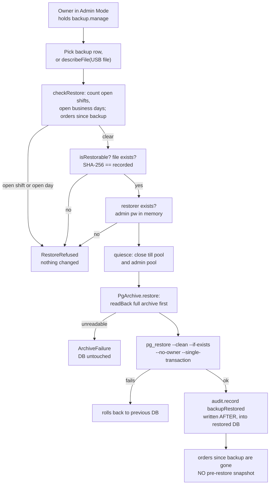
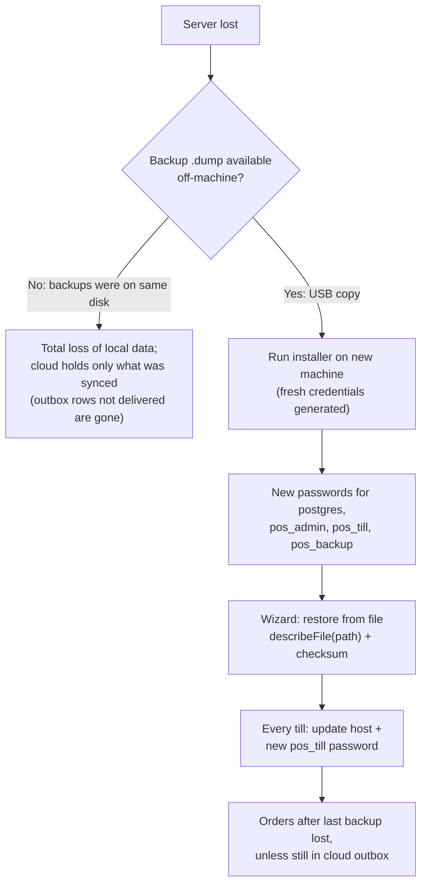

# Security and Recovery Audit — XOrder POS

Scope: read-only audit of `/home/user/xorder-pos` (Flutter desktop POS). Nothing was executed: no Flutter/Dart, no PostgreSQL, no Windows. Evidence levels: **[CODE]** read in executable code or SQL; **[ASSUMED]** inferred or not verifiable here. There is no **[OBSERVED]** item in this document.
The Laravel backend, Vue admin and cloud services are not available, so all server-side behaviour is **UNKNOWN** except the HTTP paths the POS calls. Comments and docs were not accepted as proof. Where a code comment, or `docs/pos/*.md`, says something different from the executable code, the disagreement is listed in section 14.
Tests are named as "test exists (not executed here)". No test was run and none is claimed to pass.

Status labels: IMPLEMENTED | PARTIAL | NOT_IMPLEMENTED | UNKNOWN.

---

## 1. Summary

| Area | Status | One line |
|---|---|---|
| Secret storage at rest | PARTIAL | DB password, device token, backup and admin passwords sit in one **plaintext JSON file** (`secrets.json`). No OS keystore is used anywhere. |
| DB role separation | IMPLEMENTED | `pos_till` (column-scoped DML, no DDL), `pos_admin` (owner, CREATEDB), `pos_backup` (`pg_read_all_data`), `postgres` (installer only). |
| Audit append-only | PARTIAL | Grant plus trigger. The table owner can drop the trigger, and restore replaces the table. No hash chain. |
| TLS to Postgres | PARTIAL | Loopback is always plaintext. LAN is plaintext in practice, because the installer never enables `ssl`. `verifyFull` applies only if the server has TLS. |
| TLS to cloud | IMPLEMENTED | Default Dio/`dart:io` validation, no override. `http://` allowed only for private hosts. |
| PIN hashing | IMPLEMENTED | PBKDF2-HMAC-SHA256, 120 000 iterations, 16-byte random salt, constant-time compare. Keyspace is only 10^4. |
| PIN rate limiting | PARTIAL | Admin Mode and the supervisor keypad throttle. The cashier lock screen has none. |
| Session auto-lock | PARTIAL | Admin Mode has an idle timeout. No idle lock for the cashier session was found. |
| SQL injection | IMPLEMENTED | All values are bound parameters. Interpolations are constants or validated identifiers (section 6). |
| Backup encryption | NOT_IMPLEMENTED | Plaintext `pg_dump -Fc` in the user profile, on the same disk. No automatic off-site copy. |
| Pre-restore snapshot | NOT_IMPLEMENTED | Restore is `--clean --single-transaction`. There is no safety copy of the current DB. |
| Crash/power-loss on sale | IMPLEMENTED (design) | Single-transaction settlement with an idempotency key. Not executed here. |
| Monitoring / crash reporting | NOT_IMPLEMENTED | No global error handler and no telemetry. Logs are `debugPrint` only. |

---

## 2. Trust-boundary diagram

Only boundaries visible in code are drawn.

```mermaid
flowchart LR
  subgraph TillHost["Till machine (OS user session)"]
    UI["Flutter UI + Riverpod<br/>permission gates (UI)"]
    REPO["Postgres*Repository<br/>Authorization.require (Dart)"]
    SEC[("secrets.json<br/>plaintext JSON<br/>till pw, device token,<br/>backup pw, admin pw")]
    CFG[("config.json, licence.xlic,<br/>setup progress<br/>no secrets by design")]
    BK[("backups/*.dump<br/>unencrypted pg_dump")]
    PGT["pg_dump / pg_restore<br/>subprocess, password via env"]
    PRN["winspool.drv FFI /<br/>TCP:9100 / lp"]
  end
  subgraph Server["Branch server (may be the same machine)"]
    PG[("PostgreSQL 16<br/>scram-sha-256<br/>roles: pos_till, pos_admin,<br/>pos_backup, postgres")]
    CRED[("ProgramData/XOrder POS/<br/>install-credentials.json<br/>ACL: Administrators + SYSTEM")]
    PGD[("pgdata<br/>ACL: Admins, SYSTEM,<br/>NetworkService")]
  end
  subgraph Cloud["XOrder cloud (UNKNOWN behaviour)"]
    API["/api/pos/* with<br/>Bearer device token"]
    LIC["licence server"]
  end
  UI --> REPO
  REPO -- "SQL, bound params<br/>NO TLS on loopback/LAN default" --> PG
  UI -- read/write --> SEC
  PGT -- "PGPASSWORD env,<br/>PGSSLMODE disable|verify-full" --> PG
  PGT --> BK
  REPO -- "HTTPS via Dio, system trust store" --> API
  REPO -- HTTPS --> LIC
  UI --> PRN
  CRED -. "read once by setup wizard if Admin" .-> UI
  PGD --- PG
```

Boundaries that matter:

1. **Till OS account to `secrets.json`.** Anyone who can read the till user's files holds every credential, including the back-office DB password.
2. **Till to Postgres.** The only authentication is a role password. The DB sees one role (`pos_till`) for every cashier, so DB-level authorisation cannot tell cashiers apart. Cashier identity and permissions are enforced in Dart only.
3. **LAN.** Plaintext SQL and a scram login across the restaurant network unless the operator enabled TLS manually.
4. **Till to cloud.** Bearer device token over HTTPS.

---

## 3. Secrets inventory

| Secret | Where it lives | Protection | Evidence | Status | Test |
|---|---|---|---|---|---|
| `pos_till` DB password | `secrets.json` key `pos_till_database_password`, in `getApplicationSupportDirectory()`. Cached in memory by `MutablePosDbCredentials`. | Plaintext JSON. `chmod 600` on POSIX (best effort, failure swallowed). **On Windows `_restrict` returns immediately**, so no ACL is set and the file inherits the profile ACL. | `lib/data/config/file_secret_store.dart:113-190`; `lib/main.dart:41-43`; `lib/data/postgres/pos_database.dart:158-215` | PARTIAL | `test/data/file_secret_store_test.dart` (not executed here) checks read, write, clear and key isolation. No test of Windows ACL or mode. |
| Cloud device token (`xdt_…`) | Same file, key `pos_cloud_device_token`. Memory-cached by `DeviceTokenVault`. | Same as above. | `lib/main.dart:49-51`; `lib/data/cloud/device_token_vault.dart:14-47` | PARTIAL | same |
| `pos_backup` password | Same file, key `pos_backup_database_password`. | Same. It is read-only (`pg_read_all_data`) but reads **every row**, including PIN hashes. | `file_secret_store.dart:125`; `lib/app/providers.dart:3055-3057` | PARTIAL | none specific |
| **`pos_admin` password** | Same file, key `pos_admin_database_password`. The wizard stores it so Admin Mode needs only username + PIN. | Same. `pos_admin` **owns the schema**, can disable triggers and truncate tables, and is the restore account. | `file_secret_store.dart:133`; `providers.dart:3075-3078`; `lib/features/admin/application/admin_session.dart:276` | PARTIAL, **high risk** | none specific |
| Licence file `licence.xlic` | `Application Support/licence.xlic` | Not a secret. Ed25519-signed and verified on load. | `lib/features/licensing/data/file_license_store.dart` | IMPLEMENTED | `test/features/licence_signing_test.dart` (not executed here) |
| Licence **public** key | Compiled in. Release builds require the `XORDER_LICENSE_PUBLIC_KEY_B64` and `_KEY_ID` dart-defines and throw otherwise. | Public by design. A **development public key constant is embedded** in `license_keys.dart` (value not reproduced) and used only when `dart.vm.product` is false. | `lib/features/licensing/data/license_keys.dart:27-77`; `.github/workflows/windows-installer.yml:33-34,72-76` | IMPLEMENTED | `test/features/licence_signing_test.dart` |
| Installer-generated passwords (`postgres`, `pos_admin`, `pos_till`, `pos_backup`) | `%ProgramData%\XOrder POS\install-credentials.json`, JSON, plaintext. | `icacls /inheritance:r`, granting Administrators `*S-1-5-32-544` and SYSTEM `*S-1-5-18` full control (SIDs, not names). The file is **written before the ACL is applied**, so a short window exists under inherited ProgramData ACLs. | `installer/provision.ps1:30-33,56-77,122-133`; `lib/data/config/installer_credentials.dart:287-399` | IMPLEMENTED with a window | `test/tool/installer_consistency_test.dart` (not executed here) checks consistency between script and app. ACLs not tested. |
| Superuser password for `initdb` | Temp file in `$env:TEMP`, deleted in `finally`. | Not ACL-restricted. It sits in the temp dir for the length of `initdb`. | `provision.ps1:136-147` | PARTIAL | none |
| Passwords passed to `pos_migrate` | Environment variables, cleared in `finally`. | OK. Not on the command line, not in the transcript. | `provision.ps1:187-207` | IMPLEMENTED | none |
| Owner PIN at install | `pos_migrate --seed … --pin 1234` is a **command-line argument**. | Visible in the process table. The usage text shows it. | `bin/pos_migrate.dart:235,982` | PARTIAL (CLI only) | `test/data/installer_owner_test.dart` |
| Cashier PINs | `pos_staff.pin_salt` / `pin_hash` (PBKDF2). | See section 7. The `pos_till` role has **SELECT on all of `pos_staff`**, hashes included. | `local_bootstrap.dart:~806` (SELECT list); `postgres_directory_repositories.dart:436-440` | PARTIAL | `test/core/pin_rules_test.dart` |
| Cloud login passwords | Typed in the wizard, sent to the cloud, not persisted. `setup_progress_store` states no secrets are stored. | Not verified beyond reading the store's fields: none are secrets. | `setup_progress_store.dart:19-60` | IMPLEMENTED | none |

**There is no OS keystore.** `pubspec.yaml` has no `flutter_secure_storage` or equivalent. The only OS-protected mechanism in use is `chmod 600` on POSIX. `FileSecretStore` is described in its own header as an owner decision (2026-09-04) to move off the macOS keychain, because of the unsigned-build prompt. The file store itself documents the threat model as "someone at the till's own session reads both".

`FileSecretStore._readAll` treats a damaged or unparseable file as an **empty store** (`file_secret_store.dart:154-159`). A truncated write therefore silently drops all four secrets and sends the till back through the wizard. The write is temp-file + rename, which narrows this window.

Platform matrix:

| Platform | Secrets | Installer creds |
|---|---|---|
| Windows | `secrets.json` in `%APPDATA%\…` (profile ACL; no explicit ACL) | `%ProgramData%\XOrder POS\install-credentials.json`, ACL-locked |
| macOS | `secrets.json` mode 0600 | none; manual PostgreSQL |
| Linux | same as macOS | none |

---

## 4. Database role separation

| Role | Created by | Privileges | Where defined | Used for |
|---|---|---|---|---|
| `postgres` | `initdb -U postgres -A scram-sha-256 --pwfile` | Superuser | `provision.ps1:141-144` | Install only: create roles, create DB |
| `pos_admin` | `LocalBootstrap.roleStatements(admin)`: `LOGIN CREATEDB`, no SUPERUSER, no CREATEROLE | **Owns database and tables** (`--owner pos_admin`). `administrativeGrants` adds staff, roles and menu authoring, with "no DELETE" on records. | `local_bootstrap.dart:296-297,983+`; `provision.ps1:195-198` | Migrations, Admin Mode, restore |
| `pos_till` | `LOGIN`, no other attribute | `tillGrants`: SELECT, INSERT on transactional tables; **column-scoped UPDATE** on `pos_orders` (status, void fields, business_day, server_invoice_number), `pos_order_lines`, `pos_print_jobs`, `pos_business_days`, `pos_eta_receipts`; no DELETE except `pos_parked_tickets`. | `local_bootstrap.dart:655-973` | Normal selling |
| `pos_backup` | `LOGIN` plus `GRANT pg_read_all_data` | Read everything, write nothing | `local_bootstrap.dart:302-305`; `backup_service.dart` | `pg_dump` |

Properties verified in the SQL strings [CODE]:

- Money columns on `pos_orders` are not updatable by the till. The `refunded_*` counters move only via a `SECURITY DEFINER` trigger with `search_path` pinned (`migrations.dart:1231-1305`).
- **Cloud vs offline grant difference.** `tillGrants(cloudSeeding: true)` lets the till write the whole catalogue, `pos_staff`, `pos_tender_types` and `pos_receipt_profiles`. The code comment argues this is acceptable because cloud re-prices. Offline, the same statements are **REVOKEd** (`local_bootstrap.dart:932-962`). The comment itself records that a writable `pos_staff` would let a stolen till credential point a row at the owner role or overwrite a PIN hash. On a **cloud** till the `pos_till` credential therefore can do that. It is only mitigated by `pos_staff_one_owner_*` triggers (`migrations.dart:3809-3818`) and the claim that the cloud is authoritative. The latter is UNKNOWN.
- Tests: `test/data/till_grants_enforced_test.dart`, `admin_grants_enforced_test.dart`, `grants_cover_usage_test.dart`, `till_grants_test.dart` (exist, not executed; they need Postgres, tagged `integration`). Per CLAUDE.md the integration suites self-skip when `POS_PG_HOST` is unset.
- **Single credential for all cashiers.** The DB cannot attribute a row to a cashier except through application-provided columns. Anyone with the till credential and `psql` can insert orders or audit rows naming any `staff_id`.

Audit table (`pos_audit_events`):

- Till: SELECT, INSERT only (`local_bootstrap.dart:845`).
- Triggers `pos_audit_events_no_rewrite` (BEFORE UPDATE OR DELETE, row-level) and `pos_audit_events_no_truncate` (BEFORE TRUNCATE) raise `restrict_violation` (`migrations.dart:519-535`). `pos_backups` has the same pair (`migrations.dart:3501-3509`).
- **Limits.** The table is owned by `pos_admin`, who may `ALTER TABLE … DISABLE TRIGGER`, `DROP TRIGGER`, or `DROP TABLE`. The code comment names this actor as the threat ("someone with a psql prompt and the admin password"), and that password is on the till disk (section 3). Restore (`--clean`) drops and recreates the table. There is **no hash chain, no signature, and no external anchor**, so deleting or rewriting history by an admin-level actor is undetectable from within the DB. The actor in each row comes from the app (`by:`), not from the DB. Status: PARTIAL.

---

## 5. TLS policy

### 5.1 To PostgreSQL

| Situation | `sslMode` | Evidence |
|---|---|---|
| Host is `localhost`, `127.0.0.1` or `::1` (`isLoopback`) | **disable** (always) | `deployment.dart:350-351`, `pos_database.dart:293-295` |
| Private host (RFC 1918, `*.local`) and `verifyTls == false` | **disable** | same |
| Private host and `verifyTls == true` (default) | `SslMode.verifyFull` | same |
| Any non-private host (including a LAN DNS name like `srv.lan`) | `verifyFull`. `verifyTls=false` cannot disable it. | `deployment.dart:317-351` |
| Setup/bootstrap connection (`LocalBootstrap._openMaintenance`) | `SslMode.require` when not insecure. The code's own comment states `require` **accepts any certificate**. | `local_bootstrap.dart:156-158`; `pos_database.dart:290-292` comment |
| `pg_dump` / `pg_restore` | `PGSSLMODE=verify-full` or `disable`, same decision. | `lib/data/backup/pg_archive.dart:59,86` |
| `pos_migrate` CLI | `--no-verify-tls` flag; the installer passes it for `127.0.0.1`. | `provision.ps1:187`; `bin/pos_migrate.dart:910` |

No `badCertificateCallback`, `SecurityContext` override or global `HttpOverrides` exists (grep: `badCertificate`, `SecurityContext`, `HttpOverrides`, `HttpClient(`, `createHttpClient`). There is no certificate pinning.

**Practical result [CODE + ASSUMED].** `provision.ps1` writes only `port` and `listen_addresses` into `postgresql.conf` (`Set-Block`, lines 159-160). It does not set `ssl = on` and installs no certificate. `pg_hba.conf` uses plain `host` lines, not `hostssl` (lines 161-168). With `-Lan`, a second till will find that the server has no TLS. With `verifyTls=true` the connection fails. The operator must pick "don't verify", which sets `SslMode.disable`. **LAN traffic is therefore plaintext by the supported path**: SQL, receipts, PIN hashes in `pos_staff` reads, and the SCRAM exchange. Whether the PostgreSQL build bundled from EDB has ssl pre-enabled is UNKNOWN; the script does not configure it.

The `-Lan` pg_hba block admits all roles, including `postgres` and `pos_admin`, from 10/8, 172.16/12 and 192.168/16 with password. A Windows firewall rule for Private and Domain profiles opens the port (`provision.ps1:161-175`).

### 5.2 To the cloud

- Every HTTP client is built by `posHttpClient` (`lib/core/network/network_log.dart:16-20`): plain `Dio`, so the platform trust store applies. No adapter override anywhere. Status IMPLEMENTED.
- `DeploymentConfig.isPermittedPlatformUrl` (`deployment.dart:273-279`) allows `https://` anywhere and `http://` only for private hosts. It is enforced in the wizard (`setup_controller.dart:370`), in the config validator (`deployment.dart:306`) and in the connectivity probe (`connectivity_probe.dart:61`). `PosCloudApi` itself does not re-check the scheme [CODE: no check in `cloud_api.dart`]. The check is upstream of it.
- The Bearer token header is built at `cloud_api.dart:248`.
- Server behaviour (HSTS, token rotation, scopes): UNKNOWN.

---

## 6. SQL injection review

Searched: all of `lib/data/postgres/*.dart`, `lib/data/cloud/*.dart`, `lib/data/eta/*.dart`, `lib/data/backup/*.dart`, `bin/pos_migrate.dart` for `$name` / `${…}` inside SQL-looking strings, excluding comment lines (about 230 raw hits, most `GRANT … "$role"`). Values go through `Sql.named(… @param)` with a `parameters:` map. The interpolation categories:

| Category | Examples | Assessment |
|---|---|---|
| Static column-list or join-fragment constants (`$_columns`, `$_orderColumns`, `$_joins`, `$roleColumns`, `$joinedRoleColumns`) | many repositories | Safe: compile-time constants. |
| Identifier from a fixed Dart list (`DELETE FROM $table` over `['pos_staff_roles', 'pos_staff_permission_overrides']`; seeder `DELETE FROM $table` over three table names; `setval … $table`) | `postgres_admin_repositories.dart:1070-1073`; `bootstrap_seeder.dart:539,694` | Safe: literal lists. |
| Fragments assembled from fixed switch results, with user values bound (`$reach`, `$where`, `where.join(' AND ')`, `LIMIT @limit`, `${limit==null?'':…}`) | `postgres_catalog_admin_repository.dart:1799-1813,1887`; order history; reports | Safe as read. The code documents `[where]` as "always a constant in this file". Not exhaustively traced for every `where` list; the builders sampled add `@param` predicates only. |
| Quoted identifiers with allow-list validation (`CREATE DATABASE "$name"`, `CREATE ROLE "$ident"`, `GRANT … "$role"`, `"$database"`) | `local_bootstrap.dart:104-121,285-308,660` | `_isPlainIdentifier` / `_identifier` enforce `^[A-Za-z_][A-Za-z0-9_]*$` for DB and role names (`deployment.dart:~264`). **Gap:** `tillGrants(database:, role:)` interpolates `"$role"` and `"$database"` without calling `_identifier`. The values come from `DeploymentConfig.databaseUser` / `databaseName`, which the wizard validates for the DB name (`hasValidDatabaseName`). The role name is validated for creation but not at the grant call site. Low risk because only the installer sets these. |
| Password literal in `CREATE ROLE … PASSWORD '…'` | `local_bootstrap.dart:290-308` | Escaped by `'` doubling. `CREATE ROLE` takes no bind parameters. Correct under `standard_conforming_strings=on`. The installer's passwords are alphanumeric, so the path is exercised only by the wizard-supplied ones. |
| Status-driven fragment in outbox `UPDATE` (`${action == quarantine ? ', quarantined_at = now() …' : ''}`) | `outbox_drain.dart:~432` | Safe: enum-driven. |
| `ILIKE @search` | `postgres_order_history_repository.dart:381-384,628` | Bound. LIKE metacharacters (`%`, `_`) are not escaped, so a user can widen a search. Not injection. |

Finding: no user-controlled string reaches SQL text. Status: IMPLEMENTED. Coverage: no dedicated injection test found (searched `test/` for "inject", "sql"); behaviour is covered only indirectly by repository tests.

`Process.run` / `Process.start` uses an argument list, not a shell, throughout (`pg_archive.dart:21`, `pg_tools.dart:139`, `file_secret_store.dart:110`, `spooler_printer_ports.dart:128,147`). `lp -d <printerName>`: a printer name beginning with `-` would be parsed as an option, but the name comes from `lpstat` output or settings. Negligible.

---

## 7. PIN hashing, lockout and authorisation

### 7.1 Hash

`lib/core/security/pin_hash.dart`: PBKDF2-HMAC-SHA256, **120 000 iterations**, 256-bit output, **16-byte salt** from `Random.secure()`, base64 storage, constant-time compare (lines 38-74). Salt is per row. Length is exactly 4 digits (`PinRules.length`, line 25) with an immediate submit on the fourth digit.

Consequence [CODE + arithmetic, ASSUMED timing]: with a 10^4 keyspace and per-account salt, an attacker holding the `pos_staff` rows (the `pos_till` role, a backup file, or `pos_backup`) recovers any PIN offline. At roughly 50-100 ms per derivation in pure Dart that is on the order of minutes to a few hours per account on one machine, and much faster with a native PBKDF2 on a GPU. The iteration count cannot fix a 4-digit secret. It is the dominant structural weakness, and it is documented in the file header as known.

Online verification hashes **every active staff row** per attempt (`_match`, `postgres_directory_repositories.dart:425-470`), to avoid timing differences. Latency scales with staff count.

### 7.2 Throttling

| Surface | Throttle | Evidence |
|---|---|---|
| Admin Mode sign-in | 5 failures, then lockout 30 s doubling to 15 min. Counted **per terminal**, in memory, so a restart resets it. Lockout is audited. | `admin_session.dart:205-232,402-420` |
| Supervisor override keypad | 5 attempts in the dialog | `supervisor_override.dart:249,272` |
| **Cashier lock screen (`signInAs`)** | **None found.** Greps for `lockout`, `attempts`, `failed` in `lib/features/lock` and the staff directory found none. | `lock_screen.dart:51-75`; `postgres_directory_repositories.dart:425-470` |
| Setup-wizard username + PIN | None found | `postgres_directory_repositories.dart:141-170` |

So username + 4-digit PIN at the lock screen is open to unlimited online guessing by anyone at the till, bounded only by the PBKDF2 cost per attempt multiplied by staff count. The username must also be known, which is a weak extra factor. Admin Mode lockout state is lost on restart.

### 7.3 Authorisation below the UI

`lib/domain/services/authorization.dart` (`check`, `authorize`, `require`) is called from repositories before the transaction. Enforcing sites found [CODE]:

| Capability | Enforced in repository | Evidence |
|---|---|---|
| `order.void` | yes | `postgres_orders_repository.dart:208` |
| `order.refund` (+ second person above threshold) | yes | `postgres_refunds_repository.dart:72` |
| `shift.close` (+ approval for another's drawer) | yes | `postgres_shift_repository.dart:348` |
| `cash.movement` (approval) | yes | `postgres_cash_movements_repository.dart:149`; supplier invoices |
| `staff.manage`, `catalog.manage`, `settings.manage`, `purchase.manage`, `backup.manage` | yes | admin, catalog, receiving, backup repositories |
| `discount.apply`, `price.override`, `order.item.delete_after_send`, `receipt.reprint`, `payment.remove`, `day.close`, `day.force_close` | **UI gate only found** (`requestPermission` in sale/payment/receipt/cash screens). Not found in `PostgresOrdersRepository.submit`. | `supervisor_override.dart:49-95`; grep `Authorization.` in `lib/data` |

Observations:

- Enforcement is **in-process Dart**. The `Approval` object is documented as "not a cryptographic token: code inside the app could build one without anybody's PIN" (`authorization.dart:62-70`). The approval is single-use, bound to capability and subject, re-validated against the approver's current permissions, and rejects self-approval when a second person is required. These are solid flow protections. They are not defence against a modified client or a direct DB client.
- The `by` staff argument is whatever the caller passes. The DB uses the shared till role. A client with the till password can bypass all of this. The mitigation is column-scoped grants and the append-only audit, not per-user authorisation.
- Approvals are recorded in `pos_audit_events` via `recordApproval` before the act proceeds (`supervisor_override.dart:97-131`).
- Tests: `test/domain/authorization_test.dart`, `permissions_test.dart`, `permission_resolver_test.dart`, `test/core/permission_gate_test.dart`, `test/data/permission_grants_test.dart`, `postgres_permissions_test.dart` (exist, not executed).

### 7.4 Session lock

- Admin Mode: idle timeout via `adminModeSettingsProvider.timeout` and the activity watch (`admin_session.dart:245-260`; `admin_activity_watch.dart`). Locked on leaving the till.
- Cashier session: lock is an explicit `onLock` navigation (`router.dart:231`). Greps for `inactiv`, `idleTimeout`, `autoLock`, `sessionTimeout` over `lib/` found only the Admin Mode watch. **No idle auto-lock of the till for cashiers was found.** Status NOT_IMPLEMENTED (searched four naming variants).

---

## 8. Logging and sensitive data

- `NetworkLog` is attached only when `!kReleaseMode` (`network_log.dart:16-19`). Release builds log no HTTP traffic.
- Redaction in debug: keys `password, pin, pin_hash, device_token, token, jwt, secret` (case-insensitive, recursive through maps and lists) become `•••`. Bearer tokens keep the last four characters. **Pairing code and licence key print in full** (stated in the class comment). Body strings (`final String s`) are printed unredacted. The licence request path is covered by the platform licence API's own `debugPrint` of `response.data` on non-200 (`platform_licence_api.dart:109-112`), which is a licence document, not a secret.
- `debugPrint` calls elsewhere (11 hits) print wizard step errors and exceptions, for example `setup[bootstrapDatabase] threw: $error\n$stack` (`setup_controller.dart:704`). A driver exception could embed connection details. `probe()` logs `user@host:port/db` plus the raw driver message (`pos_database.dart:365-370`). No password is interpolated in those lines. `debugPrint` is not stripped in release builds, but a desktop release has no attached console.
- The pool key includes `password.hashCode` (not the password), with a comment that it is safe to log (`pos_database.dart:196-201`). `hashCode` is a small non-cryptographic value and is not logged.
- `provision.log` (Start-Transcript) never receives passwords, because they pass through environment variables; the Windows transcript records the script's output, not env values. The final message prints only the credentials-file path.
- No file log, rotation or crash dump exists in the app.
- Test: `test/core/network_log_test.dart` (exists, not executed).

---

## 9. Installer and release integrity

| Item | Finding | Evidence |
|---|---|---|
| Password generation | 24 alphanumeric characters from `RandomNumberGenerator`, rejection by filtering base64. Entropy about 142 bits. | `provision.ps1:56-65` |
| Where written | `install-credentials.json`, then `Set-Owners` (SID-based). Administrators + SYSTEM only. A race window exists between `Set-Content` and `icacls`. | `provision.ps1:132-133` |
| Data dir ACL | Administrators, SYSTEM and NetworkService (the service account). | `provision.ps1:157` |
| Service account | `NT AUTHORITY\NetworkService`, shared with other services. | `provision.ps1:178-181` |
| Auth | `scram-sha-256` from `initdb`, never `trust`. | `provision.ps1:141-144` |
| LAN | optional task `lan`, off by default (`Flags: unchecked`). Private ranges only, firewall Private/Domain profiles. | `xorder-pos.iss:102`, `provision.ps1:161-175` |
| Elevation | `PrivilegesRequired=admin`; PowerShell runs `-ExecutionPolicy Bypass -File` with the script from `{app}\tools` (Program Files, admin-writable only). | `xorder-pos.iss:60,166` |
| Uninstall | removes service, keeps data and credentials. | `provision.ps1:109-117` |
| Re-run behaviour | if `pgdata` exists but the credentials file is missing, the script **throws** and does not regenerate. | `provision.ps1:148-151` |
| Code signing | Only if `WINDOWS_CERT_PFX_BASE64` is set; unsigned otherwise. Tag builds require the cert. Timestamped SHA-256. | `windows-installer.yml:137-150` |
| PostgreSQL binary | EDB zip, SHA-256 checked against a repo variable (`XORDER_PG_SHA256`), re-checked on cache hit. | `windows-installer.yml:92-109` |
| VC++ redistributable | Downloaded from `aka.ms` **without a hash check** in the lines read. Authenticode signature of the redist is not verified by the workflow. | `windows-installer.yml:~118` |
| Licence key at build | Build fails if the public key or key id vars are blank. | `windows-installer.yml:72-76` |
| Trigger | `workflow_dispatch` only, manual. Third-party actions are pinned by tag (`@v5`, `@v2`, `@v4`), not by commit SHA. | `windows-installer.yml:20,40-50,202` |
| Update mechanism | **None.** Upgrade is re-running a new installer manually. No auto-update, update-signature check or version-rollback logic found (searched `update`, `autoUpdate`, `appcast`, `sparkle`). | Status NOT_IMPLEMENTED |
| macOS release | `scripts/package_macos.sh` (not analysed in depth). The secrets file comment says builds are unsigned or ad-hoc until notarised. | `file_secret_store.dart:84-93` |

Embedded keys: the development Ed25519 **public** key is in source. No private key, device token or password literal was found in the `lib/` and `bin/` sources by name-based grep (`publicKey`, `dev key`, `private`). A full entropy-based secret scan was **not** run. `mcp__github__run_secret_scanning` was not used.

---

## 10. Backup security

| Question | Answer | Evidence |
|---|---|---|
| Encrypted? | **No.** Plain `pg_dump --format=custom` (compressed, not encrypted). | `pg_archive.dart:157-170` |
| Where stored | Default `%LOCALAPPDATA%\XOrder POS\backups` (Windows), `~/Library/Application Support/XOrder POS/backups` (macOS). The configured directory can override it. **Same disk as the database**, per the code's own comment. | `backup_service.dart:662-680` |
| Windows ACL | Inherits the user-profile ACL; none set. On a server where the DB service runs as NetworkService and tills as another user, `LOCALAPPDATA` is the logged-in user's. | same |
| Contents | Whole DB: orders, customers (names, phones), PIN salts and hashes, audit rows. **Not** `secrets.json`, `install-credentials.json` or the licence file. The device token is **not** in the DB (checked `pos_cloud_state` usage: `config_version`, `bootstrap_synced_at`). | `cloud_sync.dart:192-208`; `bootstrap_seeder.dart:90` |
| Integrity | `pg_restore --list` plus a full read-back to `/dev/null`, `.part` then rename, SHA-256 recorded in `pos_backups`, and the checksum rechecked before restore. | `pg_archive.dart:157-215`; `backup_service.dart:466-471` |
| Trigger | Manual (`backup.manage`, Owner) and automatic **at day close** (`BackupTrigger.dayClose`, `day_close_dialog.dart:72`). No scheduler: a branch that never closes a day takes no automatic backup. | `day_close_dialog.dart:72` |
| Retention | Newest 14 verified copies (by file name); pruned only after a good copy. | `backup_service.dart` (`keep = 14`), `pg_archive.dart:268-285` |
| Off-machine copy | `copyTo` (manual USB copy with checksum compare). No automatic off-site. The service header says this is "out of scope for this change". | `backup_service.dart:531-560` |
| Backup-account password | In `secrets.json`; passed to the tools via `PGPASSWORD` env, `--no-password`, never on the command line. | `pg_archive.dart:79-95` |
| Tests | `test/data/backup_restore_test.dart`, `backup_tools_test.dart`, `pg_archive_restore_test.dart`, `test/domain/backup_test.dart`, `test/features/backup_pane_test.dart` (exist, not executed; the DB-backed ones need Postgres). | |

Ransomware, theft and disk failure all take the backups with the database (the code comment says so).

---

## 11. Windows-specific code review

`lib/data/hardware/winspool.dart` (97 lines), `win32 ^6.3.0` and `ffi ^2.1.4` in `pubspec.yaml`.

- Only `EnumPrinters` (level 4) and the raw-print sequence `OpenPrinter, StartDocPrinter, StartPagePrinter, WritePrinter, EndPagePrinter, EndDocPrinter, ClosePrinter` are called. The `RAW` datatype is passed unmodified.
- Memory: `calloc` / `toNativeUtf16` allocations are freed in `finally` blocks. `EnumPrinters` uses the two-call size protocol. Handle closed in `finally`. No leak found on the error paths read. One subtlety: the code returns `false` inside `try` after `StartDocPrinter == 0`, and the enclosing `finally` frees the buffers. Correct.
- Input: the printer name comes from `EnumPrinters` or persisted settings and is converted to UTF-16. Payload bytes are copied into native memory with a length check (`written == bytes.length`). No format-string or length mismatch.
- Security-relevant limits: raw bytes go to the spooler unauthenticated and unencrypted. Anyone who can set the printer name in settings can aim the receipt at any installed printer, including network or "print to file" queues. That is a settings-permission matter, not a memory-safety one. Printing is synchronous on the UI isolate (a stalled spooler blocks the UI).
- `network_printer_ports.dart` opens plain TCP sockets (port 9100 style): unauthenticated, cleartext.
- Process execution on Windows: only `pg_dump`/`pg_restore`/`--version` by path discovered by `PgTools.locate()`, searching beside the app first. A user-writable directory earlier in `searchPath` would let a planted binary run with the backup/admin password in its environment [ASSUMED, not exhaustively traced].
- No other `win32`/`ffi` use (grep of `lib/`).
- Tests: `test/data/spooler_printer_test.dart` (exists, not executed) tests the port layer, not the FFI.

---

## 12. Recovery

### 12.1 Sale and payment: crash or power loss

Design [CODE]:

- A sale settles in **one transaction** (`runTx`; "there is no non-transactional write path", `pos_database.dart:~232`). `PostgresOrdersRepository.submit` locks the invoice sequence, inserts the order, lines, payments, taxes, stock movements, outbox row and so on in that transaction. On power loss PostgreSQL's WAL decides: committed or not. A half-written order cannot be seen.
- **Idempotency.** `UNIQUE (restaurant_id, client_transaction_id)`, a pre-check, and `ON CONFLICT DO NOTHING RETURNING` (`postgres_orders_repository.dart:73-190`). A retried submit after a timeout returns the existing id and invoice number. It does not take a second invoice number.
- **In-flight tickets.** Parked and seated tickets are written through to `pos_parked_tickets` (`postgres_parked_tickets.dart`), re-hydrated at boot, and excluded if a committed order exists for the same ticket id. A ticket still being built in memory, never parked, is lost on a crash. The write-through frequency of the live cart is not established (UNKNOWN; not traced).
- **Void** and **refund** are idempotent by `client_transaction_id` / `client_refund_id`.
- **Payment.** Tendering is recorded as `pos_order_payments` in the same transaction as the order. Card terminals: no integration found (no card-processor code), so "payment succeeded at the terminal but the sale was not recorded" is outside the software's control [searched: `terminal`, `pinpad`, `EMV`, `acquirer`].
- **Print.** Failed prints become `pos_print_jobs` rows with retry (`print_once` trigger, `migrations.dart:3241`), so a crash between settle and print leaves a pending job.
- **Cloud outbox.** `pos_outbox` rows are in the same DB and transaction as the sale, are drained oldest-first, and are marked delivered only after a 2xx. A rejected sale is **quarantined with a code, never deleted** (`outbox_drain.dart:305-440`). The server is expected to be idempotent on `client_transaction_id` (claimed by the comments, UNKNOWN server-side). No local order is discarded by a sync pass.
- Tests: `test/data/outbox_drain_test.dart`, `parked_tickets_schema_test.dart`, `parked_ticket_codec_test.dart`, `test/features/park_ticket_test.dart`, `integration_test/sale_to_settle_test.dart` (exist, not executed). No test simulates a process kill mid-transaction (searched `kill`, `crash`, `power`).

### 12.2 Database unavailable at start

- `PosDatabase.pool()` throws `PosDbException(dns|auth|tls|tcp|…)` when no host or no password is set. `Pool.withEndpoints` does not connect eagerly, so a bad password is detected on first query (comment in `pos_database.dart`). `probe()` classifies the failure for the UI.
- A till with no configured DB binds the `Unconfigured…` repositories and **refuses to take money** (CLAUDE.md; code in `lib/data/unconfigured/`).
- With a configured but unreachable DB, behaviour depends on each screen's handling of `PosDbException`; not traced for every screen (UNKNOWN). There is no offline queue on the till itself, because the DB is the store. If the server is down, no sale can be recorded anywhere, because the till has no local fallback database.
- Missing/corrupt `secrets.json` → empty password → `hasDatabaseCredential:false` → wizard (`main.dart:55-61`). The wizard reads `install-credentials.json` only if the process can read it (admin); otherwise it falls back to manual fields (`installer_credentials.dart:389-398`).

### 12.3 DB restart mid-session

Pool of 4 connections, connect timeout 5 s, query timeout 10 s (`pos_database.dart:274-280`). The `postgres` package pool opens new connections as needed. Whether it discards a dead connection transparently or surfaces one failed query first is a property of the package version (`postgres ^3.5.12`) and is **UNKNOWN / not verified**. The comment in the file expects reconnection after "the branch switch reboots". The reconnect path in the app is: the next query after the outage either succeeds or throws `PosDbException(tcp)`. There is no explicit retry in `runTx` (read in full: no loop). So the in-flight sale at the moment of restart fails once and the cashier retries, which the idempotency key makes safe. The 10 s query timeout can abort a long report. Status PARTIAL; no test.

### 12.4 Corrupted database

- No application-level integrity check, `amcheck`, or `pg_checksums` use found (grep). `initdb` is run without `--data-checksums` (`provision.ps1:141-144`). Storage corruption would be detected only when a page is read, and silently otherwise.
- Recovery means restore from `pos_backups` (12.5) or from a manually copied dump. PostgreSQL WAL crash recovery is automatic on service start. There is no PITR/WAL archiving configured. Data loss on restore equals everything since the last day-close backup.

### 12.5 Restore procedure and safety

[CODE] `backup_service.dart:424-515`, `pg_archive.dart:231-262`.

Safety properties:

- Permission `backup.manage` (Owner). A restorer (`pos_admin` credentials) is held only while Admin Mode is open (`providers.dart:3124-3131`), although the password is on disk (section 3).
- Guards re-checked immediately before the restore. Blocked while **any** shift or business day is open. The blockers are branch-scoped; other branches on the same server are not considered, yet `--clean` replaces the whole database [CODE: the queries filter `branch_id`]. Status: risk for multi-branch servers.
- Archive read in full before any change. The restore itself is one transaction, so a failed restore leaves the previous DB.
- **No pre-restore snapshot is taken** (grep: `pre-restore`, `safety copy`, `snapshot` found nothing relevant). A successful restore of the wrong or stale file permanently discards everything after it. The UI warns with `ordersSince` and `valueSince`, but nothing saves the current state. The most recent automatic backup might be the only other copy.
- **Downtime.** Pools on the restoring till are closed. Other tills on the LAN are not notified and keep connections. During `--clean` in a single transaction they block or then see the old/new schema. Their behaviour after the swap (cached catalogue, in-memory ticket state) is UNKNOWN.
- The audit entry is written **after** the restore into the new database. If the machine loses power in between, the restore is not recorded (acknowledged in code comments). Because restore replaces `pos_audit_events` with the archive's version, audit rows between the backup and the restore are lost with the orders.
- A restore does not touch `secrets.json`, so the till's passwords must still match the roles in the restored dump (roles are cluster-level, not in a database dump; passwords are therefore not reset).
- Tests: `test/data/pg_archive_restore_test.dart`, `backup_restore_test.dart` (exist, not executed).

### 12.6 Recovering a lost till (client machine)

- A till holds no authoritative data in the "server + client" topology. Reinstall with the `Till only` type (`install-role.json` = `client_terminal`, `xorder-pos.iss:155-162`), then the wizard finds the server. It needs the `pos_till` password, which exists only in `install-credentials.json` on the server (admin-readable) and in the old till's `secrets.json`. The operator reads it on the server and types or copies the 24-character value.
- Cloud mode: a new device token must be issued by claiming a pairing code (`POS-BE-011`). The old token is "killed only by terminal revocation" in the cloud (UNKNOWN server behaviour). Until revoked, a stolen disk gives a working bearer token. The code comment says there is no TTL.
- Unsynced local sales: for a **server-with-DB machine**, they are in the DB. For a cloud single-till where the till machine **is** the DB host, losing the machine loses the unsynced outbox (see 12.7).
- Licence: tied to the installation id (`TerminalIdFingerprint`). A reinstall generates a new id, so the licence must be re-issued or re-activated [CODE: `providers.dart:1648`; server side UNKNOWN].

### 12.7 Recovering a lost server

- The installer creates new random passwords on a fresh machine, so every client till needs the new `pos_till` password (and `pos_backup` for the nightly copy) typed again. Nothing carries them across.
- `describeFile` accepts an external file, hashes it and relies on `pg_restore`'s own read to reject bad archives (`backup_service.dart:560-600`).
- If the data directory survives but `install-credentials.json` is lost, `provision.ps1` throws (line 150) and there is no password-reset path in the scripts. A technician with the Windows service account can edit `pg_hba.conf` to `trust` and reset, which is not documented in code. [ASSUMED]
- Sales not yet delivered to the cloud at the time of loss are lost. Cloud copies of delivered sales are authoritative only to the extent the backend keeps them (UNKNOWN).
- Setup rerun after restore: `pos_migrate` migrates forward only. Restoring an older dump onto a newer build is handled by the migrator applying pending versions, which has an advisory lock (`migrations.dart:4488`). Downgrade is not supported.

### 12.8 Setup interruption (summary only)

The credentials file is written **before** `initdb` so a half-finished install keeps its passwords. `provision.ps1` is idempotent ("every step looks before it acts"). The wizard persists claim progress in `setup_progress` so a restart between the single-use pairing code and "Open the till" resumes (`setup_progress_store.dart`). The device token is written the moment it is issued (`DeviceTokenVault.accept`). Depth belongs to the wizard audit.

### 12.9 Monitoring and diagnostics

| Mechanism | Present? | Evidence |
|---|---|---|
| Crash handler (`FlutterError.onError`, `runZonedGuarded`, `PlatformDispatcher.onError`) | **No** | grep over `lib/`, empty |
| Remote crash/telemetry (Sentry, Crashlytics) | **No** | grep over `lib/`, `pubspec.yaml` |
| Application log file | **No**; `debugPrint` / `dart:developer log` only | section 8 |
| Installer log | Yes: `%ProgramData%\XOrder POS\logs\provision.log`; Inno `/LOG` in CI | `provision.ps1:47` |
| DB health probe | `PosDatabase.probe()` returns a classified failure | `pos_database.dart:358` |
| Backup status | `pos_backups` table plus the Backup pane; failed copies recorded as rows | `backup_service.dart:_record` |
| Outbox backlog | `cloud_sync.dart` reads oldest pending `enqueued_at` for both outboxes; quarantined rows carry `quarantine_code` | `cloud_sync.dart:229-232` |
| Audit trail | `pos_audit_events` (admin entries, overrides, lockouts, backups, restore) | `admin_session.dart:402-420` |
| Postgres server logs | Default location in `pgdata/log`; no rotation or shipping configured in `provision.ps1` | UNKNOWN |

---

## 13. Dependency risk notes

Direct runtime dependencies (`pubspec.yaml`): `postgres ^3.5.12`, `dio ^5.11.0`, `cryptography ^2.7.0` (pure-Dart PBKDF2/Ed25519, which is slow for PBKDF2 and not constant-time hardened), `crypto`, `win32 ^6.3.0`, `ffi`, `window_manager ^0.5.2`, `file_picker ^12.2.0`, `excel ^4.0.6`, `csv ^8.0.0`, `connectivity_plus`, `path_provider`, `qr`, `menu_bar ^0.5.3`, `uuid`, `intl`, `go_router ^18`.

- Caret ranges plus a lockfile; `pubspec.lock` was not read, per CLAUDE.md. No vulnerability database was queried: no network and no `dart pub outdated`. So advisory status is **UNKNOWN**.
- Parsers of untrusted files: `excel` and `csv` (menu import, `lib/data/import/spreadsheet_reader.dart`) take admin-chosen files. Malformed `.xlsx` may be a zip-bomb vector; limits not assessed.
- `menu_bar` and `window_manager` are lower-assurance community packages with native code on the desktop. Not assessed.
- Flutter pinned in CI to 3.47.0 and PostgreSQL 16.11-1 with a SHA-256 pin (value in a repository variable, not visible here).
- Actions pinned by version tag, not by commit SHA.

---

## 14. Documentation versus code disagreements

| Claim | Where | What the code does |
|---|---|---|
| "The OS keystore and nowhere else: Keychain on macOS, DPAPI on Windows" | `lib/data/config/pos_db_secret_store.dart:1-9` | `FileSecretStore` is the only implementation bound in `main.dart`. No keystore package is in `pubspec.yaml`. |
| "Kept in the OS keystore … Keychain / DPAPI" | `providers.dart:2156-2159`; `providers.dart:671-672` | Same as above. |
| "a file is never an option — a bearer token in `config.json` is a bearer token in a support email" | `device_token_vault.dart:7-10` | Token is stored in `secrets.json`, a file. |
| "`pos_till` … the only one in the keystore"; "The admin credential … is never persisted — `PosDbSecretStore` only ever holds the till's" | `installer_credentials.dart:306-308`; `local_bootstrap.dart:~40` | `pos_admin` and `pos_backup` passwords are also persisted (`adminPasswordKey`, `backupPasswordKey`). |
| "The administrator's password is held in memory for a Management session and never written to disk" | `backup_service.dart:~100` | Contradicted by `providers.dart:3059-3078` (a decision of 12 Sep 2026 reversed the rule). The backup-service comment is stale. |
| `docs/pos/04-flutter-pos-architecture.md:135` ("flutter_secure_storage … DPAPI-backed"), `docs/pos/08-postgres-lan.md:154,296` | docs | Same contradiction. Docs not used as evidence. |
| `docs/pos/production-readiness.md:310` mentions Credential Manager via DPAPI | docs | Not checked in detail; this contradicts the code. |
| `README`/`CLAUDE.md`: "SHA-256 for the terminal fingerprint" | CLAUDE.md | `TerminalIdFingerprint` hashes the random installation id (`providers.dart:1648`). Consistent in effect, but it is not a hardware fingerprint. |
| `installer_credentials.dart` says the file is "locked … *before* `initdb`" | `provision.ps1:130-133` | The file is created first and ACL-restricted immediately after. Only a very small window, but not atomic. |

---

## 15. Risk register

Severity is the auditor's judgement. Status: OPEN unless stated.

| ID | Risk | Severity | Evidence | Status |
|---|---|---|---|---|
| R-01 | All DB and cloud credentials, including the **schema-owning `pos_admin` password**, are stored in plaintext `secrets.json`, with no ACL on Windows. | High | `file_secret_store.dart:106-190,183`; `providers.dart:3075` | OPEN |
| R-02 | 4-digit PIN keyspace makes stored hashes crackable offline. The `pos_till` role, `pos_backup` and every dump expose the hashes. | High | `pin_hash.dart:25,38`; `local_bootstrap.dart` `GRANT SELECT ON … pos_staff` | OPEN |
| R-03 | No lockout on the cashier lock-screen PIN; the Admin Mode counter is in-memory and per terminal. | High | `lock_screen.dart:51-75`; `admin_session.dart:213-220` | OPEN |
| R-04 | LAN database traffic is plaintext in the supported install: no `ssl=on`, `host` rather than `hostssl` rules, and operator-selected `SslMode.disable`. | High | `provision.ps1:159-168`; `pos_database.dart:293` | OPEN |
| R-05 | Audit log is not tamper-evident against the DB owner: triggers can be dropped, no hash chain, and restore replaces the table. The owner credential is on the till disk. | High | `migrations.dart:519-535`; R-01 | OPEN |
| R-06 | Restore takes **no pre-restore snapshot** and discards post-backup orders and audit rows. Open-shift guards are branch-scoped, but the restore is database-wide. | High | `backup_service.dart:424-515`; `pg_archive.dart:231-262` | OPEN |
| R-07 | Backups are unencrypted, on the same disk, and automatic only at day close. No off-site copy. Theft, ransomware or disk loss destroy data and backups together. | High | `backup_service.dart:662-680`; class header | OPEN |
| R-08 | Authorisation is enforced in client Dart code; the DB sees one shared role, so the actor in rows is caller-supplied. A modified client or a direct client with the till password can forge actors. `discount`, `price.override` and `payment.remove` have only UI-level gates. | Medium | `authorization.dart:62-70`; section 7.3 | OPEN |
| R-09 | Cloud till role can write `pos_staff` and the catalogue, so a stolen credential could elevate a staff row. It is mitigated by owner-role triggers and an unverified assumption of server authority. | Medium | `local_bootstrap.dart:876-925` | OPEN |
| R-10 | No cashier idle auto-lock. | Medium | greps in 7.4 | OPEN |
| R-11 | No update/rollback mechanism and no update-signature verification. Installer is signed only when a cert is configured. VC++ redist is downloaded without a hash check. | Medium | `windows-installer.yml`, 9 | OPEN |
| R-12 | Lost `install-credentials.json` with a surviving data dir blocks provisioning, with no scripted recovery. | Medium | `provision.ps1:148-151` | OPEN |
| R-13 | Short race window: the credentials file exists with inherited ACL before `icacls`. The superuser `--pwfile` sits in `%TEMP%` during `initdb`. | Low | `provision.ps1:132-147` | OPEN |
| R-14 | No crash handler, telemetry or application log file. Field failures are invisible. | Medium | section 12.9 | OPEN |
| R-15 | Pool reconnect semantics after a server restart are unverified. There is no retry in `runTx`; the in-flight request fails once. | Medium | `pos_database.dart:274-280,232+` | UNKNOWN |
| R-16 | No page checksums at `initdb`, no WAL archiving or PITR. Silent storage corruption is undetected and data loss equals the interval since the last backup. | Medium | `provision.ps1:141-144` | OPEN |
| R-17 | In-memory un-parked cart is lost on crash; the write-through cadence is untraced. | Low | section 12.1 | UNKNOWN |
| R-18 | `tillGrants` interpolates `role` and `database` into quoted identifiers without re-validation at the call site. | Low | `local_bootstrap.dart:660-661` | OPEN |
| R-19 | `NetworkLog` (debug only) prints pairing codes and licence keys in full, and unredacted string bodies. | Low | `network_log.dart:30-34,104` | ACCEPTED in code (debug) |
| R-20 | Cloud device token has no TTL and persists on disk. It is revocable only server-side (UNKNOWN). | Medium | `device_token_vault.dart:5-8` | UNKNOWN |
| R-21 | Dependency advisories not assessed (no network, no tooling). `excel`/`csv` import parsers handle admin-chosen files. | Low | section 13 | UNKNOWN |
| R-22 | Network printing (TCP 9100) and `winspool` RAW are unauthenticated and cleartext. A settings user can redirect receipts. | Low | `network_printer_ports.dart:108`; `winspool.dart` | OPEN |
| R-23 | Restore does not notify or fence other tills on the LAN. Their post-swap behaviour is untraced. | Medium | `providers.dart:3134-3138` (quiesce only local pools) | UNKNOWN |
| R-24 | The stale comments in section 14 will mislead the next maintainer into assuming a keystore exists. | Low | section 14 | OPEN |

---

## 16. What was searched and not found

`badCertificateCallback`, `SecurityContext`, `HttpOverrides`, `flutter_secure_storage`, `FlutterSecureStorage`, `CryptProtect`, `dpapi`; `lockout`, `attempts` on the cashier path; `inactiv`, `idleTimeout`, `autoLock`, `sessionTimeout` for cashiers; `FlutterError.onError`, `runZonedGuarded`, `PlatformDispatcher`, `sentry`, `crashlytics`; `pre-restore`, `safety copy`, `snapshot` in the backup code; `autoUpdate`, `appcast`, `sparkle`; hash-chain or signature on audit rows; `data-checksums`, `amcheck`, WAL archiving. None found in executable code. Absence is established only for `lib/`, `bin/`, `installer/` and `.github/`.

Not done: no secret-entropy scan, no dependency vulnerability lookup, no Windows ACL inspection, no `scripts/package_macos.sh` review, and no tracing of every screen's handling of a `PosDbException`.
