# XOrder POS — Full Discovery Audit (single document, for Codex)

Generated 2026-10-24 from the ten documents in this folder; content is identical, concatenated in the order below. References such as `MULTI_DEVICE.md` or `FEATURE_INVENTORY.md` mean the matching Part here. Read-only static audit: nothing was executed; backend/Vue/cloud are UNKNOWN (`Xorder-Menus` repo is empty).

## Contents
1. Part 1 — README
2. Part 2 — CURRENT_ARCHITECTURE
3. Part 3 — OPERATING_MODELS
4. Part 4 — DATABASE_AND_SYNC
5. Part 5 — MULTI_DEVICE
6. Part 6 — LICENSING
7. Part 7 — CURRENT_SETUP_WIZARD
8. Part 8 — FEATURE_INVENTORY
9. Part 9 — SECURITY_AND_RECOVERY
10. Part 10 — GAPS_AND_OPEN_QUESTIONS


---

<!-- ===== PART 1: README.md ===== -->

# XOrder POS — Existing Implementation Discovery (read-only audit)

**Date:** 2026-10-24 · **Branch:** `ccr-9c1f5618-v38ivr` · **Method:** static reading of `amerelsayed1/xorder-pos` (122 commits, ~273 `lib` files, 252 test files).
No application code, schema or migration was changed or run. No secrets are reproduced.

## Evidence limits (read first)

* **Not observed, only read.** The audit sandbox had no Flutter/Dart SDK and no PostgreSQL server. Every finding is `[CODE]`; none is `[OBSERVED]`. Tests were read and are described as "exists, not executed here". `PROJECT_REVIEW.md`'s "213 passed" is the author's claim.
* **Backend not available.** `Xorder-Menus` is an empty repository. The Laravel API, Vue admin and cloud services are **UNKNOWN**; only the POS's client calls are visible. `docs/coordination/*` records agreements, not behaviour.
* Status labels: IMPLEMENTED · PARTIAL · NOT_IMPLEMENTED · UNKNOWN.

## Documents

| Doc | Contents |
|---|---|
| [CURRENT_ARCHITECTURE.md](CURRENT_ARCHITECTURE.md) | Components found/not found, layering, communication, data ownership, docs-vs-code conflicts |
| [OPERATING_MODELS.md](OPERATING_MODELS.md) | Plan A / Plan B against code; the 10 questions; data flow per mode |
| [DATABASE_AND_SYNC.md](DATABASE_AND_SYNC.md) | PostgreSQL, migrations, outbox, idempotency, conflicts, backup/restore, crash recovery, data-loss scenarios |
| [MULTI_DEVICE.md](MULTI_DEVICE.md) | Real topology (Mermaid), pairing, auth, concurrency, device limits |
| [LICENSING.md](LICENSING.md) | Ed25519 licences, activation, offline files/keys, binding, tamper analysis |
| [CURRENT_SETUP_WIZARD.md](CURRENT_SETUP_WIZARD.md) | Every wizard step, persistence, interruption recovery, Arabic/English localisation |
| [FEATURE_INVENTORY.md](FEATURE_INVENTORY.md) | Sales floor + back office features with status and tests |
| [SECURITY_AND_RECOVERY.md](SECURITY_AND_RECOVERY.md) | Secrets, roles, TLS, PINs, SQLi review, backup security, recovery, risk register |
| [GAPS_AND_OPEN_QUESTIONS.md](GAPS_AND_OPEN_QUESTIONS.md) | Plan A/B gap matrix, risks, 31 product-owner questions, discussion order |

## A. What already works (code-supported)

* Offline-capable selling against local PostgreSQL: a sale, lines, payments, stock issue and its outbox row commit in **one transaction**, idempotent on `(restaurant_id, client_transaction_id)`; invoice numbers from a row lock.
* Integer-minor-unit money engine with half-up rounding once per tax rate; split payments; discounts/refunds/voids with limits, reasons, supervisor approval, DB triggers.
* Two deployment modes (`cloud` = Plan A, `offline` = Plan B) exist; cloud mode has outbox drain, bootstrap, heartbeat, pairing.
* Ed25519 licence verification (fail-closed release builds), vendor CLI issuer.
* Role-separated DB users, parameterised SQL (no injection found), PBKDF2 PIN hashing, append-only audit by grant + trigger.
* Setup wizard (12 steps, three paths), Arabic default UI, 1,904 strings in both languages (compile-enforced).
* Suppliers / purchase orders / receiving / supplier invoices; spreadsheet menu import; shifts and cash movements; local reports.

## B. Partially implemented

Cloud sync (no stock/voids; no conflict resolution beyond error-code classification) · offline licence (verifier exists, **no UI to import**) · backups (day-close/manual only, same disk) · multi-till LAN (shared DB, no discovery/failover/TLS by default) · device limit (child-registration only) · order lifecycle (PAID/VOIDED only) · inventory (no BOM/stocktake) · language switch (exists, no "General Settings" home; wizard timing defect) · ETA e-invoicing (pending docs only) · cloud-tills back office (signpost only).

## C. Missing

In-place plan switching · offline activation keys / offline renewal · automatic scheduled & off-box backups · server failover · kitchen ticket/KDS · delivery workflow · table merge/transfer/split-bill · card terminal integration · stock sync · crash reporting/diagnostics/support bundle · auto-update · OS keystore secret storage · transactional conflict policy · quarantine release tooling · business-day opening.

## D. Critical risks

Data: restore discards unsent sales; 2xx non-JSON marks orders delivered; stuck outbox rows have no release path; backups on same disk. Security: plaintext `secrets.json`; 4-digit PINs + no cashier lockout; plaintext LAN DB traffic with one shared role; Dart-side-only permissions; licence cache/clock tamper. Availability: DB host down ⇒ no sales; last-writer-wins parked tables. Details: GAPS_AND_OPEN_QUESTIONS.md §2, §7.

## E–F. Questions and discussion order

See GAPS_AND_OPEN_QUESTIONS.md §5–§6. Recommended order: data-authority policy → Plan B offline licensing → backup/restore → server availability & LAN security → secrets/PIN/permissions → plan switching & device lifecycle → outbox tooling → inventory scope → UX/localisation & diagnostics.


---

<!-- ===== PART 2: CURRENT_ARCHITECTURE.md ===== -->

# Current architecture (as built)

Scope: what the code in `amerelsayed1/xorder-pos` does today. Evidence level is **[CODE]** throughout: nothing
was executed (no Flutter/Dart/PostgreSQL in the audit sandbox). Details and file:line evidence live in the topic
documents linked from each section.

## 1. Components: found vs. not found

| Component | Status | Evidence / note |
|---|---|---|
| Flutter POS desktop (Windows/macOS) | IMPLEMENTED | `lib/` (~214k lines incl. 12k-line `core/l10n/app_strings.dart` and 4.5k-line `data/postgres/migrations.dart`); `windows/`, `macos/` runners. `android/ios/linux/web` folders exist; the installer treats Android/iOS as "child" tablets (see MULTI_DEVICE.md §1.2) — mobile UX unverified. |
| In-app Management / back office (Admin Mode) | IMPLEMENTED (PARTIAL for cloud tills) | `lib/features/admin/**`. A claimed cloud terminal gets only a signpost to the dashboard (`lib/app/router.dart:138-160`). See FEATURE_INVENTORY.md (Part 2). |
| PostgreSQL (local, per branch) | IMPLEMENTED | Schema in `lib/data/postgres/migrations.dart`; installed by `installer/xorder-pos.iss` + `installer/provision.ps1`, or `bin/pos_migrate.dart`. No PostgreSQL server was reachable here, so the schema was read, never run. |
| Local sync queue | IMPLEMENTED | `pos_outbox` / `pos_sync_outbox` tables, `lib/data/cloud/outbox_drain.dart`. See DATABASE_AND_SYNC.md. |
| Cloud transport client (POS side) | IMPLEMENTED (client only) | `lib/data/cloud/cloud_api.dart`, `branch_sales_api.dart`, `cloud_sync.dart`. |
| Laravel backend / APIs (`xorder-new/apps/api`) | **UNKNOWN — inaccessible** | Not in the session scope. Only the *client calls* are observable (§3). `docs/coordination/*` are agreements, not evidence. |
| Vue admin panel / cloud dashboard | **UNKNOWN — inaccessible** | Referenced as "dashboard" (`/api/dashboard/pos/terminals/{id}/pairing-code`, `/api/auth/login` in POS code). |
| `Xorder-Menus` repository | Empty | Remote has no commits (`git ls-remote` returned nothing; local branch has no commits). Nothing to audit. |
| Licensing service | PARTIAL | POS-side verification and CLI issuer (`bin/pos_licence.dart`) exist; the platform side (`/api/pos/licence/activate`, `/api/pos/license/check`) is UNKNOWN. See LICENSING.md. |
| Hardware | PARTIAL | ESC/POS over Windows spooler (`lib/data/hardware/winspool.dart`, `spooler_printer_ports.dart`) and raw TCP 9100 (`network_printer_ports.dart`). No card-terminal, KDS or kitchen-routing integration found (FEATURE_INVENTORY.md Part 1); other peripherals (scale, customer display, drawer) were not specifically searched by the audit — treat as UNKNOWN. |
| CI | PARTIAL | Only `.github/workflows/windows-installer.yml`, manually triggered; tests are run locally via `scripts/check.sh`. |

## 2. Layering

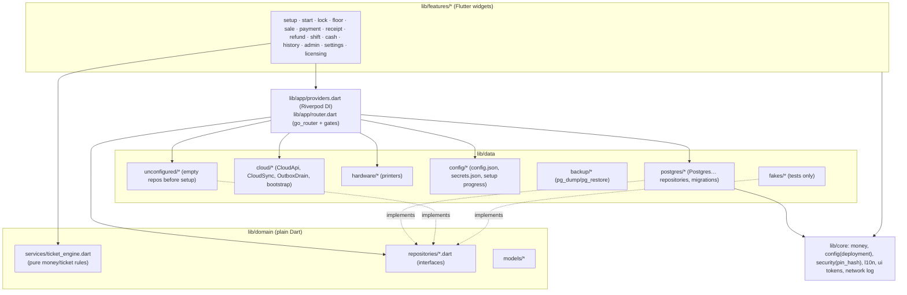

* The DI seam is `lib/app/providers.dart` (3,164 lines). Repositories are chosen there; before setup completes the
  `Unconfigured…` implementations are bound, so an unconfigured till shows nothing and refuses to sell
  (`ordersRepositoryProvider`, `providers.dart:259-300`). [CODE]
* Order writes are decorated: `PostgresOrdersRepository` → `SyncingOrdersRepository` (kicks the drain, cloud mode only)
  → `FilingOrdersRepository` (ETA e-invoicing, when enabled) (`providers.dart:259-300`). [CODE]
* Fakes are not bound by the app (confirmed by the DI code path above; `lib/data/fakes` is referenced from tests).

## 3. Communication between components

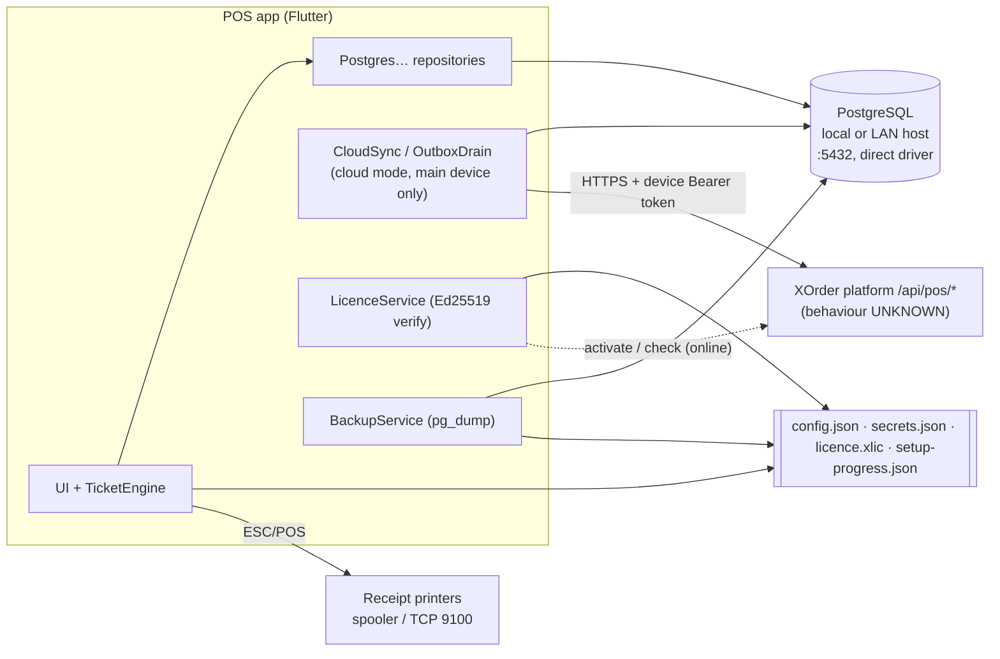

POS → platform endpoints actually referenced in code (`grep` of `lib/`; payloads/semantics server-side are UNKNOWN):
`/api/pos/bootstrap`, `/api/pos/config`, `/api/pos/orders`, `/api/pos/refunds`, `/api/pos/shifts` (+ `/{id}/close`),
`/api/pos/cash-movements`, `/api/pos/customers`, `/api/pos/terminals/{register,claim,heartbeat}`,
`/api/pos/licence/activate`, `/api/pos/license/check`, `/api/pos/branch/sales` (+`/summary`),
`/api/dashboard/pos/terminals/{id}/pairing-code`, `/api/auth/login`.

Key architectural fact: **there is no local server process / local API.** The "server" in a multi-till site is
a PostgreSQL service that every till reaches directly over TCP with a shared database role (MULTI_DEVICE.md).

## 4. Data ownership and database topology

| Data | Authoritative store today | Notes |
|---|---|---|
| Orders, payments, shifts, cash movements, refunds, audit | Local PostgreSQL (the branch DB) | Written in one transaction with the outbox row (DATABASE_AND_SYNC.md). |
| Catalogue, tables, tenders, staff, money config | Cloud mode: cloud (re-applied from bootstrap bundle, delete-and-reinsert for catalogue). Offline mode: local DB (managed in-app). | Bootstrap never touches orders/outbox/shifts/refunds/stock. |
| Stock | Local DB only | Never uploaded or downloaded. |
| Terminal identity / DB creds / device token | `config.json` + plaintext `secrets.json` in app-support dir | Not an OS keystore (SECURITY_AND_RECOVERY.md). |
| Licence | `licence.xlic` file and/or site-licence row in PostgreSQL | LICENSING.md. |
| Backups | `pg_dump` files on the same disk by default | Taken at day close or manually. |

Database topology: one PostgreSQL database `xorder_pos` per branch; roles `pos_till` (runtime, no DDL),
`pos_admin` (schema owner), `pos_backup` (read-all). Deployment is one DB per site shared by N tills on the LAN, or
one DB per machine. There is no multi-site/central database in this repo.

## 5. Dependencies and deployment requirements

* Runtime: Flutter desktop binary; PostgreSQL reachable at the configured host (installer bundles it for the
  "server" install type; "till" type installs the app only) — `installer/xorder-pos.iss` `[Types]`.
* Backups require `pg_dump`/`pg_restore` client tools on the machine (`lib/data/backup/pg_tools.dart`).
* Internet: required only for cloud-mode setup/sync and for licence activation/renewal (OPERATING_MODELS.md §6).
* Windows installer + VC++ redistributable; macOS packaging script `scripts/package_macos.sh`.
* Build-time inputs: `--dart-define` public licence key for release builds (LICENSING.md).
* Notable packages: `postgres` (pure Dart), `dio`, `riverpod`, `go_router`, `cryptography` (Ed25519), `win32`/`ffi`, `excel`, `csv`.
* No native keystore, crash-reporting, telemetry, or auto-update package in `pubspec.yaml`.

## 6. Documentation vs. code disagreements found

| Claim in docs | Code reality | Source |
|---|---|---|
| Three deployment modes (cloud/branch-server/islanded) — `CLAUDE.md` | `DeploymentMode` has two: `cloud`, `offline` (old values are aliases) | `lib/core/config/deployment.dart` |
| Secrets in OS keystore / DPAPI / Keychain (comments) | Plaintext `secrets.json`, `chmod 600` on POSIX only | SECURITY_AND_RECOVERY.md §14 |
| Fingerprint is hardware-derived | Random UUID in `config.json` + constant salt | LICENSING.md |
| Docs say `hostssl` for LAN | Installer writes `host` entries, no `ssl=on` | DATABASE_AND_SYNC.md |
| Wizard language applies immediately (comment) | Applied at `complete()` | CURRENT_SETUP_WIZARD.md |
| Cloud tills have an in-app back office (pane logic/docs) | Router shows only a signpost for claimed cloud terminals | FEATURE_INVENTORY.md (Part 2) |
| `PlatformEndpoint`: operators can't repoint licence checks | Licence step has an editable licence-server URL | LICENSING.md |

## 7. Test assets (observed to exist; not executed)

252 `*_test.dart` files under `test/`, 6 files in `integration_test/`. PostgreSQL-backed suites are tagged `integration`
and self-skip when `POS_PG_HOST` is unset (`dart_test.yaml`). `PROJECT_REVIEW.md` (2026-08-28) reports 213 passed /
6 skipped — an author's claim, not re-verified. Verification is local (`scripts/check.sh`); no automatic CI test gate.


---

<!-- ===== PART 3: OPERATING_MODELS.md ===== -->

# Operating models: Plan A (Cloud + offline-first) and Plan B (offline-only, LAN)

Scope: what the POS repo's executable code does today. The Laravel backend, Vue admin and cloud services are not available; anything about them is UNKNOWN except what this client calls (`lib/data/cloud/cloud_api.dart`).
Evidence levels: **[CODE]** read in source; **[ASSUMED]** inferred, not verified; **[OBSERVED]** none (no Flutter, Dart or PostgreSQL in the audit sandbox, so no test was executed). "Test exists (not executed here)" means the test file was read, not run.
Status labels: IMPLEMENTED | PARTIAL | NOT_IMPLEMENTED | UNKNOWN.

## 0. Headline findings

| # | Finding | Evidence |
|---|---|---|
| 1 | The code has **two** deployment modes, `cloud` and `offline`. The three modes in `CLAUDE.md` (cloud / branch / islanded) are stale. `branch_server` and `standalone` survive only as legacy wire strings that parse to `offline`. "Islanded" appears only in a comment. | [CODE] `lib/core/config/deployment.dart:10-57`, `grep -rn islanded lib` |
| 2 | Plan A = `DeploymentMode.cloud`. Plan B = `DeploymentMode.offline`. Both are IMPLEMENTED as modes. The licence's `modes[]` claim decides which the wizard offers; the operator's wizard tile picks one when the licence covers both. | [CODE] `setup_state.dart:166-169`, `setup_controller.dart:311-353` |
| 3 | Plan B does NOT mean "no internet ever". Activation and renewal go to `{platform}/api/pos/licence/activate`. The signature check is offline, but **no UI can import a signed `.xlic` file**; the file-import path exists only as a controller parameter used by tests. | [CODE] `platform_licence_api.dart:89-90`, `setup_panes.dart:674`, `licence_screen.dart:78-103` |
| 4 | `max_offline_days` is parsed from the licence and **never read** by any enforcement code. | [CODE] `license.dart:126,168`; `grep -rn maxOfflineDays lib` returns only license.dart |
| 5 | Licence enforcement is one gate: **opening a shift**. It never stops a sale already in progress. An expired-past-grace licence has `canSell: true`. | [CODE] `license_verifier.dart:290-296`, `start_screen.dart:67-68,150` |
| 6 | There is **no way to switch plans in place**. The only route is "Reset terminal" (wipes `config.json`, secrets, wizard progress; leaves the database) and re-running the wizard. There is no data migration or backfill either way. | [CODE] `providers.dart:2061-2094`, `management_terminal_pane.dart:60-102` |
| 7 | Automatic backups exist but only as "after the trading day is closed", written to a folder on the machine that closed the day (default: same disk as the database). There is no timer-based schedule and no off-box destination unless the operator copies by hand. | [CODE] `day_close_dialog.dart:67-72`, `backup_service.dart:654-675` |
| 8 | LAN multi-POS is a shared PostgreSQL reached directly by every till. No local API, no discovery, no live cross-till refresh. See `MULTI_DEVICE.md`. | [CODE] |
| 9 | If the database is unreachable the till refuses the sale. There is no second local store to fall back to. | [CODE] `payment_screen.dart:165-195` |

## 1. Table of the deployment modes as coded

`DeploymentMode` has exactly two values (`deployment.dart:10-27`).

| Aspect | `cloud` (Plan A) | `offline` (Plan B) | Where in code |
|---|---|---|---|
| Wire value | `cloud` | `offline` (also reads legacy `branch_server`, `standalone`) | `deployment.dart:14,27,46-49` |
| Needs `baseUrl` | yes, unless the terminal is a child | no (forced to `null` on parse) | `deployment.dart:60,304-308,421` |
| Sends sales to the platform | yes | no | `deployment.dart:67` |
| Enqueues to `pos_outbox` / `pos_sync_outbox` | yes, in the same DB transaction as the sale | no, `_enqueueForSync` returns false; `pendingSyncCount` returns 0 | `postgres_orders_repository.dart:337-340,361-362`; shift/cash/refund repos use the same flag |
| `CloudSync` (heartbeat, bootstrap refresh, drain) | runs on the main device, needs device token | `posCloudApiProvider` returns null, so no `CloudSync` | `providers.dart:655-664,688-755` |
| Sync policy `automatic`/`manual` | meaningful | ignored | `deployment.dart:236-241` |
| Catalogue authority | platform; `BootstrapSeeder` wipes and rewrites catalogue, floor, tenders, money config | local; Management (admin DB role) authors the menu | `bootstrap_seeder.dart:42-47,530-543`; `local_bootstrap.dart:875` and the comment above it |
| Till DB grants | gets `cloudSeeding` grants (INSERT/UPDATE/DELETE on catalogue tables) | does not; catalogue is SELECT-only for the till role | `setup_controller.dart:671-678`, `local_bootstrap.dart:655,875` |
| Provisioning | pairing code or sign-in against the platform, device token, bootstrap bundle with licence embed | owner PIN registered locally in `pos_staff`; terminal row inserted into local `pos_terminals` | `providers.dart:589-651`, `postgres_directory_repositories.dart:225-290` |
| Licence verdict | file, plus `OnlineLicenceService` asks `/api/pos/license/check` and caches; if the platform says `enforcement: offline` it falls back to the file | file only | `providers.dart:1633-1676`, `online_licence_service.dart:230-279` |
| Check-in cadence | heartbeat after 5 s, then every 4 h when settled, 30 min when not | **none**: `requiresPeriodicCheckIn` is declared but no code reads it | `providers.dart:735-752`, `cloud_sync.dart:55-59`; `grep requiresPeriodicCheckIn lib` finds only the declaration |
| DB location | `databaseHost` (default `localhost`; LAN host if licence `max_terminals > 1`) | same | `deployment.dart:199-204`, `setup_controller.dart:306-340,1249` |

What a "branch" or "islanded" mode would mean now: "branch" = `offline` with `databaseHost` set to a LAN address; "islanded" = `offline` or a cloud till that cannot reach the platform. Neither is a stored value. `docs/pos/08-deployment-modes.md:19` says the same ("There used to be three").

## 2. The ten questions

### Q1. Capabilities that exist today, per plan

| Capability | Plan A (cloud) | Plan B (offline) | Evidence / tests |
|---|---|---|---|
| Sell, park tickets, pay, refund, shifts, cash movements, business day | IMPLEMENTED (PostgreSQL first) | IMPLEMENTED | `postgres_orders_repository.dart`, `postgres_shift_repository.dart`, `postgres_business_day_repository.dart`. Tests exist (not executed here): `test/data/offline_end_to_end_test.dart`, `postgres_integration_test.dart`, `postgres_shift_test.dart` |
| Local PostgreSQL as source of record | IMPLEMENTED | IMPLEMENTED | `pos_database.dart`, `migrations.dart` |
| Outbound queue with idempotency | IMPLEMENTED | n/a | `migrations.dart:345-372,4358-4383`, `outbox_drain.dart`; `test/data/outbox_drain_test.dart` (not executed) |
| Catalogue/staff/floor pulled from platform | IMPLEMENTED | n/a | `bootstrap_seeder.dart`; `test/data/cloud_bootstrap_test.dart` (not executed) |
| Pairing code / device token | IMPLEMENTED client side | n/a | `cloud_provisioning_repository.dart`, `device_token_vault.dart`. Server side UNKNOWN |
| Licence: signature verify (Ed25519), expiry, grace, tenant, mode, fingerprint | IMPLEMENTED | IMPLEMENTED | `license_verifier.dart:116-297`; `test/features/licence_signing_test.dart`, `licensing_test.dart` (not executed) |
| Licence online activation by key | IMPLEMENTED (client) | IMPLEMENTED (client; needs internet) | `platform_licence_api.dart`; `test/features/offline_licence_activation_test.dart` |
| Licence activation by signed file, no internet | PARTIAL: verifier and controller param exist, **no UI entry point** | PARTIAL, same | see Q10 |
| Licence renewal without internet | NOT_IMPLEMENTED in UI (same gap) | NOT_IMPLEMENTED in UI | see Q10 |
| Offline licence issuing tool | IMPLEMENTED (vendor tool `bin/pos_licence.dart issue`) | same | `bin/pos_licence.dart:88-151` |
| Multiple tills on a LAN | PARTIAL (shared DB; main device drains for all) | PARTIAL (shared DB) | `MULTI_DEVICE.md` |
| Automatic local backup | PARTIAL (at day close only) | PARTIAL | Q10 |
| Cloud sync of stock, purchasing, suppliers | NOT_IMPLEMENTED: no stock/purchase endpoint in `lib/data/cloud/*` (grep `stock` in that folder returns nothing) | n/a | [CODE] |

### Q2. How the operating mode is determined and where it is persisted

Chain, in order of authority at boot:

1. **Persisted `config.json`** (`FileTerminalConfigStore`, `terminal_config_store.dart:37-81`, in the app-support directory; written atomically by temp file and rename). `DeploymentConfig.fromJson` reads `deployment.mode`; absent or unknown reads as `cloud` (`deployment.dart:411-414`). `main()` loads it and seeds `terminalBootProvider` (`main.dart`), then `DeploymentController.build()` returns `config.deployment` or `DeploymentConfig.unconfigured`, which is **cloud with nothing set** (`deployment.dart:164`, `providers.dart:2014-2022`). A saved config is only used if `isUsable` (`terminal_config_store.dart:59`); a half-written file reads as "no config" and the wizard reopens.
2. **First install, wizard** (`SetupController`): licence step runs first (`setup_state.dart:23-60`). `licensedModes` = the licence's `modes[]`, or all modes if empty (`setup_state.dart:166-169`). If more than one mode is licensed, the wizard asks (`asksSetupType`, `setup_state.dart:245`); if one, the choice is made for the operator (`_adopt`/`_coveredMode`, `setup_controller.dart:1232-1290`). `setMode` refuses a mode the licence does not cover (`setup_controller.dart:317`).
3. **Role** (main or child) is separate from mode: `TerminalRole` (`deployment.dart:123-141`). A fresh install's role comes from `deviceRoleProvider` (`providers.dart:1738-1741`): Android/iOS is always child; a Windows desktop is child only if the installer wrote `%ProgramData%\XOrder POS\install-role.json` (`installed_role.dart:56-78`); otherwise main. A child takes its mode from the main device's `pos_site_licence.mode` row (`setup_controller.dart:1349`, `postgres_site_licence.dart`).
4. **Re-check at every boot**: `LicenseVerifier.evaluateClaims` denies with `modeNotLicensed` if the licence's `modes[]` is non-empty and does not contain the persisted mode (`license_verifier.dart:227-232`). That denial blocks opening a shift (not sales in progress).

Persistence summary: mode lives in `config.json` per terminal; a child's mode copy comes from the shared DB row `pos_site_licence.mode` (CHECK `IN ('cloud','offline')`, `migrations.dart:3906-3920`). It is not stored in the database for a main device, and not derived from the licence at each boot (the licence only vetoes).

Tests (not executed here): `test/features/licence_decides_mode_test.dart`, `test/features/child_terminal_test.dart`, `test/features/setup_persistence_test.dart`.

### Q3. Does the licence control the model?

Status: **PARTIAL (restricts, does not select).**

- The licence **gates which modes the wizard offers** and **vetoes opening a shift** in a mode it does not cover. [CODE] above.
- The licence does **not** set the mode at runtime. If it covers both, nothing but `config.json` says which one runs.
- It also controls the shape of the LAN: `max_terminals > 1` is the only thing that unlocks a non-local `databaseHost` in the wizard (`setup_state.dart:182`, `setup_controller.dart:332-336,1249`) and the only thing that makes the main device publish its licence to children (`providers.dart:1825`).
- Everything the licence says is checked only against the local clock (`license_verifier.dart:244-253`, `now: clock()` with `DateTime.now`). No monotonic or last-seen-time check was found (searched: `rollback`, `lastSeen`, `monotonic`, `clock` in `lib/features/licensing`). Setting the system clock back extends a licence. [CODE]/[ASSUMED] on exploitability.
- The licence signing key is injected at build time for release builds. A **development public key is embedded in source** (`license_keys.dart:50`), used only when the release define is absent. A release build without the define throws at startup (`license_keys.dart:56-60`). Not reproduced here.
- A licence file can carry its own `issuer_public_key`. It is trusted **only in non-release builds** (`LicenseVerifier.trustIssuerKey = !_release`, `license_verifier.dart:86,112`). [CODE]

### Q4. Can the system switch plans after install? What happens to data?

Status: **NOT_IMPLEMENTED as a feature.** Only a destructive-to-config reset exists.

Path: Management > System > Terminal > "Reset terminal" (`management_terminal_pane.dart:60-102`) or the forced reset `Ctrl/Cmd+Shift+R` (`force_reset_dialog.dart`). `TerminalReset.run()` (`providers.dart:2066-2094`) clears `config.json`, the wizard progress file, the DB password secret, the admin secret, and in-memory providers. The device token (`secrets.json` key `pos_cloud_device_token`) is **not** in that list [CODE: `terminalResetProvider` clears only the db and admin password stores; `deviceTokenVaultProvider` is not touched].

Data consequences [CODE unless marked]:

| Switch | Effect on existing PostgreSQL data | Risk |
|---|---|---|
| Cloud to Offline | Rows stay. `pos_outbox`/`pos_sync_outbox` rows with `delivered_at IS NULL` stay forever; offline mode reports `pendingSyncCount = 0` (`postgres_orders_repository.dart:361-362`) so the debt becomes invisible. Reset is refused only for an open shift, not for a non-empty outbox (`management_terminal_pane.dart:79-86`). | Unsent sales silently stranded unless the terminal later returns to cloud on the same DB. |
| Offline to Cloud | Sales made while offline were never enqueued, and no backfill exists (`grep -i backfill lib` shows only schema backfills). They never reach the platform. A claim then runs `BootstrapSeeder`, which deletes and rewrites catalogue tables (`bootstrap_seeder.dart:530-543`). Local product ids are replaced by the platform's. | History is local only; catalogue identity changes. Whether a platform accepts historical orders is UNKNOWN. |
| Either way | Not a "switch": the wizard re-runs from the licence step; the DB can be reused ("database already there", `setup_controller.dart:1557`). Staff and PINs in the DB persist for offline; for cloud the staff table is rewritten from the bundle. | |

Reset does not protect a terminal that is a main device with children: children keep pointing at the same host with the old mode copied from `pos_site_licence.mode` (`mode` there is overwritten only when the main device republishes, `providers.dart:1814-1843`). [CODE]
No test found for a mode switch with pending outbox rows.

### Q5. Actual data flow per model

#### Plan A (cloud), as coded

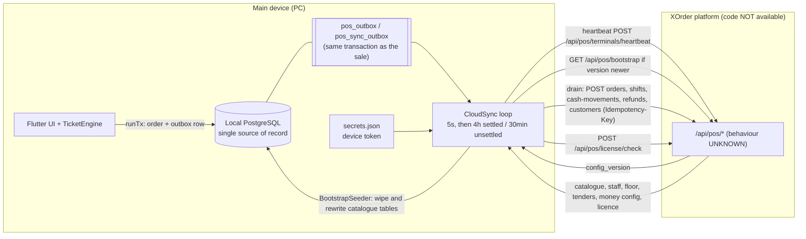

Downward (platform authoritative): catalogue, modifiers, floor, staff, tender types, money/tax config, receipt profile, embedded licence (`bootstrap_seeder.dart`, `cloud_provisioning_repository.dart`). Only applied if `config_version` is newer (stale/unchanged are skipped, `bootstrap_seeder.dart:62-75`).
Upward (device authoritative until delivered): orders (with `priced_offline: true` and `asserted_totals`), shifts, cash movements, refunds, customers (`outbox_drain.dart:140-170`, `cloud_api.dart:173-213`).
Not synced either way [CODE]: stock levels/movements, purchase orders, suppliers, audit events, parked tickets, print jobs.

Conflict rules as implemented (answers the "cloud authoritative must not discard local transactions" requirement):

| Local data | Protection in code | Gaps |
|---|---|---|
| Settled sale | Row in `pos_orders` plus `pos_outbox` row written in one transaction (`postgres_orders_repository.dart:329-345`). Till role has no DELETE on orders or outbox (`local_bootstrap.dart` comments at outbox grant). Idempotency key = `client_transaction_id`, replayed on retry. | A UI `submit` failure leaves no row (sale refused, Q8). |
| Platform rejects a sale | Codes `VALIDATION_FAILED`, `IDEMPOTENCY_PAYLOAD_MISMATCH`, `MENU_ITEM_NOT_FOUND`, `BRANCH_NOT_IN_TENANT`, `CUSTOMER_NOT_FOUND`, `REFUND_EXCEEDS_SOLD` quarantine the record locally (kept, never deleted); every other code defers and retries (`outbox_drain.dart:107-124`). UI: `management_sync_pane.dart` lists quarantine (file mentions it; contents not fully read). | No automatic resolution. A quarantined sale is local money the platform does not have until a person acts. |
| Platform re-prices differently | Order stays on both sides; `totals_mismatch` flag set locally (`outbox_drain.dart:~385-400`). Platform invoice number stored in separate `server_invoice_number`. | What the platform's own books say is UNKNOWN. |
| Reseed from bundle | Touches catalogue, floor, staff (deactivate, never delete), tenders, money config. Does not touch orders, payments, shifts, outbox. Order lines snapshot name and price (`bootstrap_seeder.dart:42-47`). | A reseed while a ticket is parked: `pos_parked_tickets` holds a jsonb ticket that references product ids; ids change after the wipe-and-rewrite. Whether `ParkedTicketCodec.decode` tolerates that was not traced. [ASSUMED risk] |
| Revoked device token (HTTP 401) | `deviceTokenRejected` set; drain skipped; banner shown; sales continue locally (`cloud_sync.dart:96-101`, `providers.dart:1064`). | Pending count climbs until re-pair. |
| Unpaid local stock/purchasing changes | Local only. | Never reach the cloud; conflict undefined. |

Tests (not executed here): `outbox_drain_test.dart`, `cloud_bootstrap_test.dart`, `cloud_refunds_test.dart`, `test/app/terminal_rejected_test.dart`.

#### Plan B (offline), as coded

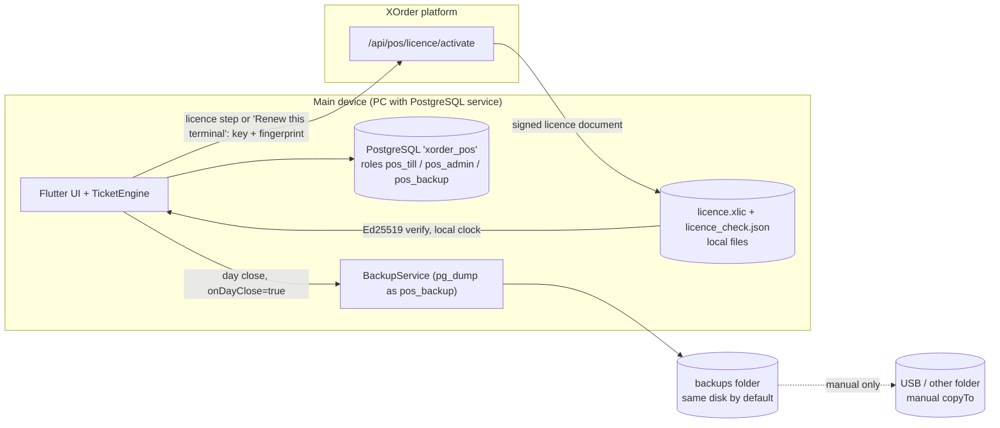

No sale, stock, staff or catalogue data leaves the machine. Outbound traffic is the licence request only (`platform_licence_api.dart:89-103`: key, `deployment_mode`, fingerprint, optional `tenant_slug`).
Offline-mode `OnlineLicenceService` is not used (needs `posCloudApiProvider`, which is null), so no periodic contact happens at all. The comment "an offline terminal reaches the platform to renew within the window" (`deployment.dart:18-23`) has **no code behind it** for the periodic part.

### Q6. Features that need internet

| Feature | Mode | Needs internet | Evidence |
|---|---|---|---|
| First-time licence activation by key | both | yes (`POST {platform}/api/pos/licence/activate`, 10 s connect timeout) | `platform_licence_api.dart:89,34` |
| Licence renewal ("Check for renewal", "Activate key") | both | yes, and requires the key to be typed again (the button passes `_keyController.text`) | `licence_screen.dart:91-106` |
| Cloud claim by pairing code / sign-in | cloud | yes | `cloud_provisioning_repository.dart` |
| Bootstrap pull, heartbeat, drain | cloud | yes (but failure is non-fatal, `cloud_sync.dart:90-93`) | |
| Online licence verdict (`/api/pos/license/check`) | cloud | yes, cache otherwise | `online_licence_service.dart` |
| Back-office branch sales view across tills | cloud | yes (`/api/pos/branch/sales*`) | `branch_sales_api.dart:55,66` |
| Tax authority (ETA) filing | optional | yes; flag-gated (`etaFilingEnabled`) | `providers.dart:2732-2790` |
| Currency, language, printing, shifts, selling | both | no | |

The cloud-mode wizard needs the platform for provisioning (pairing code or credentials). The offline wizard needs it only for licence activation, because the file route has no UI.

### Q7. What works fully offline

After setup, both modes can: take orders, split payments, park and resume tickets (to PostgreSQL), open/close shifts, cash movements, refunds, day close, local reports, receipts and printing, stock movements, purchasing, supplier invoices, Management over the admin DB role, and backups to disk. [CODE] The one hard condition is that the PostgreSQL the till points at is reachable (Q8). Cloud-only cached state: the catalogue is a local copy refreshed on `config_version` change.

### Q8. Behaviour after disconnect and reconnect

Two different disconnects:

**Platform unreachable (cloud mode)** — IMPLEMENTED.
- `CloudReply.offline()` on any Dio error (`cloud_api.dart:258-269`). Heartbeat failure does not stop the drain (`cloud_sync.dart:90-93`). A pass that sees the platform stop answering stops early (`wentOffline`, `outbox_drain.dart:34-36`). Retry cadence 30 min (`cloud_sync.dart:55-59`), plus a kick after each settled sale (`SyncingOrdersRepository`, `providers.dart:281-285`). Manual policy only drains on demand and offers a drain on shift close.
- Reconnect: the next pass drains up to 25 orders (`passLimit`) per run, then continues on the 30-min retry. A 100-order backlog takes about 4 passes, or about 90 minutes of retry cadence, unless the sale kick or manual drain fires. [CODE: derived from `passLimit = 25` and `retry = 30min`]
- Licence under `OnlineLicenceService`: trusts the cached verdict if the last verdict was definite; otherwise the file (`online_licence_service.dart:270-278`).

**Database unreachable** (either mode) — the till stops trading.
- `PosDatabase` pool: 5 s connect timeout, 10 s query timeout, 4 connections (`pos_database.dart:273-296`). Failures become `PosDbException`.
- Payment: `submit` throws, the screen restores the pre-tender ticket and shows "payment could not be recorded"; nothing is stored anywhere else (`payment_screen.dart:175-195`). Parking returns `false` and keeps the live ticket in memory (`providers.dart:933-945`).
- The top bar shows a pill from `branchDatabaseProvider` (probe `SELECT 1`) (`pos_top_bar.dart:81-90`). The probe is invalidated by tapping the pill; it does not poll. [CODE]
- Reconnect: the pool reconnects on next use. No replay is needed because nothing was queued. A ticket held only in memory when the app is closed is lost.

### Q9. Does the architecture support both models?

Status: **PARTIAL, yes in design, with gaps.** [CODE]

Supported by design:
- One schema, one set of repositories, mode as a flag that switches enqueueing, sync loop, provisioning and grants. The UI depends on `lib/domain/repositories` interfaces (`providers.dart` is the single binding point).
- Both modes share the same offline-first write path (PostgreSQL then optional outbox).

Not supported / weak:
- No in-place switch (Q4).
- Unconfigured state defaults to `cloud` (`deployment.dart:164`, `fromJson` fallback), so a damaged or unknown mode value silently becomes cloud.
- Periodic check-in for offline licences has no implementation (`requiresPeriodicCheckIn`, `max_offline_days`).
- Stock/purchasing are local in both models; Plan A has no cloud counterpart for them.
- Plan A multi-till on a shared DB: child tills have no device token and are unknown to the platform (`providers.dart:597-599` comment; `posCloudApiProvider` returns null for children). Their sales leave via the main device's token. The order request has no terminal field (`outbox_drain.dart:140-170`), so how the platform attributes child-till sales is UNKNOWN.

### Q10. Missing or partial requirements

#### Plan A (Cloud + offline-first, cloud authoritative)

| Requirement | Status | Detail |
|---|---|---|
| Offline selling | IMPLEMENTED | PostgreSQL first |
| Queue and idempotent upload | IMPLEMENTED | Q5 |
| Cloud authoritative for catalogue/config | IMPLEMENTED | version-gated overwrite |
| Cloud authoritative on sale conflict without data loss | PARTIAL | server re-price flagged, rejected records quarantined and kept; no resolution UI audited in depth, server rules UNKNOWN |
| Pull of changes made on other devices (other branches/online orders) | NOT_IMPLEMENTED | only `bootstrap` (config) is pulled; no orders/stock pull endpoint in `cloud_api.dart` |
| Stock sync | NOT_IMPLEMENTED | |
| Multi-till under cloud | PARTIAL | one main device drains for all; children invisible to platform; main device off means no sync for children's sales |
| Device revocation handling | IMPLEMENTED | banner on 401 |
| Per-device sync visibility on the platform | UNKNOWN | heartbeat payload sends pending count, oldest pending, shift open (`cloud_sync.dart:203-212`) |

#### Plan B (offline-only, multi-POS LAN, auto backups, offline signed licence)

| Requirement | Status | Detail |
|---|---|---|
| Offline-only operation | IMPLEMENTED | no sync code runs |
| Multi-POS on a LAN | PARTIAL | direct shared PostgreSQL; manual host entry; plaintext on LAN unless TLS is configured by hand; no live refresh of parked tables; no discovery (`MULTI_DEVICE.md`) |
| Automatic local backups | PARTIAL | only after day close, default folder on the same disk; keep last 14 (`backup_service.dart:49`); pg_dump as read-only `pos_backup` role; checksum verified; manual USB copy (`copyTo`, line 531). No clock schedule; no warning when a day is never closed. Runs on whichever machine closes the day, not necessarily the DB host. Restore needs the admin password and is blocked by open shifts/day (`RestoreBlockerKind`) |
| Offline signed licence **activation** | PARTIAL | signature/expiry logic offline: IMPLEMENTED. The `.xlic` file can be produced by `bin/pos_licence.dart issue`. **No file picker or paste field calls `activateLicence(fileContents:)`**; searched `FilePicker`, `fileContents:`, `xlic`, "from file" in `lib/features/licensing` and `lib/features/setup`. `licenceOfflineHelp` tells the installer to ask the supplier for a different build. File import exists only in tests |
| Offline signed licence **renewal** | NOT_IMPLEMENTED (UI); IMPLEMENTED (logic) | `licence_screen.dart` renewal calls the online route. The screen text says "re-checks at start-up and before each shift opens", but the file-only service re-reads the stored file only (`licence_service.dart:242-248`); no code fetches a newer file automatically (searched `activate(` callers) |
| No cloud sync | IMPLEMENTED | |
| Maximum offline window enforcement | NOT_IMPLEMENTED | `max_offline_days` parsed, unused |
| Licence tamper resistance (clock rollback, copied identity) | NOT_IMPLEMENTED | local clock only; fingerprint is `sha256("xorder-pos-terminal:"+installationId)` of an id stored in `config.json`, not hardware-bound (`file_license_store.dart:78-91`) |
| Licence seat enforcement for LAN tills | PARTIAL | wizard-only check (`setup_controller.dart:1742`) |
| Platform contact required | partially | activation only |

#### Doc vs code disagreements found while writing this

| Claim | Where | Reality |
|---|---|---|
| Three modes: cloud, branch-server, islanded | `CLAUDE.md` | two modes in code |
| "Renewals ... this terminal re-checks at start-up and before each shift opens" | `app_strings.dart:3877-3881` | true only for the online verdict in cloud with a device token (`OnlineLicenceService`); a file-licensed till only re-reads its file |
| Offline terminal "must renew within the window" | `deployment.dart:18-23` | no code enforces a window |
| "Activate from file already accepts bytes from anybody" | `deployment.dart:182-183`, `platform_endpoint.dart` | no UI exposes it |
| Secrets in "OS keystore" | several comments, `deployment.dart:207-209` | secrets are in `secrets.json` in app-support, mode 600 on POSIX; explicit owner decision recorded (`file_secret_store.dart` header) |

## 3. Open questions for the product owner

1. Must an offline customer be able to activate and renew with no internet at all (file import UI), or is "occasional internet" acceptable?
2. Should an offline licence enforce a maximum offline window (`max_offline_days`), and what happens at expiry (sales or only new shifts)?
3. Is in-place switching between Plan A and Plan B required? If so, what is the expected treatment of unsent sales and of history?
4. Is an off-box backup destination (USB, NAS, cloud) mandatory for Plan B, and should it run on a clock schedule?
5. For Plan A with several tills on a LAN, is it acceptable that child tills are invisible to the platform and that the main device must be on for sync?


---

<!-- ===== PART 4: DATABASE_AND_SYNC.md ===== -->

# XOrder POS — Database, Offline Persistence, Outbox/Sync, Backup & Crash Recovery

Read-only discovery audit. Scope: `/home/user/xorder-pos` only. The Laravel backend, Vue admin and cloud services are **not available**; everything about server behaviour is UNKNOWN except what this client sends and how it reacts to replies.

Evidence levels: **[CODE]** read in executable code or SQL; **[DOC]** claimed only in docs/comments (not evidence); **[UNVERIFIED]** inference. **[OBSERVED]** is not used anywhere: nothing could be executed (no Flutter/Dart/PostgreSQL in the sandbox). "test exists (not executed here)" means the test file was read, not run.

Status labels: IMPLEMENTED | PARTIAL | NOT_IMPLEMENTED | UNKNOWN.

---

## 0. Executive summary

| # | Fact | Status | Evidence |
|---|------|--------|----------|
| 1 | Every till writes sales to a local PostgreSQL first; the sale, its lines, payments, stock issue and its outbox claim commit in **one transaction**. | IMPLEMENTED | `lib/data/postgres/postgres_orders_repository.dart:73-193` |
| 2 | Upload is an outbox pattern: `pos_outbox` (orders) + `pos_sync_outbox` (customer, shift open/close, cash movement, refund). Rows are never deleted; `delivered_at` / `quarantined_at` mark them. | IMPLEMENTED | `lib/data/cloud/outbox_drain.dart`, migrations 4, 6, 49 |
| 3 | Idempotency key = the order's `client_transaction_id` (body + `Idempotency-Key` header); payment keys are deterministic UUIDv5. Duplicate prevention beyond the client key depends on the server (UNKNOWN). | IMPLEMENTED (client) / UNKNOWN (server) | `outbox_drain.dart:105-111`, `cloud_api.dart:174-178,243-254` |
| 4 | There is **no row lease / "claimed" state, no per-row backoff, no attempt cap**. A crash between HTTP send and the local `UPDATE` just re-sends the same key on the next pass. | IMPLEMENTED (by omission) | `outbox_drain.dart:307-456`; migrations 4/6/49 columns |
| 5 | **Conflict detection/resolution as such does not exist.** Rejections are classified by the server's `code` only: 6 codes quarantine, everything else (incl. any 409/422/5xx without a known code) defers forever. Nothing in the app releases a quarantined row. | PARTIAL | `outbox_drain.dart:119-131`; grep for `quarantined_at = NULL`/release: none |
| 6 | Bootstrap re-apply (`BootstrapSeeder.seed`) does **not touch** `pos_orders`, `pos_order_*`, `pos_outbox`, `pos_sync_outbox`, `pos_shifts`, `pos_stock_*`. It does DELETE+reinsert the catalog (`pos_products`, categories, modifiers, tables) and upserts staff/tenders/customers/money config. | IMPLEMENTED | `bootstrap_seeder.dart:53-104,509-676` |
| 7 | Latent hazard: `DELETE FROM pos_products` is blocked by `pos_stock_movements.product_id … ON DELETE RESTRICT` (and `pos_combo_options` RESTRICT); on violation the whole seed tx rolls back and is silently retried each pass. Reachable only if a cloud till has stock movements, which the cloud UI hides (see §6.4). | PARTIAL | `migrations.dart:2620,1909`; `cloud_sync.dart:162-177`; `test/features/cloud_purchasing_hidden_test.dart` |
| 8 | **Stock/inventory is never uploaded or downloaded.** No `/api/pos/*` call mentions stock; bundle parser has no stock field. Stock is local-only. | NOT_IMPLEMENTED (sync) | grep of all HTTP paths (§5.1); `bootstrap_bundle.dart` |
| 9 | Backups: `pg_dump -Fc` at **day close only** (default on) + manual button in Management (not present on cloud back office). Verified by `pg_restore --list` + read-through, SHA-256 recorded. **Restore ignores the outbox**: it guards only open shift/business day, not unsent sales. | PARTIAL | `backup_service.dart:150-300,345-517`, `day_close_dialog.dart:55-76` |
| 10 | DB passwords and the cloud device token are stored in a **plaintext JSON file** (`secrets.json`, `chmod 600` on macOS/Linux, nothing on Windows) — not an OS keystore, despite comments saying so. Installer writes all DB role passwords to `install-credentials.json` (ACL-restricted). | IMPLEMENTED (weak) | `lib/data/config/file_secret_store.dart`, `provision.ps1:114-133` |
| 11 | LAN access: installer writes `host … scram-sha-256` (not `hostssl`) and never enables `ssl`; client uses `SslMode.disable` whenever the host is loopback or a trusted private address. `docs/pos/08-postgres-lan.md` shows `hostssl`/`ssl = on` — doc and installer disagree. | IMPLEMENTED (plaintext LAN) | `provision.ps1:158-168`, `pos_database.dart:293-295` |
| 12 | A 2xx reply with an unparseable/empty body (e.g. captive-portal HTML) is treated as **delivered**. | IMPLEMENTED (defect) | `cloud_api.dart:256-270`, `outbox_drain.dart:372-426` |

---

## 1. PostgreSQL install / initialisation

### 1.1 Windows installer path

| Item | Detail | Status |
|---|---|---|
| Inno Setup bundles `pgsql\` (PostgreSQL binaries), `tools\pos_migrate.exe`, `tools\provision.ps1`, VC++ redist | `installer/xorder-pos.iss:80-84` | IMPLEMENTED |
| `provision.ps1` (elevated, re-runnable) | `installer/provision.ps1` | IMPLEMENTED |
| First run (`PG_VERSION` absent): picks first free port 5432–5442, generates 24-char random passwords for `postgres`, `pos_admin`, `pos_till`, `pos_backup` (crypto RNG), writes them to `%ProgramData%\XOrder POS\install-credentials.json` **before** `initdb`, locks it to Administrators+SYSTEM via `icacls` | `provision.ps1:114-134` | IMPLEMENTED |
| `initdb -A scram-sha-256 -E UTF8 --locale=C`, superuser password via temp `--pwfile` (deleted in `finally`) | `provision.ps1:139-146` | IMPLEMENTED |
| `postgresql.conf` / `pg_hba.conf` edited in a managed marker block: `listen_addresses` = `localhost` or `*` (with `-Lan`); LAN adds `host all all <10/8,172.16/12,192.168/16> scram-sha-256`; firewall rule only with `-Lan`, Private/Domain profiles | `provision.ps1:158-176` | IMPLEMENTED |
| Service `XOrderPOS-PostgreSQL` registered with `pg_ctl register -S auto -U NT AUTHORITY\NetworkService`, restarted, `pg_isready` wait (60 s) | `provision.ps1:178-190` | IMPLEMENTED |
| Then `pos_migrate --create-roles --create-database --owner pos_admin --no-migrate` as `postgres`, then `pos_migrate --user pos_admin --grant-to pos_till` (runs all migrations as owner, then grants) | `provision.ps1:192-208` | IMPLEMENTED |
| Passwords passed through env vars, removed in `finally`; never logged | `provision.ps1:197-211` | IMPLEMENTED |
| Uninstall removes the service and **keeps the data dir** | `provision.ps1:96-107` | IMPLEMENTED |
| Upgrade re-runs provision (idempotent; applies new migrations) | `provision.ps1` header; `xorder-pos.iss:134-140` | IMPLEMENTED |
| No tuning of `fsync`, `synchronous_commit`, `full_page_writes`, WAL, `ssl`, `log_*` | grep `fsync|synchronous|ssl|wal` over `installer/`: no hits | NOT_IMPLEMENTED (defaults used) |

Tests: `test/data/install_provisioning_test.dart`, `install_roles_test.dart`, `local_bootstrap_test.dart`, `migration_cli_test.dart` exist (not executed here).

### 1.2 macOS / non-installer path

`scripts/package_macos.sh` contains no PostgreSQL/`initdb` reference (grep). There is no macOS installer for the database: the operator must supply a PostgreSQL and use the setup wizard (`LocalBootstrap`) or `dart bin/pos_migrate.dart`. Status: PARTIAL for macOS (documented runbook `docs/pos/10-offline-install-runbook.md` only).

### 1.3 `bin/pos_migrate.dart` and `LocalBootstrap`

* `pos_migrate` flags: `--create-roles`, `--create-database`, `--owner`, `--no-migrate`, `--status`, `--seed`, `--seed-catalogue`, `--grant-to`, `--grant-admin-to`, `--cloud-till` (`bin/pos_migrate.dart:33-108,160-195,593-698`). Password from `POS_PG_PASSWORD` env (or `--password`). `--seed-catalogue` puts a demo menu on a DB (explicitly separate from `--seed`).
* Role creation SQL (`local_bootstrap.dart:283-306`): `pos_admin` = `LOGIN CREATEDB` (no superuser/CREATEROLE); `pos_till` = `LOGIN` only, then table-by-table grants; `pos_backup` = `LOGIN` + `GRANT pg_read_all_data`. Password is inlined as a quoted literal (CREATE ROLE takes no bind params).
* Wizard and CLI share `LocalBootstrap.tillGrants` / `administrativeGrants` (`local_bootstrap.dart:655+`), so there is one grant list. Test: `test/data/till_grants_test.dart`, `admin_grants_enforced_test.dart`, `grants_cover_usage_test.dart` (exist; not executed).
* **The app does not run migrations at launch.** `PosMigrator` is invoked only from `local_bootstrap.dart:318` (wizard), `cloud_provisioning_repository.dart:440` (claim) and `pos_migrate.dart:74`. The doc comment on `PosMigrator` ("safe to call from every till on every launch", `migrations.dart:4473-4475`) describes capability, not behaviour. grep `schema_migrations` in `lib/` outside migrations/CLI: none, so there is no startup schema-version check either. An app update on a machine where provisioning is not re-run (macOS, child tablets, manual installs) runs new code against an old schema. Status: PARTIAL.

---

## 2. Schema and migrations

### 2.1 Mechanism (`lib/data/postgres/migrations.dart`)

| Aspect | Behaviour | Evidence |
|---|---|---|
| Registry | const list `posMigrations`, **52 versions** (1…52), append-only by convention | `migrations.dart:33-4469` |
| Tracking | table `schema_migrations(version int PK, applied_at timestamptz)` created `IF NOT EXISTS` | `:4491-4495` |
| Concurrency | `pg_advisory_xact_lock(727101)` at tx start; released at commit/crash | `:23,4488` |
| Atomicity | **all pending migrations run inside ONE transaction** (`_db.runTx`); a failure rolls back every pending step, nothing half-applied | `:4483-4513` |
| Idempotency | statements use `IF NOT EXISTS` / `ADD COLUMN IF NOT EXISTS` / `DROP CONSTRAINT IF EXISTS` + the version table | e.g. `:36,4335` |
| Rollback / down migrations | **NOT_IMPLEMENTED** (grep `down|rollback` in migrations: only a comment about config_version). Recovery path is restore-from-backup | — |
| Integrity of applied history | No checksum of applied migration text; editing an applied migration silently desynchronises tills (comment-level convention only) | `:8-9`, `:4491-4495` |
| Applying as owner | tables are owned by `pos_admin`; `pos_till` has DML only, no DDL | `provision.ps1:203-208`, `local_bootstrap.dart` grants |

Tests: `test/data/postgres_integration_test.dart:87` "migrations are idempotent and run once" (integration-tagged, self-skips without `POS_PG_HOST`; not executed here).

### 2.2 Versions

1 orders/lines/payments/invoice sequence · 2 restaurants, branches, terminals, staff, menu, floor · 3 shifts · 4 outbound sync queue (`pos_outbox`) · 5 roles/audit/catalogue revisions · 6 cloud drain bookkeeping + `pos_cloud_state` · 7 parked tickets · 8 money config · 9 order lifecycle/void/reason codes · 10 discounts · 11 served_by · 12 refunds · 13 owner role caps · 14 settings, cash movements, business day · 15 owner caps · 16 tax groups/`pos_order_taxes` · 17 per-branch/channel prices · 18 combos · 19 receipt profiles · 20 e-receipt (ETA) queue · 21 QR · 22 multiple roles/overrides/ceilings · 23 payment methods as data (`pos_tender_types`) · 24 service charges · 25 order types · 26 tax-inclusive pricing · 27 suppliers · 28 purchase orders · 29 receiving + `pos_stock_movements`/`pos_stock_levels` · 30 supplier invoices/payments · 31 cancel/reversal reasons · 32 parked ticket without table · 33 supplier paid from till · 34 print queue · 35–36 trading-day stamping · 37 `pos_backups` · 38 one receipt per sale · 39 units · 40 bought-not-sold items · 41 `pos_tender_types.platform_id` · 42 single owner · 43 `pos_site_licence` · 44 PO forward-only, stock unit guard · 45 shared option groups · 46–48 owner capabilities · 49 cloud lifecycle ids + `pos_sync_outbox` + `server_invoice_number` · 50 `server_credit_note_number` · 51 `pos_customers` + `pos_orders.customer_id` · 52 opening-cost movement.

### 2.3 Main tables by domain (`CREATE TABLE` grep, `migrations.dart`)

| Domain | Tables |
|---|---|
| Sales | `pos_orders`, `pos_order_lines`, `pos_order_payments`, `pos_order_discounts`, `pos_order_line_events`, `pos_order_taxes`, `pos_order_line_items`, `pos_invoice_sequences`, `pos_customers` |
| Refunds | `pos_refunds`, `pos_refund_lines`, `pos_refund_payments` |
| Shifts / cash | `pos_shifts`, `pos_cash_drawers`, `pos_business_days`, `pos_cash_movements` |
| Sync | `pos_outbox`, `pos_sync_outbox`, `pos_cloud_state` |
| Floor / open tickets | `pos_dining_tables`, `pos_parked_tickets` |
| Catalogue | `pos_categories`, `pos_products`, `pos_modifier_groups`, `pos_modifiers`, `pos_product_modifier_groups`, `pos_modifier_group_categories`, `pos_product_prices`, `pos_combos`/`_groups`/`_options`, `pos_discounts`, `pos_discount_targets`, `pos_tax_groups`, `pos_service_charges`, `pos_order_types`, `pos_tender_types`, `pos_units`, `pos_money_config` |
| Inventory / purchasing | `pos_stock_movements`, `pos_stock_levels`, `pos_suppliers`, `pos_purchase_orders`/`_lines`/`pos_purchase_sequences`, `pos_supplier_invoices`, `pos_supplier_payments` |
| Identity / admin | `pos_restaurants`, `pos_branches`, `pos_terminals`, `pos_staff`, `pos_roles`, `pos_staff_roles`, `pos_staff_permission_overrides`, `pos_permission_limits`, `pos_audit_events`, `pos_reason_codes`, `pos_settings`, `pos_site_licence` |
| Ops | `pos_print_jobs`, `pos_eta_receipts`, `pos_eta_chains`, `pos_receipt_profiles`, `pos_backups` |

Integrity features seen in SQL (`[CODE]`): money is `bigint` minor units; `UNIQUE (restaurant_id, client_transaction_id)` on orders (`:55-56`); `UNIQUE (restaurant_id, branch_id, invoice_number)` (`:57-58`); `pos_outbox_one_per_order` unique index (`:372-374`); partial unique index one open shift per terminal (`:324`); audit ledger and `pos_backups` append-only via triggers (per grant comments `local_bootstrap.dart` and `test/data/backup_restore_test.dart:518`); refund-vs-sold trigger (`:1248`).

Note: `pos_order_lines.menu_item_id` has **no FK** to `pos_products` (`:77-92`), and `pos_order_payments.tender_type_id` has no FK (`:100-110`), so catalogue/tender replacement cannot break historical rows.

---

## 3. Connections, credentials, roles, TLS

| Topic | Behaviour | Evidence | Status |
|---|---|---|---|
| Pool | `Pool.withEndpoints`, `maxConnectionCount: 4`, `connectTimeout 5 s`, `queryTimeout 10 s`; pool keyed on host/port/db/user/password-hash and rebuilt on change | `pos_database.dart:244-300` | IMPLEMENTED |
| Transactions | `runTx` → package `postgres` `runTx`; **no isolation level or retry** set anywhere (grep `SERIALIZABLE|isolation`: none) → PostgreSQL default READ COMMITTED; errors mapped to `PosDbException` | `pos_database.dart:320-332` | IMPLEMENTED |
| Failure taxonomy | dns / tcp / auth / tls / missingDatabase / missingRole / permissionDenied / query / unknown by **string matching** the driver error | `pos_database.dart:14-105` | IMPLEMENTED (heuristic). test: `test/data/pos_db_failure_test.dart` |
| TLS | `sslMode = allowsInsecureTransport ? disable : verifyFull`; `allowsInsecureTransport = isLoopback || (!verifyTls && isPrivateHost)`. Never `require`. Public host always verifyFull. | `pos_database.dart:293-295`, `deployment.dart:350-351` | IMPLEMENTED |
| LAN server TLS | installer never sets `ssl=on`, writes `host` (not `hostssl`) lines. LAN verifyFull would fail unless operator configures certs; trusted-private mode sends scram-authenticated but unencrypted traffic. `docs/pos/08-postgres-lan.md:246,260` shows `ssl = on`/`hostssl` — **docs ≠ installer** | `provision.ps1:158-168` | PARTIAL |
| Till DB password storage | `MutablePosDbCredentials` in memory; persisted via `FileSecretStore` (`secrets.json`, key `pos_till_database_password`) under `getApplicationSupportDirectory`. Written to `.tmp` empty → `chmod 600` → content → rename (non-Windows). **On Windows `_restrict` returns immediately: no ACL hardening**. Comments in `pos_database.dart:156-157` ("backed by the OS keystore") are wrong: no keystore package (grep `flutter_secure|keychain` in `pubspec.yaml`/`main.dart`: none) | `file_secret_store.dart:31-149`, `main.dart:42,50` | IMPLEMENTED (plaintext) |
| Other secrets in same file | device token (`pos_cloud_device_token`), backup role password, admin password keys | `file_secret_store.dart:42-52`, `providers.dart:3056,3076` | IMPLEMENTED |
| Installer credentials | `install-credentials.json` holds superuser + admin + till + backup passwords in plaintext JSON; reader accepts only admin+till; `FileInstallerCredentials` returns null on permission failure | `installer_credentials.dart`, `provision.ps1:121-133` | IMPLEMENTED |
| Role | `install-role.json` (`main`/`child`) read from ProgramData | `installed_role.dart` | IMPLEMENTED |
| Role model | `pos_admin` owner/DDL; `pos_till` DML only: SELECT+INSERT on orders/lines/payments (UPDATE only column-scoped on orders), SELECT/INSERT/UPDATE on `pos_outbox`, `pos_sync_outbox`, `pos_shifts`, `pos_stock_levels`; INSERT/SELECT only on `pos_stock_movements`, `pos_audit_events`, `pos_backups`; **no DELETE except `pos_parked_tickets`**; cloud tills additionally get INSERT/UPDATE/DELETE on catalogue tables for the seeder; offline tills have those REVOKEd | `local_bootstrap.dart:663-700,797,839-840,964-970`, `:860-962` | IMPLEMENTED |
| `pos_backup` | `pg_read_all_data`, no writes | `local_bootstrap.dart:300-302` | IMPLEMENTED |
| Admin password | held in memory while Management is open; restore uses it | `providers.dart:3124-3136` | IMPLEMENTED |

Dev key: the licence public key is compiled into the binary (CLAUDE.md); not inspected, not reproduced here (licensing is outside this file's scope).

---

## 4. Transactions & concurrency

| Mechanism | Where | Behaviour | Status | Tests |
|---|---|---|---|---|
| Idempotent local order | `postgres_orders_repository.dart:81-96,100-171` | Look up `(restaurant_id, client_transaction_id)` first; INSERT … `ON CONFLICT DO NOTHING RETURNING`; if empty, re-select the winner and return it (`queued:false`). A replay returns the original id and invoice, issues no second sale | IMPLEMENTED | `test/data/postgres_integration_test.dart:126` (replay), `:152` (concurrent settlements never share an invoice number) — exist, not executed |
| Invoice number | `:391-437` | `INSERT … ON CONFLICT DO NOTHING` the `(restaurant,branch,period)` row, then `SELECT … FOR UPDATE`, then `next_value+1`, inside the order tx. Format `PREFIX-YYYY-000001`. A lost insert race burns a number (gap tolerated per comment) | IMPLEMENTED | same |
| Period = **UTC** year of `occurredAt` | `:392` | Orders between 00:00–02:00 Cairo time on 1 Jan get the previous year's period. Minor, concrete | IMPLEMENTED (quirk) | no test found |
| Local number provisional | `outbox_drain.dart:403-420`, mig 49 | Platform invoice stored separately in `pos_orders.server_invoice_number` because two offline tills can legitimately issue the same local number. The number printed at sale time is the local one | IMPLEMENTED | — |
| Stock issue | `:725-829` | Only for `is_stocked` products; `FOR SHARE` on product, `FOR UPDATE` on `pos_stock_levels` row; writes `pos_stock_movements` (kind `sale`) + upserts level; negative stock allowed. **If no level row exists, there is nothing to lock**; two concurrent first sales both read 0 and the second `ON CONFLICT DO UPDATE` overwrites the first (lost update) | IMPLEMENTED (small race) | no test found for that race |
| Double-submit (UI) | `payment_screen.dart:121,169,178-190` | `_busy` guard; on exception the pre-tender ticket is restored so the cashier can retry with the same `ticket.id` → replays safely against the unique key | IMPLEMENTED | — |
| Void | `postgres_orders_repository.dart:196-327` | Writes `status='VOIDED'` order with real totals, **no payments, not enqueued** ("what a voided one looks like on the wire is not decided") | IMPLEMENTED; voids are never uploaded | `postgres_integration_test.dart:576` |
| Shift | `postgres_shift_repository.dart:60-110,355-415` | One open shift per terminal via partial unique index; open/close enqueue in same tx; close uses `WHERE closed_at IS NULL` | IMPLEMENTED | `test/data/postgres_shift_test.dart` |
| Refund | `postgres_refunds_repository.dart:205-236` | Row + outbox claim in same tx; DB trigger on refund vs sold (`migrations.dart:1248`) | IMPLEMENTED | `test/data/cloud_refunds_test.dart:341,652` |
| Customer create | `postgres_customers_repository.dart:85-143` | Upsert **then** a separate `_enqueue` query — **two statements, not one tx** | PARTIAL | `test/data/customers_repository_test.dart` |
| Migrations | advisory xact lock | see §2.1 | IMPLEMENTED | — |
| Advisory locks elsewhere | grep `pg_advisory`: only migrations | — | — | — |
| `FOR UPDATE` on admin paths | catalogue/PO/receiving/supplier invoices | see grep in `postgres_*_repository.dart` | IMPLEMENTED | schema tests |

Multi-till on one database (LAN branch server): sequence row lock serialises invoices; no other cross-till coordination. `CloudSync._pass` is serialised only **per process** (`cloud_sync.dart:120-122`); two main tills pointing at one PostgreSQL would each drain the same `pos_outbox` (query has no terminal filter, `outbox_drain.dart:309-321`; no `SKIP LOCKED`). Duplicates are then deduped only by server idempotency (UNKNOWN). Whether such a topology is supported in cloud mode is a product question (child tablets hold no token and do not sync: `setup_controller.dart:1877`).

---

## 5. Offline persistence & the outbox

### 5.1 What is sent, and where

Every HTTP path the POS calls (grep of `lib/`): `POST /api/pos/terminals/claim`, `/terminals/register`, `/terminals/heartbeat`, `GET /api/pos/bootstrap`, `POST /api/pos/orders`, `/customers`, `/shifts`, `/shifts/{client_id}/close`, `/cash-movements`, `/refunds`, `/license/check`, `/licence/activate`, `POST /api/auth/login`, `GET /api/dashboard/{branches,pos/terminals,pulse}`, `POST /api/dashboard/pos/terminals/{id}/pairing-code`, `GET /api/pos/branch/sales[/summary]` (read model; file header says "Filed, not built" — endpoints may not exist, `branch_sales_api.dart:6-9`).

| Record | Queue | Enqueued by (same tx as the record) | Endpoint | Idempotency key | Status |
|---|---|---|---|---|---|
| Sale (settled order, with lines, payments, order-level + line discounts, price overrides) | `pos_outbox` | `PostgresOrdersRepository._enqueueForSync` `:337-358` — only if `mode.syncsSalesToPlatform` (= cloud) | `POST /api/pos/orders` | `client_transaction_id` (body + header) | IMPLEMENTED |
| Payments | inside the order body | `_paymentsFor` `outbox_drain.dart:1064-1100` | (with order) | `paymentClientId` = UUIDv5(`xorder-pos:payment:<order>:<paymentRowId>`) `:105-111` | IMPLEMENTED |
| Customer created at counter | `pos_sync_outbox` (`customer`) | `postgres_customers_repository.dart:129-143` (**separate query**) | `POST /api/pos/customers` | row uuid | PARTIAL |
| Shift open / close | `pos_sync_outbox` | `postgres_shift_repository.dart:96,400` (same tx) | `POST /api/pos/shifts`, `…/{id}/close` | `client_transaction_id` / `close_client_transaction_id` | IMPLEMENTED |
| Cash movement (pay-in/out/float; also supplier paid from till) | `pos_sync_outbox` (`cash_movement`) | `postgres_cash_movements_repository.dart:162-187`, `postgres_supplier_invoices_repository.dart:826-848,1009-1029,1125` | `POST /api/pos/cash-movements` | `client_transaction_id` | IMPLEMENTED |
| Refund | `pos_sync_outbox` (`refund`) | `postgres_refunds_repository.dart:216-233` (same tx) | `POST /api/pos/refunds` | `client_refund_id` | IMPLEMENTED (lines-based only) |
| Voided order | — | not enqueued (`postgres_orders_repository.dart:317-319`) | — | — | NOT_IMPLEMENTED |
| Stock movements, PO receipts, supplier invoices/payments (as such) | — | no queue, no endpoint | — | — | NOT_IMPLEMENTED |
| Parked/unsettled tickets | — | local only | — | — | NOT_IMPLEMENTED (by design) |
| Business-day close, audit events, print jobs, ETA receipts | — | local (ETA has its own filer, out of scope here) | — | — | NOT_IMPLEMENTED (to cloud) |

Payload shape (pure function, `outbox_drain.dart:139-180`): `client_transaction_id, branch_id, order_type, table_id, acting_user_id, shift_client_id, created_at (client UTC clock), priced_offline:true, catalog_synced_at, lines[] (client_line_id = local pos_order_lines.id, menu_item_id, option_ids, quantity, unit_price_minor, name_snapshot, discount, price_override), order_discount, asserted_totals{subtotal,discount,charges,tax,total}, payments[], currency, exponent`. No floats (tests: `test/data/outbox_drain_test.dart:56,100,195`, exist; not executed).

Offline-mode tills (`DeploymentMode.offline`) enqueue **nothing** and `OutboxDrain.run` returns immediately (`deployment.dart:67`, `outbox_drain.dart:277`, `postgres_orders_repository.dart:340`). Test: `test/data/cloud_refunds_test.dart:355`.

### 5.2 Drain trigger, order, retry

* **Triggers**: `SyncingOrdersRepository.submit/voidOrder` → `kick()` after every settle (`outbox_drain.dart:1181-1220`); first pass 5 s after boot; then self-rescheduling timer; manual "sync now" pill / Management (`pos_top_bar.dart:74`, `management_screen.dart:1924`). `syncPolicy == manual` disables the timer (`providers.dart:720-738`).
* **Cadence** (`SyncSchedule`, `cloud_sync.dart:72-82`): 4 h when `settled`, 30 min otherwise. `settled` = heartbeat OK ∧ token not rejected ∧ not offline ∧ `deferred == 0`. **Quarantined rows deliberately do not force the fast cadence.** Test: `test/data/sync_schedule_test.dart` (exists; not executed).
* **Pass** (`cloud_sync.dart:124-160`): heartbeat → if `config_version` > local, re-bootstrap → `OutboxDrain.run`. Serialised via `_running` future. Heartbeat 401 ⇒ `deviceTokenRejected`, drain skipped, queue untouched.
* **Ordering** (`outbox_drain.dart:276-296`): phases `customer` → `shift_open` → `order` → `cash_movement`+`refund` → `shift_close`; within a phase `ORDER BY enqueued_at`, `LIMIT 25` per phase per pass (`passLimit`). A refund whose sale is not yet delivered returns `_Waiting` (kept, `attempts` untouched); `SALE_NEVER_QUEUED`, `REFUND_HAS_NO_LINES`, `TENDER_NOT_FROM_PLATFORM`, `LOCAL_SOURCE_MISSING` are quarantined locally *before* any send (`:783-904,1102-1125`). Tests: `cloud_refunds_test.dart:485,513,534,583,605,627`.
* **Backoff**: none per row. `attempts`/`last_attempt_at`/`last_error` are written but never read to delay or cap (grep: only the 30-min global cadence). **No attempt ceiling** — a deferred row retries forever.
* **Offline detection**: any `DioException` ⇒ `CloudReply.offline()` (`cloud_api.dart:267-269`); the pass stops at the first offline reply. Timeouts: connect 10 s / send 15 s / receive 30 s (`:56-58`). A receive-timeout after the server committed is indistinguishable from offline ⇒ resend with same key.
* **After success** (`outbox_drain.dart:372-426`): one tx: `UPDATE pos_outbox SET delivered_at, attempts+1, server_order_id, server_invoice_number, totals_mismatch` + `UPDATE pos_orders SET server_invoice_number`. Rows are never deleted (till role has no DELETE; no pruning ⇒ unbounded growth). `totals_mismatch` is **written but read nowhere** in `lib/` (grep): the "reconciliation view" the comment mentions does not exist.
* **Pending count** = `delivered_at IS NULL`, so **quarantined rows are counted as pending forever** (`postgres_orders_repository.dart:360-384`, heartbeat `cloud_sync.dart:228-239`).

### 5.3 Outbox row states (derived from columns, no explicit state column)

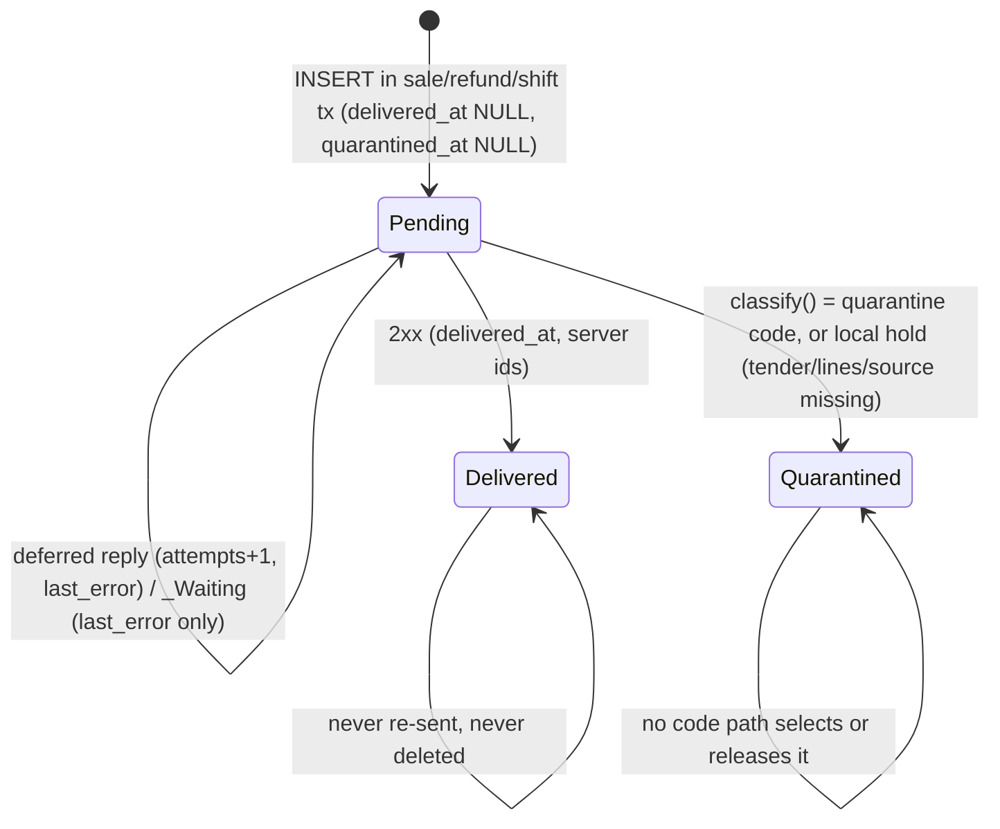
Source: `outbox_drain.dart:307-456,458-568`; migrations 4, 6, 49. There is no "in flight/claimed" state: the select at `:309-321` takes no lock and writes nothing before the HTTP call.

### 5.4 Sale → outbox → cloud sequence

```mermaid
sequenceDiagram
    participant UI as PaymentScreen
    participant Repo as PostgresOrdersRepository
    participant PG as Local PostgreSQL
    participant Sync as CloudSync / OutboxDrain
    participant API as PosCloudApi (/api/pos/*)
    UI->>Repo: submit(ticket) [_busy=true]
    Repo->>PG: BEGIN
    Repo->>PG: SELECT order by client_transaction_id (replay check)
    Repo->>PG: invoice seq FOR UPDATE, next_value+1
    Repo->>PG: INSERT pos_orders ON CONFLICT DO NOTHING
    Repo->>PG: INSERT lines, events, discounts, taxes, payments (applied amount only)
    Repo->>PG: stock issue (stocked items only)
    Repo->>PG: INSERT pos_outbox (cloud mode only)
    Repo->>PG: COMMIT
    Repo-->>UI: SubmitOrderResult(local invoice)
    Repo->>Sync: kick() (unawaited)
    Sync->>API: POST /terminals/heartbeat (pending_count)
    API-->>Sync: config_version (maybe re-bootstrap)
    Sync->>PG: SELECT pending outbox rows ORDER BY enqueued_at LIMIT 25
    Sync->>API: POST /api/pos/orders (Idempotency-Key = client_transaction_id)
    alt no answer (DioException)
        API--xSync: offline
        Sync-->>Sync: stop pass, retry in 30 min
    else 2xx
        API-->>Sync: id, invoice_number, totals_mismatch
        Sync->>PG: UPDATE pos_outbox delivered_at; pos_orders.server_invoice_number (1 tx)
    else error code
        API-->>Sync: status + code
        Sync->>PG: attempts+1,last_error; quarantine only for 6 known codes
    end
```
Source: `payment_screen.dart:169-204`, `postgres_orders_repository.dart:73-193`, `outbox_drain.dart:1181-1220`, `cloud_sync.dart:124-160`, `outbox_drain.dart:307-456`.

### 5.5 Reaction to server replies (conflict handling)

`OutboxDrain.classify` (`:119-131`): **quarantine** for `VALIDATION_FAILED`, `IDEMPOTENCY_PAYLOAD_MISMATCH`, `MENU_ITEM_NOT_FOUND`, `BRANCH_NOT_IN_TENANT`, `CUSTOMER_NOT_FOUND`, `REFUND_EXCEEDS_SOLD`; **defer** for everything else, including no code at all. HTTP status is never consulted for the decision (only recorded in `last_error`).

| Reply | Client reaction | Consequence |
|---|---|---|
| 2xx (incl. a 200 replay) | delivered | test `cloud_refunds_test.dart:684` |
| 409 / 422 / 4xx / 5xx **without a known `code`** | defer, retry every 30 min forever | a permanently bad record blocks the "settled" state and retries indefinitely |
| 401/`DEVICE_TOKEN_INVALID` on heartbeat | stop drain, UI says re-pair | queue untouched |
| 401 on an order POST | defer | — |
| Quarantine codes | row held, never retried, no release path in code | needs a person/DB access; see scenarios |
| `totals_mismatch:true` in a 2xx | flag stored | not surfaced anywhere (no reader) |
| 2xx but body not a JSON map (e.g. HTML from a captive portal/proxy) | `body = {}` → `ok` → **marked delivered** with null server ids | false delivery (scenario D5) |

What the server does on a price/total disagreement, a duplicate key with different payload, or an unknown tender is **UNKNOWN**; `docs/coordination/*` claim behaviours (e.g. 409/idempotency replay returns same invoice) but are not evidence.

Real conflict detection between two tills/branches' local data (e.g. two isolated tills, same product stock, same table) — NOT_IMPLEMENTED. There is no versioning of sales, no merge, no vector clock. The only conflict-like logic: `config_version` ordering for downloads (§6.1) and unique keys.

---

## 6. Download side: bootstrap bundle

### 6.1 When it is applied

* Claim/setup: `CloudProvisioningRepository._trySeed` → `seed(force:true)` (`cloud_provisioning_repository.dart:437-449`); setup "Download menu" → `seed(force:true)` (`setup_controller.dart:1871-1914`).
* Sync: heartbeat `config_version` > `pos_cloud_state.config_version` ⇒ `GET /api/pos/bootstrap` ⇒ `seed(bundle)` (`cloud_sync.dart:141-143,162-177`). Failure (any exception) ⇒ returns `false`, local catalogue "keeps selling", retried next pass.
* Precedence: version only. `bundle.configVersion < cached` ⇒ `stale` (refused); `==` ⇒ `unchanged`; `force` skips both (`bootstrap_seeder.dart:71-76`). Whole apply is **one transaction** (`:59-103`) so a failure leaves the previous state intact.
* Bundle content (parser `bootstrap_bundle.dart`): restaurant, terminal, branches, categories, option groups/options, products (incl. price, discounted price, sku, barcode, availability), tables, receipt profiles, staff (+PIN verifiers + capabilities), customers, `money` (tax/charges/tenders), licence embed. **No stock, no orders, no shifts, no inventory quantities.** Test: `test/data/cloud_bootstrap_test.dart` (parser; exists, not executed).

### 6.2 Exactly what happens to local data on re-apply

| Local table | Action on re-apply | Evidence |
|---|---|---|
| `pos_orders`, `pos_order_lines`, `pos_order_payments`, discounts/taxes/events, `pos_refunds*`, `pos_shifts`, `pos_cash_movements`, **`pos_outbox`, `pos_sync_outbox`**, `pos_invoice_sequences`, `pos_stock_movements`, `pos_stock_levels`, `pos_audit_events`, `pos_backups` | **untouched** (not referenced by seeder) | `bootstrap_seeder.dart` (full read) |
| `pos_restaurants`, `pos_branches` | upsert; branches not in bundle → `is_active=false` (not deleted) | `:106-157` |
| `pos_terminals` | upsert (`claimed_at` kept) | `:159-177` |
| `pos_staff` | upsert by platform id incl. PIN hash/capabilities; absent staff → `is_active=false` (never deleted: shifts reference them) | `:459-507` |
| `pos_tender_types` | upsert by `(restaurant_id, platform_id)`; everything not in bundle (incl. the till's own 4) set `is_active=false`; empty list ⇒ untouched | `:329-413` |
| `pos_customers` | upsert by phone (`platform_id` filled); never cleared; empty list untouched | `:429-457` |
| `pos_money_config` | overwritten with new JSON payload | `:298-311` |
| `pos_receipt_profiles` | upsert per branch; empty ⇒ untouched | `:207-292` |
| **Catalogue**: `pos_product_modifier_groups`, `pos_modifiers`, `pos_products`, `pos_modifier_groups`, `pos_categories` | **DELETE all rows for the restaurant, then re-insert platform rows with platform ids**. Product dropped if its category is missing from the bundle | `:509-646` |
| `pos_dining_tables` | DELETE all for restaurant, re-insert | `:648-676` |
| Cascades from product delete | `pos_product_prices` (CASCADE, `migrations.dart:1768`), `pos_stock_levels` (CASCADE, `:2678`); `pos_purchase_order_lines.product_id` SET NULL (`:2558`) | migrations |
| Blockers from product delete | `pos_stock_movements.product_id` RESTRICT (`:2620`), `pos_combo_options.product_id` RESTRICT (`:1909`) → FK violation → whole seed rolls back | migrations |
| `pos_parked_tickets` | untouched; on hydrate, a parked line whose product vanished is rebuilt **from its stored snapshot**, so it still prices and settles | `parked_ticket_codec.dart:351-373`, `postgres_parked_tickets.dart:load` |
| Pending/queued sales | **unaffected**: lines carry `name_snapshot`, `unit_price_minor`, `menu_item_id` as sold. Note they are *re-priced by the server* on upload (`priced_offline:true`, `asserted_totals`) — outcome UNKNOWN | `outbox_drain.dart:139-218` |
| `pos_cloud_state` | `config_version`, `bootstrap_synced_at` updated | `:88-100` |

So: **"cloud authoritative" is implemented as authoritative over configuration only (catalogue, staff, floor, tenders, tax rules, receipt profile).** No code path lets the download delete, overwrite or re-state any pending sale, payment, refund, shift, outbox row or stock quantity. Tenders retire instead of delete precisely so queued payments keep meaning (`:313-328`; migration 41). One side effect to note: a payment taken on a tender that has since been retired still drains (`test/data/cloud_tenders_test.dart:463`), while a payment on a tender with no `platform_id` is held (`:420,479,494`).

Seed also needs the till role to hold DELETE on catalogue tables — granted only for cloud tills (`local_bootstrap.dart:860-962`); an offline till has them REVOKEd and the seeder never runs there.

Tests touching the seeder: `cloud_tenders_test.dart`, `cloud_defaults_seed_test.dart`, `cloud_receipt_profile_test.dart` (all integration-tagged). **No test found** that re-seeds while `pos_outbox` has pending rows, nor one that seeds over stock movements.

### 6.3 Stale / rollback behaviour

Equal-or-lower `config_version` is refused (`stale`/`unchanged`) except when `force` (setup/claim). Heartbeat only triggers a download when the platform's version is strictly greater. A restored-from-backup database carries an older `config_version`, so the next heartbeat will pull a fresh bundle (consistent behaviour; [UNVERIFIED] no test).

### 6.4 Inventory / stock offline

* `_issueStock` records a `sale` movement and decrements `pos_stock_levels` **only** for `pos_products.is_stocked = true` (`postgres_orders_repository.dart:725-829`; migration 29 `is_stocked DEFAULT false`). Bundle seeding never writes `is_stocked`/`stock_unit` (`bootstrap_seeder.dart:606-627`), so seeded products are not stocked.
* On a cloud tenant the Management app is replaced by `CloudBackOfficeScreen` (`router.dart:155-160`), and `test/features/cloud_purchasing_hidden_test.dart:90,125` asserts purchasing/inventory panes are hidden for cloud (exists; not executed). Net: in cloud mode stock tracking is effectively off; in offline/branch mode it is local and complete (receiving with moving-average cost, PO, supplier invoices) but **never leaves the branch DB** except via backup.
* Negative stock is allowed (no oversell protection by design, `:716-724`).
* Refund/void do not restock (grep `stock` in refunds repo: none; void writes no stock) — not verified against UI; treat as NOT_IMPLEMENTED.

---

## 7. How pending offline sales/payments/inventory are protected today

| Risk | Protection in code | Gap | Evidence |
|---|---|---|---|
| Sale lost between "paid" and "queued" | Order + payments + stock + outbox claim in **one DB transaction** | none in the happy path; shift/refund same | `postgres_orders_repository.dart:73-193`, `postgres_refunds_repository.dart:205-236` |
| Sale sent twice | Local UNIQUE `(restaurant_id, client_transaction_id)` on `pos_orders` and `pos_outbox`; `delivered_at` never cleared; deterministic payment keys; same key reused on every retry; `Idempotency-Key` header + body field | Server-side dedupe unverifiable; no cross-process lock between two drains | migrations `:55,372`; `cloud_api.dart:243-254` |
| Sale deleted by "cloud authoritative" | Seeder never touches order/outbox/shift/stock tables; till role has **no DELETE** on them (only on catalogue for cloud seeding and `pos_parked_tickets`) | `pos_outbox` has `ON DELETE CASCADE` from `pos_orders` (migration 4) but nothing deletes orders; DB owner/admin could | grants `local_bootstrap.dart:663-700,839-840`; seeder |
| Payment on unknown tender sent as wrong method | Held locally before any send (`TENDER_NOT_FROM_PLATFORM`), money never guessed | Held row has no release path (§5.5) | `outbox_drain.dart:335-339,1102-1125` |
| Rejected record blocking others | Quarantine is per-record; queue continues; refunds wait for their sale | Quarantined rows only visible via pending count (counts them forever) and in-memory last-pass counters | `outbox_drain.dart:458-568`; `management_sync_pane.dart:59,183` |
| Platform unreachable | Offline reply stops the pass; local sales continue (local DB is the till's store) | Retry only every 30 min; no per-row visibility | `cloud_sync.dart:72-82` |
| Device token revoked | Queue untouched, UI shows re-pair | — | `cloud_sync.dart:133-134`, `test/app/terminal_rejected_test.dart` |
| Crash mid-sale | Postgres tx atomicity; ticket restored on exception; parked tickets persisted | Unparked in-progress ticket lives in memory only | `payment_screen.dart:178-190`; §9 |
| Stale device clock | none | `occurred_at`/`created_at` are the till clock | `postgres_orders_repository.dart:75` |
| Disk loss / corruption | Daily-ish `pg_dump` at day close, verified | Same disk by default; none if the day is never closed; restore ignores unsent sales | §8 |
| Stock lost on catalogue replace | seed does not touch stock tables | RESTRICT FK blocks seed instead (loud failure, silent in UI) | §6.2 |

---

## 8. Backup & restore

| Aspect | Behaviour | Status | Evidence |
|---|---|---|---|
| Tool | `pg_dump --format=custom` as read-only `pos_backup` (`pg_read_all_data`); tools located beside app (`pgsql\`) or on PATH | IMPLEMENTED | `pg_archive.dart:157-195`, `backup_service.dart:79-90`, `xorder-pos.iss:80-82` |
| Scheduling | **No scheduler.** Automatic copy runs only inside the day-close dialog (`BackupTrigger.dayClose`), default `onDayClose=true`; manual button in Management → Backup (owner, `backup.manage`) | PARTIAL | `day_close_dialog.dart:55-76`, `backup.dart:186-208`; dialog comment admits "a restaurant that never closes its day never gets a copy" |
| Cloud tills | Day-close copy applies; the Backup pane is not in `CloudBackOfficeScreen` (no `backup` hit) so no manual copy/restore UI on a claimed cloud tenant | PARTIAL | `cloud_back_office_screen.dart` grep |
| Destination | Default `%LOCALAPPDATA%\XOrder POS\backups` (Win), `~/Library/Application Support/XOrder POS/backups` (macOS) — **same disk as the database** (comment concedes it); configurable; "copy to USB" with checksum compare | PARTIAL | `backup_service.dart:654-689,531-561` |
| Retention | newest 14 `.dump` files (`keep=14`), pruned only after a restorable new copy | IMPLEMENTED | `:49,285-298`, `pg_archive.dart:268` |
| Verification | After dump: `pg_restore --list` must contain `TABLE DATA`, then full read to `/dev/null`/`NUL`; check 8 essential tables are in the TOC; SHA-256 recorded; outcome `verified`/`unverified`/`failed` row in append-only `pos_backups` + audit event. **No test restore into a scratch database**; verification proves readability, not completeness of data | IMPLEMENTED | `pg_archive.dart:197-220`, `backup_service.dart:123-132,254-283` |
| Atomic file | written to `.part`, renamed only after readback | IMPLEMENTED | `pg_archive.dart:157-195` |
| Restore guard | requires `backup.manage`; **blocks only if an open shift or open business day exists** for this branch; counts orders (by `received_at`) and their value since the copy and shows them in the confirmation; refuses non-restorable or checksum-changed file; reads archive fully before touching DB | PARTIAL | `backup_service.dart:345-402,424-480` |
| Restore execution | `pg_restore --clean --if-exists --no-owner --single-transaction` as the admin role after closing pools; failure leaves old DB intact; audit row written *after* into the restored DB | IMPLEMENTED | `pg_archive.dart:230-262`, `backup_service.dart:486-514` |
| Restore vs outbox | **Not considered** (grep `outbox|pending` in `lib/data/backup` and the pane: none). `pos_outbox`, `pos_sync_outbox`, invoice sequences and `config_version` all revert to the dump | NOT_IMPLEMENTED | see scenario D3 |
| Tests | `test/data/backup_restore_test.dart` (copy, verify, ledger append-only, blockers, orders-since counts, checksum refusal, restore round trip, USB copy, retention), `pg_archive_restore_test.dart` (damaged DB, part-way failure atomic), `backup_tools_test.dart` — exist; integration-tagged; not executed here | — | — |

---

## 9. Crash recovery

| Scenario | What the code does | Status |
|---|---|---|
| Power loss during `submit` | PostgreSQL tx not committed ⇒ nothing persisted (order, payments, stock, outbox row all absent). Durability relies on PostgreSQL defaults (`fsync`, `synchronous_commit` not changed by installer). Cashier restarts, ticket was in memory only unless parked ⇒ must re-ring; the customer may have paid | IMPLEMENTED (atomic), depends on PG defaults |
| Power loss just after COMMIT, before UI reaction | Order + outbox row exist; parked row may remain; `PostgresParkedTickets.load` excludes parked tickets whose `client_transaction_id` already has an order ("the committed order is the authoritative fact") | IMPLEMENTED (`postgres_parked_tickets.dart:load`) |
| Exception/timeout during `submit` (e.g. 10 s `queryTimeout`) | UI restores the pre-tender ticket and shows error; retry uses same `ticket.id` ⇒ replay returns the existing order if the first attempt had actually committed | IMPLEMENTED (`payment_screen.dart:178-190`) |
| Parked tickets | `pos_parked_tickets` write-through on park; hydrate on boot (merge, not replace); `park()` returns false if the durable copy failed; settle removes row; products missing from catalogue are rebuilt from snapshot | IMPLEMENTED (`providers.dart:864-1000`). Test: `test/data/parked_ticket_codec_test.dart`, `parked_tickets_schema_test.dart` |
| Un-parked live cart | In memory (`ticketProvider`) only; lost on crash | NOT_IMPLEMENTED |
| Crash mid-drain, after HTTP send, before `UPDATE delivered_at` | Row still pending ⇒ re-sent with same key next pass; correctness depends on server idempotency (UNKNOWN) | IMPLEMENTED (client side) |
| "Claimed-but-unsent" rows | Concept does not exist: no lease/claim column, nothing written before send | NOT_IMPLEMENTED |
| Crash mid-seed | Single tx ⇒ rolls back; previous catalogue stays | IMPLEMENTED |
| Crash mid-migration | Single tx + advisory lock ⇒ all-or-nothing, lock released | IMPLEMENTED |
| Crash during restore | `--single-transaction` ⇒ old DB remains; but audit row may be lost if crash occurs after restore and before audit write (documented in code) | IMPLEMENTED |
| DB unreachable at launch | Parked hydrate returns empty (swallowed); sale refused ("unconfigured/PosDbException"); `unconfigured` binds refuse to take money | IMPLEMENTED |
| `CloudSync.run()` exception | `kick()` is `unawaited(run())`; an exception inside `_drain.run()` (e.g. the post-2xx tx failing, `outbox_drain.dart:375`) propagates as an unhandled async error and, in the auto timer, the `await sync.run()` throws before `schedule(...)` is called again (`providers.dart:728-733`) ⇒ **the auto-reschedule chain can stop** until the provider is rebuilt. No try/catch found around it | PARTIAL ([CODE]; consequence [UNVERIFIED]) |

---

## 10. Data-loss / duplication scenarios (code-based)

| ID | Scenario | Mechanism in code | Outcome | Severity | Test |
|---|---|---|---|---|---|
| D1 | Product removed in dashboard while a sale of it is queued | Sale still has `menu_item_id`; server answer `MENU_ITEM_NOT_FOUND` is a quarantine code (`outbox_drain.dart:121-123`). Nothing releases it | Paid sale never reaches cloud; counted as pending forever; needs DB-level intervention. Whether the server really returns that code: UNKNOWN | High | `outbox_drain_test.dart:246` (classification only) |
| D2 | Tender retired/replaced between sale and upload | Retired tender still drains; payment on a tender without `platform_id` is quarantined `TENDER_NOT_FROM_PLATFORM` (e.g. sale rung up before first successful bootstrap using fallback tenders) | Held sale, no release path | High | `cloud_tenders_test.dart:420-494` |
| D3 | Restore older backup on a cloud till | Restore guard checks only open shift/day (`backup_service.dart:345-402`). Sales made after the dump and not yet uploaded vanish with the database; sales delivered after the dump reappear as `delivered_at NULL` ⇒ re-sent (idempotent). Invoice sequences revert ⇒ local invoice numbers already printed can be issued again | Silent loss of unsent sales (UI warns of "orders since" count but does not distinguish unsent ones) | High | `backup_restore_test.dart:537,577` (guards), no outbox test |
| D4 | Captive-portal / proxy returns 2xx non-JSON | `_send` maps non-map body to `{}` (`cloud_api.dart:259-266`); drain treats any 2xx as success (`outbox_drain.dart:372`), writes `delivered_at` with null server ids | Sale marked delivered without cloud ever receiving it; never retried | High (needs hostile network) | no test found |
| D5 | Same row resent after crash/timeout | No lease; same key | Duplicate only if server fails idempotency (UNKNOWN) | Medium | `cloud_refunds_test.dart:652,684` (refunds) |
| D6 | Two main tills sharing one PostgreSQL in cloud mode | Both drain all rows (no terminal filter, no `SKIP LOCKED`) | Concurrent duplicate POSTs with same key; relies on server; also rows delivered under the wrong terminal's token | Medium ([UNVERIFIED] topology) | no test found |
| D7 | Server rejects with 409/422/5xx and no known code | Defer forever, 30-min loop, `settled` never true | Queue never "settles"; one poison row keeps the fast cadence; no cap/alarm except pending count | Medium | `outbox_drain_test.dart:272` |
| D8 | Quarantined row | `delivered_at IS NULL` ⇒ included in pending count and heartbeat `pending_count`/`oldest_pending_at` | Permanent "owed" money visible to Super Admin but un-actionable on the till; held counter is in-memory (`management_sync_pane.dart:59`) so after restart only the raw pending count remains | Medium | `sync_schedule_test.dart:69` |
| D9 | Catalogue replace vs stocked product with movements | `DELETE FROM pos_products` hits RESTRICT FK ⇒ seed tx fails ⇒ swallowed (`cloud_sync.dart:173-176`) ⇒ till never takes a new menu while `config_version` stays old | Stale menu/prices indefinitely, silently | Medium; requires stock on a cloud till (hidden by UI) | no test found |
| D10 | Stocked product deleted by seed with no movements | `pos_stock_levels` CASCADE-deleted | Local quantity silently lost | Low (cloud UI hides stock) | no test found |
| D11 | Customer created offline, crash between upsert and enqueue | Not one tx (`postgres_customers_repository.dart:85-143`) | Customer never uploaded; later sale naming it can be sent with a local id `CUSTOMER_NOT_FOUND` ⇒ quarantine | Low | no test found |
| D12 | Voids never uploaded | `postgres_orders_repository.dart:317-319` | Cloud never sees voided orders / waste | Low–Medium | `postgres_integration_test.dart:576` |
| D13 | Flat-amount refund | `REFUND_HAS_NO_LINES` held (`outbox_drain.dart:839-847`) | Cash left the drawer, cloud has no refund until a person acts | Medium | `cloud_refunds_test.dart:583` |
| D14 | Cloud authoritative tax/prices change before upload | Order totals already fixed at sale; server re-prices (`priced_offline:true`); mismatch flagged only | `totals_mismatch` stored, never displayed; resolution UNKNOWN | Medium | none |
| D15 | Local clock wrong | `occurred_at`, `created_at` use device clock; invoice year uses UTC | Wrong period/ordering | Low | no test found |
| D16 | Stock first-sale race | no row to lock before first level row exists | lost decrement of one sale | Low | no test found |
| D17 | Backups on same disk, only at day close | `BackupPaths.defaultDirectory` | Disk failure loses DB and backups; no day close = no backup | High (operational) | `backup_restore_test.dart:815` (retention only) |
| D18 | Credential exposure | plaintext `secrets.json`, `install-credentials.json`, DB traffic unencrypted on LAN by installer defaults | Local attacker/LAN sniffer obtains `pos_till`/token | Medium | `file_secret_store_test.dart` (permissions on POSIX only) |
| D19 | Unupdated schema | no launch-time migration or version check | New code vs old schema errors at runtime | Medium | none |
| D20 | Delivered outbox rows never pruned | no DELETE grant, no archive job | Table growth | Low | none |

---

## 11. Docs vs code disagreements found

1. `pos_database.dart:156-157` / CLAUDE.md-style claims of OS keystore — code uses a plaintext JSON file (`file_secret_store.dart`).
2. `docs/pos/08-postgres-lan.md:246,260` (`ssl = on`, `hostssl`) vs installer (`host`, no `ssl`) — `provision.ps1:158-168`.
3. `PosMigrator` doc "every launch" vs no launch call (`migrations.dart:4473` vs grep).
4. `totals_mismatch` "marks it for the reconciliation view" (`outbox_drain.dart:397-399`) — no such view/reader exists.
5. `branch_sales_api.dart:6-9` states endpoints do not exist yet, while `branch_sales_providers.dart` wires it for cloud tills.
6. `CLAUDE.md` lists `lib/data/cloud/` as including "outbox drain" and says POS-BE-006/007 `READY` — only a documented claim; server behaviour not verifiable here.

## 12. Searches performed (for the "missing" claims)

`isolation|SERIALIZABLE|SKIP LOCKED|pg_advisory` (lib, bin); `quarantined_at|quarantine` outside drain/migrations; `totals_mismatch`; `stock|inventory` in `lib/data/cloud`; `outbox|pending` in `lib/data/backup` and backup pane; `fsync|synchronous|ssl|hostssl` in installer/lib; `keychain|flutter_secure|keystore`; `PosMigrator(`; `schema_migrations`; `DeploymentMode.cloud|syncsSalesToPlatform` in features; `Timer.periodic|SyncSchedule`; every `'/api/` literal in `lib/`; tests: `BootstrapSeeder`, `OutboxDrain(`, `pos_outbox`, `SyncSchedule` in `test/` and `integration_test/`.

## 13. Not verified (UNKNOWN)

Backend idempotency/replay semantics, server re-pricing and mismatch handling, which error codes the server really emits, `config_version` semantics, whether `/api/pos/branch/sales*` exists, any test result (none executed), PostgreSQL runtime defaults on customer machines, behaviour of `postgres` package `runTx` on connection drop beyond what the code shows, macOS DB provisioning in practice.


---

<!-- ===== PART 5: MULTI_DEVICE.md ===== -->

# Multi-device behaviour: local server, shared database, pairing, concurrency, device limits

Evidence levels: **[CODE]** read in source; **[ASSUMED]** inferred; **[OBSERVED]** none (no Flutter, Dart or PostgreSQL in the audit sandbox; no test was run). "Test exists (not executed here)" means the file was read, not run.
Status labels: IMPLEMENTED | PARTIAL | NOT_IMPLEMENTED | UNKNOWN.
Backend (Laravel API, admin panel, cloud) is not available: anything about it is UNKNOWN except the HTTP paths this client calls.

## 0. Summary

| Question | Answer | Status | Evidence |
|---|---|---|---|
| Does one device act as a local server? | Yes, as a role, not a process. A "main device" is the normal POS app plus a PostgreSQL service on the same machine. There is no separate API or server application. | IMPLEMENTED (as PostgreSQL host) | `deployment.dart:104-141`, `installer/xorder-pos.iss:97-102,150-173`, `installer/provision.ps1` |
| Do tills share one PostgreSQL directly, with no API? | Yes. Every till opens its own connection pool (max 4) to the main device's PostgreSQL using the Dart `postgres` driver. No HTTP layer between tills and the DB. | IMPLEMENTED | `pos_database.dart:273-296` |
| Discovery? | None. Manual host + port + password entry. No mDNS, no broadcast, no subnet sweep for the database. The docs plan a `/24` sweep on 5432 ("Find the main device"); it is not coded. Only printers are found by a sweep. | NOT_IMPLEMENTED | `setup_panes.dart:575-612`; `grep -rin "mdns\|nsd\|bonsoir\|multicast\|RawDatagramSocket\|DiscoveredSite" lib bin pubspec.yaml` finds nothing relevant; `network_printer_ports.dart:51` is the only sweep |
| Pairing? | Child: type host/port/password, then sign in as an existing manager (username + PIN) and register as one more terminal row. Cloud main: pairing code from dashboard, or platform sign-in. | IMPLEMENTED (manual) | `setup_controller.dart:1310-1370,1725-1790` |
| Authentication between devices? | There is none device-to-device. Device-to-DB: one shared PostgreSQL role `pos_till` (password in `secrets.json`) used by every till. Device identity (`terminal_id`) is a value the client writes itself. Device token (`device_token_vault`) exists only for main-device-to-cloud. | PARTIAL | Section 3 |
| If the DB host is down? | The till cannot sell, park, open a shift or read the catalogue. No local queue, no degraded mode. The payment screen restores the ticket and says it could not be recorded. | By design; no degradation | `payment_screen.dart:175-195`, Section 4 |
| Can secondary tills trade independently? | Not of the main device's database. They can trade independently of the internet, and of each other (own shift, own cashbox, own printer) while the main device and LAN are up. | PARTIAL | Section 5 |
| Device limit enforced by licence? | Checked once, in the wizard of the machine being added, by counting rows in `pos_terminals`. No database constraint, no runtime check, no server check in the offline path. Bypassable by anyone holding the till DB credential. | PARTIAL | Section 7 |
| Installed role concept? | Yes: `TerminalRole.main` / `child`, plus the Windows installer's `install-role.json` marker. | IMPLEMENTED | Section 8 |

## 1. Network topology as built

Legend. Solid box = coded and reachable from the UI. Dashed box (class `doc`) = mentioned in docs/comments, **not coded**. Every dashed box is also listed in the table after the diagrams.

### 1.1 Mode `offline`, one machine (default install)

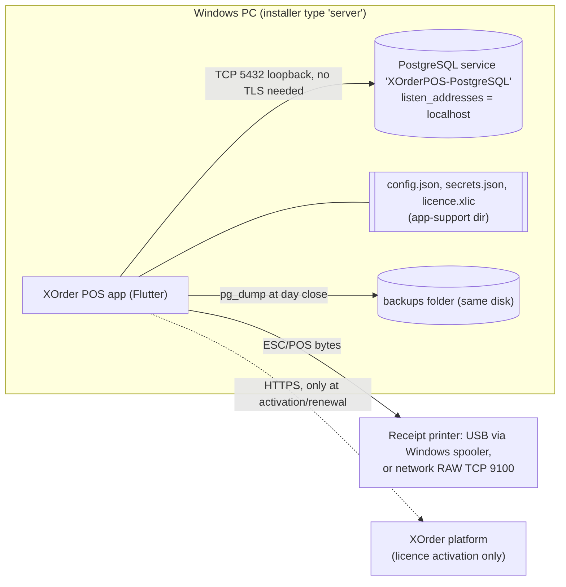

### 1.2 Mode `offline`, shared LAN database (licence `max_terminals > 1`)

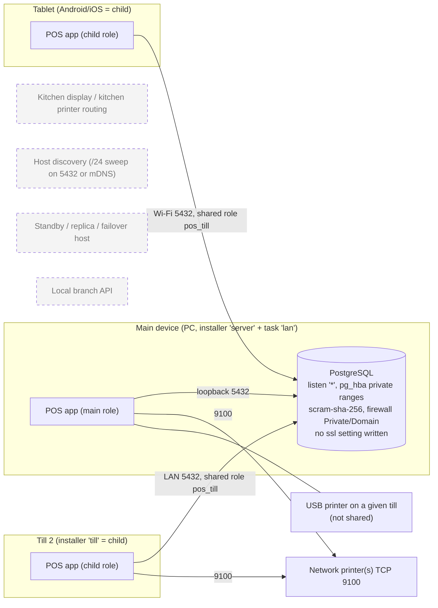

### 1.3 Mode `cloud`, one machine

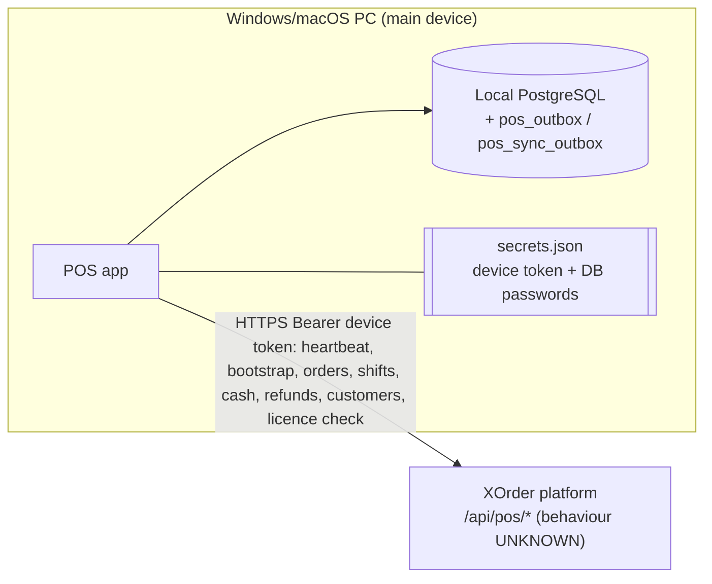

### 1.4 Mode `cloud`, shared LAN database

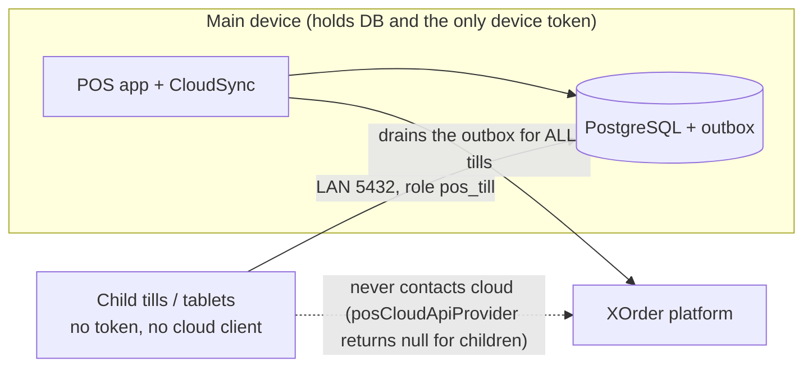

[CODE] `providers.dart:655-664` (`config.isChild` returns null), `providers.dart:597-599` comment, `cloud_sync.dart:73-75`.
Consequences: the platform never sees child terminals (UNKNOWN how it attributes their sales; the order payload has no terminal field, `outbox_drain.dart:140-170`); the main device must be on for any sync to happen.

### 1.5 Things drawn dashed above, and why

| Box | Where it is documented | Code status |
|---|---|---|
| Host discovery (sweep or mDNS) | `docs/pos/10-setup-architecture.md` §10 plans a "Find the main device" TCP sweep on 5432; `08-postgres-lan.md` §9 discusses mDNS and rejects it as the only path | NOT_IMPLEMENTED. Searched `mdns`, `nsd`, `bonsoir`, `multicast`, `RawDatagramSocket`, `DiscoveredSite`, `findMainDevice`, `sweep` in `lib`, `bin`, `pubspec.yaml`. Only `network_printer_ports.dart` sweeps, and only for printers |
| Standby / failover DB host | `08-postgres-lan.md:55` says there is "no selling when the branch box is down" as a known limit | NOT_IMPLEMENTED: no replica, failover or second host setting exists in `DeploymentConfig` |
| Local branch API | `08-deployment-modes.md` (earlier idea: Laravel in docker as a branch box) | NOT_IMPLEMENTED in this repo; superseded by direct PostgreSQL (`deployment.dart` header text still mentions it, now stale) |
| KDS / kitchen display | `order_history_screen.dart:482` comment "until the KDS"; `10-setup-architecture.md:371` lists a `kds` module | NOT_IMPLEMENTED: `grep -rIn -i "kds\|kitchen display" lib` finds one comment only |
| Kitchen printer routing | none found in code | NOT_IMPLEMENTED: a "sent to kitchen" status exists on tickets (`sale_screen.dart:498`), but the only print path is the till's single configured printer (`PrinterConfig`, one `name`) and receipts. Not traced beyond that |

## 2. Hardware network links (`lib/data/hardware`)

| Link | Status | Behaviour | Evidence |
|---|---|---|---|
| Network thermal printer, RAW TCP 9100 | IMPLEMENTED | `Socket.connect(host, 9100, 5 s)`, write bytes, flush, destroy. Return `false` on socket error or timeout. No printer status read-back, so "sent" is not "printed". | `network_printer_ports.dart:75-120` |
| Printer discovery | IMPLEMENTED | Sweeps every host `1..254` of each local interface's /24 on port 9100 with a 300 ms timeout. Only a /24. | `network_printer_ports.dart:51-70` |
| USB printer via OS spooler | IMPLEMENTED (Windows `winspool` RAW; other OS backend per `SpoolerBackend.forThisPlatform()`) | Printer is local to the till that owns it; another till cannot use it. | `spooler_printer_ports.dart`, `winspool.dart` |
| Transport choice | IMPLEMENTED | Name shaped like `ip` or `host:port` means network, else USB. | `printer_config.dart` `transportOf` |
| Printer config scope | per terminal | Stored in that till's `config.json` (`SavedTerminalConfig.printer`), not in the shared database. Each till names its own printer. | `terminal_config.dart:60` |
| Cash drawer | IMPLEMENTED via printer | Drawer kick is an ESC/POS command inside the print job. `pos_cash_drawers` table exists with a nullable `terminal_id`, but **no repository reads or writes it** (`grep pos_cash_drawers lib` finds migrations and grants only). | `migrations.dart:1440`, `local_bootstrap.dart:749,1061` |
| Failed print | PARTIAL | Receipt jobs are queued in `pos_print_jobs` (bytes stored; status pending/printed; a trigger forbids re-queueing a printed job). The drain is **per terminal** (`terminal_id`), so a receipt stays with the till that took the money. Test exists (not executed here): `print_queue_schema_test.dart`. | `migrations.dart:3163-3245`, `postgres_print_queue_repository.dart` |
| Barcode scanner | UNKNOWN | `scannerAttached` flag in setup draft; no network link. | `setup_state.dart` |

## 3. Authentication and transport

### 3.1 Device to database

| Item | Finding | Evidence |
|---|---|---|
| DB roles | `pos_admin` (owns DB, CREATEDB; used by Management), `pos_till` (column-scoped grants; no DELETE on orders/outbox/shifts), `pos_backup` (member of `pg_read_all_data`; read-only), `postgres` superuser (installer only). | `local_bootstrap.dart:296-306`, `provision.ps1:123-130` |
| One role for all tills | **Every till uses the same `pos_till` role and password.** A single till cannot be revoked at database level; a leaked `secrets.json` on any till is a credential for the entire shared DB. | `deployment.dart:211`, `providers.dart:2146-2163` |
| Where passwords live | `secrets.json` in app-support, JSON, plaintext, `chmod 600` on POSIX, per-user-profile ACL on Windows. Keys: `pos_till_database_password`, `pos_cloud_device_token`, `pos_backup_database_password`, `pos_admin_database_password`. Documented owner decision to avoid the macOS keychain prompt; the code comments elsewhere still say "OS keystore". Not reproduced here. | `file_secret_store.dart` header and constants |
| Admin password on child tills | The `pos_admin` password is stored too (`adminDbSecretStoreProvider`), so any till that has been used for Management holds the schema owner's password in `secrets.json`. | `file_secret_store.dart` (adminPasswordKey), `providers.dart:3075` |
| Terminal identity to DB | `terminal_id` is read from the till's own `config.json` and written into every row by the client (`PosWriteContext`). The DB does not tie `terminal_id` to the connecting role. `pos_till` can INSERT into `pos_terminals`. Any till can write rows labelled as another terminal. | `providers.dart:2178-2201`, `postgres_orders_repository.dart:21-41`, `local_bootstrap.dart:821` |
| Cashier auth | PIN checked **client-side**: the till reads `pin_salt`/`pin_hash` from `pos_staff` (till has SELECT) and compares. PINs are exactly 4 digits, PBKDF2-HMAC-SHA256, 120,000 iterations. With read access to the hashes (the till credential), 10,000 candidates is a trivial offline search. [CODE] for design; exploitation [ASSUMED]. | `pin_hash.dart:25,38`, `postgres_directory_repositories.dart:151-178` |
| TLS | `sslMode` is `disable` when the host is loopback, or when the host is a private address AND the operator ticked "trust" (`verifyTls = false`); otherwise `verifyFull`. The Windows installer's `-Lan` option writes `listen_addresses='*'`, `pg_hba` private ranges and a firewall rule but **no `ssl = on` and no certificate**. So the default LAN deployment is plaintext (the operator must tick the trust box, else the connection fails verification against a server with ssl off). Passwords are hashed by scram-sha-256 on the wire; order data is not encrypted. | `pos_database.dart:293-295`, `deployment.dart:350-351`, `provision.ps1:159-176` |
| Network exposure | Firewall rule limited to Private/Domain profiles; `pg_hba` lines allow `10/8`, `172.16/12`, `192.168/16`. Not limited to known till IPs. | `provision.ps1:161-176` |
| Test | `test/data/till_grants_enforced_test.dart`, `admin_grants_enforced_test.dart`, `deployment_transport_test.dart` (not executed here). |  |

### 3.2 Device to cloud (main device only)

| Item | Finding | Evidence |
|---|---|---|
| Device token | Obtained by claim (`POST /api/pos/terminals/claim`) or register; stored in `DeviceTokenVault` (memory) and `secrets.json`; sent as `Authorization: Bearer`. | `cloud_api.dart:84,160,246`, `device_token_vault.dart` |
| Revocation | HTTP 401 on heartbeat sets `terminalRejectedProvider`; drain stops; sales continue. | `cloud_sync.dart:96-101`, `providers.dart:1064` |
| Reset does not clear the token | `TerminalReset.run()` clears config, wizard progress, DB and admin secrets; it does not call `DeviceTokenVault.forget()`. [CODE: `providers.dart:2066-2094`] | |
| Platform URL scheme | HTTPS required unless the host is private (`isPermittedPlatformUrl`). | `deployment.dart:273-279` |
| `device_token_vault` for children | Not used. Children hold no token. | `providers.dart:655-664` |

### 3.3 Device to device

None. No peer socket, no shared secret, no message passing between tills. All coordination is through rows in the shared PostgreSQL. [CODE: searched `ServerSocket`, `RawDatagramSocket`, `LISTEN`, `NOTIFY` in `lib`; only `Timer.periodic` found is the ETA reconciler at `providers.dart:2804`.]

## 4. When the DB host is unavailable

| Component | Behaviour | Evidence |
|---|---|---|
| Sale settlement | Fails. The ticket is restored to its pre-payment state and the cashier sees "payment could not be recorded". | `payment_screen.dart:175-195` |
| Parking a table ticket | `park()` returns `false`, the live ticket stays in memory; the floor does not change. | `providers.dart:933-945` |
| Floor/catalogue/session reads | Providers are `FutureProvider`s over repositories; failure becomes an error state; parked-ticket load swallows errors and returns an empty floor (`PostgresParkedTickets.load` catch). | `postgres_parked_tickets.dart:~40-60` |
| Status indicator | A pill driven by `SELECT 1` probe; refreshed only by tap (no timer). Cloud mode shows the sync pill instead. | `providers.dart:475-483`, `pos_top_bar.dart:60-90` |
| Pool settings | 5 s connect, 10 s query, 4 connections, no retry loop. | `pos_database.dart:283-292` |
| Outbox | Lives in the same DB, so it is also unreachable; the main device's cloud drain also stops. | |
| Backup | Needs the DB to run `pg_dump`; fails and records a failure row (which also needs the DB). | `backup_service.dart` |
| Local fallback store | None. There is no SQLite, no write-ahead log, no second store (`grep sqflite lib` empty, per CLAUDE.md; `08-postgres-lan.md:55` acknowledges this). | |
| Failover | None. | Section 1.5 |

So on the main device, "main device off" equals "branch cannot trade", for every till including the main one if the PostgreSQL service is stopped. A secondary till does **not** degrade into an offline mode of its own.

## 5. Can secondary tills trade independently?

Independently of the cloud: yes (the DB is local to the LAN). Independently of the main device: no. Among themselves they are independent in the following ways [CODE]:

| Resource | Per till? | Mechanism |
|---|---|---|
| Shift | yes | `pos_shifts_one_open_per_terminal` partial unique index on `terminal_id WHERE closed_at IS NULL` (`migrations.dart:323-324`); a shift query is by terminal id (`postgres_shift_repository.dart:52`) |
| Cash drawer and cash-up | yes via shift | `expected_cash` etc. stored per shift; `pos_cash_movements.terminal_id NOT NULL` (`migrations.dart:1503`). The separate `pos_cash_drawers` table is unused by code |
| Receipt printing | yes | printer name per till, print jobs keyed by `terminal_id` |
| Invoice numbers | no, shared | one sequence per `(restaurant, branch, year)`, row lock (Section 6) |
| Business (trading) day | no, shared | `pos_business_days_one_open` allows one open day per branch (`migrations.dart:1486-1488`); closing the day is a branch-wide act and day close blocks on open shifts unless forced with a reason |
| Parked table tickets | shared table, no live refresh | Section 6 |
| Catalogue, staff, settings | shared | read from the one DB |
| Backup | per machine that closes the day | Section 6.4 |

## 6. Concurrency

### 6.1 Order numbers

[CODE] `_nextInvoiceNumber` (`postgres_orders_repository.dart:391-440`): inside the sale transaction, `INSERT ... ON CONFLICT DO NOTHING` the sequence row, `SELECT ... FOR UPDATE`, increment, format `prefix-period-value`. All tills of a branch serialize on that one row, which is correct and adequate at restaurant volumes. A replay with the same `client_transaction_id` finds the existing order first and consumes no number (`:62-85`). Test exists (not executed here): `test/data/postgres_integration_test.dart:152` "concurrent settlements never share an invoice number".

Caveat: in cloud mode with **each till on its own local PostgreSQL** (the single-machine shape), each DB has its own sequence with the same branch prefix, so two tills can issue the same local number. The code accepts this and stores the platform's number separately in `server_invoice_number` (`outbox_drain.dart:402-415`). Under the offline mode with separate DBs per till, the numbers can duplicate within a branch with no reconciliation. [CODE]

### 6.2 Tables and open tickets

| Aspect | Finding | Evidence |
|---|---|---|
| Where open tickets live | In-memory per app, plus a persisted copy in `pos_parked_tickets` (jsonb payload, one row per `(restaurant, table)` via unique index). | `migrations.dart:650-662,3049-3056` |
| Locking | None. No advisory lock, no `FOR UPDATE`, no version column on parked tickets. | `postgres_parked_tickets.dart` |
| Write rule | `INSERT ... ON CONFLICT (restaurant_id, table_id) DO UPDATE` : **last writer wins**. If till A and till B both park table 5, B's payload replaces A's silently. | `postgres_parked_tickets.dart:~75-95` |
| Visibility to other tills | Hydrated once when `OpenTicketsController` is first built (`_hydrate`, `providers.dart:900-925`), merged into local memory. No polling, no LISTEN/NOTIFY, no timer. Another till's newly seated table does not appear until this till restarts. [CODE: searched `LISTEN`, `NOTIFY`, `Timer.periodic`, `Stream.periodic` in `lib`] | |
| Delete on settle | `DELETE ... WHERE restaurant_id=@r AND (client_transaction_id=@txn OR (@table IS NOT NULL AND table_id=@table))`. So when till A settles its own ticket on table 5, it also deletes whatever ticket is parked on table 5 at that moment, including one till B parked after A. Order commit is unaffected; B's unpaid ticket row is lost from the database (B still holds it in memory until restart). | `postgres_parked_tickets.dart:~110-125`, `providers.dart:970-990` |
| Double-seating | Possible: nothing prevents two tills selling the same table concurrently; both settlements succeed as separate orders. | `postgres_orders_repository.dart` has no table-occupancy check |
| Test | `test/data/parked_tickets_schema_test.dart`, `test/features/park_ticket_test.dart`, `open_tickets_test.dart` (not executed here). No test found for two tills on one table. |  |

### 6.3 Inventory

[CODE] `postgres_orders_repository.dart:716-830`: stock issue is written in the same transaction as the sale. `SELECT ... FROM pos_stock_levels WHERE branch_id AND product_id FOR UPDATE` (`:764-765`), then an INSERT into `pos_stock_movements` and an upsert of the level. Two tills selling the same stocked item serialize on that row. Negative stock is explicitly allowed ("declining a paid sale because receiving is late makes the financial ledger less truthful", `:722-724`). Only products flagged as stocked move stock; there is no recipe/BOM deduction. Test exists (not executed here): `stock_levels_test.dart`, `stock_items_test.dart`. Stock is not synced to the cloud in either mode.

Other shared-row guards [CODE]: refunds lock the order (`FOR UPDATE` in trigger `pos_refund_applied`, `migrations.dart:1246-1248`); supplier payments lock the invoice (`:2871`); one owner per restaurant by trigger (`:3743`); audit and backup tables append-only by trigger.
Management edits by two managers on two tills: a test file exists (`postgres_catalog_admin_test.dart:36` mentions it); the mechanism (revision numbers) was not traced here.

### 6.4 Backups in multi-till

`DayCloseDialog` calls `BackupService.take(trigger: dayClose)` on whichever till closes the day (`day_close_dialog.dart:67-72`). `pg_dump` runs on that machine through the read-only `pos_backup` connection (`providers.dart:3093-3140`) and writes to that machine's folder (default under `%LOCALAPPDATA%` / app-support, `backup_service.dart:654-675`). The dump needs the PostgreSQL client tools on that machine; the installer places them under `{app}\pgsql` only for the `database` component (`xorder-pos.iss:107-109`). Whether a "Till only" install can back up over the LAN is UNKNOWN [ASSUMED it cannot without tools; `PgTools.locate()` result decides].

## 7. Device limit via licence

| Where | What it checks | Enforced at | Bypass | Evidence |
|---|---|---|---|---|
| Licence claim `max_terminals` | integer, default 1 | n/a, data | forging requires the licence private key | `license.dart:87,151` |
| Wizard, main device | `max_terminals > 1` unlocks a non-local DB host field; otherwise host forced to `localhost` | UI only | hand-edit `config.json` (`database_host`) | `setup_controller.dart:332-336,1249`, `deployment.dart:432` |
| Wizard, child registration | `site.terminalCount >= maxTerminals` refuses with "all terminals taken" | client of the registering machine, before INSERT | no DB constraint or trigger (searched `migrations.dart` for triggers on `pos_terminals`: none); race between read and insert; direct SQL with `pos_till` credential; edited wizard | `setup_controller.dart:1742-1748`, `postgres_site_licence.dart:42-46` |
| Seat count query | `count(*) FROM pos_terminals WHERE restaurant_id = …`: counts **every** row, including never-claimed and retired ones. There is no deactivate or delete (no `is_active` column; till and admin roles have no DELETE grant on `pos_terminals`). A replaced or lost till permanently uses a seat unless an operator deletes the row as superuser. | | | `migrations.dart:152-165`, `local_bootstrap.dart:821` |
| Children's licence | A child reads the main device's `pos_site_licence` row; signature, tenant and dates are verified; fingerprint pin is skipped (`viaMainDevice`). | runtime | none needed: a child with a valid DB connection is licensed | `site_licence.dart:209-214`, `license_verifier.dart:234` |
| Fingerprint pinning | If the licence lists `fingerprints`, only terminals whose fingerprint matches pass (main device only). Fingerprint = SHA-256 of `"xorder-pos-terminal:" + installationId`, where `installationId` is a random id kept in `config.json`; **not hardware-bound**, so copying `config.json` clones identity. | runtime, at shift open | copy `config.json` + `secrets.json` | `file_license_store.dart:78-91`, `terminal_profile.dart:165-174` |
| One-open-shift-per-terminal | A cloned identity cannot open a second concurrent shift under the same `terminal_id` (unique index); different `terminal_id` values avoid that. | DB | | `migrations.dart:323` |
| Single-terminal licence (`max_terminals = 1`) | The main device does not publish its licence (`providers.dart:1825`), so a child cannot adopt one (`mainDeviceHasNoLicence`). A hand-configured second main-role install can still point at the same DB. | UI | edit `config.json`; a valid licence on that second machine is a separate matter | `child_terminal_test.dart:158`, `providers.dart:1825` |
| Runtime enforcement of terminal count on every start or sale | NOT_IMPLEMENTED (searched `maxTerminals`, `terminalCount`, `max_terminals` across `lib`, `bin`) | | | |
| Cloud mode | A cloud main device registers/claims on the platform; any seat limit there is UNKNOWN. Child seats in cloud mode are counted only locally (the platform does not know them). | | | `providers.dart:597-599` |
| Binary patching | Public key is compiled in; anyone willing to patch the app defeats all checks (stated by the vendor tool header). | | | `bin/pos_licence.dart:17-21` |

Verdict: device limit is **a soft, client-side check at pairing time**. It is not enforced by licence at runtime, by the database, or (for offline) by any server. Tests (not executed here): `child_terminal_test.dart:218` ("a tablet that would exceed the licence is refused before it..."), `site_licence_postgres_test.dart:109` (terminals are counted).

## 8. Installed role concept (`installed_role.dart`)

| Item | Finding | Evidence |
|---|---|---|
| Values | `TerminalRole.main` (`main_device`) and `child` (`client_terminal`). Not "server" vs "till": the machine that holds the database is still a full till. | `deployment.dart:123-141` |
| Installer marker | Windows installer, component `database` unselected ("Till only"): writes `%ProgramData%\XOrder POS\install-role.json` = `{"role": "client_terminal"}`. Selecting `database` deletes a stale marker. | `xorder-pos.iss:150-165` |
| Reading | `FileInstalledRole.read()` at startup, injected as `installedRoleProvider`. Absent file or unreadable JSON gives null, which means main. Only `ProgramData` on Windows is read; macOS/Linux never have a marker. | `installed_role.dart:56-78`, `main.dart` |
| Role for a fresh install | Android/iOS: always child. Desktop: marker if present, else main. A saved `config.json` role outranks the marker. | `providers.dart:1738-1741` |
| Installer types | `server` = app + database (+ optional `-Lan` task, unchecked by default); `till` = app only. | `xorder-pos.iss:97-102` |
| Child behaviour | No licence step, no DB build, no first owner, no device token. Enters main device host/port/password, signs in as an existing manager, is checked against `pos_site_licence`, registers a `pos_terminals` row. Mode copied from the main device. | `setup_controller.dart:1310-1370` |
| A Mac cannot be a child | `deviceRoleProvider` has no marker path on macOS; a Mac is always a main device. [CODE] | `providers.dart:1738-1741` |
| Loopback guard | A child whose DB host is loopback is refused ("the tablet cannot be its own main device"). | `setup_controller.dart:1322-1325` |
| Tests | `test/data/installed_role_test.dart`, `test/data/install_roles_test.dart`, `test/features/child_terminal_test.dart` (not executed here). |  |

## 9. Findings ranked for the product owner

| # | Risk | Severity | Basis |
|---|---|---|---|
| 1 | Main device or LAN down means no trading on any till; no standby | High for restaurants | [CODE] |
| 2 | Same DB credential on every till; terminal identity self-asserted; LAN traffic plaintext by default; `pos_admin` password stored on any till used for Management | High (security) | [CODE] |
| 3 | Parked-ticket last-writer-wins with no refresh; settle deletes the table's current parked row regardless of owner | Medium (data loss of unpaid tickets, double seating) | [CODE] |
| 4 | Device limit enforced only in the pairing wizard, counts every terminal row forever, no retire path | Medium (commercial and operational) | [CODE] |
| 5 | No discovery: installer must type IP and know the till DB password; DHCP changes break tills | Medium | [CODE] |
| 6 | 4-digit PIN verified client-side against hashes readable by the shared role | Medium (security) | [CODE] design; exploit [ASSUMED] |
| 7 | Backups are per closing machine, same-disk by default, only at day close | Medium | [CODE] |
| 8 | Cloud + LAN children are invisible to the platform; main device must be on for sync | Medium | [CODE], server side UNKNOWN |

## 10. Open questions

1. Is a hot-standby or "any till can become the server" capability required for the LAN plan? Today it does not exist.
2. Should each till have its own DB credential or certificate, with revocation?
3. Is automatic discovery required, or is a printed pairing sheet (host, port, password) acceptable?
4. Must a table be exclusive to one till at a time (needs locking and live refresh)?
5. Should retired terminals free their licence seat, and who may do that?


---

<!-- ===== PART 6: LICENSING.md ===== -->

# Licensing — discovery audit (code-level)

Scope: `lib/features/licensing/**`, `bin/pos_licence.dart`, `lib/data/postgres/postgres_site_licence.dart`,
`lib/core/security/*`, licence calls in `lib/data/cloud/*`, licence providers in `lib/app/providers.dart`,
the licence step in `lib/features/setup/**`, and `test/**/licen*`.

Evidence labels: **[CODE]** read in source; **[ASSUMED]** inferred / not verifiable here; **[OBSERVED]** none
(no Dart/Flutter/PostgreSQL in the sandbox; nothing was executed). Tests are "exists (not executed here)".
Comments, UI strings and `docs/pos/09-licensing.md` were not treated as proof.
No key material is reproduced in this file.

## 1. Executive answers

| Question | Answer | Status | Evidence |
|---|---|---|---|
| Are offline licence **files** (`.xlic`) supported? | The parse, verify, evaluate and store path exists and is reachable only from the cloud bootstrap bundle and tests. **No UI entry point imports a file.** Strings still say "Activate from file", but no such control exists (see 5.2). | PARTIAL | [CODE] `licence_service.dart:140-185` (`activate(fileContents:)`); only caller with `fileContents` is `providers.dart:623`; `setup_controller.dart:1096,1136` takes the param but `setup_panes.dart:674` calls `activateLicence()` with none; no `FilePicker` use in `lib/features/licensing/` or setup |
| Are offline **activation keys** supported (a key verified locally, no network)? | No. A typed key is only ever exchanged at the platform (`POST /api/pos/licence/activate`). Nothing verifies a key offline. | NOT_IMPLEMENTED | [CODE] `licence_service.dart:213-225`, `platform_licence_api.dart:74-160`; grep `activationKey\|offlineKey\|challenge\|response code` found nothing |
| Offline **renewal**? | No offline renewal flow. Renewal = re-run key activation (needs the platform) or replace `licence.xlic` on disk by hand. A Check for renewal button re-posts the typed key. | NOT_IMPLEMENTED (file path PARTIAL, see above) | [CODE] `licence_screen.dart:75-105` |
| Signature scheme | Ed25519 detached signature over the exact decoded payload bytes. No canonicalisation step. Algorithm fixed in code, not selectable by the file. | IMPLEMENTED | [CODE] `license_verifier.dart:116-147` |
| Public key | Release builds: injected via `--dart-define=XORDER_LICENSE_PUBLIC_KEY_B64` + `XORDER_LICENSE_KEY_ID`; build fails closed if absent. Debug/profile: an embedded **development** public key (confirmed present, not reproduced). | IMPLEMENTED | [CODE] `license_keys.dart` |
| Private key in repo? | Not found. Only references to env var names (`POS_LICENCE_KEY`). `keygen` prints, never writes to disk. Caveat: grep by variable name, not an entropy scan of every file. | IMPLEMENTED | [CODE] `bin/pos_licence.dart` `_keygen`; grep of repo |
| Device binding | Optional fingerprint pin; SHA-256 of a constant salt + a random UUID kept in `config.json`. Not hardware-derived. Copyable. | PARTIAL | [CODE] `file_license_store.dart` `TerminalIdFingerprint` |
| Terminal-count enforcement | Only for **child tablets** joining a shared DB at setup, counting `pos_terminals`. Main device and cloud path: not enforced by the POS. | PARTIAL | [CODE] `setup_controller.dart:1742`; `providers.dart:1825` |
| Feature flags / plan / `branch_ids` / `max_offline_days` | Parsed, **not enforced** anywhere. `plan` is display only. | NOT_IMPLEMENTED (parse only) | [CODE] grep over `lib/` (only `max_users` and `max_terminals` are read outside `license.dart`) |
| `max_users` | Enforced in the staff-management **UI** only (active staff count at "add user"). No repository or DB-level check. | PARTIAL | [CODE] `management_staff_pane.dart:277` |
| Revocation | Online only: HTTP 403 on activate maps to `LicenceRevoked`; `/license/check` returns `suspended`/`expired` etc. An offline file has no revocation. | PARTIAL | [CODE] `platform_licence_api.dart:119`, `online_verdict.dart` |
| Clock-rollback protection | None for the file path. | NOT_IMPLEMENTED | [CODE] `DateTime.now` injected as `clock`; no stored high-water mark (grep) |

## 2. Licence file format

**Container** (`LicenseFile`, `license_verifier.dart:13-61`), JSON text, conventional extension `.xlic`, stored as `licence.xlic`
in the application-support directory (`file_license_store.dart:25-28`):

| Field | Meaning | Signed? |
|---|---|---|
| `payload` | base64url (padding optional) of UTF-8 JSON claims | yes (it is the signed message) |
| `signature` | base64url Ed25519 signature (64 bytes) | n/a |
| `key_id` | defaults `v1`; used only to word the error ("other key" vs "edited") | **no** |
| `issuer_public_key` | optional base64; used only by non-release builds | **no** |

Shaped like a JWS but there is no `alg` field, so "alg: none" does not apply [CODE]. `key_id` is **not** used to select
the key: verification always tries the single compiled-in key (plus, in non-release builds, `issuer_public_key`).

**Claims** (`LicenseClaims.fromJson`, `license.dart:143-170`):

| JSON key | Default if absent | Enforced where |
|---|---|---|
| `license_id` (required), `tenant_slug` (required), `tenant_name` | `''` | tenant compared in `evaluateClaims` |
| `issued_at`, `expires_at` (required, ISO-8601) | throws -> `LicenceFileDamaged` | state machine, section 8 |
| `grace_days` | 14 | grace end = expiry + N days |
| `warn_days` | 30 | `expiringSoon` banner |
| `max_terminals` | 1 | child-join count, DB-host choice, publish gate (section 9) |
| `max_users` | null = unlimited | staff UI only |
| `features` (list) | empty | **not enforced** |
| `modes` (list of wire names) | `{cloud}` in the constructor; but `fromJson` builds an **empty set** when absent, and empty means "every mode" | `evaluateClaims`, setup wizard |
| `fingerprints` | empty = unpinned | `evaluateClaims` |
| `branch_ids` | empty = all | **not enforced** |
| `plan` | null | display |
| `max_offline_days` | null = unlimited | **not enforced** (code comment says so) |
| `license_version` | 1 | newer than 1 is evaluated, not denied |

Mode names: `cloud`, `offline`; legacy `branch_server` and `standalone` map to `offline` (`deployment.dart:44-56`) because
already-signed licences carry them. "Lifetime": no lifetime claim exists in the signed file. `lifetime` exists only in the online
verdict (`online_verdict.dart:44`). A "never expires" file would simply need a far-future `expires_at`.

Doc/code note: in `LicenseClaims` the constructor default `modes = {cloud}` differs from `fromJson`'s empty-set-when-absent
result; for parsed files, absent `modes` therefore means all modes [CODE].

## 3. Generation (`bin/pos_licence.dart`)

Commands: `keygen`, `issue`, `inspect` [CODE].

- `keygen`: new Ed25519 pair, **printed to stdout**, not written to disk. No key file in the repo.
- `issue`: private key from `POS_LICENCE_KEY` (or `--private-key`); builds `LicenseClaims`, `payload = base64url(utf8(jsonEncode(claims.toJson())))`,
  signs `base64url-decode(payload)` with Ed25519, writes `LicenseFile.serialize()`. Options map to tenant, name, days, issued, expires,
  grace, warn, max-terminals, modes, features, fingerprints, plan, id, key-id.
  **Gaps vs the parser:** it cannot set `max_users`, `max_offline_days`, `branch_ids` or `license_version`. A CLI-issued file therefore
  always has `max_users: null` (unlimited). `toJson` still emits those keys as null/default.
- `inspect`: prints claims; verifies only when a public key is passed.
- The production issuer is stated to be the Laravel platform (`LicenceIssuer::mint`, `LICENCE_SIGNING_KEY`). That code is **not available** here: UNKNOWN. The
  CLI is a dev/offline tool; whether it is used for production issuance is not determinable from this repo.
- `integration_test/support/e2e_licence.dart` signs real fixtures using the `POS_LICENCE_KEY` environment variable (no key committed) [CODE].

## 4. Signature and verification

- Algorithm: `cryptography` package `Ed25519().verify(message, signature)` where message = base64url-decoded `payload` bytes. The claims are then
  parsed from the **same bytes** (`claimsOf`). There is no re-serialisation, so no canonical-JSON requirement and no parse differential between signed
  and used bytes [CODE: `license_verifier.dart:116-161`].
- Code path: `DefaultLicenceService.current/evaluate` -> `LicenseVerifier.evaluate` -> `verifySignature` -> `claimsOf` -> `evaluateClaims(now = clock())`.
- Key source: `LicenseKeys.current` (`license_keys.dart`). `XORDER_LICENSE_PUBLIC_KEY_B64` (and `XORDER_LICENSE_KEY_ID`) are `String.fromEnvironment`; if
  empty and `dart.vm.product` is true, a `StateError` is thrown (the licence provider fails to build) [CODE]. If empty in a non-product build, the embedded
  development key and id `development-v1` are used. **Confirmed: a development verification key is embedded** (reviewed, not reproduced). It is the public half of the platform's dev signing key per the
  comment; that provenance is [ASSUMED]. The release workflows require the two defines (`.github/workflows/windows-installer.yml:72-76`, `scripts/package_macos.sh:47-56`).
  Production key injection = set repo variables `XORDER_LICENSE_PUBLIC_KEY_B64` / `XORDER_LICENSE_KEY_ID`, passed as `--dart-define` at build.
- **Issuer-key trust in non-release builds:** `LicenseVerifier.trustIssuerKey = !dart.vm.product`. In such builds, a file failing against the compiled key is
  re-verified against the **unsigned** `issuer_public_key` field in the file itself. This means any dev/debug build accepts a self-signed licence. Release builds
  never read that field. Risk: if a build intended for customers is ever produced without `dart.vm.product` (e.g. a profile build; not verified whether `dart.vm.product` is false in profile mode), the licence is trivially forgeable. Test: `licence_signing_test.dart:104` (exists, not executed here).
- Child tablets verify with the same verifier (`SiteLicenceService`).
- `FakeLicenceService` (accepts any key, placeholder zero signature) exists in `licence_service.dart:259` but `licenceServiceProvider` (`providers.dart:1633`) does not bind it; searched for other uses: tests only [CODE].

## 5. Activation

### 5.1 Online activation by key [IMPLEMENTED, CODE]

`POST {base}/api/pos/licence/activate` body `{key, deployment_mode, fingerprint, tenant_slug?}`, Accept JSON (`platform_licence_api.dart:89-103`). `{base}` resolution order
(`providers.dart:1688-1704`): operator-typed `licenceServerUrl` -> terminal `baseUrl` -> `PlatformEndpoint.base` (`--dart-define=XORDER_PLATFORM`, else
`http://localhost:8080` in debug, `https://xorder.io` otherwise; `platform_endpoint.dart`). **Doc/code mismatch:** the `PlatformEndpoint` doc says the operator must not be able
to repoint licence checking; the licence step exposes an editable "licence server" address in every build (`setup_panes.dart` ~655, `setLicenceServer`). In a release build the signature still has to verify against the compiled key, so redirecting the fetch cannot mint a valid licence; it can only deliver a genuine file from another server or deny service.

Reply mapping: 200 -> parse as `LicenseFile`; 404 -> not recognised (names address); 403 -> revoked; 429 -> throttled; other -> refused; network -> unreachable.
Claimed vs implemented: the platform side of `/licence/activate` is UNKNOWN here (documented in `docs/coordination/BACKEND_TO_POS.md` under POS-BE-015 as READY; not evidence).
Activation response `enforcement` is not read from the activation body by `LicenseFile.tryParse`; only the bootstrap bundle path records it (`providers.dart:631-640`).

### 5.2 File import [PARTIAL]

`activate(fileContents:)` parses -> `evaluate` -> optionally `store`. Reached by the cloud bootstrap bundle's `licence` block (`cloud_provisioning_repository.dart:368-375` -> `providers.dart:617`).
No screen offers file import. `licence_screen.dart` has key entry + "Check for renewal"; the setup pane has "Activate online" only and, when no transport exists,
shows text that says to ask the supplier for a different build (`licenceOfflineHelp`). Strings `noLicenceServer`/`notALicenceFile` and a comment in `deployment.dart:182` mention "Activate from file"; no such widget exists
(grep `activateFromFile|importLicence|FilePicker` in licensing/setup). `file_picker` is a dependency, used elsewhere (backup, menu import). So an air-gapped site today cannot install a licence through the UI. A hand-copied
`licence.xlic` into the app-support dir would be read at boot (`FileLicenseStore.read`) [CODE]; but the setup wizard (step 1 is the licence) cannot be passed without activating, since `canAdvance` for the licence step needs an entitlement (`setup_state.dart:488`), unless the licence was restored from disk (`restore`) [CODE, partially inferred].
Test coverage: `licence_renewal_test.dart:123` (garbage file rejected, via the service); `:183` asserts no "Import licence file" control when no transport.

### 5.3 Offline activation keys / offline renewal [NOT_IMPLEMENTED]

No challenge/response, no key-embedded licence, no offline verification of a typed string. Offline-mode tills (`DeploymentMode.offline`) still activate and renew against the hosted platform; `LicenceService.canActivateOnline` doc says as much.

### 5.4 Persistence timing

Wizard activation uses `persist: false`; the file is held in `SetupDraft.licenceFile` and written by `SetupController.complete()` **before** the config file (`setup_controller.dart:879-881`). Renewal from the licence screen persists immediately, then calls `SiteLicencePublisher.publish()`.

## 6. Diagrams

### 6.1 Validate-on-start

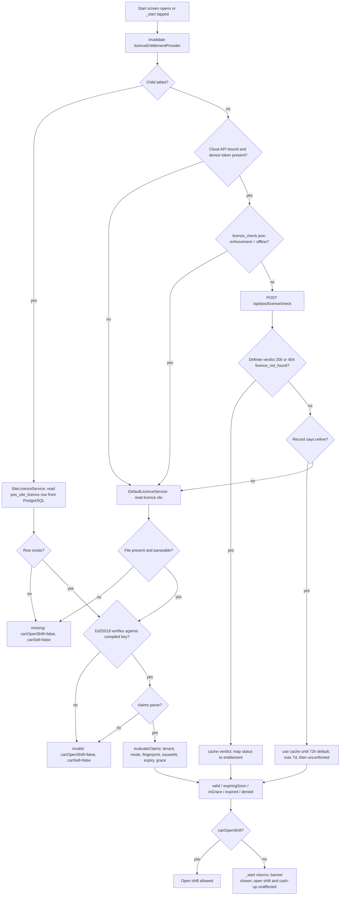

### 6.2 Online activation (setup wizard)

```mermaid
sequenceDiagram
    participant Op as Installer
    participant W as SetupController
    participant L as LicenceActivation.activate
    participant API as PlatformLicenceApi
    participant P as Platform (not in repo)
    participant V as LicenseVerifier
    participant FS as licence.xlic
    participant DB as pos_site_licence
    Op->>W: type key, press Activate online
    W->>L: activate(key, persist=false)
    L->>API: fetchByKey(key, fingerprint)
    API->>P: POST /api/pos/licence/activate {key, deployment_mode, fingerprint, tenant_slug?}
    P-->>API: 200 {payload, signature, key_id, issuer_public_key?}
    API-->>L: LicenseFile
    L->>V: evaluate (signature, tenant, mode, fingerprint, dates)
    V-->>L: LicenseEntitlement
    L-->>W: claims, entitlement, file (held in SetupDraft)
    W->>W: adopt tenant and mode from claims; mode screen offers only licensed modes
    Note over W: further wizard steps, then complete()
    W->>FS: store(file) before writing config.json
    Note over FS,DB: Later, start screen: SiteLicencePublisher.publish()
    FS-->>DB: INSERT/UPDATE pos_site_licence (only if max_terminals > 1)
```

## 7. Device binding

- `TerminalIdFingerprint.value()` = `sha256("xorder-pos-terminal:" + installationId)` hex; empty string when no id (`file_license_store.dart`). [CODE]
- `installationId` is a UUID v4 generated on first run (`providers.dart:2123`), persisted in `config.json` via the terminal profile, preserved by `TerminalProfileController.reset()`.
  Old builds used `terminal_id` as the identity (`terminal_profile.dart:87`).
- No hardware identifiers are read, although comments in `license_store.dart` say "derived from hardware identifiers" (**comment/code disagreement**).
- Spoofing: copy `config.json` (or edit `installation_id`) to another machine and the fingerprint matches; the salt is a public constant in the binary. Also, deleting the config
  produces a new fingerprint (a pinned licence then fails, `terminalNotLicensed`). Test: `licensing_test.dart:265` pin honoured (exists, not executed here).
- Scope: pin is per machine (set of fingerprints), but `fingerprints` is empty unless the issuer sets it. Whether the platform sets it on activation (the POS sends `fingerprint` "to bind") is UNKNOWN. Child tablets skip the pin (`viaMainDevice`).
- The same fingerprint is sent to the cloud provisioning and `/license/check` calls (`online_licence_service.dart:127`).

## 8. Expiry, grace, renewal, tamper states

`evaluateClaims` order [CODE: `license_verifier.dart:207-297`]: tenant -> mode -> fingerprint -> `now < issuedAt` (notYetValid, deny) -> before expiry (valid or expiringSoon within `warn_days`) -> before `expiry + grace_days` (inGrace: sell and open shift allowed, configuration frozen) -> expired (`canOpenShift=false`, `canSell=true`). Deny states set `canSell=false`.
Cash-up, reprint, export are hard-coded true (`license.dart:246-250`).

| State | canOpenShift | canSell | canChangeConfiguration |
|---|---|---|---|
| valid / expiringSoon | yes | yes | yes |
| inGrace | yes | yes | no |
| expired | no | yes | no |
| missing, invalid, tenantMismatch, modeNotLicensed, terminalNotLicensed, notYetValid | no | no (by flag) | no |
| online: suspended, expired, not_yet_valid, licence_not_found, unconfirmed | no | yes | no |

**Where the flags are enforced:** only `StartScreen._start` and the banner (`start_screen.dart:67-68,150`). `canSell` and `canChangeConfiguration` are not read by any sales, payment or settings code (grep `canSell|canChangeConfiguration` outside licensing/setup: no hits); a till already past the start screen keeps selling regardless. Router has only the `/licence` route, no guard (`router.dart:173`). The start screen also treats a still-loading entitlement as permitted (`start_screen.dart:149-150`). So the real gate is "cannot open a **new** shift", and a pre-opened shift never ends.
Online verdict cache: default 72h, hard cap 7d (`online_verdict.dart:27-31`); backwards clock treated as inside the window (`:211-216`). Test: `online_licence_test.dart:188-222` (exists, not executed here).
Renewal: key re-activation or "check for renewal" (the same call), then `invalidate` and re-publish to children. Grace and warn windows come from the signed claims.

## 9. Mode selection, multi-device, site licence

- **Licence selects mode:** licence is wizard step 1; `_adopt` takes `tenant_slug` and moves the draft to a mode the licence covers (`_coveredMode`); the mode screen shows only `licensedModes`, and is skipped when only one is covered (`setup_state.dart:166,245,483`; `setup_controller.dart:311-317`). `max_terminals > 1` is what permits a non-local database host (`setup_controller.dart:1249`, `setup_state.dart:182`). Tests: `licence_decides_mode_test.dart` (exists, not executed here).
- **Site licence in PostgreSQL:** table `pos_site_licence` (migration 43, `migrations.dart:3906`): `restaurant_id PK`, `payload`, `signature`, `key_id`, `mode` (CHECK in `cloud`,`offline`), `published_at`. Written by the main device (`PostgresSiteLicence.publish`, upsert) from `StartScreen` and after renewal, **only if `max_terminals > 1`**. Children read it, verify the signature with their own compiled key, judge it with `viaMainDevice=true` (fingerprint pin skipped). The `pos_till` role has SELECT/INSERT/UPDATE (`migrations.dart:3926`, `local_bootstrap.dart:827`). Child tablets cannot activate (`canActivateOnline=false`).
  Local file `licence.xlic` is the main device's store; the DB row is a copy for children. Tests: `site_licence_postgres_test.dart` (integration, self-skips without `POS_PG_HOST`; not executed here).
- **Terminal counting:** only in `registerTerminal` for a child (`setup_controller.dart:1742`: `site.terminalCount >= maxTerminals` where `terminalCount` = `count(*)` of `pos_terminals` rows for the restaurant, `postgres_site_licence.dart:46`). Main device not counted; cloud path relies on the platform's `MAX_TERMINALS_EXCEEDED` warning, shown as a notice (`cloud_provisioning_repository.dart:429`), not a block. Bypass: insert a `pos_terminals` row directly, or run a second main device against its own DB. Enforced once, at join time, not at sale time.
- **max_users** (staff UI only) counts active staff from the DB on the "add" button; direct DB inserts bypass it.

## 10. Tamper-resistance analysis

| Attack | Result | Notes |
|---|---|---|
| Edit `pos_site_licence` row (change expiry/payload) | Fails: signature over payload no longer verifies on children | [CODE]. Editing the `mode` column is **not signed**: a child takes its mode from the row (`site.mode`, `setup_controller.dart:1749`), though the licence's `modes` claim is still checked against it by `evaluateClaims`. Deleting the row stops children (missing). Replaying an older valid row (longer remaining term is not possible; an old row has an earlier expiry) is possible but only restores an earlier term |
| Edit `licence.xlic` claims | Fails verification | [CODE] `licence_signing_test.dart:215` |
| Delete `licence.xlic` / `licence_check.json` | File: till reads "missing" and cannot open shifts. Cache deleted: loses fallback verdict, no bypass | [CODE] |
| Set `licence_check.json` `enforcement` to `offline` | The till then uses the signed file and never calls `/license/check`, so a server-side suspension is never heard. Defeats online revocation. File is a plain JSON, unsigned | [CODE] `online_licence_service.dart:73` |
| Edit cached `licence_check.json` verdict to `valid` with large `cache_seconds` | Capped at 7 days from `checked_at`, but `checked_at` is also in the file: editable, so the cached "valid" can be extended indefinitely while offline | [CODE]; plausible, not exercised |
| Change system clock backwards | Extends an expired file licence indefinitely; no high-water mark or monotonic check. Online cache explicitly tolerates backward clock | [CODE] |
| Replace the public key in the binary | Defeats all checks. Release builds fail closed only when the define is missing, not when the binary is patched | [CODE]; acknowledged by the code's own comments ("commercial hygiene, not security") |
| Debug/profile build with self-signed licence | Accepted via `issuer_public_key` (non-release) | [CODE] |
| Copy `licence.xlic` to another machine | Works when the licence is unpinned (`fingerprints` empty). If pinned, copy `config.json` too (UUID, constant salt) | [CODE] |
| Wizard / DB admin: raise `max_terminals`? | Not possible without the key; but `terminalCount` is just a DB count | [CODE] |
| Admin sets own `licenceServerUrl` | Cannot forge a licence (signature), can deny service or deliver a genuine file | [CODE] |
| Revoked licence while offline | Not detectable; only the signed `expires_at` bounds use | [CODE] |

Net: DB/file edits cannot extend a signed term except through the clock, the unsigned verdict cache, or the binary. Server-side enforcement (cloud) is the stated backstop and is UNKNOWN in this repo.

## 11. What the POS calls vs what the backend must provide

| Endpoint | POS side | Status of POS code | Backend status |
|---|---|---|---|
| `POST /api/pos/licence/activate` | `platform_licence_api.dart:90` | IMPLEMENTED | UNKNOWN (documented as shipped in `BACKEND_TO_POS.md`) |
| `POST /api/pos/license/check` (device bearer) | `cloud_api.dart:224`, `online_licence_service.dart` | IMPLEMENTED, called on start screen | UNKNOWN; the doc says POS-BE-031, with the POS tolerating 404s |
| bootstrap bundle `licence` block | `bootstrap_bundle.dart:694`, `cloud_provisioning_repository.dart:368` | IMPLEMENTED | UNKNOWN |
| `GET /api/pos/licence/current` | none in `lib/` (grep) | NOT_IMPLEMENTED on POS | documented only |
| heartbeat (`/api/pos/terminals/heartbeat`) | `cloud_api.dart:219` | IMPLEMENTED; no licence use found | UNKNOWN |

## 12. Test inventory (exists, not executed here)

`licensing_test.dart` (signature, expiry, scope, legacy modes, claims version), `licence_signing_test.dart` (real Ed25519 fixtures, dev-issuer-key, key-id wording, edited term, unsigned file),
`offline_licence_activation_test.dart` (HTTP request shape, endpoint resolution, failure taxonomy, user cap), `licence_renewal_test.dart`, `licence_decides_mode_test.dart`, `online_licence_test.dart` (verdict mapping, cache window),
`test/data/site_licence_postgres_test.dart` (needs PostgreSQL). **No test found** for: clock rollback, tampered `licence_check.json`, `max_users` at a repository level, `features` enforcement (none exists), file-import UI (none exists). Note the file name `offline_licence_activation_test.dart` is misleading; it tests key activation via HTTP.

## 13. Open questions for the product owner

1. Is an air-gapped site a requirement? If so, file import UI and a clear offline renewal (file or short code) are missing.
2. Should an unsigned `enforcement: offline` or a hand-edited verdict cache be able to switch off online revocation?
3. Is `max_terminals` meant to be enforced for main devices and cloud tills?
4. Should `features`, `branch_ids`, `max_offline_days` be enforced or removed from the claim set?
5. Is `bin/pos_licence.dart` used for production issuance, or only the platform? (Its output cannot set `max_users`.)


---

<!-- ===== PART 7: CURRENT_SETUP_WIZARD.md ===== -->

# Current setup wizard and localisation: discovery audit

Scope: read-only audit of the first-run setup wizard and of the Arabic/English localisation as the code stands today.
Date of audit: 2026-10-24. Repo: `/home/user/xorder-pos`.

Evidence levels used below:

- **[CODE]** supported by executable code that was read. Nothing here was executed.
- **[ASSUMED]** inference, or something that depends on code that is not in this repo (backend, Windows host, PostgreSQL server).
- **[OBSERVED]** is not used. No Flutter, Dart or PostgreSQL is available in this sandbox, so no test or run was possible.

Status labels: IMPLEMENTED | PARTIAL | NOT_IMPLEMENTED | UNKNOWN.

Tests are "test exists (not executed here)". `PROJECT_REVIEW.md` claims 213 passed and 6 skipped; that is the author's claim, not observed.

Backend behaviour is UNKNOWN. The Laravel API is not available. Only the HTTP paths the POS calls are known (section 3.4).

---

## 0. Headline findings

| # | Finding | Status | Evidence |
|---|---|---|---|
| 1 | The wizard is one `SetupStep` enum (12 members) and one `SetupController`. It walks **three different step lists**: cloud main device, offline main device, child terminal. `visibleSteps` picks the list. | IMPLEMENTED | [CODE] `lib/features/setup/domain/setup_state.dart:26,264,305,320,342` |
| 2 | **Default UI language is Arabic.** A machine with no saved config opens in `ar`. Both `localeProvider` and `SetupDraft.locale` default to `'ar'`. | IMPLEMENTED | [CODE] `lib/app/providers.dart:1859`, `setup_state.dart:85`; test `test/core/localisation_test.dart` "a terminal with no configuration yet opens in Arabic" and "and so does the wizard it opens" |
| 3 | A language switch exists in three places, **none is called "General Settings"**: (a) the Settings menu-bar toggle (visible in the wizard, hidden on the welcome screen), (b) a "Language" pane under back-office Settings, (c) a wizard Language step on the **offline path only**. | PARTIAL vs approved UX | [CODE] `lib/app/app.dart:386-398`, `management_appearance_pane.dart:62-89`, `setup_panes.dart:235-271` |
| 4 | **Wizard language step does not switch the screen.** `setLocale()` only writes `SetupDraft.locale`. The UI language changes only when `complete()` calls `localeProvider.apply`. A comment in `providers.dart` says the opposite. | PARTIAL (defect) | [CODE] `setup_controller.dart:301,904`; comment `providers.dart:1841-1846`. No test found. |
| 5 | **Menu-bar language toggle is not reflected in what the wizard saves.** The toggle calls `localeProvider.apply`, which does not touch `SetupDraft.locale`. `complete()` then writes `draft.locale` to `config.json` and re-applies it. An installer who switches to English via the bar and never visits the Language step can end up with Arabic saved. | PARTIAL (probable defect, [CODE] reading, not executed) | [CODE] `setup_controller.dart:106,889,904`; `app.dart:397`. No test found. |
| 6 | Wizard strings are fully localised through `AppStrings`. 1,904 members, each implemented in both `EnStrings` and `ArStrings`; the sealed class makes a missing key a compile error. Residual literals in setup files are placeholders and identifiers (section 6.4). | IMPLEMENTED | [CODE] `lib/core/l10n/app_strings.dart`; test `test/core/localisation_test.dart` "no operator-facing literal survives in the widget layer" |
| 7 | Server-originated refusal text is English and reaches the screen only when the wizard has no code mapping. Raw `'$error'` exceptions are shown verbatim in two places. | PARTIAL | [CODE] `labels.dart:234-264`, `setup_controller.dart:705,1587` |
| 8 | RTL is by `MaterialApp.locale`, not hand-rolled. The wizard has hard-coded physical left/right in places (7 `Alignment.centerLeft`, rail `Border(right:)`, spinner `EdgeInsets.only(right:)`, welcome toggle `Positioned(right:)`). Mono fields (URLs, codes, hosts) set no LTR text direction. | PARTIAL | [CODE] section 7.3 |
| 9 | Numbers, dates and currency are **always Western digits** with `,` grouping, `.` decimal, ISO code suffix (`EGP`), `dd/mm/yyyy`. `intl` is a dependency but is never imported in `lib/`. No Arabic-Indic digits anywhere. | IMPLEMENTED (as designed) | [CODE] `lib/core/money/money.dart:119-146`, `labels.dart:220` |
| 10 | Receipt language equals the terminal UI language and is printed right-to-left when `ar`. One language per slip. | IMPLEMENTED | [CODE] `lib/features/receipt/receipt_document.dart:174-190,425` |
| 11 | Offline licence activation has **no file-import UI**. The wizard offers only "Activate online". The `fileContents` parameter exists for tests and the cloud bundle. A licence already on disk is picked up by `_restoreInstalledLicence`. | PARTIAL | [CODE] `setup_panes.dart:631-676`, `setup_controller.dart:1096`; test `setup_wizard_test.dart:577` asserts "Activate from file" is absent |
| 12 | The offline path never reads the Windows installer's `install-credentials.json`. Only the cloud path's `provisionTerminal` does. The offline operator types database name, port, till password and admin password. The installer's closing message says "The setup wizard will ask for them". | PARTIAL | [CODE] `setup_controller.dart:1521,1678` (only caller of `installerCredentialsProvider`), `installer/xorder-pos.iss:90-91` (`DatabaseReady`) |
| 13 | `complete()` writes the **admin** database password in clear text to `secrets.json` (file store, `0600` on POSIX, per-user profile on Windows) whenever the wizard held one. Offline always holds one. Comments elsewhere say "OS keystore"; the code uses a file. | IMPLEMENTED (security-relevant) | [CODE] `setup_controller.dart:869-873`, `file_secret_store.dart`, `lib/main.dart:41-52` |
| 14 | Offline terminal registration is not idempotent: each run of `registerManually` inserts a fresh `pos_terminals` row with a new UUID. A kill and re-run leaves orphans. No unique constraint prevents it. | PARTIAL | [CODE] `postgres_directory_repositories.dart:240-254`, `migrations.dart:152-165` |
| 15 | Only the **cloud claim** is resumable (`setup-progress.json`). Offline has no progress file; its database is built in PostgreSQL at the account step and survives a kill, but the licence (held in memory) and all form input are lost. | PARTIAL | [CODE] `setup_controller.dart:207-299` |

Product-owner direction: "Arabic by default with language switching through General Settings". Gap summary in section 9.

---

## 1. How the wizard is launched

### 1.1 Routing and gates [CODE] `lib/app/router.dart:62-100`

| Condition | Result |
|---|---|
| `setupCompleteProvider == false` and path not `/setup` or `/welcome` | redirect to `/welcome` |
| `setupCompleteProvider == true` and path is `/setup` or `/welcome` | redirect to `/` (start) |
| initial location | `/` |

`setupCompleteProvider` is `terminalSeedProvider.isConfigured`, which is `config.isUsable && hasDatabaseCredential` (`terminal_config.dart` `TerminalBoot.isConfigured`; `providers.dart:2038`).

`isUsable` is `setupComplete && terminal.isSet && deployment.isConfigured`. A saved `config.json` without the till database password in `secrets.json` is **not configured**, so the wizard is shown again, seeded from the config.

The router uses `ref.read` and has no `refreshListenable`. Navigation after state changes is done explicitly with `context.go`.

### 1.2 Doors into `/setup`

| Door | Where | Code | Note |
|---|---|---|---|
| Ctrl+Shift+S or Cmd+Shift+S on the welcome screen | `WelcomeScreen` `CallbackShortcuts` | `welcome_screen.dart:91-99` | test `welcome_screen_test.dart` "Ctrl+Shift+S opens the setup wizard" |
| Twelve taps on the logo (2 s pause resets the count) | `WelcomeScreen._onLogoTap` | `welcome_screen.dart:42-62` | for tablets; test "twelve taps on the mark open setup" |
| Back-office "Reset terminal" then `onReconfigure` | `management_terminal_pane.dart:100-101` | runs `terminalResetProvider.run()`, then `context.go('/setup')` | refuses while a shift is open (`resetTerminalShiftOpen`) |
| Ctrl+Shift+R forced reset | `app.dart:79-89`, `force_reset_dialog.dart:40-90` | requires username+PIN with `terminal.manage` on a configured till; shows open-shift and queued-sync counts; then `terminalResetProvider.run()`, then `go('/')`, which the redirect turns into `/welcome` | test `force_reset_gate_test.dart` |

**Doc/code disagreement:** `CLAUDE.md` says "Ctrl+Shift+S opens the setup wizard". That is true only on the welcome screen of an unconfigured till. On a configured till the root binding of Ctrl+Shift+S opens Admin Mode (`app.dart:73-78`, `_openAdmin` returns early when setup is incomplete, `app.dart:~510`). The chord is configurable (`AdminShortcut`: ctrlShiftS, ctrlShiftA, ctrlAltS, ctrlShiftF12; `admin_shortcut.dart`).

The `start` feature (`lib/features/start/start_screen.dart`) does **not** launch the wizard (no reference to setup or reconfigure in it). It is the destination after the wizard.

The welcome screen shows the logo, the localised line `terminalNotSetUp` and a light/dark toggle. The Settings menu bar, including the language toggle, is **disabled on `/welcome`** (`_beforeTheTill`, `app.dart:~488-492`). A fresh till therefore opens in Arabic with no on-screen way to switch before entering the wizard.

### 1.3 What the wizard is seeded from [CODE] `SetupController.build()` `setup_controller.dart:61-125`

| Situation | Seed |
|---|---|
| No saved config (fresh or after reset) | `step = licence` (or `deployment` for a child), `deployment = unconfigured` (cloud) with `role` from `deviceRoleProvider`, `terminalId`/`installationId` from `terminalProfileProvider` (kept across reset so the licence pin survives), `locale = localeProvider.languageCode` |
| Saved config but keystore password missing | Draft refilled from config: deployment, branch, terminal name, ids, `claimed = terminal.provisioned`, `locale = saved.languageCode`. Passwords blank. |
| Child | `deviceRoleProvider`: Android and iOS are always child; desktop is child when `install-role.json` says `client_terminal`, otherwise main (`providers.dart:1738-1741`). |

Two microtasks start at build: `_restoreInstalledLicence` (all roles except child) and `_restoreProgress` (only when no saved config and not child).

---

## 2. Step inventory

### 2.1 `SetupStep` and the three paths [CODE] `setup_state.dart`

Enum order: `licence, language, setupType, deployment, account, branch, terminal, connecting, hardware, money, catalogue, summary`.

| Path | When | Steps in order |
|---|---|---|
| **Cloud main device** (`cloudSteps`, line 305) | `mode == cloud && !isChild` | licence, [setupType if `asksSetupType`], account (pairing code, or branch and terminal behind "sign in instead"), connecting, [hardware unless exactly one printer was detected], summary. Walks 4 to 6 screens on the pairing-code road. Manual road adds branch and terminal. |
| **Offline main device** (`offlineSteps`, line 320) | `mode == offline && !isChild` | licence, language, [setupType], deployment, account (first administrator and database build), branch, terminal, hardware, money, catalogue, summary. 11 screens, 10 when the licence is single-mode. |
| **Child terminal** (`childSteps`, line 342) | `deployment.isChild` | deployment (find main device), account (manager sign-in), branch, terminal, hardware, catalogue, summary. 7 screens. |

`asksSetupType` is `licensedModes.length > 1` (an empty `modes` claim means all modes). `DeploymentMode` has only `cloud` and `offline` today; legacy wire values `branch_server` and `standalone` parse to `offline` (`deployment.dart:12-26`). There is no separate "branch-server role": the server-role distinction is `TerminalRole.main` vs `TerminalRole.child` plus `allowsSharedDatabase` (`maxTerminals > 1`).

**Doc/code disagreement:** `CLAUDE.md` says "Three deployment modes: cloud, branch-server, islanded". The enum has two.

The wizard header counts steps from `visibleSteps` (`stepNumber`, `stepCount`). A step being stood on is always listed even if the path rule would drop it (`visibleSteps`, line 264).

### 2.2 Step table (all steps)

`canAdvance` is `setup_state.dart:468-543`. "Persisted" refers to durable storage; draft state is in memory only.

| # | Step (`SetupStep`) | Pane | Paths | Purpose | Inputs and validation | Needs before | Operations (SQL, HTTP) | Persisted, where, when | Errors (AppStrings keys) |
|---|---|---|---|---|---|---|---|---|---|
| 1 | `licence` | `_LicencePane` (`setup_panes.dart:617`) | cloud, offline | Install the licence that supplies tenant, modes, `max_terminals` | Licence key (any non-empty; trimmed), licence server URL (default `PlatformEndpoint.base`, editable, blank resets). Gate: `entitlement.canSell` | none | HTTP `POST {base}/api/pos/licence/activate` (`platform_licence_api.dart:90`) body: key, deployment_mode, fingerprint, optional tenant_slug. Then local Ed25519 verification. | **Held in memory** (`licenceFile`) until `complete()`. `persist: false`. Exception: a licence already on disk is only read. | `LicenceKeyNotRecognised`, `LicenceRevoked`, `TooManyLicenceAttempts`, `LicenceServerRefused`, `NoLicenceServer`, `NotALicenceFile`; verdict card plus notice bar |
| 2 | `language` | `_LanguagePane` (`setup_panes.dart:235`) | **offline only** | Choose en or ar | Two tiles. Gate: always true. | licence | none | Draft only. Written to `config.json` `language` by `complete()` | none |
| 3 | `setupType` | `_SetupTypePane` (`setup_panes.dart:279`) | cloud, offline, only when licence covers both modes | Choose cloud or offline | Tile per mode, disabled when not licensed. Gate: `licensedModes.contains(mode)` | licence | none | Draft only | `notLicensedBadge` |
| 4 | `deployment` | `_DeploymentPane` (`setup_panes.dart:319`) | offline main only (child gets `_MainDevicePane`) | Where is the database and which login | Host (only if `maxTerminals > 1`), TLS trust toggle, database name, port, till role, till password, sync policy (cloud only). Gate: `isConfigured && hasValidDatabaseName && databasePassword.isNotEmpty`. Name rule `^[A-Za-z_][A-Za-z0-9_]*$` (`deployment.dart:266`). Port 1..65535 else ignored. | licence | "Test connection": for offline, `SELECT 1`-style probe via `posDatabaseProvider.probe`. HTTP reachability probe only if `mode.needsBaseUrl`. | Password to `MutablePosDbCredentials` memory; durable only at `complete()` | `dnsFailure`, `tcpFailure`, `authFailure`, `roleMissing`, `tlsFailure`, `missingDatabase` (notice, not error), `permissionDenied`, `queryFailure`, `platformAddressRequired`, `couldNotReach`, `databaseNameInvalid` |
| 4c | `deployment` (child) | `_MainDevicePane` (`setup_panes.dart:524`) | child | Find the main device and read its shared licence | Host, TLS, db name, port, till password. Loopback refused. Gate: `mainDeviceLinked && !isLoopback && databasePassword.isNotEmpty && canSell` | none | Reads `SiteLicence` from the main device database (`PostgresSiteLicence`) | memory | `mainDeviceIsThisTablet`, `mainDeviceHasNoLicence`, plus the DB failure strings above |
| 5 | `account` (cloud, pairing) | `_AccountPane` + `_PairingCodeFields` | cloud | Redeem a pairing code | Code (trimmed, uppercased). Tenant slug read-only from licence. Gate: slug non-empty and `claimed` | licence | HTTP `POST /api/pos/terminals/claim` (tenant_slug, pairing_code, platform, app_version, fingerprint). Response: device token, terminal, bootstrap bundle. Then best-effort `PosMigrator.migrate` plus `BootstrapSeeder.seed(force: true)` | Device token to `secrets.json` **at claim**. `setup-progress.json` written. Licence from bundle held in memory. | `refusalPairingCodeInvalid/Spent/Expired`, `refusalTenantUnknown`, `refusalPlatformUnreachable`, `refusalWrongPlatform`, `refusalClaimUnreadable`, `claimOverTerminalCount` (notice) |
| 5m | `account` (cloud, manual) | `_ManualCredentialFields` | cloud ("sign in instead") and child | Staff login, pull branches and terminals | Username, password. Gate: `connected` | licence | HTTP `POST /api/auth/login`, `GET /api/dashboard/branches`, `GET /api/dashboard/pos/terminals`. Child: PostgreSQL `pos_staff`. | memory only (`operatorPassword` never persisted) | `refusalCredentialsRejected`, `refusalNoBranches`, `WRONG_PLATFORM`, `PLATFORM_UNREACHABLE` |
| 5o | `account` (offline) titled "First administrator" | `_FirstInstallFields` (`setup_panes.dart:2030`) | offline | Build the database and create the first owner | Admin role password, owner name, username (lowercased), PIN (digits only, exactly `PinRules.length`, enforced while typing). Gate: `bootstrapped` | deployment | See section 3.2 | PostgreSQL (everything built); admin password memory until `complete()` | `installLicenceFirst`, `pinIsExactlyDigits`, `firstPersonIncomplete`, `databaseNameInvalid`, `tillRoleRefused`, `ownerAlreadyExists`, `bootstrapAuthFailed`, `bootstrapUnreachable`, `bootstrapDatabaseMissing`, `bootstrapAdminRoleMissing`, `bootstrapRefused` |
| 6 | `branch` | `_BranchPane` (`setup_panes.dart:1109`) | offline, child, cloud manual | Pick branch | Tiles from `pulledBranches` or `branchesProvider` (SQL `pos_branches`). Gate: `branchId != null`. Single pulled branch is pre-picked. | account | `SELECT … FROM pos_branches WHERE restaurant_id AND is_active` | memory | error branch shows raw `'$error'` |
| 7 | `terminal` | `_TerminalPane` (`setup_panes.dart:1173`) | offline, child, cloud manual | Name and register this till | Name (non-empty). Optionally adopt an existing cloud terminal. Gate: `name.trim().isNotEmpty && claimed` | branch | Offline/child: `INSERT INTO pos_terminals`. Cloud manual: `POST /api/pos/terminals/register` (with `client_transaction_id`) or issue-and-redeem pairing code `POST /api/dashboard/pos/terminals/{id}/pairing-code` then claim. Child first checks seat count against `SiteLicence.terminalCount`. | Cloud: device token plus `setup-progress.json`. Offline: DB row. Terminal UUID generated in memory on first keystroke. | `allTerminalsTaken`, `refusalBranchUnknown`, `refusalAdoptUnsupported`, credentials errors |
| 8 | `connecting` | `_ConnectingPane` (`setup_panes.dart:1315`) | cloud only | Automatic: database, schema, menu, printer | None, except the fallback fields (`_InstalledDatabaseMissing`) when no installer credentials file. Gate: `provisioned`. | account (and terminal on manual) | Section 3.3 | DB built. Progress file read. Report text in memory. | `bootstrapAuthFailed`, `tillRoleRefused`, `catalogueAuthFailed`, `catalogueDownloadFailed`, `menuDownloadRefused`, `menuShapeNotUnderstood`, `noPlatformAddressInForce`, `terminalNotRegisteredYet`; `tryAgain` button |
| 9 | `hardware` | `_HardwarePane` (`setup_panes.dart:1567`) | offline, child, cloud when 0 or 2+ printers | Printer, paper width, drawer, scanner | Gate: always true (printing never blocks trade) | previous | `hardwarePortsProvider.discoverPrinters`, `testPrint` | memory, then `config.json` `printer` at `complete()` | `nothingPrinted` toast |
| 10 | `money` | `_MoneyPane` (`setup_panes.dart:1681`) | offline only | Read-only display of tax defaults | None. Currency shown as the literal `EGP`. Gate: true | hardware | none | nothing | `deviceTaxHelp` warning |
| 11 | `catalogue` | `_CataloguePane` (`setup_panes.dart:1748`) | offline, child | Read the menu | Button "Read menu". Gate: `catalogueItems != null` | money | `catalogRepositoryProvider.load()` (SELECT). Cloud would download, but cloud no longer shows this step. | nothing | `menuEmpty` warning, does not block |
| 12 | `summary` | `_SummaryPane` (`setup_panes.dart:1835`) | all | Review and "Open the till" | Cloud shows 4 rows, others 11. Test-print button. | previous | `complete()` | Section 4.1 | `setupIncomplete`, `couldNotSaveSetup` |

Language-aware titles come from `SetupStepLabel.title/blurb` (`lib/app/labels.dart:67-130`), which retitles `account` per mode, role and method.

---

## 3. Operations in detail

### 3.1 Licence step

`SetupController.activateLicence` (`setup_controller.dart:1096-1192`) pushes the licence server URL into `deploymentProvider`, then calls `LicenceService.activate(persist: false)` (`licence_service.dart:140-186`). The service fetches by key through `PlatformLicenceApi.fetchByKey`, then verifies the Ed25519 signature locally and evaluates tenant, mode, expiry and fingerprint pin. `_judgeOnCoveredMode` re-judges a `modeNotLicensed` verdict against the mode the licence itself grants. `_adopt` copies tenant slug, mode, platform URL and database host (`localhost` when `maxTerminals <= 1`) into the draft.

Dev builds can wire `FakeLicenceService`, which accepts any non-empty key (`licence_service.dart` `FakeLicenceService`, "wired only in debug builds" per its comment; the wiring in `providers.dart:1633-1665` as read uses `DefaultLicenceService` unconditionally. The comment and the wiring disagree; test `setup_wizard_test.dart` "a development key issues a licence that permits trade" injects its own service).

### 3.2 Offline build: `bootstrapDatabase` (`setup_controller.dart:531-711`)

Runs as the admin role over a throwaway `PosDatabase`, then closes it. In order:

| Order | Operation | Code | SQL or effect | Idempotent |
|---|---|---|---|---|
| 1 | `createDatabase` | `local_bootstrap.dart:88` | `SELECT 1 FROM pg_database WHERE datname`; `CREATE DATABASE "name"` if absent. Connects to database `postgres`. | yes |
| 2 | `ensureTillRole` | `:226,256` | `SELECT 1 FROM pg_roles`; `CREATE ROLE "pos_till" LOGIN PASSWORD '…'` if absent. `permission denied` becomes `TillRoleRefused`. | yes, but does **not** reset the password of an existing role |
| 3 | `migrate` | `PosMigrator` `migrations.dart:4478-4511` | One transaction: `pg_advisory_xact_lock`, `CREATE TABLE IF NOT EXISTS schema_migrations`, apply each missing version (52 `PosMigration` entries) | yes; each migration set is transactional with the version row |
| 4 | `seedRestaurant` | `:346` | `INSERT INTO pos_restaurants (slug, name) … ON CONFLICT (slug) DO UPDATE SET slug = EXCLUDED.slug` | yes (name not updated) |
| 5 | `seedBranch` | `:364` | `pos_branches` row `'Main'` / `'MAIN'`, order types `{dine_in,takeaway,delivery}`, `ON CONFLICT (restaurant_id, code)` | yes. Name and code are hard-coded, not asked. |
| 6 | `seedSystemRoles` | `:388` | `pos_roles` upsert per `SystemRoles.seeded` | yes |
| 7 | `seedReasonCodes`, `seedTaxGroup`, `seedTenderTypes`, `seedOrderTypes` | `:429,539,482,514` | upserts | yes |
| 8 | `seedOwner` | `:579` | One transaction. Locks the owner role row, refuses if a **different** active owner exists (`AnotherOwnerActive`), else `INSERT INTO pos_staff … ON CONFLICT (restaurant_id, username) DO NOTHING`. PIN stored as PBKDF2 salt and hash. | yes, but a re-run with a different PIN for the same username changes nothing (`OwnerAlreadyHere`). Test `installer_owner_test.dart` "the owner again, by username, changes nothing — PIN included" |
| 9 | `applyGrants` | `:1145`, `tillGrants` `:655`, `administrativeGrants` `:983` | Statement list run one by one: table-level GRANTs to the till role and the admin role | yes |

Steps 1 to 9 are separate statements and transactions. There is no outer transaction and no rollback. `provision.ps1` or the wizard can leave a partially built database; the next run completes it (section 5). The restaurant name comes from the licence claim `tenantName`; the slug from `tenantSlug`.

Tests: `test/data/local_bootstrap_test.dart` "builds a sellable database from nothing" and others are PostgreSQL-tagged and skip when `POS_PG_HOST` is unset (test exists, not executed here).

### 3.3 Cloud `provisionTerminal` (`setup_controller.dart:1513-1672`)

Runs automatically from `_ConnectingPaneState.initState` after the first frame (guards: not already `provisioned`, not `busy`, not `needsDatabase`).

1. `_adoptInstalledDatabase`: reads `%ProgramData%\XOrder POS\install-credentials.json` (`FileInstallerCredentials`). Missing or unreadable: sets `needsDatabase = true` and shows `_InstalledDatabaseMissing` (db name, port, till role and password, admin role and password). Non-Windows machines always take this fallback because `ProgramData` is unset.
2. `databaseBuilderProvider` (`providers.dart:2331-2404`): `createDatabase`, `ensureTillRole` (if till password present), `migrate`, `applyGrants` with `cloudSeeding: true`. No restaurant, branch or owner seeding.
3. `_seedFromPlatform`: `GET /api/pos/bootstrap` with the device token, `BootstrapBundle.tryParse`, `BootstrapSeeder.seed(bundle, force: true)` in **one transaction** (`runTx`, `bootstrap_seeder.dart:59`). It DELETEs and re-inserts catalogue and dining tables, upserts identity, branches, tender types, staff PIN verifiers, money config, receipt profiles. It does not touch orders, payments or the outbox. Failure is a **notice**, not a blocker.
4. `_seedLocalDefaults`: `seedReasonCodes`, `seedOrderTypes` via `cloudDefaultsSeederProvider`, only if step 3 had no notice, a restaurant id exists and an admin password is held.
5. Printer scan; exactly one printer is auto-selected (80 mm, drawer on, scanner off) and the hardware step is dropped.
6. Sets `provisioned = true`, which un-gates Continue.

Failures in steps 1 and 2 return without `provisioned`, so the wizard cannot finish over an unbuilt database.

### 3.4 HTTP endpoints called by the wizard

| Endpoint | Method | Caller | Purpose |
|---|---|---|---|
| `/api/pos/licence/activate` | POST | `PlatformLicenceApi.fetchByKey` | Licence by key |
| `/api/auth/login` | POST | `CloudProvisioningRepository.connect`, `adoptTerminal`, `registerManually` | Staff JWT |
| `/api/dashboard/branches` | GET | `connect` | Branch list |
| `/api/dashboard/pos/terminals` | GET | `connect` | Existing terminals (non-fatal if it fails) |
| `/api/dashboard/pos/terminals/{id}/pairing-code` | POST | `adoptTerminal` | Mint a code for an existing terminal |
| `/api/pos/terminals/claim` | POST | `claimByCode` | Redeem code; returns token, terminal, bundle |
| `/api/pos/terminals/register` | POST | `registerManually` | Create terminal (idempotency key `client_transaction_id` is a fresh UUID per call) |
| `/api/pos/bootstrap` | GET | `_seedFromPlatform` | Bundle (device token header) |

All paths are in `lib/data/cloud/cloud_api.dart:78-170` and `platform_licence_api.dart:90`. Backend behaviour for each is UNKNOWN. `docs/coordination/*` documents agreements (POS-BE-0xx) and is not evidence of implementation.

### 3.5 Error handling model

- Every refusal is `SetupDraft.error` (red bar) or `notice` (amber bar). The `state` setter overrides print `setup[<step>] refused: …` via `debugPrint` for every new error (`setup_controller.dart:44-51`).
- Provisioning refusals carry a machine code. `provisioningRefusal(s, code, fallback:)` (`labels.dart:234`) maps 15 codes to localised sentences; unmapped codes fall back to the **English** message built in the repository (`cloud_provisioning_repository.dart`, `postgres_directory_repositories.dart`).
- Database failures are classified by `PosDbFailure` (auth, dns, tcp, tls, permissionDenied, missingDatabase, missingRole, query, unknown) and mapped by `_describe` and `_bootstrapFailure`.
- Unclassified exceptions are shown as `'$error'` (`setup_controller.dart:705,1587`; `setup_panes.dart:1135`). These are driver or Dart text in English.
- Catalogue and seed failures during `connecting` are notices; they never block.

Tests: `setup_wizard_test.dart` groups "testing the connection", "step gating", "provisioning" assert these gates and messages (test exists, not executed here). `cloud_setup_collapsed_test.dart` group "a machine the installer never ran on" asserts the fallback screen and the sentence-not-driver error rule.

---

## 4. Persistence map

### 4.1 `complete()` (`setup_controller.dart:835-916`)

Order of writes:

| Order | Write | Where | Notes |
|---|---|---|---|
| 0 | Guard | `profile.isSet` | needs terminal name, restaurant id, branch id, branch code, terminal id; else `setupIncomplete(<missing list>)` |
| 1 | `publishCredentials` then `posDbCredentialsStoreProvider.save()` | `secrets.json` key `pos_till_database_password` | via `FileSecretStore` |
| 2 | Admin password, if the wizard held one | `secrets.json` key `pos_admin_database_password` | clear text in the file. Offline always; cloud when it came from the installer file or the fallback screen |
| 3 | Licence file, if `licenceFile != null` | `licenseStoreProvider` (file beside config) | skipped when the licence was restored from disk |
| 4 | `config.json` | `FileTerminalConfigStore.write` | deployment (no password), terminal profile, `language`, printer, brightness, admin_mode, `setup_complete: true`. Temp file then atomic rename. |
| 5 | `setup-progress.json` cleared | `FileSetupProgressStore.clear` | |
| 6 | In-memory publish | `localeProvider.apply(state.locale)`, `deploymentProvider`, `printerConfigProvider`, `terminalProfileProvider`, `setupCompleteProvider.markComplete()` | the route then goes to `/` |

If any of 1 to 5 throws `Exception`, `couldNotSaveSetup(error)` is shown and nothing is marked complete. Steps 1 to 3 are not rolled back (a password and licence may already be on disk). This is safe: `isConfigured` needs `config.json`, which is written after them. `Error` (not `Exception`) types escape the `on Exception` clause.

Test: `setup_persistence_test.dart` "finishing setup" group, including "writes the terminal to disk before reporting itself done", "a keystore write failure leaves setup incomplete", "activating a licence installs nothing until setup finishes" (test exists, not executed here).

### 4.2 Files and stores

| Item | Location | Contents | Written when |
|---|---|---|---|
| `config.json` | Application Support dir (`getApplicationSupportDirectory`) | deployment, terminal, language, printer, brightness, admin_mode. No passwords. | `complete()`; later `localeProvider.apply` and brightness rewrite it, only if it already exists |
| `secrets.json` | same dir | till DB password, cloud device token, backup password key, admin DB password. One JSON object, `0600` on POSIX. | token at claim; passwords at `complete()` |
| `setup-progress.json` | same dir | deployment, terminal id and name, locale, branch fields, restaurant id, branch code, signed licence string | after a cloud claim or manual register |
| Licence file | `FileLicenseStore` | signed licence | `complete()` (or a later renewal) |
| `install-credentials.json` | `%ProgramData%\XOrder POS\` | ports, roles, **all four generated passwords including the superuser** | by `provision.ps1`, ACL: Administrators and SYSTEM |
| `install-role.json` | same | `{"role": "client_terminal"}` | by the Inno script for "Till only" |
| PostgreSQL | branch machine | schema, seed rows, `pos_terminals` | offline: during the wizard; cloud: during `connecting` |

**Doc/code disagreement:** comments in `terminal_config_store.dart`, `setup_state.dart` and `setup_controller.dart` say the database password lives in the "OS keystore". The implementation in `main.dart:41-52` and `file_secret_store.dart` is a JSON file; a comment in that file records the owner decision of 2026-09-04.

---

## 5. Recovery after interruption (kill the app between steps)

Nothing below was run. It is derived from the code.

### 5.1 Cloud main device

| Killed at | What is on disk or in the database | On next launch |
|---|---|---|
| Licence step, before or after activation | Nothing. The licence is held in memory (`persist: false`). | Wizard from step 1; key must be entered again. A licence file that was already on disk is picked up by `_restoreInstalledLicence`. |
| Account step, before claim | Nothing | As above |
| Immediately after claim | Device token in `secrets.json`; `setup-progress.json` (via `_rememberProgress`); PostgreSQL schema possibly seeded (best effort) | `_restoreProgress` sets `step = connecting`, `claimed = true`, `resumed = true`, restores deployment, branch, terminal, locale, licence (re-verified). `provisionTerminal` runs automatically. `setupResumed` is the first line of the report. The spent pairing code is not needed again. |
| During `connecting` | Partial database build. Seed is one transaction (all or nothing). | Resume as above. All build steps are idempotent (section 3.2, 3.3). |
| After `connecting`, before "Open the till" | Same as above | Same resume. |
| During `complete()` | Possibly `secrets.json`, licence file written; `config.json` is atomic via temp file and rename | If `config.json` was not renamed, the till is not configured and resume applies. If it was, `setup-progress.json` may linger but is never read when a config exists. |
| Fallback fields (no installer file) | The admin and till passwords typed are memory-only | Fields are asked again. |

What a resume does not restore: tenant display name, printer choice and the admin or till passwords. The resume path needs `state.step == licence && !claimed` and `saved == null`.

No rollback exists. Abandoning a half-finished cloud setup leaves a claimed terminal on the platform and a device token in `secrets.json`. The reset path (section 5.4) clears the progress file and database credentials but not the device token (see 5.4).

### 5.2 Offline main device

| Killed at | State | On next launch |
|---|---|---|
| Before "Build the database" | Nothing durable | Wizard from step 1 |
| During or after build | Database, roles, restaurant, branch `MAIN`, system roles, owner exist in PostgreSQL. Grants may be partial if killed mid-list. | Wizard from step 1. Re-running the build skips what exists. The owner PIN re-entered is ignored if the username exists. A different username fails with `ownerAlreadyExists`. |
| After terminal register | One `pos_terminals` row | Re-running registers **another** row with a new UUID. Orphan rows are not cleaned up. [CODE] |
| During `complete()` | As in 5.1 | As in 5.1 |

No progress file for offline (`_rememberProgress` returns when `mode != cloud`). The licence must be re-activated online or must already be on disk.

### 5.3 Child terminal

Nothing durable until `complete()`, except the `pos_terminals` row inserted at registration in the main device's database. Re-running inserts another row and re-checks the seat count against `SiteLicence.terminalCount` (`registerTerminal`, `setup_controller.dart:1730-1749`).

### 5.4 Reset (`TerminalReset.run`, `providers.dart:2066-2090`)

Clears `config.json`, `setup-progress.json`, the till password store, the admin password store, the in-memory admin credential, and resets providers. It does **not** delete the licence file, the terminal id/installation id (intentional, pins the licence), the device token vault, or any PostgreSQL data. `grep -rn "forget\|vault" lib/app/providers.dart` finds no device-token clear in the reset path.

Protection of local transactions: reset touches no PostgreSQL table, so unsent orders, payments and the `pos_outbox` queue survive it. The forced reset dialog shows the open shift reference and the queued sync count and requires confirmation (`force_reset_dialog.dart:55-90`). The back-office reset is refused while a shift is open. After a reset the terminal needs a database credential again; the sales remain in the database. This is the only wizard-related protection found. A forced re-seed (`BootstrapSeeder.seed(force: true)`) deletes only catalogue, tables and related rows; it has no DELETE on orders or the outbox (grep of `bootstrap_seeder.dart`).

Tests: `setup_persistence_test.dart` groups "resetting a terminal" and "a claim made on an earlier run" (test exists, not executed here).

### 5.5 Idempotency summary

| Operation | Re-run safe | Caveat |
|---|---|---|
| Licence activate | POS side yes; server side UNKNOWN | server may bind or rate-limit (`TooManyLicenceAttempts` exists) |
| `claimByCode` (cloud) | no, the code is single-use | resume exists to avoid a second claim |
| `registerManually` cloud | likely (fresh `client_transaction_id` per call, so server-side dedupe does **not** apply across calls) [ASSUMED] | UNKNOWN |
| `registerManually` offline and child | no | new `pos_terminals` row each time |
| `bootstrapDatabase` | yes | PIN change ignored; till role password not updated if the role exists |
| `provisionTerminal` | yes | |
| `BootstrapSeeder.seed(force:true)` | yes | replaces catalogue |
| `complete()` | yes | |

---

## 6. State diagrams

### 6.1 Launch and gates

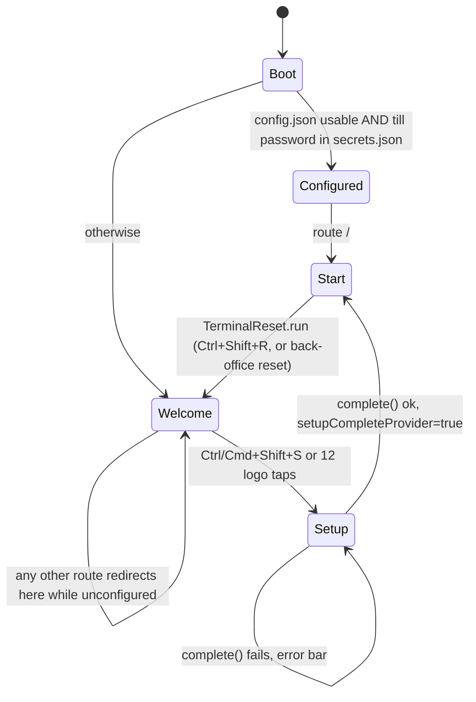

### 6.2 Cloud main device path

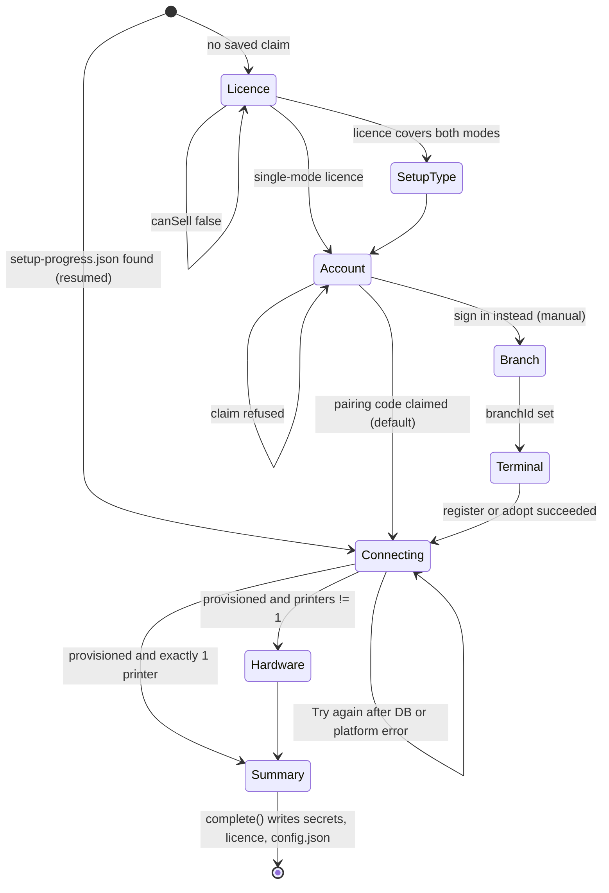

### 6.3 Offline main device path (single-machine and shared database)

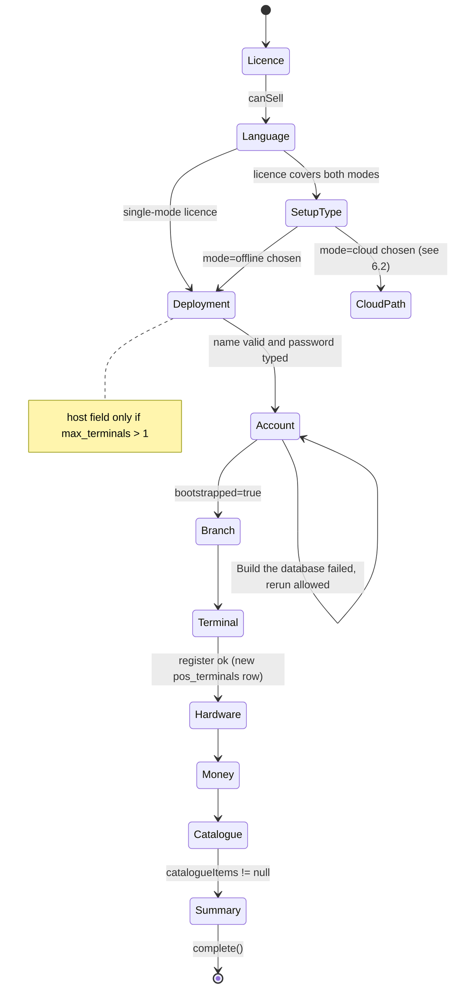

### 6.4 Child terminal path

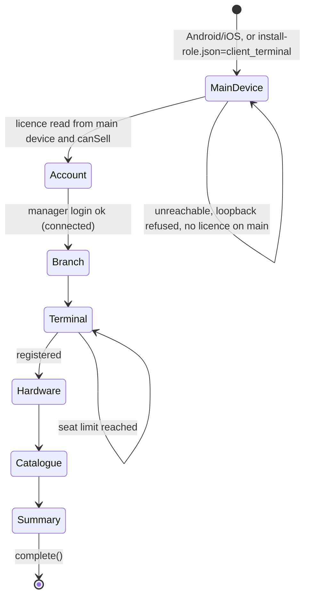

---

## 7. Localisation as it is today

### 7.1 Structure [CODE] `lib/core/l10n/app_strings.dart` (12,283 lines)

- `sealed class AppStrings` (line 36): abstract getters and methods only; the sole `=>` in the base is the static `of()` factory.
- `final class EnStrings` (line 2589) and `final class ArStrings` (line 7495). Both are hand-written.
- `AppStrings.of(Locale)`: `ar` returns `ArStrings`, **anything else returns `EnStrings`** (line 41).
- `AppLocalizations` delegate: `supportedLocales = [en, ar]` (line 12263). `BuildContext.strings` falls back to `EnStrings` when no delegate is above (line ~12278).
- No ARB files, no code generation. `direction` is a member (`ltr` for en, `rtl` for ar).

Counts (script over the file, not by eye): `EnStrings` and `ArStrings` each override 1,904 distinct names, and the base declares the same 1,904 (one signature, `refusalStockHeldInAnotherUnit`, spans several lines and was missed by the single-line count of the base, which gave 1,903). Missing keys per language: **0 en, 0 ar by construction** (Dart will not compile otherwise). What the compiler cannot show is an Arabic value that is still English; test `localisation_test.dart` "has no Arabic string left in English" scans a sample map for Arabic letters and exempts `licenceKeyHint`, `notSet`, `listSeparator`.

### 7.2 Which locale is chosen

| Question | Answer | Code |
|---|---|---|
| Default with no config | **Arabic** | `TerminalLocaleController._default = 'ar'` (`providers.dart:1859`) |
| Default wizard draft | **Arabic** | `SetupDraft.locale = 'ar'` (`setup_state.dart:85`) |
| Value when a saved config lacks the field | **English** | `SavedTerminalConfig.fromJson`: `json['language'] as String? ?? 'en'` (`terminal_config.dart`). This disagrees with the Arabic default. |
| Value for an unsupported language | English | `AppStrings.of` |
| Seed during a reset | the current `localeProvider` (the process boot snapshot), so the wizard keeps the language the till had | `setup_controller.dart:102-106` |
| Cloud claim | restaurant's `default_language` from the bundle (`en` or `ar`; anything else null) overrides the draft **and** applies immediately | `bootstrap_bundle.dart:96-100`, `setup_controller.dart:1476,1486` |
| Source for OS locale | not used. `Platform.localeName` is never read. | grep |

### 7.3 Can the language be switched, where, and does it persist

| Surface | Where | Persists | Note |
|---|---|---|---|
| Settings menu-bar item | `app.dart:386-398`, label shows the language you would switch to | `localeProvider.apply` rewrites `config.json` `language` **only if the file already exists**; during the wizard it persists nothing (`providers.dart:1895-1904`; test `localisation_test.dart` "writes nothing on a terminal still inside the wizard") | Bar is visible in the wizard and on a signed-in till. Hidden on welcome, start and lock screens (`_beforeTheTill`). |
| Back office, Settings, Language pane | `management_appearance_pane.dart:62-89`, `ManagementPane.language` | same `apply` | Admin Mode only; local (offline) tills. The cloud back-office screen has no language reference (grep). |
| Wizard Language step | `_LanguagePane` | `draft.locale` then `complete()` | **Offline path only.** Does not change the screen language (finding 4). |
| "General" | `settingsGeneral` is the title of the **receipt** pane (`management_screen.dart:952`); language is not there | n/a | |

Test: `localisation_test.dart` "outlives the process that chose it" asserts that `apply('ar')` updates state at once, later writes `config.json`, changes nothing else, and that the next boot reads it.

Finding 5 mechanics: `SetupDraft.locale` is read from `localeProvider` once at `build()`. The bar toggle then changes `localeProvider` only. `complete()` finally calls `localeProvider.apply(state.locale)` and writes `languageCode: state.locale`, so a toggle made during the wizard is lost unless the draft locale was also updated (offline Language step, or a cloud claim carrying `default_language`).

### 7.4 RTL handling

- **Direction** comes from `MaterialApp.router(locale: …)` plus `GlobalWidgetsLocalizations` etc. (`app.dart:41,123-130`). No hand-set `Directionality` at the app root. Test `arabic_screens_test.dart` "the setup wizard header is Arabic" asserts `إعداد الجهاز` is shown, English `TERMINAL SETUP` is absent and `Directionality` is `rtl`.
- **Direction-aware widgets** are used widely (151 occurrences of `EdgeInsetsDirectional`, `AlignmentDirectional`, `BorderDirectional`, `PositionedDirectional` in `lib/` excluding l10n).
- **Numbers stay LTR** through `MonoAmount`, which wraps its text in `Directionality(ltr)` (`mono_amount.dart:88,128`) and the cart panel does likewise (`cart_panel.dart:452,783`).
- **Hard-coded physical sides** [CODE]:
  - `setup_panes.dart:483,598,918,1003,1259,1762,2117`: `Alignment.centerLeft` for action buttons. The same file uses `AlignmentDirectional.centerStart` at lines 668, 841, 1404, 1543, 1990, so the choice is inconsistent. In RTL the `centerLeft` buttons sit on the trailing side.
  - `setup_wizard.dart:69`: step rail `Border(right: …)`. In RTL the rail is laid out on the right edge, and the divider border is then on the outer edge.
  - `setup_wizard.dart:340`: spinner `EdgeInsets.only(right: …)`.
  - `welcome_screen.dart:147`: brightness toggle `Positioned(right: …)`.
  - Repo-wide: 7 `Alignment.centerLeft/Right/…` literals, 63 `EdgeInsets.only/fromLTRB`, 3 `TextAlign.left/right`, 5 `Border(left/right)`, 1 `Positioned(`.
- **Mixed-script text**: `_bidi()` isolates (FSI/PDI) around operator data inside licence summary strings (`app_strings.dart:~33`). Test `localisation_test.dart` "isolates a name written in the other script" and "lays the isolated name out at the start of the line".
- **Wizard text fields**: `_Field` (`setup_panes.dart:110-233`) sets no `textDirection`. Hosts, URLs, slugs, codes and the `MAADI-7Q42` hint are rendered under the ambient direction, i.e. right-aligned and bidi-ordered in Arabic. Other screens do set `TextDirection.ltr` on specific fields (`refund_sheet.dart:416`, `cash_dialogs.dart:159`, `menu_editor_widgets.dart:466`, `management_screen.dart:1887`); the setup feature has none.
- **Fonts**: the app bundles **IBM Plex Sans Arabic** (also used for Latin) and **IBM Plex Mono** (all numbers) from `assets/fonts/` and declares them in `pubspec.yaml:82-107`; `PosFonts.ui` is `IBM Plex Sans Arabic` (`tokens.dart:378`). `CLAUDE.md` and `README.md:65` still say Archivo, IBM Plex Mono and Tajawal are "named but the platform substitutes". That is stale. `grep -rn Tajawal lib pubspec.yaml` finds nothing in code. A comment in `tokens.dart:363-365` also still describes the old substitution.

### 7.5 Are the wizard strings fully localised

Method: grep of caption-slot literals in the setup files and the start screen, plus the repo's own scanner test.

| File | Inline English literals found | Nature |
|---|---|---|
| `setup_panes.dart` | 12 `hint:`/`field:` literals (`https://xorder.io`, `xorder_pos`, `pos_till`, `pos_admin`, `mahsoub`, `MAADI-7Q42`, `manager`, `owner`, `192.168.1.20`, `5432`); `Text('$error')` at 1135; `'EGP'` at 1700 inside `currencyValue('EGP', 2)`; branch order types `join(' · ').replaceAll('_','-')` at 1152 | placeholders and data; the currency and order-type codes are not localised |
| `setup_controller.dart` | `error: '$error'` at 705 and 1587; branch seed name `'Main'` and code `'MAIN'` at 612-619 | raw exception text; seeded data |
| `setup_wizard.dart`, `welcome_screen.dart`, `force_reset_dialog.dart`, `setup_state.dart` | none | |
| `start_screen.dart` | `Text('$error')` at 97 | raw error |

`AppStrings` references: `setup_panes.dart` 155 distinct members, `setup_controller.dart` 54, `force_reset_dialog.dart` 12, `setup_wizard.dart` 6, `welcome_screen.dart` 4.

Repo scanner: `test/core/localisation_test.dart` "no operator-facing literal survives in the widget layer" walks `lib/features`, `lib/app`, `lib/core` for literals in caption slots (`Text(`, `label:`, `title:`, `hintText:` and others) and allows lowercase single tokens, glyph-only strings, `XOrder POS`, `EGP`, key names, URLs and `{placeholder}` holes. Test exists, not executed here. That is why the placeholders above pass.

Residual English that reaches an Arabic screen:

1. English repository messages (`cloud_provisioning_repository.dart`, `postgres_directory_repositories.dart`) for any code not in `provisioningRefusal` (15 mapped codes). Examples: `TERMINAL_SEAT_LIMIT` uses `reply.message` from the server, `SETUP_RATE_LIMITED`, `SETUP_SLUG_UNKNOWN`, the default `'… answered: …'`.
2. `menuDownloadRefused` appends the platform's `reply.message` untranslated (documented in code, `setup_controller.dart:1890`).
3. Raw `'$error'` exceptions.
4. The server-supplied branch and terminal names.

**Measured conclusion:** UI chrome and wizard prose are 100 percent keyed in both languages. The localisation gaps are in server and exception text, not in screen text.

### 7.6 Number, date and currency formatting in Arabic

| Item | Behaviour | Code |
|---|---|---|
| Digits | Western `0-9` in both languages, in prose and in data. A comment in `mono_amount.dart:25` mentions "Arabic-Indic digits in prose", but no code converts digits (grep for `0x0660`, `٠`, `indic` finds nothing). Tests assert Western digits in Arabic prose: `localisation_test.dart` expects `4 مقعد` and `6 أجهزة`. | |
| Money | `Money.format`: `,` thousands, `.` decimal, optional trailing ` EGP`; exponent 2 or 3 per currency | `money.dart:119-146`, `currency.dart` |
| Currency symbol | ISO code in both languages, never `ج.م` | `Money.currency` |
| Date | `dd/mm/yyyy` manual padding | `labels.dart:220` |
| Time | manual `padLeft` | `receipt_document.dart:459` |
| `intl` | listed in `pubspec.yaml:45`, **never imported under `lib/`** (`grep package:intl`) | |
| Plurals | Hand-written per string (Arabic one, two, few, many in `licenceCoverage`) | `app_strings.dart` |
| Flutter widgets | `GlobalMaterialLocalizations` is installed for `ar`, so any Material widget that formats numbers itself (date pickers, etc.) uses the framework's Arabic behaviour. Not audited per widget. | `app.dart:123-130` |

### 7.7 Receipt language

`ReceiptDocument` receives the terminal's `AppStrings` and sets `rightToLeft: strings.languageCode == 'ar'` (`receipt_document.dart:174-190,425`). The slip language is the terminal UI language. There is no per-customer or per-order language. Amounts use `Money.format` (Western digits). The provisional-tax line is `receiptTaxFromDevice`. Tests: `test/features/receipt_document_test.dart`, `receipt_print_test.dart`, `receipt_raster_test.dart` exist (not read in this audit; their contents were not inspected).

---

## 8. Installer interplay

| Item | Behaviour | Code |
|---|---|---|
| Installer languages | Inno Setup lists `arabic` first, then `english`; custom messages exist in both | `installer/xorder-pos.iss:71-95` |
| Types | "This machine keeps the database" (server) or "Till only" | `.iss:97-103` |
| Server install | Runs `provision.ps1` elevated after file copy. Transcript at `%ProgramData%\XOrder POS\logs\provision.log`. | `.iss:164-185` |
| `provision.ps1` | Fresh data dir: generates 24-character secrets for superuser, `pos_admin`, `pos_till`, `pos_backup`; writes `install-credentials.json` and locks it with `icacls` **before** `initdb`; `initdb` with `scram-sha-256`; picks a free port from 5432 to 5442; sets `listen_addresses` and `pg_hba.conf` (private ranges only with `-Lan`); firewall rule; registers the service `XOrderPOS-PostgreSQL`; runs `pos_migrate.exe` twice (create roles and database, then migrate and grant). Passwords reach the tool by environment variables. Re-running is the upgrade path. | `provision.ps1` |
| Till only | Writes `install-role.json` `{"role":"client_terminal"}`; app opens the child path | `.iss:152-160`, `installed_role.dart` |
| Cloud path | Reads `install-credentials.json` in `provisionTerminal`, so no database questions on Windows | `setup_controller.dart:1678-1707` |
| Offline path | **Does not read the file.** Defaults are `xorder_pos`, `pos_till`, `pos_admin`, port 5432 (`deployment.dart:153-156`). The installer may pick a different port and the passwords are random, so the operator must open the Administrators-only file. The closing dialog does say the wizard will ask for them. | `setup_controller.dart:1521`; `.iss` `DatabaseReady` |
| Failure | The installer shows `DatabaseFailed` with the exit code and log path; it does not roll back files | `.iss:178-181` |

Tests: `test/tool/installer_consistency_test.dart` (pos_migrate flags, `install-role.json` agreement, service name, credential permissions, no `trust` auth) and `test/data/install_provisioning_test.dart` (PostgreSQL-gated) exist, not executed here. I did not read the `.iss` into a rendered installer; whether Inno picks Arabic by default depends on the host locale and on the `[Setup]` section options not reviewed in full.

---

## 9. Gap versus the approved UX direction

Direction: **Arabic by default, with language switching through General Settings.**

| Requirement | Today | Status |
|---|---|---|
| Arabic by default | Yes on a fresh till (`'ar'`). Exception: a saved config with no `language` key reads as `en`. | IMPLEMENTED, one inconsistency |
| Switch through General Settings | No pane called General holds it. There is a Settings menu-bar toggle and a back-office Settings, Language pane. | NOT_IMPLEMENTED as specified |
| Persisted | Yes, in `config.json` `language`, once the till is configured. During the wizard the choice is held only in memory. | PARTIAL |
| Switch available at first run | The Settings bar is available inside the wizard but not on the welcome screen. The Language step exists only on the offline path. The step does not switch the screen. | PARTIAL |
| Wizard fully localised | Chrome and prose yes. Server and exception text no. | PARTIAL |
| RTL correct in the wizard | Direction is right. Several physical-side layout choices and unset LTR on mono fields. | PARTIAL |
| Arabic numerals | Western digits throughout. Whether the design wants Arabic-Indic digits is a product decision. | by design |
| Receipt follows language | Yes (terminal language only) | IMPLEMENTED |

---

## 10. Tests cited (test exists, not executed here)

| File | What it asserts |
|---|---|
| `test/core/localisation_test.dart` | catalogue selection; `fr` falls back to English; `rtl` for Arabic; language names in themselves; bidi isolates; plural forms; no Arabic value without Arabic letters; a widget renders Arabic RTL; `apply` persists to config and next boot reads it; no write when no config; scanner sees the literal shapes; no operator-facing literals in `lib/features`, `lib/app`, `lib/core`; fresh terminal opens in `ar`; `SetupDraft().locale == 'ar'` |
| `test/features/arabic_screens_test.dart` | start screen identity grid and CTA are Arabic; no Latin script on the Arabic start screen; wizard header is Arabic and RTL |
| `test/features/setup_wizard_test.dart` | probe messages and notice-vs-refusal rules; step gating per step; scheme-less URL completion; mode re-selection keeps input; licence supplies tenant and mode; a mode the licence does not cover is refused; the "STEP 1 OF 6" screen with `LICENCE SERVER` shown and no "Activate from file"; offline registers as the administrator just created; database defaults are the restricted ones; password never in persisted config; finishing hands the password to the store; pairing-code fill-in; spent vs wrong code; manual credentials gating; failed manual registration cannot open the till; empty catalogue behaviour |
| `test/features/setup_persistence_test.dart` | config round trip; printer remembered; no password in the file; reset clears; next launch decisions (configured, keystore lost, empty keystore, fresh); finishing writes disk before reporting done; licence held until finish; bundle licence waits; keystore failure leaves setup incomplete; claim written when the code is spent; resume at connecting; progress cleared at finish and on reset; installed licence adopted and replaceable |
| `test/features/cloud_setup_collapsed_test.dart` | the 4, 5, 6 screen cloud shapes; restart between claim and open; installer-less fallback; build failure sentences; role-not-found vs bad password; administrator password kept for back office; "sign in instead" brings its screens |
| `test/features/setup_input_rules_test.dart` | database name regex; PIN exact length and digits; errors reach the console |
| `test/features/setup_typing_test.dart` | PIN and database name keep every typed character |
| `test/features/welcome_screen_test.dart` | official mark; no hint of the way in; toggle cannot open setup; Ctrl+Shift+S and twelve taps open setup; plain key does nothing |
| `test/features/child_terminal_test.dart` | tablet opens on main device; child registers by sign-in; licence adoption from main device; seat limit check; role survives restart |
| `test/features/licence_decides_mode_test.dart` | offline-only licence not refused; mode step offers only what was bought; single-mode licence removes the mode screen |
| `test/features/force_reset_gate_test.dart` | forced reset asks who; wrong PIN and cashier refused; cancel wipes nothing |
| `test/data/local_bootstrap_test.dart`, `installer_owner_test.dart`, `install_provisioning_test.dart` | PostgreSQL-tagged; they self-skip without `POS_PG_HOST` |
| `test/tool/installer_consistency_test.dart` | the installer script and `pos_migrate` agree |

**No test found** for: the bar language toggle versus `SetupDraft.locale` at `complete()`; the Language step switching the screen; duplicate `pos_terminals` rows on re-register; LTR text direction of mono fields; the offline path reading `install-credentials.json`.

---

## 11. Searches performed

- Setup files: read in full `setup_state.dart`, `setup_controller.dart`, `setup_wizard.dart`, `welcome_screen.dart`, `setup_panes.dart` (all 2,129 lines), `setup_progress_store.dart`, `terminal_config_store.dart`, `file_secret_store.dart`, `installer_credentials.dart`, `installed_role.dart`, `cloud_provisioning_repository.dart`, `router.dart`; key parts of `local_bootstrap.dart`, `postgres_directory_repositories.dart`, `providers.dart`, `app.dart`, `licence_service.dart`, `platform_licence_api.dart`, `migrations.dart` (`PosMigrator` and the `pos_terminals` DDL), `provision.ps1`, `xorder-pos.iss`.
- Not read: the body of `app_strings.dart` (searched by `grep` and a member-counting script), `force_reset_dialog.dart` beyond the first 100 lines, `start_screen.dart` beyond grep, most receipt files and tests, `docs/pos/10-setup-architecture.md` (deliberately not used as evidence).
- Greps for missing items, with variants: `file_picker|FilePicker|fileContents|importLicence|pickFiles` (no file-import UI), `Tajawal`, `package:intl|DateFormat|NumberFormat` (none), `0x0660|u0660|indic` (none), `textDirection|Directionality` under `lib/features/setup` (none), `setLocale|\.locale\b` (only the draft), `installerCredentialsProvider` (one caller), `deviceTokenVaultProvider).forget|vault.forget` (none in reset), `Accept-Language|locale` in `cloud_api.dart` (none; the platform is not told the UI language).


---

<!-- ===== PART 8: FEATURE_INVENTORY.md ===== -->

# Feature inventory

Evidence level **[CODE]** (static reading; nothing executed, tests are "exists, not executed here"). Backend/Vue features are UNKNOWN.
Status labels: IMPLEMENTED | PARTIAL | NOT_IMPLEMENTED | UNKNOWN.

* **Part 1 — Sales floor** (order types, lifecycle, payments, refunds, shifts, printing, ETA)
* **Part 2 — Management / back office** (catalogue, inventory, staff, settings, reports, diagnostics)

## Headline findings

| Area | Status | Key point |
|---|---|---|
| Sale, split payment, money/tax engine | IMPLEMENTED | Integer minor units, half-up once per tax rate; settlement is one transaction with idempotency key |
| Order lifecycle | PARTIAL | `pos_orders` written only as PAID or VOIDED (+ refund-derived states); no persisted open/sent/ready states; clearing an unsent ticket leaves no record |
| Dine-in tables / park | PARTIAL | Park/resume works; merge, transfer, split-bill NOT_IMPLEMENTED; parked state last-writer-wins |
| Takeaway / pickup | PARTIAL | Order types exist as config |
| Delivery | NOT_IMPLEMENTED beyond an enum | No driver, zone, fee, status; customer/address requirement flags never enforced |
| Kitchen ticket / KDS / station routing | NOT_IMPLEMENTED | "Send round" only changes in-memory line stage; print queue kinds are receipt/reprint only |
| Card/wallet payments | PARTIAL | Recorded label + reference only; no terminal integration |
| Discounts / refunds / voids | IMPLEMENTED (with gaps) | Limits, supervisor approval, reasons, idempotency, triggers; no restock on refund; dead flags (`refundAllowed`, `requiresManager`) |
| Shifts & cash movements | IMPLEMENTED | Business day is never *opened* by the app (no caller of `BusinessDayRepository.open` in `lib/`, re-verified by grep) |
| Inventory | PARTIAL | Stock decrements 1:1 for `is_stocked` products at sale; no recipes/BOM, stocktake, waste, adjustments; suppliers/PO/receiving/invoices IMPLEMENTED |
| Users/roles/permissions | PARTIAL | Enforced in Dart on writes only; shared DB credential |
| Reports | PARTIAL | Local per-branch; profit is an upper bound; cloud reporting client unused by any screen |
| ETA e-invoicing | PARTIAL | Compile-time flag off by default; builds/hash-chains pending documents; no signer or submission |
| Diagnostics / crash reporting | NOT_IMPLEMENTED | Only dev-build HTTP console log |
| Language switch (en/ar) | IMPLEMENTED | In 3 places; no screen named "General Settings" as the single home |

Suspected defects flagged by the audit (runtime unverified): shift id captured with `ref.read` and never invalidated on shift
open/close (orders/refunds could carry a stale/NULL shift id → missing from Z report); parked tickets restored after restart lose
tax mode/groups/service charges/customer; `TicketEngine.setLineNote` drops combo/free-allowance snapshot; order upload carries no
customer reference.

---

# Part 1 — Sales floor

# Feature inventory, part 1: sales, money, shifts, printing

Scope: order types and lifecycle, dine-in, takeaway, delivery, customers, discounts, tax and service, refunds, voids, payments, shifts and cash, catalog read side, receipts, kitchen and printing, history, ETA, sale-screen hotkeys.
Out of scope (other agents): back-office admin screens, sync drain internals, licensing, setup wizard. They appear only where a sales feature depends on them.

## 0. Method and evidence conventions

- Read-only audit of `/home/user/xorder-pos`. No flutter, dart or PostgreSQL in the sandbox. Nothing was executed.
- `[CODE]` means supported by executable code I read. `[ASSUMED/UNVERIFIED]` means inference or runtime behaviour I could not confirm. `[OBSERVED]` is not used (nothing could be run).
- "test exists (not executed here)" means I read the test and can say what it would assert. It does not mean it passes. Suites tagged `integration` self-skip without `POS_PG_HOST` (CLAUDE.md, `dart_test.yaml`), so even on the author's machine the DB-level tests only count when a database is configured.
- Status labels: IMPLEMENTED, PARTIAL, NOT_IMPLEMENTED, UNKNOWN.
- Docs and comments disagree with code in several places. Those are called out as **DOC vs CODE**.
- The Laravel backend is not available. What the server does with a POS upload is UNKNOWN. Only the HTTP shapes the till sends are visible (`lib/data/cloud/outbox_drain.dart`, `cloud_api.dart`).

### Headline findings (details in the sections)

1. **There is no persistent "open order".** `pos_orders` is written only at settlement (PAID) or whole-order void (VOIDED). Of the 10 statuses the schema allows, the app writes `PAID`, `VOIDED`, and (by DB trigger) `PARTIALLY_REFUNDED`/`REFUNDED`. `DRAFT, OPEN, SENT_TO_KITCHEN, READY, CLOSED, CANCELLED` are never written by any code in `lib/`. An in-progress ticket exists in memory plus, if parked, as a JSON blob in `pos_parked_tickets`.
2. **No kitchen output of any kind.** "Send round" flips line stages in memory and shows a toast. No kitchen ticket, no KDS, no station routing, no second printer. The print queue only accepts `receipt` and `reprint`.
3. **Delivery is an enum value plus two configuration flags nobody enforces.** No address on the order, no driver, zone, fee or status.
4. **Merge, transfer and split-bill do not exist.** Split *payment* (several tenders on one bill) does.
5. **Card payments are recorded, not processed.** A card tender is a label plus a typed reference. No terminal integration.
6. **Business days are never opened by the app.** `BusinessDayRepository.open()` has no caller in `lib/`. The "Close day" button only appears if a day is open. Day-close and per-day gross/net therefore depend on rows nothing creates.
7. **ETA e-invoicing only builds and queues a local document** behind a compile-time flag (default off). No signing implementation, no submission code, and the receipt QR payload is never populated outside tests.
8. **Suspected defects** worth a runtime check: shift attribution may be cached in a provider (section 13, R1); parked tickets restored after restart lose tax mode, tax groups, service charges and customer (section 15, R2); `TicketEngine.setLineNote` drops a line's combo and free-allowance snapshot (section 3, R3).

---

## 1. Order types and order lifecycle

| Item | Evidence |
|---|---|
| Module | `lib/domain/models/ticket.dart` (`OrderType`, `Ticket`, `TicketLine`, `LineStage`), `lib/domain/models/order_record.dart` (`OrderStatus`), `lib/domain/models/order_type_config.dart` (`OrderTypeConfig`, `OrderTypeRules`), `lib/app/providers.dart` (`branchOrderTypesProvider` :1173, `TicketController` :1323, `OpenTicketsController` :867) |
| Tables | `pos_orders` (migration 1, extended by 9, 10, 12, 14, 51), `pos_order_lines`, `pos_order_line_events`, `pos_order_types` (migration ~25), `pos_parked_tickets` (7, 32) |
| Status | **PARTIAL** (selling lifecycle yes; persisted multi-step order lifecycle no) |

### Order types [CODE]

`OrderType` has four members: `dineIn`, `takeaway`, `delivery`, `driveThru` (`ticket.dart:14`). Wire synonyms `pickup`, `take_away`, `dinein`, `drivethru`, `drive_through` are mapped (`ticket.dart:35`). So **"pickup" is takeaway under another name**, not a separate flow.

Which types a till offers is the intersection of (a) active rows in `pos_order_types` (`OrderTypeRules.active`) and (b) the branch's `supportedOrderTypes` (`branchOrderTypesProvider`, `providers.dart:1173`). If the intersection is empty, the branch list wins. Per-type flags are `requiresTable`, `requiresCustomer`, `requiresAddress`, `isActive`, `sortOrder` (`order_type_config.dart:20`).

Enforced: only `requiresTable` is enforced anywhere in selling (`sale_screen.dart:139` `_charge` refuses and sends the cashier to the floor; `TicketEngine.setOrderType` drops the table when switching to an unseated type, `ticket_engine.dart:526`; the router skips the floor when nothing seats, `router.dart:96`). `requiresCustomer` and `requiresAddress` are stored, edited in admin and read back, but **no selling code reads them** (grep over `lib/`: only `order_type_dialog.dart`, `management_order_types_pane.dart`, the catalog-admin repo, `local_bootstrap.dart`, `postgres_order_types_repository.dart`). The model's own comment says "Nothing reads this yet".

### Lifecycle: what the code actually does

`OrderStatus` (`order_record.dart:28`) lists ten states mirroring the CHECK constraint (`migrations.dart:709`). Writers found by grep over `lib/`:

| Status | Written by | Notes |
|---|---|---|
| `PAID` | `PostgresOrdersRepository.submit` (column default, `migrations.dart:701`) | the only "sale" row |
| `VOIDED` | `PostgresOrdersRepository.voidOrder` (`postgres_orders_repository.dart:252`) | inserted directly as VOIDED, with real totals |
| `PARTIALLY_REFUNDED`, `REFUNDED` | DB trigger `pos_refund_applied` (`migrations.dart:1241`) | derived from `refunded_minor`; no Dart code writes status |
| `DRAFT, OPEN, SENT_TO_KITCHEN, READY, CLOSED, CANCELLED` | **nothing** | read in `PostgresBusinessDayRepository.check` (`:148`) to count "unpaid orders" blocking a day close, but no writer can produce them, so that blocker is always 0 |

`UNPAID` and `PARTIALLY_PAID` exist only as a *derived* payment status in SQL/Dart (`order_history_repository.dart:67`, `payment_status.dart`); they are unreachable for orders written by `submit`, which requires a settled ticket and caps payments at the total.

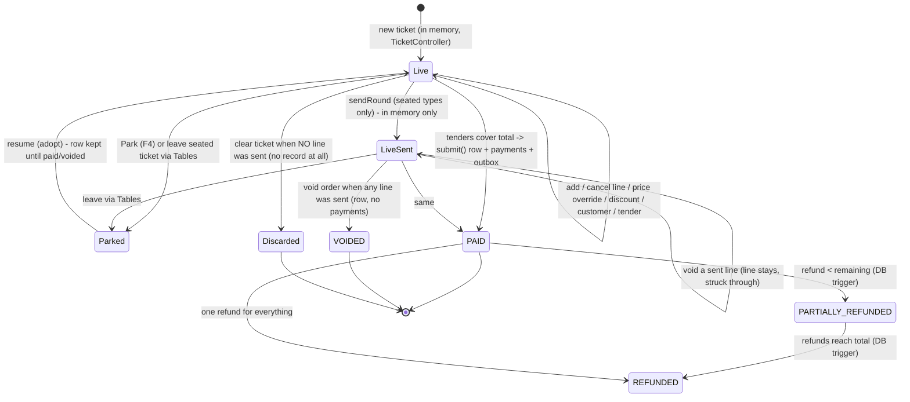

Diagram sources: `Live/LiveSent/Parked`: `ticket_engine.dart:494` (`sendRound`), `sale_screen.dart:482-527` (`_hold`, `_park`), `router.dart:240` (leave via Tables); `Discarded` vs `VOIDED`: `line_void_dialog.dart:218` (`_clear`) vs `:241` (`_void`); `PAID`: `payment_screen.dart:120` (`_take`); refund transitions: trigger at `migrations.dart:1241`.

Consequences [CODE]:
- A "sent" line only exists for **seated** tickets. `TicketHoldAction.forTicket` (`cart_panel.dart:89`) maps seated-with-table to "send round" and everything else to "park". A takeaway/delivery ticket therefore never reaches `LineStage.sent`, so "void after send" cannot occur for it; all its line removals are plain cancels.
- Sending a round is **not persisted**. `_sendRound` (`sale_screen.dart:496`) calls `TicketController.sendRound` and toasts. The sent state reaches disk only if the ticket is later parked (leaving via Tables, `router.dart:240`, or F4 on an unseated ticket). A crash between rounds loses the stage changes and any lines added since the last park [CODE; runtime effect UNVERIFIED].
- Clearing a ticket with no sent lines leaves **no trace** (no CANCELLED row, no audit event). Removed-before-send line events live on the in-memory ticket (`lineEvents`) and are only written when the ticket settles or is voided (`_insertLineEvents`, `postgres_orders_repository.dart:538`).
- Order number is allocated only at settlement (`_nextInvoiceNumber` :391, `pos_invoice_sequences`, row lock). A void also consumes a number.

Tests (not executed here): `test/domain/ticket_engine_test.dart` (add/merge/send/stage rules, order-type switch detaches table, `pickup` synonym), `test/domain/order_type_rules_test.dart` (only dine-in seeded `requiresTable`; delivery flags exist; unconfigured type unseated), `test/data/order_lifecycle_test.dart` (DB: default PAID, status CHECK, void attribution; skips without DB), `test/data/order_types_schema_test.dart`, `test/features/branch_order_types_test.dart`, `test/features/order_type_enable_test.dart`, `test/features/park_ticket_test.dart`.

**Limitations**: no way to see "open orders" across tills (parked tickets are hydrated per branch only at boot, `OpenTicketsController._hydrate` :883); no pre-bill/check printing (`TableState.billAsked` is just "has tenders", `floor_overlay.dart`); guest count is set to the table's seat count (`providers.dart:1429` `attachTable(... guests: table.seats)`), never entered by the cashier.

---

## 2. Dine-in: floor, tables, merge, transfer, split

| Item | Evidence |
|---|---|
| Files | `lib/features/floor/floor_screen.dart`, `lib/domain/models/dining_table.dart`, `lib/domain/services/floor_overlay.dart`, `lib/data/postgres/postgres_floor_repository.dart`, `lib/data/postgres/postgres_parked_tickets.dart`, `lib/app/router.dart:200-230` |
| Tables | `pos_dining_tables` (migration 2), `pos_parked_tickets` |
| Permission | `pos.operate` to reach the floor/sale screens; no per-table permission |
| Status | floor and seat/resume: **IMPLEMENTED**. Merge, transfer, split bill: **NOT_IMPLEMENTED** |

[CODE] Floor behaviour: `floorTablesProvider` overlays this till's parked tickets on the plan (`providers.dart:1005`, `floor_overlay.dart`). Table state is `free` (no parked ticket), `open` (parked, no tenders), `billAsked` (parked with tenders). Picking a busy table adopts the parked ticket (same `client_transaction_id`), a free one attaches the table to the live ticket (`router.dart:216-228`). Leaving the sale screen via Tables parks a seated non-empty ticket (`router.dart:240`).

Persistence: parked tickets are rows in `pos_parked_tickets` (JSON payload via `ParkedTicketCodec`), upserted on park, deleted on settle/void, hydrated at boot with `NOT EXISTS (SELECT 1 FROM pos_orders ...)` so a committed sale never resurrects (`postgres_parked_tickets.dart:44-69`). One parked ticket per (restaurant, table) is enforced by a unique index (`migrations.dart` migration 32); tickets with no table are unique per transaction id.

Searches for the absent features (all with zero hits in `lib/` outside comments): `transfer table`, `moveTable`, `merge table/ticket/bill/check`, `split bill/check/by/equal/item`, `separate check`. The only matches were line-key merging (same product merges into one line) and "split bill" meaning several tenders.

Multi-till seating: the code says outright that the floor is single-terminal truth (`floor_overlay.dart` header): the overlay uses *this till's* in-memory `OpenTickets`; other tills' parked tickets are only loaded at boot. Two tills on one branch DB can seat the same table; the second `save` replaces the first's row (`ON CONFLICT (restaurant_id, table_id) DO UPDATE`, `postgres_parked_tickets.dart:88-97`). [CODE]. Whether this loses the first till's ticket on a live system is UNVERIFIED (depends on whether the first till later settles from its in-memory copy, which it can: settlement uses the in-memory ticket).

Tests (not executed): `test/features/sale_flow_test.dart` (floor lists tables with live state; dine-in with no table goes to floor), `test/features/open_tickets_test.dart`, `test/data/parked_tickets_schema_test.dart` (one ticket per table, held key, branch scope, day-close blocker; skips without DB), `test/domain/floor_overlay_test.dart`.

---

## 3. Sale-screen mechanics (read side of menu, lines, modifiers, combos)

| Item | Evidence |
|---|---|
| Files | `lib/features/sale/sale_screen.dart`, `widgets/cart_panel.dart`, `widgets/modifier_sheet.dart`, `widgets/combo_sheet.dart`, `widgets/open_item_dialog.dart`, `widgets/line_note_dialog.dart`, `lib/domain/models/catalog.dart`, `combo.dart`, `option_group.dart`, `lib/data/postgres/postgres_catalog_repository.dart` |
| Tables read | `pos_categories, pos_products, pos_modifier_groups, pos_modifiers, pos_product_modifier_groups, pos_product_prices (branch overrides, LEFT JOIN at `postgres_catalog_repository.dart:81`), pos_combos, pos_combo_groups, pos_combo_options, pos_tax_groups` |
| Permission | `pos.operate`; open-item uses `price.override` (`open_item_dialog.dart:307`) |
| Status | **IMPLEMENTED** (with caveats below) |

[CODE] Features in the engine (`ticket_engine.dart`):
- Modifier validation: required groups, `minSelect`, `maxSelect` (`validateSelection` :221); single-select replace, multi-select cap (`toggleModifier` :272); default selections incl. first available size (`defaultSelection` :253).
- Size variants: a variant modifier *replaces* the base price, others add (`priceWithOptions`, `catalog.dart:349`).
- Free allowance per group (`freeOptions`), snapshotted onto the line as `includedAllowance` (`addLine` :298-330).
- Lines merge only if draft, same product+modifier key and same note (`addLine` :333). Sent lines never merge.
- Combos: `addComboLine` (:658) validates each group's min/max, stores a snapshot (`ComboSelection`) and a synthetic negative-id product; price is the combo price, not the sum of parts.
- Open-price line: `addOpenPriceLine` (:758), requires a name, non-negative price, uses synthetic negative id; gated by `price.override`.
- Out of stock = `Product.isAvailable == false` only (`addLine` :306). `isStocked` items decrement `pos_stock_levels` at settlement and **may go negative by design** (`_issueStock`, `postgres_orders_repository.dart:725`, comment lines 716-724). Combos and dishes never consume stock (no recipe model).
- Per-line note: `setLineNote` (:790).
- Scanner: `Catalog.search` matches name, SKU (exact) and barcode (exact) (`catalog.dart:406`), so typing/scanning a barcode filters the grid. `Catalog.byBarcode` (:420) exists but has **no caller** in `lib/`, and the search field has no `onSubmitted`, so a scan does not auto-add the item. [CODE, grep for `byBarcode`/`onSubmitted`]
- Branch pricing: read via `pos_product_prices` join; the admin side is another agent's.

Defects [CODE]:
- **R3: `TicketEngine.setLineNote` rebuilds the line through the `TicketLine` constructor without `combo` and `includedAllowance`** (`ticket_engine.dart:795-811`; the constructor call lists product, quantity, modifiers, note, stage, roundNumber, voided, priceOverride only). Setting a note on a combo line would turn it back into a synthetic open-price product at `product.price` (the combo's price, so the figure may survive) but lose `combo` (components, ETA/tax group via `combo?.taxGroupId`, `pos_order_line_items` rows). On a line with a modifier free allowance it would remove the allowance and raise the price. No test calls `setLineNote` except `test/features/cart_density_test.dart` (UI). Runtime impact UNVERIFIED.
- Live ticket currency is hard-wired: `TicketController.build()` constructs `Ticket(...)` without currency/exponent (`providers.dart:1351`), defaulting to `'EGP'`, 2. The three-decimal path is only exercised in domain tests (`test/domain/ticket_totals_golden_test.dart`). The comment at `providers.dart:174` says currency is not yet configurable. Refund, cash-movement and business-day repositories also default `'EGP'`/2 (`postgres_refunds_repository.dart` ctor; the provider at `providers.dart:431` does not pass a currency).

Tests (not executed): `test/domain/ticket_engine_test.dart`, `option_group_rules_test.dart`, `size_pricing_test.dart`, `modifier_economics_test.dart`, `combo_test.dart`, `open_item_test.dart`, `price_override_test.dart`, `test/features/sale_flow_test.dart`, `combos_ui_test.dart`, `option_groups_ui_test.dart`, `cart_density_test.dart`, `test/data/combo_schema_test.dart`, `branch_pricing_test.dart`, `size_price_derivation_test.dart`.

### Price override (related)
`TicketEngine.overridePrice` (:834) replaces the whole unit price, measured against the menu price (not the previous override), allowed on sent lines, treated as a discount against the same `DiscountLimit`, writes a `price_overridden` line event with before/after (`PriceOverride` snapshot, reason, approver). Permission `price.override` (high risk, lendable). Persisted at settlement into the line's price and `pos_order_line_events`. Tests: `test/domain/price_override_test.dart`, `test/features/price_override_ui_test.dart`. Status IMPLEMENTED.

---

## 4. Takeaway and pickup

| Item | Evidence |
|---|---|
| Files | same as order types; `TaxConfig.appliesServiceTo` (`ticket.dart:448`) |
| Status | **IMPLEMENTED** as a plain unseated order type |

[CODE] Takeaway = order type with no table. No pickup time, no ready notification, no customer name requirement. A takeaway ticket parks (not sends) from the cart button (`cart_panel.dart:89`), so the "Held" list is the only way to keep several in flight (`HeldTicketsDialog`, `held_tickets_dialog.dart`). Service charge is not applied by default (legacy config is dine-in only; `serviceDineInOnly` default true, `ticket.dart:381`). Tests: `test/features/park_ticket_test.dart` ("an unseated takeaway parks"; "a takeaway the restaurant seats, at a table, sends a round"), `sale_flow_test.dart` ("a takeaway ticket needs no table").

---

## 5. Delivery

| Item | Evidence |
|---|---|
| Status | **NOT_IMPLEMENTED** as a workflow. **PARTIAL** as configuration only |

Searched (case-insensitive, all of `lib/`): `driver`, `delivery zone/fee`, `courier`, `dispatch`, `aggregator`, `pickup time`, `scheduled for`, `prep time`, `estimated time`. Nothing in selling code. Hits were only comments (the open-item doc mentions "a delivery fee"; `service_charge.dart` mentions a fee collected for an aggregator).

What exists [CODE]:
- Enum member `OrderType.delivery` (wire `delivery`), seeded in `pos_order_types` with `requires_customer=true, requires_address=true` (`order_type_config.dart:71-79`). Those two flags are **not enforced**: a delivery ticket can be charged with no customer and no address.
- `PosCustomer.address` and `canTakeDelivery` (`customer.dart:40`). `canTakeDelivery` has no caller.
- A delivery fee can only be modelled as (a) an open-price line the cashier types (`addOpenPriceLine`) or (b) an automatic `pos_service_charges` row scoped to delivery (`service_charge.dart`), configured in back office.
- The customer can be attached to a delivery order (section 6). `pos_orders.customer_id` stores the link. The **address is not copied onto the order**; it lives only on the customer record. The receipt has no delivery block (`receipt_data.dart` fields listed: invoice, type, table label, lines, totals, payments).
- No delivery state (out for delivery, delivered), no driver assignment, no cash-on-delivery reconciliation, no zone pricing, no kitchen-to-dispatch flow.

Tests: `test/domain/order_type_rules_test.dart` ("delivery wants a customer and an address") checks only the seeded flags.

---

## 6. Customer creation and lookup at checkout

| Item | Evidence |
|---|---|
| Files | `lib/features/payment/customer_dialog.dart`, `lib/data/postgres/postgres_customers_repository.dart`, `postgres_customer_directory_repository.dart`, `lib/domain/models/customer.dart`, `customer_summary.dart`, `lib/features/admin/presentation/management_customers_pane.dart` (directory, read-only view) |
| Tables | `pos_customers` (migration 51, `migrations.dart:4412`), `pos_orders.customer_id`, `pos_sync_outbox` event `customer` |
| Permission | none beyond reaching the payment screen (no capability gates create/attach) |
| Status | **IMPLEMENTED** (create, find, attach); **PARTIAL** (order-to-customer link not uploaded; not persisted on restart; not required for delivery) |

[CODE]
- Entry point is the payment dialog header button "who is this for" (`payment_screen.dart` `_chooseCustomer`). Not available from the sale screen.
- `upsert` conflicts on `(restaurant_id, phone)`; phone normalised (Arabic-Indic and Persian digits mapped to ASCII, `customer.dart` `normalisePhone`). Name overwrites on conflict; email/address/note use COALESCE so a blank does not erase. A customer without a usable number is refused (`ArgumentError`).
- Search: name `LIKE` or phone `LIKE`, ordered by `updated_at DESC`, empty query returns most recent (`postgres_customers_repository.dart` `search`).
- Created customers are queued as `customer` events in `pos_sync_outbox` only when the deployment syncs to the platform and the row has no `platform_id` (`upsert`, `_enqueue`). The drain sends them ahead of orders (`outbox_drain.dart:281-285`) and writes back `platform_id` (:657).
- `pos_orders.customer_id` is written by `submit` (`postgres_orders_repository.dart` insert column `customer_id`).

Gaps [CODE]:
- **The upload of the order does not carry the customer.** `OutboxDrain.buildOrderRequest` (`outbox_drain.dart:139`) has no `customer` parameter and the request map (:156-184) has no customer key. Customer records are uploaded as standalone `/api/pos/customers` posts, but the sale-to-customer link stays local. Whether the backend can learn it otherwise is UNKNOWN. (The drain treats `CUSTOMER_NOT_FOUND` as a quarantining error at :124, which suggests the contract expects a customer reference, so this may be a gap relative to the agreed contract; UNVERIFIED.)
- **Parked tickets drop the customer.** `ParkedTicketCodec.encode/decode` contain no customer field (grep for `customer` in `parked_ticket_codec.dart`: none). A ticket parked and restored loses its customer.
- Delivery requirement not enforced (section 5).
- No customer loyalty, credit, or "on account" balance. "On account" tender is hidden at payment (section 11).

Tests (not executed): `test/data/customers_repository_test.dart` (phone identity, refusal without number, search, cloud till queues, offline queues nothing, bundle customer never sent back; DB), `test/data/customer_directory_test.dart`, `test/data/order_customer_test.dart`, `test/domain/customer_test.dart`, `customer_summary_test.dart`, `test/features/customers_ui_test.dart`.

---

## 7. Discounts

| Item | Evidence |
|---|---|
| Files | `lib/domain/models/discount.dart`, `ticket_engine.dart:947-1202`, `lib/features/sale/widgets/discount_sheet.dart`, `lib/data/postgres/postgres_discounts_repository.dart`, `lib/features/admin/presentation/supervisor_override.dart`, `lib/domain/services/authorization.dart` |
| Tables | `pos_discounts`, `pos_discount_targets`, `pos_order_discounts` (migration 10, `migrations.dart:889-1030`), `pos_orders.discount_minor`, `pos_roles.max_discount_bp/max_discount_minor`, `pos_reason_codes` |
| Permission | `discount.apply` (medium, lendable); limit key `discount.max` (also governs price override); reasons scope `discount` |
| Status | custom (typed) discount and the cap/approval machinery: **IMPLEMENTED**. Configured named discounts: **PARTIAL** (read-only on the till; no in-app source found). Several configured flags: **NOT_IMPLEMENTED** |

[CODE] Behaviour
- Three entry points in the engine: configured line discount (`applyLineDiscount` :947), configured order discount (`applyOrderDiscount` :993), typed discount (`applyCustomDiscount` :1038, percentage or fixed). All end in `_apply` (:1153).
- Rules: at most **one discount per line and one per order** (`AlreadyDiscounted`); an order discount's base is goods minus line discounts (`_orderDiscountBase`); amounts are capped at the base; liveness checks `isLiveAt` (active flag, date range, weekday, time window incl. wrap past midnight), order-type targets, product/category targets, `minOrder`, `requiresCustomer`.
- Cap enforcement: `DiscountLimit.permits` (`discount.dart` class `DiscountLimit`) applies both a percentage ceiling (cross-multiplied, no rounding) and a cash ceiling to every discount kind, so a fixed amount cannot walk around a percentage cap. Over the cap the engine returns `DiscountAboveLimit`; the sheet opens the supervisor dialog, the approver's own limit then binds the retry (`discount_sheet.dart:165-195`), and an audit row `discount.above_limit` is recorded.
- Capability gate in `SaleScreen._discount`: a person lacking `discount.apply` is prompted for a supervisor via `requestPermission` and then works inside the sheet with the approver recorded (`sale_screen.dart:412-430`).
- Reasons: seeded per restaurant for scopes void, refund, discount, price_override (10 codes; `other` requires a note; `migrations.dart` migration 9 seed). Whether a reason is required is `SystemReasons.defaultRequirement(ReasonScope.discount)`.
- Persisted at settlement into `pos_order_discounts` with snapshot name, kind, `value_bp`/`value_minor`, amount, reason, note, `applied_by`, `approved_by_id` (`_insertDiscounts`, `postgres_orders_repository.dart:620`).
- Default roles: **cashier has no `discount.apply`**; supervisor, manager, owner do (`permissions.dart:575-625`). Per-role `max_discount_bp/minor` is read by `PostgresDiscountsRepository.limitFor` (:153) and tightened by per-staff limits.
- Discounts reduce the base for service and tax (`Ticket.totals`, `ticket.dart:679`; test "a fully comped meal costs nothing at all").

Gaps / dead settings [CODE]
- `Discount.requiresManager` and `Discount.isRestricted` are loaded (`postgres_discounts_repository.dart:78-79`) and never read afterwards. A configured discount marked "requires manager" does not demand one.
- `Discount.maxDiscount` is honoured only inside `amountOn`; fine.
- **No in-app writer for `pos_discounts` rows.** grep for `INSERT INTO pos_discounts` finds only SQL in tests; `local_bootstrap.dart:1053` grants INSERT/UPDATE on it to a role, but no repository or screen uses it. `bootstrap_bundle/seeder` contain no discount handling (grep). So named discounts must be inserted out-of-band or arrive via a mechanism I did not find; the discount sheet says "nothing configured" otherwise (`discount_sheet_test.dart`: "says so plainly when nothing is configured"). Typed discounts always work. Status of configured discounts therefore: PARTIAL / UNKNOWN as to origin.
- The discount-limit check is client-side only. The DB protects `pos_orders` money columns by column-scoped grants and check constraints (migration 10 `pos_orders_discount_sane`), not the limit itself.
- Loyalty/coupon/voucher-code discounts: NOT_IMPLEMENTED (grep `loyalty|coupon|promo|gift`: only config comments and `TenderKind.voucher`).

Tests (not executed): `test/domain/ticket_discount_test.dart` (comp, footing, one-per-line, limit within/above/at-limit/cash ceiling, liveness, typed vs configured parity), `test/domain/discount_test.dart`, `test/features/discount_sheet_test.dart`, `cart_discount_test.dart`, `manager_approval_test.dart`, `test/data/discount_schema_test.dart` (DB).

---

## 8. Service charge and tax engine

| Item | Evidence |
|---|---|
| Files | `ticket.dart` (`TaxConfig` :375, `Ticket.totals` :679), `lib/domain/models/tax.dart` (`TaxGroup`, `TaxEngine.linesFor` :194), `service_charge.dart`, `lib/core/money/money.dart`, `rounding.dart`, `lib/data/postgres/money_config_codec.dart`, `providers.dart` (`moneyConfigProvider` :1288, `taxConfigProvider` :1203, `taxGroupsProvider` :1230) |
| Tables | `pos_money_config` (migration 8: one JSON payload per restaurant), `pos_tax_groups` (16), `pos_products.tax_group_id`, `pos_service_charges` (~23), `pos_order_taxes` (16) |
| Permission | read by all; edit is back office (`settings.manage`), other agent |
| Status | **IMPLEMENTED** |

### Computation [CODE] (`Ticket.totals`, `ticket.dart:679-776`)

```
subtotal   = sum(lineTotal of non-voided lines)
discount   = sum(applied discounts, minus those on voided lines)
net        = max(subtotal - discount, 0)
service    = TaxConfig.serviceFor(orderType, base: net)   // taxable part + untaxed part
tax bases  = per tax group: each line's total less its value-proportional share of discount
             (last line takes the remainder so bases sum to net exactly)
           + taxable service charge, taxed at the DEFAULT group's rate
tax lines  = TaxEngine.linesFor(bases, inclusive)          // ONE rounding per rate
vat        = sum(tax lines)
total      = exclusive: net + service + vat
             inclusive: net + service            (tax already inside)
```

- **Rounding is half-up, applied once per charge line**: `percentBp` = `roundHalfUp(minor * bp, 10000)` (`money.dart:86`, `rounding.dart:10`, away from zero for negatives so a refund mirrors a sale). All arithmetic is integer minor units; no `double` in the path.
- Tax is rounded once **per rate**, not per line (test "rounding is per rate, not per line": 3 lines of 33.33 at 14% give 14.00, not 14.01).
- Inclusive mode extracts tax with `taxWithinBp` = `roundHalfUp(minor * bp, 10000 + bp)` and reports base = gross - tax (`tax.dart:194`).
- Service charges: legacy single `serviceBp` (default 1200, applied to dine-in only unless config says otherwise) or, if any `pos_service_charges` rows exist, each active automatic charge scoped to the order type, percentage or fixed, taxable or not, each rounded separately (`ticket.dart:489`). `isOptional` and non-automatic charges exist only as configuration: **no till control adds or waives them** (grep `isAutomatic|isOptional`: only the admin dialog, repository, and the model).
- Service charge is computed on `net` (after discount) and its taxable part is taxed at the default group, ignoring per-product groups.

### Where rates come from [CODE]

- Defaults: `TaxConfig` constructor `serviceBp = 1200`, `vatBp = 1400`, `source = deviceConfig` (`ticket.dart:376-383`).
- `moneyConfigProvider` reads `pos_money_config.payload` for the restaurant; on any exception or no row it returns null, and `taxConfigProvider` then falls back to the `TaxConfig()` defaults (12%/14%, `source: deviceConfig`) (`providers.dart:1203-1223`, `:1288-1315`).
- `MoneyConfigCodec.toTaxConfig` (`money_config_codec.dart:21`): takes the **first** `percent` charge and the **first** tax rule with a rate. If the payload exists but lacks them, rates become **0%** (test "a tenant with no rules charges NOTHING, not the old default"). It marks `source: server`.
- Writers of `pos_money_config`: the cloud bootstrap seeder (`bootstrap_seeder.dart:301`) and the offline admin pane (`postgres_catalog_admin_repository.dart:567`, `management_taxes_pane.dart`). So **DOC vs CODE**: CLAUDE.md says tax is "provisional device config, read-only on the device"; in code the offline back office *can write* it, and the slip's `TaxSource.server` label then means "stored in `pos_money_config`", not necessarily "authored by the server".
- A slip says "from device config" when `taxConfig.source == deviceConfig` (`receipt_data.dart:167`; `receipt_document.dart:417`).
- Named groups (`pos_tax_groups`) and `taxMode` (exclusive/inclusive) are folded in by `taxConfigProvider`.

Status of the "Egypt" assumptions: ETA tax codes `T1`/`V009`/`V003` are constants (`tax.dart` `EtaTaxCode`); other ETA codes are deliberately not modelled.

### Risks [CODE]

- **R2a: `TaxConfig.operator ==` compares only `serviceBp`, `vatBp`, `serviceDineInOnly`, `source`** (`ticket.dart:518`). It ignores `taxMode`, `taxGroups` and `serviceCharges`. Consequences: (1) `TicketController` listens to `taxConfigProvider` and returns early `if (previous == next)` (`providers.dart:1334-1337`); if groups, charges or mode arrive/change without a rate/source change, the live ticket may keep stale config. (2) `Provider` change notification also uses `==`, so such updates may not propagate at all. Test `live_ticket_survives_config_test` / `tax_groups_wiring_test` check provider values and the "unchanged config is a no-op", not a late-arriving group on an existing ticket. Runtime effect UNVERIFIED; plausible after a mid-session back-office change or a slow first load.
- Provisional-disclosure risk: if `pos_money_config` cannot be read, the till silently sells at 12%/14% (`providers.dart:1313` comment says "keeps the device default and says so on the slip"). A cashier does not see it at sale time.
- Server-side agreement: the order upload sends `asserted_totals` (subtotal, discount, charges, tax, total) and `priced_offline: true` (`outbox_drain.dart:166-176`), no tax lines or per-charge breakdown. The comment at `providers.dart:1203` / migration 8 records a past mismatch ("27.68% more than the ledger recorded") caught only by `totals_mismatch`. How the backend resolves a mismatch is UNKNOWN; the outbox has a `totals_mismatch` column (`migrations.dart:624`).

Tests (not executed): `test/domain/ticket_engine_test.dart` ("applies service to dine-in and VAT on subtotal + service"), `ticket_totals_golden_test.dart`, `tax_lines_test.dart`, `tax_mode_test.dart`, `service_charge_test.dart`, `money_test.dart` (`test/core`), `test/data/money_config_codec_test.dart`, `tax_lines_schema_test.dart`, `service_charges_schema_test.dart`, `tax_groups_admin_test.dart`, `test/features/tax_groups_wiring_test.dart`, `service_charge_ui_test.dart`.

---

## 9. Voids and cancellations

| Item | Evidence |
|---|---|
| Files | `ticket_engine.dart:398` (`cancelLine`), `:443` (`voidLine`), `sale_screen.dart:175` (`_void`), `widgets/line_void_dialog.dart` (`LineVoidFlow`, `OrderVoidFlow`, `_clear` :218, `_void` :241), `postgres_orders_repository.dart:196` (`voidOrder`), `lib/core/ui/widgets/reason_picker.dart` |
| Tables | `pos_orders` (status, voided_by/at, void_reason_id, void_note), `pos_order_lines` (voided_*), `pos_order_line_events`, `pos_reason_codes`, `pos_audit_events` |
| Permissions | cancel an unsent line: `order.item.delete_before_send` (low; **not lendable**, a role without it cannot be overridden); void a sent line: `order.item.delete_after_send` (medium; lendable); void whole order: `order.void` (high; lendable). Cashier role holds only the first (`permissions.dart:629`) |
| Status | **IMPLEMENTED** |

[CODE] Three distinct acts, kept apart in engine, schema and permission model:
1. **Cancel line** (unsent): line removed, its discount removed, event `removed_before_send` appended to the in-memory ticket. No reason requested (`ReasonRequirement.disabled`, `line_void_dialog.dart` `_cancel`). If the role lacks the capability the user is shown a refusal and nothing happens (no supervisor path).
2. **Void line** (sent): line stays on the ticket with a `LineVoid` record (who, when, reason, note, approver); excluded from totals; event `voided_after_send`. Needs reason (default requirement for scope `void`) and, without the capability, a supervisor PIN. Written to `pos_order_lines.voided_at/voided_by/void_reason_id` and `pos_order_line_events` at settlement.
3. **Void order**: if no line was ever sent, `_clear` discards the ticket with **no record**. If any sent line exists, `_void` records an order row `status='VOIDED'` with real totals, reason, note, `voided_by`, `served_by`, line rows, discounts, tax lines, line events, and **no payments**, in one transaction (`voidOrder` :196-326). The repository re-checks `order.void` with `Authorization.require` before the transaction (:208). A void is not enqueued for the platform ("what a voided one looks like on the wire is not decided", :317-320); a void is not ETA-filed (`test/data/filing_orders_test.dart` "a void is not filed").
4. A void **consumes an invoice number** and counts in shift totals as `voids` (`_summarise` :433-440). Stock is not issued for voided order rows (`voidOrder` omits `_issueStock`). A voided sent-line on a settled order also does not decrement stock (`_issueStock` skips `line.isVoided`).

Audit: when a supervisor lends the permission, `requestPermission` records a `pos_audit_events` row (`auditAction: 'order.void'` etc.). When the signed-in person holds the capability themselves, no audit event is written by these flows; the order row itself carries `voided_by/reason` [CODE].

Limitations: after a void the parked ticket row is deleted via `OpenTicketsController.settle` (best-effort, `sale_screen.dart:196`); a failed write keeps the ticket on screen. There is no "cancel a settled order" other than refund. `OrderStatus.cancelled` is unused.

Tests (not executed): `test/domain/ticket_void_test.dart`, `test/domain/authorization_test.dart`, `permission_resolver_test.dart`, `test/data/order_lifecycle_test.dart` (void attribution, line events), `test/features/manager_approval_test.dart`, `reason_picker_test.dart` (`test/core`).

---

## 10. Refunds

| Item | Evidence |
|---|---|
| Files | `lib/domain/services/refund_engine.dart`, `lib/domain/models/refund.dart` (`RefundPolicy` :61), `lib/features/refund/presentation/refund_sheet.dart`, `lib/features/history/presentation/refunds_screen.dart`, `lib/data/postgres/postgres_refunds_repository.dart`, `lib/data/eta/filing_refunds_repository.dart` |
| Tables | `pos_refunds`, `pos_refund_lines`, `pos_refund_payments` (migration 12), `pos_orders.refunded_minor`, `pos_order_lines.refunded_quantity`, `pos_sync_outbox` event `refund` |
| Permission | `order.refund` (high; lendable); limit key `refund.max`; policy settings `refund.*` |
| Status | **IMPLEMENTED** (partial by lines, partial by amount, full), with specific gaps |

[CODE]
- Two quoting paths: by line quantities (`quoteForLines` :146) and by free amount (`quoteForAmount` :243). Service/VAT/discount are **pro-rated** from the original order, and the closing refund takes exactly what remains (`_remainder`) so shares foot. Amount refunds put any rounding drift into VAT.
- Guards (`_guard`): policy enabled, order status `tookMoney` (PAID, CLOSED, PARTIALLY_REFUNDED), something left, within window (`sameShift | sameDay | 7d | 30d | unlimited`, default 7d). Optional ceiling `refund.max_value_minor` (`policy.permits`, "which nobody can approve away") and approval threshold (`needsApproval`, requires a second person).
- UI (`refund_sheet.dart:617` `_issue`): reason required by default; allocation of tenders (`_refundTenders` :124) returns money through the **original payments' tender types only**, preferred tender first, never more than each tender received net of earlier refunds; so card sales are refunded to card and a refund cannot exceed what was paid in any tender. `requestPermission(order.refund)`; above threshold a `SupervisorOverrideDialog` forces a second person, and the repository refuses self-approval (`Authorization.require(... approvalRequired: quote.requiresApproval)` in `PostgresRefundsRepository.issue` :58).
- Idempotent: `client_refund_id` unique per restaurant; a retry returns the same refund (`issue` :58-110).
- DB integrity (trigger functions in migration 12, `migrations.dart:1241+`): `pos_refund_applied` locks the order row, rejects non-refundable statuses, adds to `refunded_minor` and derives `REFUNDED`/`PARTIALLY_REFUNDED`; `pos_refund_line_applied` checks the line belongs to the order and bumps `refunded_quantity` within sold quantity; a tender-balance trigger requires the refund payments to sum exactly to `total_minor`.
- Cash-out: refund payments carry `counts_as_cash` copied from `pos_tender_types` at issue time; shift summary subtracts cash refunds from expected cash (`_summarise` :395-400, `shift.dart:328`); the refund is stamped with the shift open when the repository was built (see R1).
- Cloud: refunds are queued in `pos_sync_outbox` and uploaded via `/api/pos/refunds`; the drain quarantines `REFUND_EXCEEDS_SOLD` (`outbox_drain.dart:124-128`). A refund against an order not yet uploaded references the order's `client_transaction_id`.
- ETA: a credit-note receipt is built for refunds when filing is enabled (`filing_refunds_repository.dart`, `EtaFiler._fileRefund`).

Gaps [CODE]
- **Stock is not returned** on refund (grep: no stock movement of kind return/refund; `pos_stock_movements` kinds written elsewhere are sale, receipt, opening...). A refunded stocked item stays decremented.
- `TenderMethod.refundAllowed` is stored and editable but **never read** by the refund flow (grep `refundAllowed`: admin dialog, repos, model).
- `refund.receipt_required` only displays a note (`refund_sheet.dart:325-333`); it does not require anything.
- `RefundWindow.sameShift` uses "sold at or after the open shift's opened_at" (`_sameShift` :218), which is the current shift only.
- A refund is a standalone act against a settled order; there is no exchange flow and no refund-to-store-credit.
- Currency defaults to EGP/2 in the repository (see section 3).

Tests (not executed): `test/domain/refund_engine_test.dart` (exact part-for-part give-back, pro-rata, remainder closes, window/ceiling/disabled refusals), `test/data/refund_schema_test.dart` (DB triggers: quantity, total, tender balance; skips without DB), `refund_history_test.dart`, `cloud_refunds_test.dart`, `filing_refunds_test.dart`, `test/features/refund_sheet_test.dart`.

---

## 11. Payment methods, split payments, change, card/wallet

| Item | Evidence |
|---|---|
| Files | `lib/features/payment/payment_screen.dart`, `lib/domain/models/tender_method.dart`, `lib/data/postgres/postgres_tender_types_repository.dart`, `ticket_engine.dart:565` (`addTender`), `:608` (`removeTenderAt`), `postgres_orders_repository.dart:679` (`_insertPayments`) |
| Tables | `pos_tender_types` (migration ~26/27; `platform_id` added later), `pos_order_payments` (`tender_type_id, label, amount_minor, reference, counts_as_cash`) |
| Permission | taking payment: `pos.operate`; removing a tender: `payment.remove` (high, lendable; engine + screen both check, `ticket_engine.dart:608`) |
| Status | **IMPLEMENTED** for recording; **NOT_IMPLEMENTED** for any card-terminal integration |

[CODE]
- Tender kinds: cash, card, wallet, account, voucher, other (`tender_method.dart`). Platform kinds `cash|card|external|other` map to till kinds (`external` is treated as card, with a comment explaining the bank-terminal slip reasoning).
- Seeded methods (id 1-4): Cash (counts as cash, opens drawer), Card (reference required), "Wallet · InstaPay" (reference required), "On account". In cloud mode the list comes only from the platform tender types; if not loaded, none (`payment_screen.dart:97-106`), so a cloud till cannot take payment until tender types load [CODE].
- **"On account" is filtered out** of the payment screen ("Customer receivables are not modelled yet... fail closed", `payment_screen.dart:102-105`), and `_take` refuses it again. So credit/house accounts: NOT_IMPLEMENTED.
- **Card = label + typed reference.** `requiresReference` forces the cashier to type an auth code; the comment on `Tender.reference` says "The POS is not a payment processor and stores no card data" (`ticket.dart:337`). No terminal protocol, no amount push, no reconciliation with a bank. No wallet/QR integration either.
- Split payments: n tenders accumulate on `Ticket.tenders`; each tender defaults to the whole remaining due when the entry is empty; overpayment yields `change`. Settlement happens automatically once `due` is zero (`_take`, `payment_screen.dart:150-153`).
- **The ledger stores applied amounts, not tendered.** `_insertPayments` caps each tender at the remaining total in order and skips tenders with nothing left; change is a till-side figure only (`postgres_orders_repository.dart:661-714`). The cited incident (`BR8-2026-000007`, 380.00 uploaded against a 360.00 bill) is the origin of this rule. The cash counted for the drawer uses the capped amount, which equals cash tendered minus change.
- `counts_as_cash` is snapshotted per payment, so later edits to a tender type do not move past cash-ups (tests below).
- Partial tenders are **in-memory only** unless the ticket is parked from the payment state; nothing writes a "partially paid" order. Failure of the submit restores the pre-tender ticket (`applyEdit(ticket)` :180) so a retry reuses the same transaction id.
- No tips field, no rounding to nearest 0.25/0.5 (cash rounding), no currency exchange, no foreign-currency tender. Quick-cash buttons exist (`_quickCash` :90).
- No keyboard shortcuts in the payment dialog (grep `SingleActivator` in `payment_screen.dart`: none; it uses an on-screen keypad).

Tests (not executed): `test/domain/ticket_engine_test.dart` (null amount tenders remaining; split leaves balance; overpay = change; zero refused; payment-removal authorisation), `test/domain/tender_cash_test.dart`, `tender_types_test.dart`, `test/features/payment_removal_test.dart`, `tender_types_ui_test.dart`, `test/data/tender_types_schema_test.dart`, `cloud_tenders_test.dart`, `payment_remove_migration_test.dart`, `test/domain/payment_status_test.dart`.

---

## 12. Cashier shifts, cash management, Z/X report, business day

| Item | Evidence |
|---|---|
| Files | `lib/features/shift/presentation/shift_dialogs.dart`, `lib/features/cash/presentation/cash_dialogs.dart`, `day_close_dialog.dart`, `lib/data/postgres/postgres_shift_repository.dart`, `postgres_cash_movements_repository.dart`, `postgres_business_day_repository.dart`, `lib/domain/models/shift.dart`, `business_day.dart` |
| Tables | `pos_shifts` (migration 2; unique open shift per terminal), `pos_cash_movements` and `pos_cash_drawers` and `pos_business_days` (migration 14), `pos_settings`, `pos_sync_outbox` (shift_open, shift_close, cash_movement) |
| Permissions | `shift.open`, `shift.close` (lendable: closing someone else's drawer needs a handover), `cash.movement` (lendable), `cash.open_without_sale` (lendable), `shift.view_expected_cash`, `cash.variance.view` (not lendable), `day.close`, `day.force_close` (lendable) |
| Status | shift open/close, Z report with variance, pay-in/out, drawer-open: **IMPLEMENTED**. X (mid-shift) report: **NOT_IMPLEMENTED**. Business day: **PARTIAL** (close exists; nothing opens one) |

### Shift [CODE]
- Open: `PostgresShiftRepository.open` (`postgres_shift_repository.dart:55`): returns the existing open shift if any; otherwise inserts with the opening float; the partial unique index `pos_shifts_one_open_per_terminal` is the DB guarantee. Enqueues `shift_open` in the same transaction when syncing. Opening float is typed (default empty); the cashier whose PIN is entered becomes `opened_by` and is signed in.
- The router forces `/lock` when a shift is open but nobody signed in (`router.dart:47-52`); the till does not remember the signed-in staff across restarts (`providers.dart` `SignedInStaffController`).
- Close: `close` (:337) requires `shift.close`; if the closer is not the opener an approval is required (`approvalRequired: !shift.openedBy(by.id)`). It computes the summary in the same transaction, stores counted, expected and variance, and refuses a double close (`StateError` "already closed"). Blind close: setting `cash.blind_close` plus lack of `shift.view_expected_cash` hides the expected figure while counting (`shift_dialogs.dart:260-266`); the variance is revealed after commit only to holders of `cash.variance.view`.
- Closing the shift requires an empty on-screen ticket (`sale_screen.dart:214`). It does **not** check parked tickets (that is the business-day close's job).
- **Z report** = `ShiftSummary`/`ZReportView`, built by `_summarise` (:425): counts and sums over `pos_orders WHERE shift_id = @shift` (excluding VOIDED), voids separately, tender breakdown from `pos_order_payments` joined by `shift_id`, refunds and cash refunds from `pos_refunds.shift_id`, pay-in/out/drawer-opens from `pos_cash_movements`. `expectedCash = openingFloat + cashTaken + cashIn - cashOut - cashRefunded` (`shift.dart:328`). Past shifts can be viewed (`ShiftReportDialog`, back-office shifts/settlements panes) using stored counted/expected/variance.
- **X report**: grep `x.?report|xReport` finds nothing. There is no read-without-closing shift report on the till. The back-office "open drawers" view (`openDrawers()` :95, `OpenDrawer.expectedCash`) shows an expected figure per open drawer, which approximates an X report for managers (permission-gated by `shift.view_expected_cash`/reports).
- Printing: no Z report print path found (`ZReportView` is an on-screen widget; the only printer path is `ReceiptPrinter.printReceipt` for sale slips). [CODE; grep of `ZReport`/`printReceipt` call sites]

### Cash movements [CODE]
Pay-in, pay-out, drawer-open (F11, F12, F10 in `sale_screen.dart`). `CashMovementWrite.sql` inserts with `shift_id` NOT NULL; amount always positive with `kind` carrying direction; drawer-open has amount 0 (CHECK in migration 14). Requires reason (scope pay_in/pay_out seeded), optional note, optional supervisor approval; a pay-out ceiling `cash.pay_out_max_minor` is enforced in the dialog (`cash_dialogs.dart:292`). Drawer open has its own capability and confirmation, audit row `drawer.opened`. Physical drawer kick: ESC/POS `ESC p` pulse sent via the receipt printer when the settling tender's method has `opensDrawer` (`receipt_dialog.dart:218-231`), or via F10 (`receipt_printing.dart:153`). Kick is sent through the same printer connection; there is no separate drawer port.

### Business day [CODE]
- Table and repository exist. `check()` (`postgres_business_day_repository.dart:119`) returns blockers: open shifts, any parked tickets in the branch, unpaid orders in statuses that nothing writes. `close()` totals `pos_orders` for the day (gross, and net of refunds) in the same transaction; a forced close needs a reason (DB CHECK) and `day.force_close`. A DB trigger stamps `business_day_id` on new orders, refunds and shifts from the currently open day (migration 35, `migrations.dart:3246`).
- **Nothing opens a day.** `BusinessDayRepository.open` (:86) is not called anywhere in `lib/` (searched `.open(` callers: only the shift `open(by:, openingFloat:)`; `INSERT INTO pos_business_days` appears only in this repository method). The start screen shows "Close day" only when `businessDayProvider` returns a day (`start_screen.dart:~286`). So on a fresh install, `business_day_id` stays NULL, the Close-day button never appears, and readers that "fall back to the day's window" (trigger comment) have no day to fall back on, using the `day.start_time` setting instead (`PostgresOrderHistoryRepository.businessDateRange`/`tradingDayJoin`). The backup-on-day-close hook (`BackupTrigger.dayClose`) can therefore never fire from the till. Tests create days directly with SQL. [CODE; UNVERIFIED whether the cloud bundle or an installer step creates a day; grep of `bootstrap_seeder.dart`/`local_bootstrap.dart` finds no insert]

### R1: shift attribution is captured when a repository is built [CODE; runtime UNVERIFIED]
`ordersRepositoryProvider` (`providers.dart:260`) and `refundsRepositoryProvider` (:431) pass `shiftId: ref.read(shiftProvider).valueOrNull?.id` when the provider body runs. `ref.read` creates no dependency. Neither provider is invalidated when a shift opens or closes (`shift_dialogs.dart:129-131` invalidates only `shiftProvider`; grep for `invalidate(ordersRepositoryProvider)`: none). If the repository is first built before the shift exists (for instance `pendingSyncCountProvider` watches it on the start screen, `start_screen.dart:320`), or built during shift A and still used in shift B without a rebuild trigger, a sale would be stamped with `shift_id = NULL` or with the previous, closed shift. `_summarise` selects `WHERE shift_id = @shift`, so such sales would be absent from the correct Z report and from expected cash. The integration test `integration_test/sale_to_settle_test.dart:357` asserts the first sale in a fresh process is attributed; it does not exercise a second shift in one process. Needs a runtime check before relying on Z-report totals.

Tests (not executed): `test/data/postgres_shift_test.dart` (one open shift per terminal, totals only this shift, expected cash, split payment, variance, second cash-up refused, sale stamped; DB), `shift_history_test.dart`, `test/domain/shift_ownership_test.dart`, `tender_cash_test.dart`, `cash_movement_test.dart`, `test/data/business_day_schema_test.dart`, `business_day_stamping_test.dart`, `test/features/cash_dialogs_test.dart` (pay-in/out, ceiling, day-close blockers), `shift_history_panes_test.dart`.

---

## 13. Receipts

| Item | Evidence |
|---|---|
| Files | `lib/features/receipt/receipt_data.dart`, `receipt_document.dart`, `receipt_raster.dart`, `receipt_paper.dart`, `receipt_printing.dart`, `receipt_dialog.dart`, `reprint_dialog.dart`, `receipt_qr.dart`, `slip_style.dart`; `lib/domain/models/receipt_profile.dart`; `lib/data/postgres/postgres_receipt_profile_repository.dart` |
| Tables | `pos_receipt_profiles` (migration ~19), `pos_print_jobs` (migration 34) |
| Permission | reprint: `receipt.reprint` (low, lendable; cashier holds it); reprint writes an audit row |
| Status | **IMPLEMENTED** |

[CODE]
- The slip is rendered to a **bitmap** (`ReceiptRaster.render`) and sent as an ESC/POS raster image (`EscPos.raster`, `GS v 0`) with initialise, feed 3, optional drawer pulse, partial cut (`buildJob`, `receipt_printing.dart:163`). Arabic therefore needs no printer code page. `EscPos.text` (Latin-1, `?` for other chars) is used only for the test receipt.
- Paper width 80 mm = 576 dots or 58 mm = 384 dots, selectable (`printer_config.dart`).
- Content: header from `pos_receipt_profiles`, invoice number, type, table, lines with struck-through voided lines and a repriced marker, subtotal/discount/service/VAT (per-rate lines from `pos_order_taxes`), tender lines with change, a "tax from device config" disclosure, sync note, REPRINT/REFUNDED banners, refund summary on reprint.
- **Printing is manual at the sale**: the receipt dialog offers "New sale" (no print) and "Print & new" (`receipt_dialog.dart` `_actions`). There is no auto-print setting that I found.
- ETA QR block (`SlipQr`) exists, but `ReceiptData.etaQrPayload` is never passed in production code (only tests set it: `receipt_raster_test.dart:38`, `receipt_profile_ui_test.dart:440`). Production slips therefore never carry the ETA QR.
- Reprint: `ReprintFlow` requires `receipt.reprint` (supervisor lend possible), records an audit event, prints a stamped copy via the same queue; a failed ledger write means nothing prints.
- Customer name/address and delivery data do not appear on the slip.

Tests (not executed): `test/features/receipt_document_test.dart`, `receipt_raster_test.dart`, `receipt_print_test.dart` (ESC/POS job reaches printer; cash kicks drawer; offline printer queues; queue retried first), `reprint_test.dart`, `receipt_profile_ui_test.dart`, `test/domain/receipt_profile_test.dart`, `test/data/receipt_profile_schema_test.dart`, `cloud_receipt_profile_test.dart`.

---

## 14. Kitchen tickets, KDS and printing infrastructure

| Item | Evidence |
|---|---|
| Files | `lib/data/hardware/network_printer_ports.dart`, `spooler_printer_ports.dart`, `winspool.dart`, `lib/core/config/printer_config.dart`, `lib/data/postgres/postgres_print_queue_repository.dart`, `lib/features/settings/printer_settings_dialog.dart` |
| Tables | `pos_print_jobs` (migration 34; kind CHECK `('receipt','reprint')`, status, attempts, payload bytea, print-once trigger) |
| Status | receipt printing and queue: **IMPLEMENTED**. Kitchen ticket printing, KDS, per-station routing: **NOT_IMPLEMENTED** |

### What exists [CODE]
- **One printer per terminal**: `PrinterConfig` holds a single `name` and a paper width (`printer_config.dart`). The name encodes the transport: IPv4 or `host:port` means network, anything else means an OS spooler queue (`PrinterConfig.transportOf`).
- Network: raw TCP, default port 9100, 5 s connect timeout, bytes written then `flush` then socket destroyed; success = socket accepted the bytes (`NetworkPrinterPorts.send`). It cannot tell paper-out or offline-after-accept. Discovery probes `/24` subnets (254 hosts per interface at 300 ms).
- Spooler: `SpoolerPrinterPorts` picks a backend: **Windows** `WinspoolBackend` → FFI `OpenPrinter/StartDocPrinter(RAW)/WritePrinter/EnumPrinters` (`winspool.dart:28-73`); **macOS/Linux** `CupsBackend` → `lpstat -p` and `lp -d NAME -o raw` (`spooler_printer_ports.dart:121-160`). `CompositeHardwarePorts` routes by name shape.
- Queue: if `sendJob` fails, the receipt bytes are inserted in `pos_print_jobs`; before each print the terminal's pending jobs (oldest first, limit 5) are retried; success marks `printed`; a trigger prevents printing twice. Queue is scoped to the terminal. A cash drawer pulse is deliberately not queued with a job (`receipt_dialog.dart:170-174`).
- Drawer: ESC/POS pulse bytes `ESC p 0 0x25 0xFA`.

### What does not exist [CODE]
- `sendRound` has no output side effect (`ticket_engine.dart:494`, `sale_screen.dart:496`). Searches over `lib/` for `kitchen`, `kds`, `station`: hits are only strings ("Round sent to kitchen"), the void dialogs' consequence text, the `kitchen` role template (catalog-view only), a fake printer name in fakes, and unrelated words. The `pos_print_jobs.kind` CHECK forbids any other kind.
- No routing of items to stations/printers, no course firing, no re-fire, no kitchen reprint, no order-ready (`READY` status unused).
- Status of the toast: "Round sent to kitchen" tells the cashier something that is only true if a human reads the screen or is told verbally. This is a product-risk if kitchens are assumed to receive tickets.

Tests (not executed): `test/data/network_printer_test.dart` (ESC/POS test receipt, port parsing, subnet discovery, cut and drawer bytes), `spooler_printer_test.dart` (backend routing, failures), `print_queue_schema_test.dart` (DB queue semantics), `test/features/printer_settings_test.dart`, `printer_pane_test.dart`, `receipt_print_test.dart`.

---

## 15. Parked / held tickets

Covered partly in sections 1-2. Specifics:

| Item | Evidence |
|---|---|
| Files | `OpenTicketsController` (`providers.dart:867`), `postgres_parked_tickets.dart`, `parked_ticket_codec.dart`, `widgets/held_tickets_dialog.dart` |
| Tables | `pos_parked_tickets (restaurant_id, table_id NULL, branch_id, client_transaction_id, payload jsonb, parked_at)` |
| Status | **IMPLEMENTED**, with restore-fidelity gaps |

[CODE]
- Park writes the DB first and only changes the UI on success (`park` :~935); on failure the cashier keeps the live ticket and sees "cash could not be recorded" (a reused string).
- Resuming a held ticket first parks whatever is on screen (`_showHeld`, `sale_screen.dart:~527`). A resumed hold keeps its row until paid/voided.
- Day-close counts every parked ticket in the branch as a blocker (`check()`).
- `POST` to `/api` never carries parked tickets: they are local branch-DB state only. They are not synced, not backed up separately from the DB backup, and not mentioned by the forced-reset warning (`force_reset_dialog.dart:57-72` names only the open shift and queued sales).

**R2: restore fidelity.** `ParkedTicketCodec.encode` stores `tax: {service_bp, vat_bp, service_dine_in_only, source}` only (`parked_ticket_codec.dart:36-41`, decode at :212-221). `taxMode`, `taxGroups`, `serviceCharges` and `customer` are not stored. After a restart, hydrated tickets are rebuilt with the exclusive default mode, the default group only, no named charges and no customer, and `TicketController.adopt` (`providers.dart:1481`) takes the ticket as-is without reapplying the current `taxConfigProvider`. For an inclusive-tax restaurant this could price a resumed ticket as exclusive (tax added on top); for one with zero-rated products or named service charges it would re-price them. In-session park/resume keeps the original `Ticket` object (not the JSON), so the issue is specific to restart/hydration. Codec test "the bill is the same after a round trip" uses the default config. Runtime effect UNVERIFIED.

Tests (not executed): `test/features/park_ticket_test.dart`, `open_tickets_test.dart`, `test/data/parked_ticket_codec_test.dart` (round trips money/stages/discounts/overrides/combos/tenders/events), `parked_tickets_schema_test.dart`.

---

## 16. Order history

| Item | Evidence |
|---|---|
| Files | `lib/features/history/presentation/order_history_screen.dart`, `order_detail_pane.dart`, `refunds_screen.dart`, `history_scope.dart`, `sales_export.dart`; `lib/data/postgres/postgres_order_history_repository.dart` |
| Permissions | open history: `pos.operate` (`sale_screen.dart:379`); see all staff's sales: `order.view_all`, else restricted to own sales (`HistoryScope.scope`); reprint `receipt.reprint`; refund `order.refund`; export `report.export` |
| Status | **IMPLEMENTED** |

[CODE] Filters by date range (default today), status, order type, seller, tender, terminal, free-text search (invoice tail, table label, customer name/phone); paged; summary strip; detail pane with lines, payments, discounts, line events timeline (printed, reprinted, voided, refunded), refunds; payment status computed in SQL (`paymentStatusSql`, twin of `payment_status.dart`); invoice shown as `coalesce(server_invoice_number, invoice_number)` once the platform has assigned one (`_orderColumns`). A cashier without `order.view_all` cannot open another person's sale (`HistoryScope.mayOpen`). Export to Excel via `app/excel_export.dart`. Scoped to the branch.

Tests (not executed): `test/features/order_history_test.dart`, `history_scope_test.dart`, `sales_views_test.dart`, `test/data/order_history_test.dart`, `order_history_paging_test.dart`, `sales_history_test.dart` (SQL status rule equals Dart rule; DB), `excel_export_test.dart`.

---

## 17. ETA e-invoicing

| Item | Evidence |
|---|---|
| Files | `lib/data/eta/eta_filer.dart` (`EtaFiler` :49, `EtaReconciler`), `filing_orders_repository.dart`, `filing_refunds_repository.dart`, `lib/domain/services/eta_filing.dart` (`etaFilingEnabled` :34), `eta_receipt.dart`, `eta_serialization.dart`, `eta_signer.dart` (`UnconfiguredEtaSigner` :107), `lib/domain/models/eta_submission.dart`, `lib/data/postgres/postgres_eta_queue_repository.dart` |
| Tables | `pos_eta_receipts`, `pos_eta_chains` (migration ~20-21), `pos_receipt_profiles` |
| Status | **PARTIAL**: local document building + queue only. Signing: **NOT_IMPLEMENTED**. Submission to ETA: **NOT_IMPLEMENTED** in this repo |

[CODE] What it does when enabled:
- Compile-time gate `bool.fromEnvironment('XORDER_ETA_FILING')`, default false (`eta_filing.dart:34`); when off, `etaQueueRepositoryProvider` is null so no filer, reconciler or UI pane exists (`test/features/eta_filing_off_test.dart`).
- At settlement `FilingOrdersRepository.submit` calls the inner repository first, then files by order id; a filer error never fails the sale (`test/data/filing_orders_test.dart`: "a filer that throws does not lose the sale"; void not filed). A reconciler runs 10 s after start and every 5 minutes, files unfiled settled sales of this terminal oldest first, and files refunds only after their sale is filed (`providers.dart:2787`).
- `EtaFiler._fileOrder` reads the sale from the DB (header, lines, tax lines, cash flags), `EtaFiling.inputFrom` maps it (needs a complete receipt profile: registration number, activity code, device serial, etc.; blank profile = not filing, half-typed = reported), `EtaReceiptBuilder.build` creates the Receipt v1.2 JSON with `uuid` computed and hash-chained to the previous receipt per terminal in `pos_eta_chains`, inserted into `pos_eta_receipts` with status `pending` under a queue lock (`_enqueue` :426).
- `EtaQueueRepository` has `markSigned`, `markAccepted`, `markRejected`, but **no code in `lib/` calls them** (grep `.markSigned|.markAccepted|.markRejected`: none outside the repository itself). The only `EtaReceiptSigner` implementation is `UnconfiguredEtaSigner` (always "no seal"). There is no HTTP client for the ETA API in `lib/data/eta` or `lib/domain/services/eta_*.dart` (grep for http clients, endpoints: none).
- Result: receipts accumulate as `pending` with a visible age/deadline summary (`summary()` counts outstanding and oldest). Nothing moves them to `signed/submitted/accepted`. The ETA QR on the slip is never populated (section 13).
- **DOC vs CODE**: any statement that the till "files e-receipts with ETA" is not supported; it prepares and queues them. Whether an external service or a later build signs and submits is UNKNOWN.

Tests (not executed): `test/domain/eta_filing_test.dart`, `eta_receipt_test.dart`, `eta_serialization_test.dart`, `eta_submission_test.dart`, `test/data/eta_filer_test.dart` (queue behaviour; DB), `eta_queue_schema_test.dart`, `filing_orders_test.dart`, `filing_refunds_test.dart`, `test/features/eta_queue_ui_test.dart`, `eta_filing_off_test.dart`.

---

## 18. Keyboard and hotkeys

Evidence: `SaleScreen._shortcuts` (`sale_screen.dart:620-651`), `app.dart:78-90`, `start_screen.dart:101`, `lock_screen.dart:100`, dialogs' Esc/Enter bindings.

| Key | Action | Gate |
|---|---|---|
| F2 | focus product search | none |
| F4 | cart secondary action: send round (seated with table) or park (otherwise) | needs draft lines / non-empty |
| F5 | override price of selected line | `price.override` (supervisor lend) |
| F6 | discount (selected line, else whole order) | `discount.apply` (supervisor lend) |
| F7 | order history | `pos.operate` |
| Delete | cancel/void selected line | per-act capability |
| F9 | charge (opens payment, or floor if table needed) | none beyond non-empty |
| F10 | open drawer, no sale | `cash.open_without_sale` + confirm + audit |
| F11 / F12 | pay-in / pay-out | `cash.movement` |
| Esc | clear search text | none |
| Ctrl/Cmd+Shift+S | setup wizard (unconfigured) / Admin chord (`adminShortcutActivators`) | see other agents |
| Ctrl/Cmd+Shift+R | forced reset | `terminal.manage` + PIN |
| Enter | start screen "Start shift" | none |

[CODE] Not bound: F1, F3, F8, arrow-key line selection, quantity keys (`+`/`-`), void-order shortcut, payment-dialog keys, barcode scan Enter (section 3). Line selection and quantity changes are mouse/touch. A shortcut-handling gate note: F7 is checked in the handler (`_openOrders`) as well as the button, so a key cannot bypass it.

Tests (not executed): `test/features/sale_flow_test.dart` (F7 gates), `park_ticket_test.dart` (F4 behaviours), `discount_sheet_test.dart`, `cash_dialogs_test.dart`.

---

## 19. How pending local sales are protected (sales-side view)

Sync internals belong to another report; this is what the sales path itself guarantees.

[CODE]
- A sale is committed to the branch PostgreSQL first, in one transaction: invoice number (row-locked sequence), order, lines, line events, discounts, tax lines, payments (capped), stock issues, **and the outbox row** (`submit` :73-193, `_enqueueForSync` :337 inserts `pos_outbox` in the same transaction). A crash cannot leave a committed sale without its outbox claim. In offline mode no outbox row is written (`syncsSalesToPlatform` false) because nothing will drain it.
- Idempotency: `UNIQUE (restaurant_id, client_transaction_id)`; the ticket id is generated at ticket creation and survives park/resume; a retry returns the original order and invoice number (`submit` :81-96, and race fallback :156-171).
- On failure to commit, the ticket is restored with its previous tenders (`payment_screen.dart:180`). The parked row is deleted only after the order commits, and hydration excludes parked rows whose transaction already has an order.
- Refunds, shifts and cash movements go to `pos_sync_outbox` in their own transactions.
- A voided order is not queued; therefore voids are invisible to the platform.
- The invoice number is local (`BRANCH-YEAR-NNNNNN`); once the platform assigns `server_invoice_number` the history shows that (`migrations.dart` migration 51 area, `order_history_repository.dart` `_orderColumns`). Whether the platform honours the local number is UNKNOWN.
- Not protected: in-memory tickets (live cart, un-parked sent rounds), partial tenders on an un-parked ticket, parked tickets in a terminal reset (the reset warns about unsent sales and the open shift only), and sales whose `shift_id` could be NULL (R1).
- "Cloud authoritative" does not appear as a rule in the sales path: nothing in `submit` or the repositories deletes or rewrites a local order from a server reply; `server_order_id`/`server_invoice_number` are annotations on outbox/orders (`migrations.dart:622-626`, `:4356`). Whether the bootstrap/seeder can overwrite local catalog or money config while sales are pending is for the sync/bootstrap report.

---

## 20. Permissions summary for the sales surface

Source: `permissions.dart` (capabilities :18-130, lendable set :176, default role sets :564-643), `authorization.dart` (check/approve/authorize).

- Enforcement is **client-side**: `Authorization.require` is called in repositories (`voidOrder`, `issue`, `close`, `record`) and `Authorization.check` in screens. The database enforces data integrity (checks, triggers, column-scoped grants, `local_bootstrap.dart`), not who may call. A modified client with the till DB credentials could write what the grants allow. Hardening beyond grants is UNKNOWN.
- Approval objects are single-use, bound to a capability and a subject (ticket id, order id), and cannot be self-approved when `approvalRequired` (`authorize` :~190-215).
- Default cashier: operate, catalog view, cancel unsent line, reprint, open/close shift. No discount, no price override, no void, no refund, no pay-in/out, no drawer-open, no history of others (`permissions.dart:629`).

---

## 21. Coverage table

| # | Feature | Status | Key evidence | Tests (not executed) | Main limitation |
|---|---|---|---|---|---|
| 1 | Order types (4) and per-branch offering | IMPLEMENTED | `ticket.dart:14`, `providers.dart:1173` | `order_type_rules_test`, `branch_order_types_test` | only `requiresTable` enforced |
| 2 | Order lifecycle as persisted states | PARTIAL | `postgres_orders_repository.dart` writes PAID/VOIDED only | `order_lifecycle_test` (DB) | 6 of 10 statuses never written |
| 3 | Dine-in floor, seat, resume | IMPLEMENTED | `router.dart:200-250`, `floor_overlay.dart` | `sale_flow_test`, `open_tickets_test` | single-till truth; guests = seats |
| 4 | Table merge / transfer / split bill | NOT_IMPLEMENTED | grep, no hits | none | n/a |
| 5 | Takeaway / pickup | IMPLEMENTED | `ticket.dart:35` | `park_ticket_test` | no pickup time/status |
| 6 | Delivery (address, driver, zone, fee) | NOT_IMPLEMENTED (config flags only) | `order_type_config.dart:71-79` | `order_type_rules_test` | flags not enforced |
| 7 | Drive-thru | PARTIAL | enum member only | none specific | no lane/vehicle concept |
| 8 | Customer create/lookup/attach | IMPLEMENTED | `customer_dialog.dart`, `postgres_customers_repository.dart` | `customers_repository_test` (DB) | not uploaded with order; lost on park restore |
| 9 | Discounts (typed, caps, approval, reasons) | IMPLEMENTED | `ticket_engine.dart:947-1202` | `ticket_discount_test`, `discount_sheet_test` | one per line/order |
| 10 | Configured named discounts | PARTIAL | `postgres_discounts_repository.dart` read-only | `discount_schema_test` (DB) | no in-app source; `requiresManager`/`isRestricted` dead |
| 11 | Service charge | IMPLEMENTED | `ticket.dart:489` | `service_charge_test` | optional/manual charges not usable at till |
| 12 | Tax engine (exclusive/inclusive, per-rate rounding) | IMPLEMENTED | `ticket.dart:679`, `tax.dart:194` | `tax_lines_test`, `tax_mode_test`, golden | config equality ignores mode/groups/charges (R2a) |
| 13 | Currency other than EGP in live sale | NOT_IMPLEMENTED (domain-only) | `providers.dart:1351` | `ticket_totals_golden_test` (domain) | live ticket fixed EGP/2 |
| 14 | Line cancel / line void / order void | IMPLEMENTED | `ticket_engine.dart:398,443`, `line_void_dialog.dart` | `ticket_void_test` | discard path leaves no record; void not synced |
| 15 | Refunds (line, amount, full, partial) | IMPLEMENTED | `refund_engine.dart`, `postgres_refunds_repository.dart` | `refund_engine_test`, `refund_schema_test` (DB) | no restock; `refundAllowed` unused |
| 16 | Refund approval / supervisor override | IMPLEMENTED | `refund_sheet.dart:617` | `refund_sheet_test`, `manager_approval_test` | client-side checks |
| 17 | Split payment, change, cash/card/wallet recording | IMPLEMENTED | `payment_screen.dart:120`, `_insertPayments` | `ticket_engine_test`, `tender_cash_test` | applied amount capped at total |
| 18 | Card terminal / wallet integration | NOT_IMPLEMENTED | `ticket.dart:337` | none | reference typed by hand |
| 19 | On-account / receivables | NOT_IMPLEMENTED | `payment_screen.dart:97-106` | none | hidden fail-closed |
| 20 | Shift open/close, Z report, variance, blind close | IMPLEMENTED | `postgres_shift_repository.dart:55,337,425` | `postgres_shift_test` (DB) | shift id capture risk R1; Z not printable |
| 21 | X report (mid-shift) | NOT_IMPLEMENTED | grep | none | only back-office open-drawer view |
| 22 | Pay-in / pay-out / drawer-open | IMPLEMENTED | `cash_dialogs.dart`, `postgres_cash_movements_repository.dart` | `cash_dialogs_test`, `business_day_schema_test` | none notable |
| 23 | Business day open/close | PARTIAL | `postgres_business_day_repository.dart` | `business_day_stamping_test` (DB) | nothing opens a day |
| 24 | Catalog read side: modifiers, sizes, free options, combos, open item, notes | IMPLEMENTED | `ticket_engine.dart:221-780` | multiple domain tests | `setLineNote` drops combo/allowance (R3); no barcode auto-add |
| 25 | Price override | IMPLEMENTED | `ticket_engine.dart:834` | `price_override_test` | none notable |
| 26 | Receipts (raster ESC/POS, reprint, profile) | IMPLEMENTED | `receipt_printing.dart`, `receipt_raster.dart` | `receipt_print_test`, `reprint_test` | manual print; no ETA QR |
| 27 | Printer transport: network 9100, Windows winspool RAW, CUPS | IMPLEMENTED | `network_printer_ports.dart`, `spooler_printer_ports.dart` | `network_printer_test`, `spooler_printer_test` | "sent" = accepted by socket; one printer |
| 28 | Print queue with retry | IMPLEMENTED | `postgres_print_queue_repository.dart` | `print_queue_schema_test` (DB) | receipts/reprints only |
| 29 | Kitchen tickets / KDS / station routing | NOT_IMPLEMENTED | `sale_screen.dart:496` | none | "send round" is state + toast |
| 30 | Parked / held tickets | IMPLEMENTED | `providers.dart:867`, `postgres_parked_tickets.dart` | `park_ticket_test`, `parked_ticket_codec_test` | restart fidelity R2 |
| 31 | Order history and search | IMPLEMENTED | `order_history_screen.dart` | `order_history_test`, `history_scope_test` | branch-scoped |
| 32 | ETA e-invoicing | PARTIAL | `eta_filer.dart` | `eta_filer_test` (DB), `eta_filing_test` | queue only, flag off, no signer/submit |
| 33 | Hotkeys | IMPLEMENTED (bounded set) | `sale_screen.dart:620` | `sale_flow_test`, `park_ticket_test` | no line navigation/qty keys |
| 34 | Local-sale protection (atomic outbox, idempotency) | IMPLEMENTED | `postgres_orders_repository.dart:73-193` | `outbox_drain_test`, `offline_end_to_end_test` (other agent) | in-memory carts not protected |

## 22. Open questions for the product owner

1. Is kitchen/bar ticket printing or a KDS expected? Today a seated "send round" produces nothing physical.
2. Is delivery meant to be a supported order type? If yes: address on the order, driver, zones, fee, status, dispatch, COD.
3. Are table merge/transfer/split-bill required before pilot?
4. Should a business day be opened automatically (at first shift open or first sale)? Today the Close-day control never appears.
5. Should `requiresCustomer`/`requiresAddress`, discount `requiresManager`/`isRestricted`, tender `refundAllowed` and `refund.receipt_required` be enforced, or removed from the UI to avoid implying control?
6. Who populates named discounts and optional service charges in practice, and where do cashiers apply them?
7. Is ETA signing/submission planned inside this repo or in another service, and should the flag be on for the pilot?
8. Should a refund restore stock for stocked items?
9. Will any non-EGP currency be sold on a live till? The live ticket is EGP/2.
10. Should an order's customer travel with the order upload (contract with the backend)?


---

# Part 2 — Management / back office

# FEATURE_INVENTORY part 2 — Management / back office

Scope: `lib/features/admin/**`, `lib/features/settings`, `lib/features/history`, `lib/domain/repositories/admin_repositories.dart`,
`lib/data/postgres/postgres_*admin*`, catalog admin, purchasing/stock repositories, reports, backup (summary), diagnostics, audit.
Method: read-only audit of code and SQL in `lib/data/postgres/migrations.dart`. Nothing was executed (no Flutter/Dart/PostgreSQL in the sandbox).

Evidence levels: **[CODE]** read in source; **[ASSUMED]** inferred, not verified; **[OBSERVED]** none (nothing could be run).
Test statements are "test exists (not executed here)". `docs/` and code comments are never used as proof; where they disagree with code this is flagged **DOC≠CODE**.
Status labels: IMPLEMENTED | PARTIAL | NOT_IMPLEMENTED | UNKNOWN.

---

## 0. The five facts that shape everything below

1. **A cloud terminal has no back office at all.** `lib/app/router.dart:138-160` (CB-07): if `mode == cloud` and a `tenantSlug` is set, the `/management` route returns `CloudBackOfficeScreen` — a signpost with the dashboard address (`cloud_back_office_screen.dart:90-107`, `<slug>.<host>/admin`) and a copy button. No pane is reachable. All "on a cloud till this pane is hidden/read-only" logic inside `ManagementScreen` (`_authoringPanes`, `platformAuthoredPointer`, `hiddenBecausePlatformAuthors`, cloud branches of the Sync/Customers/Receipt panes) is therefore only reachable in tests that mount `ManagementScreen` directly, or on a cloud-mode machine with no tenant slug. **DOC≠CODE**: pane doc-comments and `docs/pos/16`/`19` describe cloud-till panes as present-but-restricted; the router makes the whole back office absent for a claimed cloud till. [CODE]
2. **Authorisation is application-level.** Every admin write checks `Authorization.check(by, capability)` inside the Dart repository, but all Admin-Mode users share ONE database credential (the `adminDatabaseUser` role). PostgreSQL itself does not know which person is acting; it only separates "till role" (limited grants) from "admin role". Capability gates in Dart can be bypassed by anything with the admin password (which is stored on disk, see §9). [CODE]
3. **Stock is only decremented at sale for products flagged `is_stocked`, one whole unit per quantity. There is no recipe/BOM, no stocktake, no waste, no adjustment writer, no transfer, and refunds/voids do not restock.** (§3.)
4. **Many "settings" keys have readers but no UI writer** (`pos_settings`: day start, refund policy, cash policy). Only backup keys are written from the UI. No currency picker exists; currency defaults to `EGP`/exponent 2 in code. (§7.)
5. **No crash reporting, no telemetry, no log files, no support bundle, no diagnostics screen.** Only a dev-build HTTP console log. (§10.)

---

## 1. Shell, navigation and Admin Mode (door)

| Feature | Where | Status | Behaviour / limitations | Tests (not executed here) |
|---|---|---|---|---|
| Back-office shell with 10 tabs (Home, Sales, Reports, Menu, Inventory, Purchasing, Finance, People, System, Settings) | `management_screen.dart:262` `BackOfficeTab`; `tabOf` (:296); `ManagementPane` enum :1118; `managementPanesFor` (:~125) | IMPLEMENTED (offline mode) | Nav is the window menu bar (`app.dart` `_managementMenus`), only shown inside Admin Mode. 40-odd panes. Panes filtered by `_paneRequires` (:999) via `admin.can`. | `test/features/back_office_shell_test.dart` (ten tabs in order; every Settings pane under a Settings item; all pages lay out in en/ar; a table-driven check that bar == `managementPanesFor`) |
| Admin Mode door: username + 4-digit PIN + capability `admin.enter` | `admin_session.dart:267` `AdminSessionController.signIn`; `checkStaffPin` :139; UI `admin_sign_in.dart`; shortcut `admin_shortcut.dart` | IMPLEMENTED | Hidden shortcut (default chord; configurable per till via `AdminModeSettings`). Same refusal for wrong PIN / wrong username / no permission. Owner is let in before migration 46 grants `admin.enter` (`_ownerBeforeTheGrant`). Entry, exit, timeout, refusal and lockout each write an audit row. If the audit row cannot be written, entry is refused. | `test/features/admin_session_test.dart`, `admin_entry_test.dart`, `management_gate_test.dart`, `data/admin_enter_migration_test.dart` |
| Lockout | `admin_session.dart:203-212` | PARTIAL | 5 wrong tries -> 30 s, doubling per lockout to 15 min cap; counted per terminal, **in memory only** (restart clears it). Lockout audited only if the username names a real person. | `admin_session_test.dart` groups "too many wrong PINs" |
| Inactivity timeout | `admin_session.dart` `locksAt/isIdle`, `admin_activity_watch.dart`; setting in terminal `config.json` (`AdminModeSettings`) | IMPLEMENTED | Ends session, forgets admin DB credential. Locking the till also ends Admin Mode. | `admin_session_test.dart` "the end of it"; `admin_entry_test.dart` "the timeout" |
| Admin DB credential per session | `providers.dart:2226` `adminDbCredentialProvider`; `adminPosDatabaseProvider` :2242; `adminPasswordProbeProvider` | IMPLEMENTED | Second connection pool as `adminDatabaseUser`; credential held in memory only during session. Loaded from `adminDbSecretStoreProvider` (`providers.dart:3075`, `FileSecretStore` in `secrets.json`). Door also runs pending schema migrations (`schemaUpgraderProvider`). | `admin_session_test.dart` "the back-office database password" |
| Manager gate on the *till* (not Admin Mode) | `supervisor_override.dart:249,293` `SupervisorOverrideDialog`; `Authorization.approve/authorize` (`authorization.dart:~190-300`) | PARTIAL | PIN-only (no username) matched against all active staff (`byPin`, `postgres_admin_repositories.dart:407`). Approval is an in-process `Approval` object, single use, bound to capability and optional subject; approver re-checked at write time. **The "five attempts then the keypad stops" is NOT enforced**: `_used` only changes the message (`supervisor_override.dart:249,272,328-333`); `_canApprove` ignores it; closing/reopening the dialog resets it. No test asserts exhaustion. | `test/features/manager_approval_test.dart` (counts down to "one attempt left"; no lock test), `domain/authorization_test.dart` |
| Cloud-tenant back office | `router.dart:138-160`, `cloud_back_office_screen.dart` | PARTIAL by design | Signpost only (see §0.1). | `test/features/cloud_back_office_test.dart` (only `dashboardAddress()` string building) |

Till-level (non-admin) PIN checks: `PostgresSessionRepository._match` (`postgres_directory_repositories.dart:428`) hashes every active staff row (PBKDF2-HMAC-SHA256, 120 000 iterations, `lib/core/security/pin_hash.dart`) and compares in constant time. **No lockout or rate limit on the lock screen / shift-open sign-in** (searched `lockout|attempts|failed` in `lib/features/lock`, `shift_dialogs.dart`: none). PIN length is fixed at 4 digits (`PinRules`).

---

## 2. Menu / catalogue administration

All catalogue writes are in `PostgresCatalogAdminRepository` (`postgres_catalog_admin_repository.dart`, 2 409 lines), bound only when `mode == offline` and a DB exists (`providers.dart:2458`; returns null otherwise -> panes disappear). Guard `_blocked()` (:70-82): offline only, admin credential held, `catalog.manage` (money/tax/tender/order-type/tables use `settings.manage`). All writes run in a transaction, audited to `pos_audit_events`, and use optimistic `revision` columns (`EditedElsewhere`).

| Feature | Where | DB tables | Permission | Status | Notes | Tests |
|---|---|---|---|---|---|---|
| Categories (create/rename/archive/restore) | `saveCategory`, `archiveCategory`; pane `management_menu_pane.dart` (1 252 lines) | `pos_categories` | `catalog.manage` | IMPLEMENTED | Never deleted. | `data/postgres_catalog_admin_test.dart`, `features/catalog_refusals_test.dart` |
| Items/products (name EN/AR, price, discounted price, SKU, barcode, availability, tax group, stocked flag + stock unit) | `saveProduct` :369, `archiveProduct`; price change audited as `product.repriced` | `pos_products` | `catalog.manage` | IMPLEMENTED | Discount > price refused in Dart only (no SQL check). No images, no cost-price field on a product (cost comes from the stock ledger). | `postgres_catalog_admin_test.dart`, `features/product_tax_group_ui_test.dart` |
| Modifiers / option groups ("Extras" library; size groups, free options, min/max, defaults, scopes: item / category / all) | `saveOptionGroup` :1195, `setProductOptionGroups`, `deleteOptionGroup`, `optionLibrary`; panes `management_extras_pane.dart`, `menu_editor_widgets.dart` | `pos_modifier_groups`, `pos_modifiers`, `pos_product_modifier_groups`, `pos_modifier_group_categories` (+ triggers keeping scope consistent, migration ~4143-4253) | `catalog.manage` | IMPLEMENTED | Rules in `domain/option_group` (`OptionGroupRules`). | `data/option_groups_admin_test.dart`, `domain/option_group_rules_test.dart`, `features/option_groups_ui_test.dart` |
| Combos (groups of real products, price delta per option) | `saveCombo` :2161; `management_combos_pane.dart` | `pos_combos`, `pos_combo_groups`, `pos_combo_options`, `pos_order_line_items` | `catalog.manage` | IMPLEMENTED | Retire by availability, no delete. Combo components are not stock-decremented (§3). | `data/combos_admin_test.dart`, `data/combo_schema_test.dart`, `domain/combo_*_test.dart`, `features/combos_ui_test.dart` |
| Pricing: base + discounted price | in `saveProduct` | `pos_products.price_minor`, `discounted_price_minor` | `catalog.manage` | IMPLEMENTED | Integer minor units. | as above |
| **Per-branch / per-order-type price overrides ("price lists")** | table `pos_product_prices` (migration 17); **read only** in `postgres_catalog_repository.dart:81` (LEFT JOIN) | `pos_product_prices` | n/a | **PARTIAL (read path only)** | Searched `pos_product_prices` across `lib/` and `bin/`: the only non-migration/grant reference is the till's catalogue read. **No writer in the app**, not in the cloud seeder either. Overrides can only be inserted by hand in SQL. No named price lists exist (searched `price.?list`: only migrations text). | `test/data/branch_pricing_test.dart` (tests the read; not executed) |
| Menu import from spreadsheet | `lib/data/import/spreadsheet_reader.dart:21` (`.csv .tsv .txt .xlsx .xlsm`; `.xls` refused with message), pure planner `lib/domain/services/menu_import.dart:184` `MenuImport.read`, writer `importMenu` :198, UI `menu_import_dialog.dart` | `pos_categories`, `pos_products` | `catalog.manage` | IMPLEMENTED | Columns: category, name_en, name_ar, price, sku, barcode, available. Match by SKU, fallback exact name; preview plan; one transaction, one bad row blocks all; never deletes; new categories auto-created; price parsed without `double`. Does not import modifiers, tax group, stock flag, combos. Audit rows tagged `source: import`. | `domain/menu_import_test.dart` (many cases), `features/menu_import_ui_test.dart` |
| Tables / floor plan | `saveTable`, `archiveTable`; `management_floor_pane.dart` | `pos_dining_tables` | `settings.manage` | IMPLEMENTED | Unique label per branch. | `postgres_catalog_admin_test.dart` (assumed; floor overlay in `domain/floor_overlay_test.dart`) [ASSUMED for table writes] |
| Tax groups, default tax config | `saveTaxGroup`, `saveMoneyConfig`; `management_taxes_pane.dart`, `tax_group_dialog.dart` | `pos_tax_groups`, `pos_money_config`, `pos_order_taxes` | `settings.manage` | IMPLEMENTED | Default group cannot be retired; groups not deletable. | `data/tax_groups_admin_test.dart`, `features/tax_group_ui_test.dart`, `tax_groups_wiring_test.dart` |
| Payment methods (tender types) | `saveTenderType`; `management_tenders_pane.dart` | `pos_tender_types` | `settings.manage` | IMPLEMENTED | Retire with `isActive`. | `data/tender_types_schema_test.dart`, `features/tender_types_ui_test.dart` |
| Service charges | `postgres_service_charges_repository.dart`; `management_charges_pane.dart` | `pos_service_charges` | `settings.manage` | IMPLEMENTED | | `data/service_charges_schema_test.dart`, `features/service_charge_ui_test.dart` |
| Order types (4 fixed enum values; rename, requirements, enable) | `saveOrderType`; `management_order_types_pane.dart` | `pos_order_types` | `settings.manage` | PARTIAL | No create/delete by design. | `features/order_types_ui_test.dart` |
| Discounts admin (pos_discounts) | repository `postgres_discounts_repository.dart` (till side) | `pos_discounts`, `pos_discount_targets` | n/a | UNKNOWN | Searched admin panes for a discount-authoring pane: none found. Discounts are read for the sale screen; authoring path not located. [ASSUMED not implemented in back office] | `test/data/discount_schema_test.dart` |

---

## 3. Inventory (verified in SQL and code)

### 3.1 What exists

| Feature | Where | DB tables | Permission | Status | Behaviour / limitations | Tests |
|---|---|---|---|---|---|---|
| Stock items ("stocked rows of `pos_products`") | `postgres_stock_items_repository.dart:21,69`; pane `management_items_pane.dart`, `stock_item_dialog.dart` | `pos_products` (`is_stocked`, `stock_unit`, `category_id` NULL for bought-only) | `purchase.manage` | IMPLEMENTED | A "stock item" is a product row; bought-only items have no category and price 0 so they never appear on the sale grid. A menu product can also be flagged stocked. There is no separate ingredient entity. | `data/stock_items_test.dart` (bought-only item never on menu; unit lock when stock held; DB refuses relabel; audited) |
| Units of measure | `postgres_units_repository.dart`; `management_units_pane.dart`, `unit_dialog.dart`; domain `core/money/quantity.dart` | `pos_units` (seeded per restaurant by trigger `pos_seed_units`) | `purchase.manage` | IMPLEMENTED | Quantities in milli-units (integer). Unit change blocked while stock is held (trigger `pos_stock_level_keeps_unit`, migration 44; `StockUnitGuard`). | `data/units_test.dart`, `features/units_pane_test.dart`, `core/quantity_test.dart` |
| Stock levels view (on hand, unit, average cost, value) | `postgres_stock_levels_repository.dart:30`; pane `management_stock_pane.dart` | `pos_stock_levels` | pane gated `purchase.manage`; **repository read has no check** | IMPLEMENTED (read-only) | Pane is read-only by design. One action: set an *opening cost* for an item with stock but no cost (`OpeningCostDialog`, `setOpeningCost` -> ledger row kind `opening`, qty 0). | `data/stock_levels_test.dart`, `data/opening_cost_test.dart`, `features/stock_pane_test.dart`, `domain/stock_valuation_test.dart` |
| Stock ledger | table `pos_stock_movements` (migration 29, constraints: kind in receipt/sale/waste/adjustment/opening/transfer_in/transfer_out; qty<>0 except `opening`, migration 52) | | | IMPLEMENTED | Each row stores resulting balance and average cost. **Append-only by GRANT only** (till role has SELECT, INSERT; `local_bootstrap.dart:698,1123`). There is **no trigger** (unlike `pos_audit_events` and `pos_backups`). The admin role (schema owner) can UPDATE/DELETE. | `receiving_schema_test.dart` "a movement cannot be edited or deleted": **the test body only counts rows (`count == 1`); it does not attempt an UPDATE/DELETE** — the title overstates what is asserted. |
| Weighted-average costing | `domain/services/stock_costing.dart:44` `StockCosting.receive/issue/costOfGoods` | | | IMPLEMENTED | Issue leaves average unchanged; quantity may go negative. Half-up rounding in `Quantity.costAt`. | `domain/stock_costing_test.dart`, `receiving_schema_test.dart` "the cost after a delivery" |
| Receiving against a purchase order | `postgres_receiving_repository.dart:39` `receive` | `pos_purchase_order_lines.received_milli`, `pos_stock_movements`, `pos_stock_levels`, `pos_purchase_orders.status` | `purchase.manage` | IMPLEMENTED | One transaction, `FOR UPDATE` on position; status derived from lines (partial/received/over-delivery closes); refused on draft/cancelled; unit mismatch refused; lines with no product move no stock. Audited (`stock.received`). | `data/receiving_schema_test.dart` (cost, ledger, order follows goods, unit, refusals incl. cashier, branch isolation, audit) |
| Suppliers | `postgres_suppliers_repository.dart:18,74`; `management_purchasing_pane.dart` (1 044 lines), `supplier_dialog.dart` | `pos_suppliers` | `purchase.manage` | IMPLEMENTED | Retire rather than delete (FK RESTRICT). | `data/suppliers_schema_test.dart`, `domain/supplier_test.dart` |
| Purchase orders | `postgres_purchase_orders_repository.dart:16,165,329`; `purchase_order_dialog.dart` | `pos_purchase_orders`, `pos_purchase_order_lines`, `pos_purchase_sequences` | `purchase.manage` | IMPLEMENTED | Draft -> sent -> partially_received -> received / cancelled, enforced by trigger `pos_purchase_order_moves_forward` (migration ~3965) incl. "no lines, can't send". Numbering per period sequence. | `data/purchase_orders_schema_test.dart`, `domain/purchase_order_test.dart`, `features/purchasing_*_test.dart` |
| Supplier invoices (single total, no lines) | `postgres_supplier_invoices_repository.dart:361 save, :523 voidInvoice` | `pos_supplier_invoices` | `purchase.manage` | IMPLEMENTED | Balance is derived (total - allocated payments), not stored. Void blocked while payments are allocated (trigger `pos_supplier_invoice_void_is_clear`). | `data/supplier_invoices_schema_test.dart`, `domain/supplier_invoice_test.dart`, `features/supplier_ledger_ui_test.dart` |
| Supplier payments (+ link to drawer pay-out) | `:634 pay`, `:908 voidPayment`; `supplier_payment_dialog.dart` | `pos_supplier_payments`, `pos_cash_movements` (via trigger `pos_supplier_payment_drawer_link`), `pos_sync_outbox` (`_enqueueCashMovement`) | `purchase.manage` | IMPLEMENTED | Allocation trigger `pos_supplier_payment_allocation`. | same as above |
| Supplier balances / bills due | `balances`, `unpaid`; `FinanceBillsPane` | derived | `reports.view` + `purchase.manage` | IMPLEMENTED | | `features/finance_bo10_panes_test.dart` |

### 3.2 What does NOT exist (searched)

Searched `lib/` and `bin/` for: `recipe`, `ingredient`, `bill of material`/`bom`, `stocktake`, `stock take`, `'waste'`, `'adjustment'`, `transfer_in`, `reorder`, `par level`. Results:

| Capability | Status | Evidence |
|---|---|---|
| Recipes / BOM / ingredient consumption on sale | **NOT_IMPLEMENTED** | The only hit for "recipe/ingredient" in the orders repository is the doc comment in `_issueStock` itself: "there is no recipe model here, so inferring that a burger consumes one of every component would manufacture stock facts" (`postgres_orders_repository.dart:~716-723`). No table. |
| Stocktake / stock count | **NOT_IMPLEMENTED** | No writer. `management_stock_pane.dart` header says counts/waste/adjustments are "the next wave". |
| Waste / adjustment movements | **NOT_IMPLEMENTED** (schema allows the kinds) | `kind IN (... 'waste','adjustment','transfer_in','transfer_out')` is allowed by the CHECK; the only INSERTs into `pos_stock_movements` are `sale` (orders repo :787), `receipt` (receiving :196) and `opening` (receiving :361). A `waste` reason-code scope exists (`reason_code.dart:47`) but is not tied to stock. |
| Inter-branch transfer | NOT_IMPLEMENTED | same |
| Reorder levels / low-stock alerts | NOT_IMPLEMENTED | no column/query |
| Stock restore on refund / void | **NOT_IMPLEMENTED** | `pos_stock_*` is referenced only by receiving, orders (sale issue), reports, levels read, unit guard. `postgres_refunds_repository.dart` has no stock reference. Refunded/voided sales therefore leave stock decremented. |

### 3.3 What actually decrements stock when an order is sold

`PostgresOrdersRepository._issueStock` (`postgres_orders_repository.dart:725-830`), called from the same transaction that writes the sale (:179). [CODE]

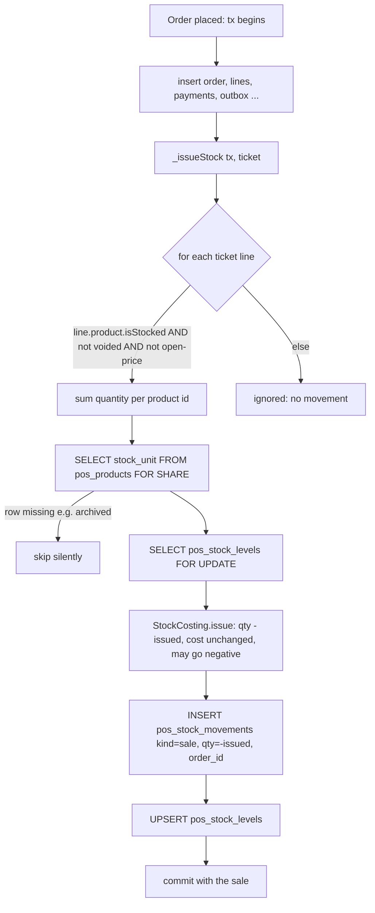

Rules verified in code:
- Quantity decremented = `line.quantity` whole sellable units, in the item's stock unit. A stocked item sold as "1 each" decrements 1 000 milli. There is no conversion from "portion" to a purchase unit.
- Only `line.product` is considered. Modifiers, combo component lines (`pos_order_line_items`) and option groups never move stock.
- **Negative stock is allowed** (no check, comment says deliberately). A sale is never declined for stock reasons.
- Atomic with the sale: a stock failure rolls the sale back [CODE: same `tx`]. Mitigation: a missing product row is skipped to avoid an FK failure killing a legitimate sale.
- Only on the repository that has the stock tables (the local DB). The cloud bundle does not mark products `is_stocked` (seeder `INSERT INTO pos_products` list at `bootstrap_seeder.dart:608` does not include `is_stocked`) [CODE], and stock movements are not sent to the platform (no reference to stock in `lib/data/cloud/*`; searched `stock`).
- Tests: **no test found** that places an order and asserts the `sale` movement (tests insert `sale` movements by hand: `profit_report_test.dart:221-259`; `grep pos_stock_movements test/` -> opening_cost, receiving, profit_report, stock_levels only).

---

## 4. Finance panes

All read-only except supplier payments (Purchasing). Gate `reports.view` (and `purchase.manage` for Bills due). Gating is applied in providers (`reportsAllowedProvider`, `reports_providers.dart:52`; `finance_providers.dart`), **not in the repository** — `PostgresReportsRepository` has no capability check and reads on the till's DB credential. [CODE]

| Pane | Where | Source / basis | Status | Notes | Tests |
|---|---|---|---|---|---|
| Overview, Revenue, Payments, Taxes | `management_finance_panes.dart:138,205,282,410` | `salesReportProvider`, `taxReportProvider`, `paymentLedgerProvider` -> `PostgresReportsRepository` | IMPLEMENTED | Same provider as Reports so figures agree. | `features/finance_panes_test.dart`, `data/finance_reports_test.dart` |
| Expenses | `:1247` `FinanceExpensesPane`; `expenseReportProvider` | = drawer **pay-outs** (`pos_cash_movements`) + **supplier payments** | PARTIAL | **No expense entry entity**: nothing records rent, salaries, utilities (confirmed in `profit_and_loss.dart` header: "Rent and salaries have no entity"). Supplier figures omitted (with explanatory label) when not authoring purchasing / lacking `purchase.manage`. | `data/finance_expenses_test.dart`, `domain/finance_expenses_model_test.dart`, `features/finance_bo10_panes_test.dart` |
| Drawers | `:1357`; `ShiftRepository.openDrawers` | open drawers now | IMPLEMENTED | | `finance_bo10_panes_test.dart` |
| Bills due | `:1452` | supplier ledger | IMPLEMENTED (offline only) | | same |
| Transactions | `:1551` | order history rows + expenses | IMPLEMENTED | Rows scoped by `HistoryScope` (see §5). | same |
| Profit & loss | `:1076`; `domain/profit_and_loss.dart` | sales - tax = revenue; COGS from stock ledger `sale` movements with cost > 0; minus drawer expenses | PARTIAL | COGS only for stocked items with a recorded cost, so gross profit is an **upper bound** (`itemsWithNoCost` caveat); supplier purchases deliberately excluded (counted as stock); caveats printed. | `domain/profit_and_loss_test.dart`, `features/profit_loss_ui_test.dart`, `data/profit_report_test.dart` |
| Settlements (cash-ups) | `management_settlements_pane.dart` | stored shift close counts | IMPLEMENTED (read-only) | | `features/shift_history_panes_test.dart` |

Supplier invoice/payment *entry* is in Purchasing (§3), not Finance.

---

## 5. People: staff, roles, permissions

| Feature | Where | DB | Status | Behaviour | Tests |
|---|---|---|---|---|---|
| Staff directory: create, edit, disable/enable, reset PIN, assign role(s), direct grants/denies | `PostgresStaffDirectoryRepository` (`postgres_admin_repositories.dart:334`), pane `management_staff_pane.dart` (1 574 lines), `staff_grants_dialog.dart` | `pos_staff`, `pos_staff_roles`, `pos_staff_permission_overrides`, `pos_permission_limits` | IMPLEMENTED (offline) | All writes need `staff.manage`. PIN stored as salt+PBKDF2 hash, PIN never audited. Licence seat limit (`UserSeatsExhausted`). Duplicate username refused. Cannot disable/demote the last `staff.manage` holder (`WouldLockEveryoneOut`). Exactly one owner (DB triggers `pos_staff_one_owner_*`, `pos_staff_roles_not_owner`, `pos_staff_overrides_not_owner`). Owner PIN only by owner. On a cloud tenant these writes return `ManagedByPlatform`. No self-service PIN change (stated in `management_user_pane.dart`). | `data/postgres_admin_test.dart` (cashier refused; last manager; ledger records changes; cloud-till refusals), `data/permission_grants_test.dart`, `features/owner_rule_test.dart` |
| Roles CRUD | `PostgresRolesRepository` :116; `management_roles_pane.dart` | `pos_roles` | IMPLEMENTED | System roles owner/manager/supervisor/cashier (`permissions.dart:564-770`) cannot be deleted; owner keeps every capability; cashier role cannot hold any `PosCapability.backOffice` key (`Authorization.validateRole`, `authorization.dart:340`); **no-escalation**: an editor cannot add a capability they lack. | `postgres_admin_test.dart` "roles", `domain/permissions_test.dart` |
| Capability catalogue (28 keys) with risk levels | `lib/domain/models/permissions.dart` | `pos_roles.capabilities text[]` | IMPLEMENTED | `critical` keys (`staff.manage`, `terminal.manage`, `settings.manage`, `backup.manage`, `admin.enter`, `report.export`) are never lendable. | `domain/permissions_test.dart` (asserts every key classified) |
| Numeric limits (discount %, refund ceiling, pay-out ceiling) | `PermissionLimit`, `Authorization.checkWithin` | `pos_permission_limits` | IMPLEMENTED | The approver's ceiling binds an overridden act. | `domain/authorization_test.dart`, `permission_resolver_test.dart` |
| Supervisor override ("lend a permission once") | §1 | none (in-process `Approval`; approver recorded in audit/order events) | PARTIAL | See §1 attempt-limit gap. | `manager_approval_test.dart` |
| Shifts view (read-only) | `management_shifts_pane.dart` | `pos_shifts` | IMPLEMENTED | | `shift_history_test.dart`, `shift_history_panes_test.dart` |
| Customers directory (read-only) | `management_customers_pane.dart` | `pos_customers` | IMPLEMENTED | Gated `reports.view`. | `customers_ui_test.dart`, `customer_directory_test.dart` |

### Is permission enforcement below the UI?
- **Repository layer: yes, for writes.** `Authorization.check(...)` appears in the roles/staff/catalog/units/stock-items/suppliers/PO/receiving/supplier-invoice/receipt-profile/service-charge/backup repositories (grep of `Authorization.(check|authorize)` in `lib/data`: 36 call sites). Tests such as `receiving_schema_test.dart` "a cashier" and `postgres_admin_test.dart` "a cashier cannot edit a role" exercise this.
- **Not enforced in the data layer:** all *reads* in Finance/Reports/Stock levels/Customers/Audit (providers gate `reports.view`; `AuditRepository.recent` has no check); `terminal.manage` (terminal reset and printer pane are UI gates only — `management_screen.dart:1014-1021` comment admits "nothing in the database refuses it"); `report.export` (UI button only).
- **Database level:** no row-level security, no per-user DB role. Admin credential is shared, and its password is on disk (§9). The audit and backup tables have triggers; most others do not.

---

## 6. Reports (local)

Source: `PostgresReportsRepository` (`postgres_reports_repository.dart`, 860 lines), providers `reports_providers.dart`, panes `management_reports_pane.dart` (1 178), `report_breakdown_panes.dart` (1 111), charts `report_charts.dart`.

| Report | Method | Basis | Status | Tests |
|---|---|---|---|---|
| Business summary (tiles, trend, by terminal) | `sales()` :170 | `pos_orders` rows filtered by the **same WHERE as the Sales list** (`PostgresOrderHistoryRepository.filterFor`), filed by business day (`tradingDayJoin`), calendar-day fallback when no business day covers the row; refunds filed by the day/terminal that **issued** them; one REPEATABLE READ, READ ONLY snapshot; throws `StateError` if a row is filed outside the range | IMPLEMENTED | `data/reports_test.dart`, `domain/sales_report_test.dart`, `features/back_office_reports_test.dart` |
| Sales / Items (top-N or full) | `topProducts()` :351 | `pos_order_lines`, kept quantity = quantity - refunded, voided lines excluded | IMPLEMENTED | `data/reports_test.dart`, `back_office_report_breakdowns_test.dart` |
| Payments | `payments()` :785 + `PostgresBranchSalesRepository.paymentTotalsCte` | `pos_order_payments` | IMPLEMENTED | `finance_reports_test.dart` |
| Branches/devices | derived from `terminals` table inside `sales()` | local branch only | PARTIAL | "Branches" is only this branch's terminals (data is one branch DB). |
| Employees | `staffSales()` :552 | `served_by` | IMPLEMENTED | `reports_test.dart` |
| Taxes | `taxes()` :665 | `pos_order_taxes` | IMPLEMENTED | `finance_reports_test.dart`, `domain/tax_lines_test.dart` |
| Profit / COGS | `profit()` :405 | revenue ex-tax per line (pro-rated by order tax ratio, exact for single-rate orders, estimate for mixed) vs `pos_stock_movements` kind=`sale` cost>0 | PARTIAL | Upper-bound caveat; coverage % shown. `data/profit_report_test.dart`, `features/profit_section_test.dart` |
| Home (day vs previous day at the same cut) | `back_office_home.dart:readHomeSales` | local DB, every deployment | IMPLEMENTED | `data/home_sales_test.dart`, `features/back_office_home_test.dart` |
| Z / shift report | in shift feature (other inventory part) | | n/a here | |

Excel export: `lib/core/export/workbook.dart`, `report_export.dart` (529), `history/sales_export.dart`, button `excel_export.dart` (shown only with `report.export`, owner-only by default; Windows/macOS save dialog via `file_picker`). `test/features/excel_export_test.dart`, `profit_export_test.dart`, `data/report_export_migration_test.dart`.

Cloud reporting: **NOT_IMPLEMENTED in the UI.** `BranchSalesApi` (`lib/data/cloud/branch_sales_api.dart:55,66` -> `/api/pos/branch/sales/summary`, `/api/pos/branch/sales`) and `branchSalesSourceProvider` (`branch_sales_providers.dart:57`) exist, but grep shows nothing consumes `branchSalesSourceProvider`/`branchSalesProvider` outside its own file (`management_home_pane.dart:73` only mentions `branchSalesAllowedProvider`; `back_office_home.dart` explicitly reads the local DB instead). Server behaviour: UNKNOWN. Reports are per-branch, single database; no multi-branch consolidation.

---

## 7. Settings

| Setting | Where it lives | Persisted? | Editable in UI? | Status | Evidence / tests |
|---|---|---|---|---|---|
| **Language (en/ar) - a screen exists** | Settings tab > Language pane (`ManagementPane.language`), also inside "General" pane card, also the till's own Settings menu toggle (reachable outside Admin Mode) | Terminal `config.json` via `FileTerminalConfigStore` (`TerminalLocaleController.apply`, `providers.dart:~1860-1904`), per machine, not per restaurant | Yes, no permission gate | IMPLEMENTED | `management_appearance_pane.dart`; `test/app/terminal_preference_persistence_test.dart` (survives a store throwing `Error`), `features/settings_general_test.dart` ("the language is the one the Settings menu switches"). Only `en` and `ar` (`AppStrings.supportedLocales`, `app_strings.dart:12263`). |
| Theme (system/light/dark) | same card | `config.json` | Yes | IMPLEMENTED | `BrightnessController` `providers.dart:~1913-1945` |
| "General" screen | `ManagementPane.receipt` (label General) = company/receipt profile + Appearance card + Backup summary card (`management_screen.dart:1633`) | profile in `pos_receipt_profiles` (branch scoped); appearance in config file | Profile: yes (`settings.manage`, `postgres_receipt_profile_repository.dart`) | IMPLEMENTED | `features/settings_general_test.dart` |
| Receipt profile (trade name, address, phone, tax/commercial registration, activity code, header/footer, ETA fields) | `management_receipt_pane.dart`, `pos_receipt_profiles` | DB | Yes (saves incomplete forms) | IMPLEMENTED | `settings_general_test.dart`, `receipt_print_test.dart` |
| Currency | `Money` defaults `EGP`/2; tables default `'EGP'` (`migrations.dart:57,2512,...`) | n/a | **No picker** (`providers.dart:174` comment: "When currency becomes configurable (SRS §93, Wave D)") | NOT_IMPLEMENTED | Searched `currency` in `lib/features`: display only. |
| Tax | `pos_money_config`, `pos_tax_groups` | DB | Yes offline (`settings.manage`) | IMPLEMENTED | §2. Without a saved config the till falls back to built-in 12% service / 14% VAT and labels slips `deviceConfig` (per `management_taxes_pane.dart` header; not re-verified in `TaxConfig`). |
| Printer & cash drawer | `printer_settings_dialog.dart` (till Settings menu) and `management_printer_pane.dart`; `core/config/printer_config.dart` | `config.json` (name or `host:port`, paper 80 mm = 576 / 58 mm = 384 dots) | Yes, `terminal.manage` (UI gate) | IMPLEMENTED | Transport inferred from name: IP/host:port -> network, otherwise OS printer name (USB/spooler). `features/printer_settings_test.dart`, `printer_pane_test.dart`, `data/network_printer_test.dart`, `spooler_printer_test.dart`. Print queue table `pos_print_jobs` with print-once trigger. |
| Admin Mode chord + timeout | `management_terminal_pane.dart:152+` | `config.json` | Yes | IMPLEMENTED | `admin_session_test.dart` |
| `pos_settings` table keys (day start, refund enabled/window/max/approval threshold/receipt/reason, cash blind close, drawer-open reason, pay-out ceiling) | `domain/models/pos_settings.dart:65-86`; `PostgresSettingsRepository` | DB | **Only `backup.directory` and `backup.on_day_close` have a UI writer** (`management_backup_pane.dart:92,~937`). Others: readers exist (`DayPolicy`, `CashPolicy`, refund policy), no writer found (searched callers of `settingsRepositoryProvider`: one file) | PARTIAL | `test/domain/pos_settings_test.dart`; "the day-close switch writes the policy the pane writes" in `settings_general_test.dart` |
| Numbering (invoice) configurable | `pos_invoice_sequences` | | No | NOT_IMPLEMENTED | doc 16 says the same. |
| About / version | `settings/about_dialog.dart`, `management_about_pane.dart` | | | IMPLEMENTED | |

---

## 8. Device / terminal management

| Feature | Where | Status | Notes |
|---|---|---|---|
| Terminal pane: reset this till (wipes local config, DB address, secrets, setup state; refused while a shift is open; confirmation dialog) | `management_terminal_pane.dart:60-130`, `TerminalReset` (`providers.dart:~2050-2096`) | IMPLEMENTED | `terminal.manage`; UI gate only. A "forced reset" chord exists when the DB is unreachable and requires username+PIN with `terminal.manage` (`app.dart:581`, `showForceResetDialog`). Tests: `features/terminal_pane_test.dart`, `terminal_adoption_test.dart`, `app/terminal_rejected_test.dart`. |
| Terminal registry (list, rename, revoke other tills) | table `pos_terminals` | NOT_IMPLEMENTED in app | No pane lists terminals or can deactivate one. On cloud, pairing codes come from the platform (`/api/dashboard/pos/terminals/{id}/pairing-code`, `cloud_api.dart:146`); platform side UNKNOWN. |
| Sync pane (queue count, last sync, "sync now", problem summary) | `management_sync_pane.dart` | PARTIAL | Cloud half only reachable on a cloud till, which cannot open the back office (§0.1); the offline half just says "no cloud". |
| Licence screen / seats | `lib/features/licensing/**` (other inventory part); `licenceClaimsProvider` used for `max_users` | n/a | |

---

## 9. Backup pane (summary only)

`management_backup_pane.dart` (1 176 lines), `lib/data/backup/backup_service.dart`, `pg_archive.dart`, table `pos_backups` (append-only by trigger `pos_backups_append_only`, migration 37). Take-now, scheduled copy at day close (`backup.on_day_close`), verify, restore (with pre-check), copy-out; `pg_dump`/`pg_restore` binaries must be present (pane lists where it looked). Gate `backup.manage` (owner only), checked in `BackupService` (`backup_service.dart:154,428`) as well as the pane. Banner says a same-disk copy is not off-machine; off-site copying NOT_IMPLEMENTED. Tests: `data/backup_restore_test.dart`, `backup_tools_test.dart`, `domain/backup_test.dart`, `features/backup_pane_test.dart`. Depth: other agent.

Credential note (no secret reproduced): the admin DB password and a backup-role password are kept in `secrets.json` (key names in `FileSecretStore`; `adminDbSecretStoreProvider` doc-comment `providers.dart:3059-3074` states that anyone with the OS account's files has admin DB rights without a PIN). The till DB password and the cloud device token are in the same file. Whether the file is encrypted: not verified here ([ASSUMED] plain JSON; `file_secret_store.dart` writes `jsonEncode(secrets)` at :98).

---

## 10. Error reporting and diagnostics

Searched `lib/` for `FlutterError.onError`, `runZonedGuarded`, `PlatformDispatcher`, `ErrorWidget`, `Sentry`, `crashlytics`, `firebase`, `telemetry`, `package:logging`, `dart:developer`, `.log`, `support bundle`, `diagnos`; and `pubspec.yaml` for logging/crash packages.

| Item | Status | Evidence |
|---|---|---|
| HTTP debug log | PARTIAL | `core/network/network_log.dart:16` `posHttpClient`: adds `NetworkLog` interceptor **only when `!kReleaseMode`**; prints via `debugPrint` (console); masks bearer tokens/PIN/password/token fields; truncates bodies at 2 000 chars. Release builds log nothing. `test/core/network_log_test.dart` (masking, truncation, release = bare client). Pairing code and licence key print in full in dev builds by design. |
| Global error handler / crash reporting | NOT_IMPLEMENTED | `lib/main.dart` has no `runZonedGuarded`/`FlutterError.onError`; no crash package in `pubspec.yaml`. |
| Telemetry / analytics | NOT_IMPLEMENTED | none found. |
| Log files | NOT_IMPLEMENTED | only `writeAsString` calls are config/secret/licence stores. One stray `debugPrint('site licence not shared: ...')` at `providers.dart:1832`. |
| Support bundle / diagnostics screen | NOT_IMPLEMENTED | no such pane; closest are Sync pane problem line, Backup pane tool locator, About dialog, and the schema-upgrade failure banner (`schemaUpgradeFailureProvider`, `providers.dart:2420`). |
| Failed-sync visibility | PARTIAL | outbox `last_error`, `quarantined_at`, `totals_mismatch` columns (`migrations.dart:622-625`); surfaced as a count/"held" in the Sync pane only. |

---

## 11. Audit log

| Aspect | Detail |
|---|---|
| Table | `pos_audit_events` (`migrations.dart:465`): actor id+name, optional `approved_by_*`, action, entity type/id, `before_value`/`after_value` jsonb, reason, `occurred_at`, terminal/shift ids. |
| Append-only | Triggers `pos_audit_events_no_rewrite` (BEFORE UPDATE OR DELETE) and `pos_audit_events_no_truncate` (BEFORE TRUNCATE) raise `restrict_violation` (`migrations.dart:519-538`); till role granted SELECT, INSERT only (`local_bootstrap.dart:845`). Limits: a superuser/table owner can `DROP TRIGGER` or `ALTER TABLE ... DISABLE TRIGGER`; the table is never sent to the cloud (no `audit` reference in the outbox/sync write paths of `lib/data/cloud`; grep hits there are English "auditor" comments). So tamper-evidence = trigger + grants only; no hash chain or off-box copy. [CODE] |
| What is audited | `AuditAction` list (`admin_repositories.dart:371-553`): staff/role/grant changes, PIN reset (no PIN value), admin entered/exited/timed-out/refused/locked-out, catalogue/option/combo/tax/tender/order-type/table saves (price changes as `product.repriced` with old/new), money config, receipt profile, units/stock items/suppliers/PO status/stock received/cost set/supplier invoice+payment, backup taken/restored, shift opened/closed, receipt reprinted. **Sales-side acts (void, refund, discount, line delete) are recorded in their own tables** (`pos_order_line_events`, `pos_refunds`, `pos_order_discounts`) and are not all in `pos_audit_events`. |
| UI | `management_activity_pane.dart`: read-only list of `recent()` = latest 100 rows (default `limit: 100`, `postgres_admin_repositories.dart:1155`); the pane exposes no filter, search or paging although the repository supports `entityType/entityId/staffId`. |
| Tests | `features/management_gate_test.dart` ("Activity pane reads as sentences", money formatting, before/after), `data/postgres_admin_test.dart` ("the ledger": role change records both sides; PIN reset has no PIN; supervisor names both people; refused write leaves no trace), `receiving_schema_test.dart` audit. No test attempts `UPDATE`/`DELETE`/`TRUNCATE` on `pos_audit_events` (searched `append-only` in test/: only titles/comments) — [ASSUMED] covered by DB trigger text. |

---

## 12. Admin functionality the POS expects a separate platform (Vue/Laravel) to own

**All items here are UNKNOWN / not verifiable in this repository.** Source of the expectation: code comments and `docs/pos/16-back-office-scope.md`, `19-back-office-redesign.md`, `docs/coordination/*` (documentation of agreements, not evidence). The sibling repo `xorder-new` and the Vue panel were not available.

| Expected platform-owned area | POS evidence of the expectation | Status here |
|---|---|---|
| Menu/catalogue authoring on cloud (categories, products, modifiers, tables) | `BootstrapSeeder` deletes and re-inserts these tables (`bootstrap_seeder.dart:517-539`, `:654`); POS panes disabled on cloud; `ExtrasView.vue`, `OptionGroupController`, `MenuItemController::syncOptionGroups` cited in comments | UNKNOWN (platform side) |
| Staff identity (names, usernames, PIN hashes, base capabilities, active) on cloud | seeder `INSERT INTO pos_staff` / `UPDATE ... is_active=false` (:465,498); POS staff writes return `ManagedByPlatform` | UNKNOWN |
| Tender types and tax/money config on cloud | seeder :301, :362; `POS-BE-013` | UNKNOWN |
| Suppliers, purchase orders, receiving, supplier invoices/payments, units, stock items on cloud (CB-09 / POS-BE-030: "the platform is the only author", "none of it comes down to the till") | comment block above `_authoringPanes` (`management_screen.dart:137-167`) | UNKNOWN; also note: on cloud the till's stock never reaches the platform |
| Receipt profile authoring on cloud (CB-08) | `ManagementReceiptPane` read-only on cloud; seeder :223 | UNKNOWN |
| Customer records (shared) | `/api/pos/customers` (`cloud_api.dart:186`), seeder :436 | UNKNOWN |
| Terminal pairing/registration, licence activation/renewal, heartbeat | `/api/pos/terminals/claim|register|heartbeat`, `/api/dashboard/pos/terminals/.../pairing-code`, `/api/pos/license/check`, `/api/pos/licence/activate` | The POS call sites exist [CODE]; server behaviour UNKNOWN |
| Branch-level and cross-branch sales reporting | `/api/pos/branch/sales[/summary]` client exists; unused by UI; doc 19 notes cloud Insights is menu analytics, "platform's C3 is unbuilt" | UNKNOWN |
| Accounting, expenses (rent/salaries), payables beyond supplier invoices | doc 16 §3-4 | NOT_IMPLEMENTED locally; platform status UNKNOWN |
| Cost price on products / inventory valuation across branches | doc 16 | local ledger only; platform UNKNOWN |
| User/device management at tenant level (revoking a till, seats) | none in POS beyond local licence claims | UNKNOWN |

---

## 13. Coverage table

| # | Feature | Status | Key evidence | Tested? (exists, not executed) |
|---|---|---|---|---|
| 1 | Admin Mode door (user+PIN+`admin.enter`) | IMPLEMENTED | `admin_session.dart:267` | yes |
| 2 | Admin lockout (5 tries, backoff, 15 min cap) | PARTIAL (memory only, per terminal) | `admin_session.dart:203` | yes |
| 3 | Admin inactivity timeout / exit | IMPLEMENTED | `admin_session.dart` | yes |
| 4 | Supervisor PIN override | PARTIAL (attempt cap not enforced) | `supervisor_override.dart:249-333` | partial (no exhaustion test) |
| 5 | Till PIN sign-in lockout | NOT_IMPLEMENTED | `postgres_directory_repositories.dart:428` | no |
| 6 | Roles/permissions (28 keys, risk, no-escalation) | IMPLEMENTED | `permissions.dart`, `authorization.dart` | yes |
| 7 | Staff CRUD / PIN reset / grants | IMPLEMENTED (offline) | `postgres_admin_repositories.dart:334` | yes (DB tests skip without `POS_PG_HOST`) |
| 8 | Capability enforcement in data layer | PARTIAL (writes yes; reads/terminal/export UI-only; shared DB credential) | grep Authorization in `lib/data` | partial |
| 9 | Categories/products/pricing | IMPLEMENTED (offline) | `postgres_catalog_admin_repository.dart:369` | yes |
| 10 | Option groups / modifiers | IMPLEMENTED | `:1195` | yes |
| 11 | Combos | IMPLEMENTED | `:2161` | yes |
| 12 | Per-branch/per-channel price overrides | PARTIAL (read only, no writer) | `postgres_catalog_repository.dart:81` | read test only |
| 13 | Named price lists | NOT_IMPLEMENTED | grep | no |
| 14 | Spreadsheet menu import | IMPLEMENTED | `spreadsheet_reader.dart`, `menu_import.dart` | yes |
| 15 | Tax groups / money config | IMPLEMENTED (offline) | `management_taxes_pane.dart` | yes |
| 16 | Tenders, service charges, order types, tables | IMPLEMENTED | panes | yes |
| 17 | Stock items + units | IMPLEMENTED | `postgres_stock_items_repository.dart` | yes |
| 18 | Stock levels view + opening cost | IMPLEMENTED (read-only otherwise) | `management_stock_pane.dart` | yes |
| 19 | Stock decrement on sale | PARTIAL (stocked products only, 1:1, no BOM, negative allowed) | `postgres_orders_repository.dart:725` | **no test found** |
| 20 | Recipes / BOM | NOT_IMPLEMENTED | grep | no |
| 21 | Stocktake / waste / adjustment / transfer | NOT_IMPLEMENTED | grep | no |
| 22 | Restock on refund/void | NOT_IMPLEMENTED | grep | no |
| 23 | Suppliers / POs / receiving | IMPLEMENTED (offline) | repos | yes |
| 24 | Supplier invoices / payments / balances | IMPLEMENTED (offline) | repo | yes |
| 25 | Expense entry (rent, salary, etc.) | NOT_IMPLEMENTED (derived expenses only) | `FinanceExpensesPane` | yes |
| 26 | Finance panes (overview, revenue, payments, taxes, drawers, bills, transactions) | IMPLEMENTED | `management_finance_panes.dart` | yes |
| 27 | Profit & loss / COGS | PARTIAL (upper bound) | `profit_and_loss.dart` | yes |
| 28 | Local reports (sales, items, payments, employees, taxes) | IMPLEMENTED | `postgres_reports_repository.dart` | yes |
| 29 | Excel export (`report.export`) | IMPLEMENTED | `excel_export.dart` | yes |
| 30 | Cloud / multi-branch reporting in POS | NOT_IMPLEMENTED (client exists, unused) | `branch_sales_providers.dart:57` | no |
| 31 | Language switch (en/ar) | IMPLEMENTED | Settings > Language / General / till menu | yes |
| 32 | General settings screen (company profile + appearance + backup card) | IMPLEMENTED | `management_screen.dart:1633` | yes |
| 33 | Currency setting | NOT_IMPLEMENTED | `providers.dart:174` | no |
| 34 | Printer settings | IMPLEMENTED | `printer_config.dart` | yes |
| 35 | Policy settings in `pos_settings` (day start, refund, cash) | PARTIAL (readers, no UI writer) | `pos_settings.dart` | read tests |
| 36 | Terminal reset | IMPLEMENTED | `management_terminal_pane.dart` | yes |
| 37 | Terminal registry / revoke | NOT_IMPLEMENTED | - | no |
| 38 | Backup pane | IMPLEMENTED (local only; summary) | `backup_service.dart` | yes |
| 39 | Audit ledger (append-only trigger) | IMPLEMENTED | `migrations.dart:519` | partial |
| 40 | Audit viewer (filter/paging) | PARTIAL (latest 100, no filters) | `management_activity_pane.dart` | partial |
| 41 | Crash reporting / telemetry / log files / diagnostics / support bundle | NOT_IMPLEMENTED | §10 | no |
| 42 | Dev-only HTTP log | PARTIAL | `network_log.dart` | yes |
| 43 | Cloud-till back office | PARTIAL (signpost only) | `router.dart:138-160` | address helper only |
| 44 | Platform-owned admin (Vue/Laravel) | UNKNOWN | §12 | n/a |

---

## 14. Docs-vs-code disagreements found

1. Cloud-till panes (Menu hidden, Receipt read-only, Sync pane cloud half, Customers "same on cloud") are described as live in comments/`docs/pos/16,19`; the router (CB-07) replaces the whole back office with a signpost for a claimed cloud tenant.
2. `supervisor_override.dart:245-248` comment says the keypad stops after five tries; code only changes the message.
3. `receiving_schema_test.dart:223` test name claims a movement "cannot be edited or deleted"; body only counts rows. Append-only for stock is by grants alone, no trigger.
4. `docs/pos/16` §2 scores Settings "no backup settings"; backup settings now exist (`backup.directory`, `backup.on_day_close`). Not otherwise re-verified.
5. `pos_product_prices` is described in migration 17 as per-branch / per-channel pricing and in doc 16 as "per-branch prices ... Done"; no authoring path exists in the app.


---

<!-- ===== PART 9: SECURITY_AND_RECOVERY.md ===== -->

# Security and Recovery Audit — XOrder POS

Scope: read-only audit of `/home/user/xorder-pos` (Flutter desktop POS). Nothing was executed: no Flutter/Dart, no PostgreSQL, no Windows. Evidence levels: **[CODE]** read in executable code or SQL; **[ASSUMED]** inferred or not verifiable here. There is no **[OBSERVED]** item in this document.
The Laravel backend, Vue admin and cloud services are not available, so all server-side behaviour is **UNKNOWN** except the HTTP paths the POS calls. Comments and docs were not accepted as proof. Where a code comment, or `docs/pos/*.md`, says something different from the executable code, the disagreement is listed in section 14.
Tests are named as "test exists (not executed here)". No test was run and none is claimed to pass.

Status labels: IMPLEMENTED | PARTIAL | NOT_IMPLEMENTED | UNKNOWN.

---

## 1. Summary

| Area | Status | One line |
|---|---|---|
| Secret storage at rest | PARTIAL | DB password, device token, backup and admin passwords sit in one **plaintext JSON file** (`secrets.json`). No OS keystore is used anywhere. |
| DB role separation | IMPLEMENTED | `pos_till` (column-scoped DML, no DDL), `pos_admin` (owner, CREATEDB), `pos_backup` (`pg_read_all_data`), `postgres` (installer only). |
| Audit append-only | PARTIAL | Grant plus trigger. The table owner can drop the trigger, and restore replaces the table. No hash chain. |
| TLS to Postgres | PARTIAL | Loopback is always plaintext. LAN is plaintext in practice, because the installer never enables `ssl`. `verifyFull` applies only if the server has TLS. |
| TLS to cloud | IMPLEMENTED | Default Dio/`dart:io` validation, no override. `http://` allowed only for private hosts. |
| PIN hashing | IMPLEMENTED | PBKDF2-HMAC-SHA256, 120 000 iterations, 16-byte random salt, constant-time compare. Keyspace is only 10^4. |
| PIN rate limiting | PARTIAL | Admin Mode and the supervisor keypad throttle. The cashier lock screen has none. |
| Session auto-lock | PARTIAL | Admin Mode has an idle timeout. No idle lock for the cashier session was found. |
| SQL injection | IMPLEMENTED | All values are bound parameters. Interpolations are constants or validated identifiers (section 6). |
| Backup encryption | NOT_IMPLEMENTED | Plaintext `pg_dump -Fc` in the user profile, on the same disk. No automatic off-site copy. |
| Pre-restore snapshot | NOT_IMPLEMENTED | Restore is `--clean --single-transaction`. There is no safety copy of the current DB. |
| Crash/power-loss on sale | IMPLEMENTED (design) | Single-transaction settlement with an idempotency key. Not executed here. |
| Monitoring / crash reporting | NOT_IMPLEMENTED | No global error handler and no telemetry. Logs are `debugPrint` only. |

---

## 2. Trust-boundary diagram

Only boundaries visible in code are drawn.

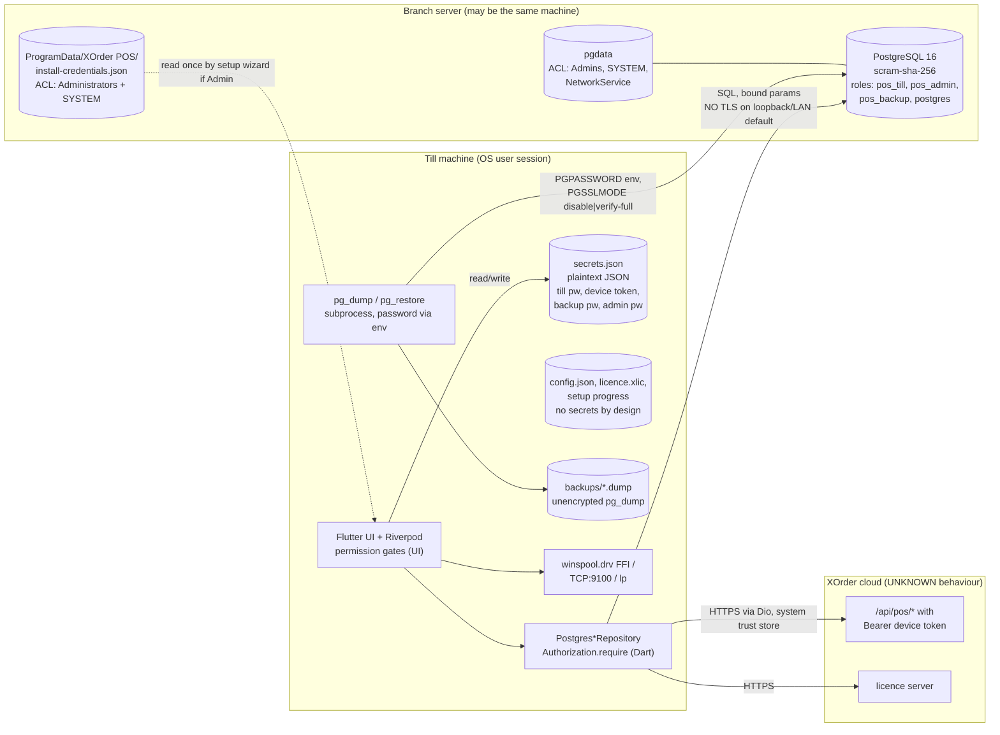

Boundaries that matter:

1. **Till OS account to `secrets.json`.** Anyone who can read the till user's files holds every credential, including the back-office DB password.
2. **Till to Postgres.** The only authentication is a role password. The DB sees one role (`pos_till`) for every cashier, so DB-level authorisation cannot tell cashiers apart. Cashier identity and permissions are enforced in Dart only.
3. **LAN.** Plaintext SQL and a scram login across the restaurant network unless the operator enabled TLS manually.
4. **Till to cloud.** Bearer device token over HTTPS.

---

## 3. Secrets inventory

| Secret | Where it lives | Protection | Evidence | Status | Test |
|---|---|---|---|---|---|
| `pos_till` DB password | `secrets.json` key `pos_till_database_password`, in `getApplicationSupportDirectory()`. Cached in memory by `MutablePosDbCredentials`. | Plaintext JSON. `chmod 600` on POSIX (best effort, failure swallowed). **On Windows `_restrict` returns immediately**, so no ACL is set and the file inherits the profile ACL. | `lib/data/config/file_secret_store.dart:113-190`; `lib/main.dart:41-43`; `lib/data/postgres/pos_database.dart:158-215` | PARTIAL | `test/data/file_secret_store_test.dart` (not executed here) checks read, write, clear and key isolation. No test of Windows ACL or mode. |
| Cloud device token (`xdt_…`) | Same file, key `pos_cloud_device_token`. Memory-cached by `DeviceTokenVault`. | Same as above. | `lib/main.dart:49-51`; `lib/data/cloud/device_token_vault.dart:14-47` | PARTIAL | same |
| `pos_backup` password | Same file, key `pos_backup_database_password`. | Same. It is read-only (`pg_read_all_data`) but reads **every row**, including PIN hashes. | `file_secret_store.dart:125`; `lib/app/providers.dart:3055-3057` | PARTIAL | none specific |
| **`pos_admin` password** | Same file, key `pos_admin_database_password`. The wizard stores it so Admin Mode needs only username + PIN. | Same. `pos_admin` **owns the schema**, can disable triggers and truncate tables, and is the restore account. | `file_secret_store.dart:133`; `providers.dart:3075-3078`; `lib/features/admin/application/admin_session.dart:276` | PARTIAL, **high risk** | none specific |
| Licence file `licence.xlic` | `Application Support/licence.xlic` | Not a secret. Ed25519-signed and verified on load. | `lib/features/licensing/data/file_license_store.dart` | IMPLEMENTED | `test/features/licence_signing_test.dart` (not executed here) |
| Licence **public** key | Compiled in. Release builds require the `XORDER_LICENSE_PUBLIC_KEY_B64` and `_KEY_ID` dart-defines and throw otherwise. | Public by design. A **development public key constant is embedded** in `license_keys.dart` (value not reproduced) and used only when `dart.vm.product` is false. | `lib/features/licensing/data/license_keys.dart:27-77`; `.github/workflows/windows-installer.yml:33-34,72-76` | IMPLEMENTED | `test/features/licence_signing_test.dart` |
| Installer-generated passwords (`postgres`, `pos_admin`, `pos_till`, `pos_backup`) | `%ProgramData%\XOrder POS\install-credentials.json`, JSON, plaintext. | `icacls /inheritance:r`, granting Administrators `*S-1-5-32-544` and SYSTEM `*S-1-5-18` full control (SIDs, not names). The file is **written before the ACL is applied**, so a short window exists under inherited ProgramData ACLs. | `installer/provision.ps1:30-33,56-77,122-133`; `lib/data/config/installer_credentials.dart:287-399` | IMPLEMENTED with a window | `test/tool/installer_consistency_test.dart` (not executed here) checks consistency between script and app. ACLs not tested. |
| Superuser password for `initdb` | Temp file in `$env:TEMP`, deleted in `finally`. | Not ACL-restricted. It sits in the temp dir for the length of `initdb`. | `provision.ps1:136-147` | PARTIAL | none |
| Passwords passed to `pos_migrate` | Environment variables, cleared in `finally`. | OK. Not on the command line, not in the transcript. | `provision.ps1:187-207` | IMPLEMENTED | none |
| Owner PIN at install | `pos_migrate --seed … --pin 1234` is a **command-line argument**. | Visible in the process table. The usage text shows it. | `bin/pos_migrate.dart:235,982` | PARTIAL (CLI only) | `test/data/installer_owner_test.dart` |
| Cashier PINs | `pos_staff.pin_salt` / `pin_hash` (PBKDF2). | See section 7. The `pos_till` role has **SELECT on all of `pos_staff`**, hashes included. | `local_bootstrap.dart:~806` (SELECT list); `postgres_directory_repositories.dart:436-440` | PARTIAL | `test/core/pin_rules_test.dart` |
| Cloud login passwords | Typed in the wizard, sent to the cloud, not persisted. `setup_progress_store` states no secrets are stored. | Not verified beyond reading the store's fields: none are secrets. | `setup_progress_store.dart:19-60` | IMPLEMENTED | none |

**There is no OS keystore.** `pubspec.yaml` has no `flutter_secure_storage` or equivalent. The only OS-protected mechanism in use is `chmod 600` on POSIX. `FileSecretStore` is described in its own header as an owner decision (2026-09-04) to move off the macOS keychain, because of the unsigned-build prompt. The file store itself documents the threat model as "someone at the till's own session reads both".

`FileSecretStore._readAll` treats a damaged or unparseable file as an **empty store** (`file_secret_store.dart:154-159`). A truncated write therefore silently drops all four secrets and sends the till back through the wizard. The write is temp-file + rename, which narrows this window.

Platform matrix:

| Platform | Secrets | Installer creds |
|---|---|---|
| Windows | `secrets.json` in `%APPDATA%\…` (profile ACL; no explicit ACL) | `%ProgramData%\XOrder POS\install-credentials.json`, ACL-locked |
| macOS | `secrets.json` mode 0600 | none; manual PostgreSQL |
| Linux | same as macOS | none |

---

## 4. Database role separation

| Role | Created by | Privileges | Where defined | Used for |
|---|---|---|---|---|
| `postgres` | `initdb -U postgres -A scram-sha-256 --pwfile` | Superuser | `provision.ps1:141-144` | Install only: create roles, create DB |
| `pos_admin` | `LocalBootstrap.roleStatements(admin)`: `LOGIN CREATEDB`, no SUPERUSER, no CREATEROLE | **Owns database and tables** (`--owner pos_admin`). `administrativeGrants` adds staff, roles and menu authoring, with "no DELETE" on records. | `local_bootstrap.dart:296-297,983+`; `provision.ps1:195-198` | Migrations, Admin Mode, restore |
| `pos_till` | `LOGIN`, no other attribute | `tillGrants`: SELECT, INSERT on transactional tables; **column-scoped UPDATE** on `pos_orders` (status, void fields, business_day, server_invoice_number), `pos_order_lines`, `pos_print_jobs`, `pos_business_days`, `pos_eta_receipts`; no DELETE except `pos_parked_tickets`. | `local_bootstrap.dart:655-973` | Normal selling |
| `pos_backup` | `LOGIN` plus `GRANT pg_read_all_data` | Read everything, write nothing | `local_bootstrap.dart:302-305`; `backup_service.dart` | `pg_dump` |

Properties verified in the SQL strings [CODE]:

- Money columns on `pos_orders` are not updatable by the till. The `refunded_*` counters move only via a `SECURITY DEFINER` trigger with `search_path` pinned (`migrations.dart:1231-1305`).
- **Cloud vs offline grant difference.** `tillGrants(cloudSeeding: true)` lets the till write the whole catalogue, `pos_staff`, `pos_tender_types` and `pos_receipt_profiles`. The code comment argues this is acceptable because cloud re-prices. Offline, the same statements are **REVOKEd** (`local_bootstrap.dart:932-962`). The comment itself records that a writable `pos_staff` would let a stolen till credential point a row at the owner role or overwrite a PIN hash. On a **cloud** till the `pos_till` credential therefore can do that. It is only mitigated by `pos_staff_one_owner_*` triggers (`migrations.dart:3809-3818`) and the claim that the cloud is authoritative. The latter is UNKNOWN.
- Tests: `test/data/till_grants_enforced_test.dart`, `admin_grants_enforced_test.dart`, `grants_cover_usage_test.dart`, `till_grants_test.dart` (exist, not executed; they need Postgres, tagged `integration`). Per CLAUDE.md the integration suites self-skip when `POS_PG_HOST` is unset.
- **Single credential for all cashiers.** The DB cannot attribute a row to a cashier except through application-provided columns. Anyone with the till credential and `psql` can insert orders or audit rows naming any `staff_id`.

Audit table (`pos_audit_events`):

- Till: SELECT, INSERT only (`local_bootstrap.dart:845`).
- Triggers `pos_audit_events_no_rewrite` (BEFORE UPDATE OR DELETE, row-level) and `pos_audit_events_no_truncate` (BEFORE TRUNCATE) raise `restrict_violation` (`migrations.dart:519-535`). `pos_backups` has the same pair (`migrations.dart:3501-3509`).
- **Limits.** The table is owned by `pos_admin`, who may `ALTER TABLE … DISABLE TRIGGER`, `DROP TRIGGER`, or `DROP TABLE`. The code comment names this actor as the threat ("someone with a psql prompt and the admin password"), and that password is on the till disk (section 3). Restore (`--clean`) drops and recreates the table. There is **no hash chain, no signature, and no external anchor**, so deleting or rewriting history by an admin-level actor is undetectable from within the DB. The actor in each row comes from the app (`by:`), not from the DB. Status: PARTIAL.

---

## 5. TLS policy

### 5.1 To PostgreSQL

| Situation | `sslMode` | Evidence |
|---|---|---|
| Host is `localhost`, `127.0.0.1` or `::1` (`isLoopback`) | **disable** (always) | `deployment.dart:350-351`, `pos_database.dart:293-295` |
| Private host (RFC 1918, `*.local`) and `verifyTls == false` | **disable** | same |
| Private host and `verifyTls == true` (default) | `SslMode.verifyFull` | same |
| Any non-private host (including a LAN DNS name like `srv.lan`) | `verifyFull`. `verifyTls=false` cannot disable it. | `deployment.dart:317-351` |
| Setup/bootstrap connection (`LocalBootstrap._openMaintenance`) | `SslMode.require` when not insecure. The code's own comment states `require` **accepts any certificate**. | `local_bootstrap.dart:156-158`; `pos_database.dart:290-292` comment |
| `pg_dump` / `pg_restore` | `PGSSLMODE=verify-full` or `disable`, same decision. | `lib/data/backup/pg_archive.dart:59,86` |
| `pos_migrate` CLI | `--no-verify-tls` flag; the installer passes it for `127.0.0.1`. | `provision.ps1:187`; `bin/pos_migrate.dart:910` |

No `badCertificateCallback`, `SecurityContext` override or global `HttpOverrides` exists (grep: `badCertificate`, `SecurityContext`, `HttpOverrides`, `HttpClient(`, `createHttpClient`). There is no certificate pinning.

**Practical result [CODE + ASSUMED].** `provision.ps1` writes only `port` and `listen_addresses` into `postgresql.conf` (`Set-Block`, lines 159-160). It does not set `ssl = on` and installs no certificate. `pg_hba.conf` uses plain `host` lines, not `hostssl` (lines 161-168). With `-Lan`, a second till will find that the server has no TLS. With `verifyTls=true` the connection fails. The operator must pick "don't verify", which sets `SslMode.disable`. **LAN traffic is therefore plaintext by the supported path**: SQL, receipts, PIN hashes in `pos_staff` reads, and the SCRAM exchange. Whether the PostgreSQL build bundled from EDB has ssl pre-enabled is UNKNOWN; the script does not configure it.

The `-Lan` pg_hba block admits all roles, including `postgres` and `pos_admin`, from 10/8, 172.16/12 and 192.168/16 with password. A Windows firewall rule for Private and Domain profiles opens the port (`provision.ps1:161-175`).

### 5.2 To the cloud

- Every HTTP client is built by `posHttpClient` (`lib/core/network/network_log.dart:16-20`): plain `Dio`, so the platform trust store applies. No adapter override anywhere. Status IMPLEMENTED.
- `DeploymentConfig.isPermittedPlatformUrl` (`deployment.dart:273-279`) allows `https://` anywhere and `http://` only for private hosts. It is enforced in the wizard (`setup_controller.dart:370`), in the config validator (`deployment.dart:306`) and in the connectivity probe (`connectivity_probe.dart:61`). `PosCloudApi` itself does not re-check the scheme [CODE: no check in `cloud_api.dart`]. The check is upstream of it.
- The Bearer token header is built at `cloud_api.dart:248`.
- Server behaviour (HSTS, token rotation, scopes): UNKNOWN.

---

## 6. SQL injection review

Searched: all of `lib/data/postgres/*.dart`, `lib/data/cloud/*.dart`, `lib/data/eta/*.dart`, `lib/data/backup/*.dart`, `bin/pos_migrate.dart` for `$name` / `${…}` inside SQL-looking strings, excluding comment lines (about 230 raw hits, most `GRANT … "$role"`). Values go through `Sql.named(… @param)` with a `parameters:` map. The interpolation categories:

| Category | Examples | Assessment |
|---|---|---|
| Static column-list or join-fragment constants (`$_columns`, `$_orderColumns`, `$_joins`, `$roleColumns`, `$joinedRoleColumns`) | many repositories | Safe: compile-time constants. |
| Identifier from a fixed Dart list (`DELETE FROM $table` over `['pos_staff_roles', 'pos_staff_permission_overrides']`; seeder `DELETE FROM $table` over three table names; `setval … $table`) | `postgres_admin_repositories.dart:1070-1073`; `bootstrap_seeder.dart:539,694` | Safe: literal lists. |
| Fragments assembled from fixed switch results, with user values bound (`$reach`, `$where`, `where.join(' AND ')`, `LIMIT @limit`, `${limit==null?'':…}`) | `postgres_catalog_admin_repository.dart:1799-1813,1887`; order history; reports | Safe as read. The code documents `[where]` as "always a constant in this file". Not exhaustively traced for every `where` list; the builders sampled add `@param` predicates only. |
| Quoted identifiers with allow-list validation (`CREATE DATABASE "$name"`, `CREATE ROLE "$ident"`, `GRANT … "$role"`, `"$database"`) | `local_bootstrap.dart:104-121,285-308,660` | `_isPlainIdentifier` / `_identifier` enforce `^[A-Za-z_][A-Za-z0-9_]*$` for DB and role names (`deployment.dart:~264`). **Gap:** `tillGrants(database:, role:)` interpolates `"$role"` and `"$database"` without calling `_identifier`. The values come from `DeploymentConfig.databaseUser` / `databaseName`, which the wizard validates for the DB name (`hasValidDatabaseName`). The role name is validated for creation but not at the grant call site. Low risk because only the installer sets these. |
| Password literal in `CREATE ROLE … PASSWORD '…'` | `local_bootstrap.dart:290-308` | Escaped by `'` doubling. `CREATE ROLE` takes no bind parameters. Correct under `standard_conforming_strings=on`. The installer's passwords are alphanumeric, so the path is exercised only by the wizard-supplied ones. |
| Status-driven fragment in outbox `UPDATE` (`${action == quarantine ? ', quarantined_at = now() …' : ''}`) | `outbox_drain.dart:~432` | Safe: enum-driven. |
| `ILIKE @search` | `postgres_order_history_repository.dart:381-384,628` | Bound. LIKE metacharacters (`%`, `_`) are not escaped, so a user can widen a search. Not injection. |

Finding: no user-controlled string reaches SQL text. Status: IMPLEMENTED. Coverage: no dedicated injection test found (searched `test/` for "inject", "sql"); behaviour is covered only indirectly by repository tests.

`Process.run` / `Process.start` uses an argument list, not a shell, throughout (`pg_archive.dart:21`, `pg_tools.dart:139`, `file_secret_store.dart:110`, `spooler_printer_ports.dart:128,147`). `lp -d <printerName>`: a printer name beginning with `-` would be parsed as an option, but the name comes from `lpstat` output or settings. Negligible.

---

## 7. PIN hashing, lockout and authorisation

### 7.1 Hash

`lib/core/security/pin_hash.dart`: PBKDF2-HMAC-SHA256, **120 000 iterations**, 256-bit output, **16-byte salt** from `Random.secure()`, base64 storage, constant-time compare (lines 38-74). Salt is per row. Length is exactly 4 digits (`PinRules.length`, line 25) with an immediate submit on the fourth digit.

Consequence [CODE + arithmetic, ASSUMED timing]: with a 10^4 keyspace and per-account salt, an attacker holding the `pos_staff` rows (the `pos_till` role, a backup file, or `pos_backup`) recovers any PIN offline. At roughly 50-100 ms per derivation in pure Dart that is on the order of minutes to a few hours per account on one machine, and much faster with a native PBKDF2 on a GPU. The iteration count cannot fix a 4-digit secret. It is the dominant structural weakness, and it is documented in the file header as known.

Online verification hashes **every active staff row** per attempt (`_match`, `postgres_directory_repositories.dart:425-470`), to avoid timing differences. Latency scales with staff count.

### 7.2 Throttling

| Surface | Throttle | Evidence |
|---|---|---|
| Admin Mode sign-in | 5 failures, then lockout 30 s doubling to 15 min. Counted **per terminal**, in memory, so a restart resets it. Lockout is audited. | `admin_session.dart:205-232,402-420` |
| Supervisor override keypad | 5 attempts in the dialog | `supervisor_override.dart:249,272` |
| **Cashier lock screen (`signInAs`)** | **None found.** Greps for `lockout`, `attempts`, `failed` in `lib/features/lock` and the staff directory found none. | `lock_screen.dart:51-75`; `postgres_directory_repositories.dart:425-470` |
| Setup-wizard username + PIN | None found | `postgres_directory_repositories.dart:141-170` |

So username + 4-digit PIN at the lock screen is open to unlimited online guessing by anyone at the till, bounded only by the PBKDF2 cost per attempt multiplied by staff count. The username must also be known, which is a weak extra factor. Admin Mode lockout state is lost on restart.

### 7.3 Authorisation below the UI

`lib/domain/services/authorization.dart` (`check`, `authorize`, `require`) is called from repositories before the transaction. Enforcing sites found [CODE]:

| Capability | Enforced in repository | Evidence |
|---|---|---|
| `order.void` | yes | `postgres_orders_repository.dart:208` |
| `order.refund` (+ second person above threshold) | yes | `postgres_refunds_repository.dart:72` |
| `shift.close` (+ approval for another's drawer) | yes | `postgres_shift_repository.dart:348` |
| `cash.movement` (approval) | yes | `postgres_cash_movements_repository.dart:149`; supplier invoices |
| `staff.manage`, `catalog.manage`, `settings.manage`, `purchase.manage`, `backup.manage` | yes | admin, catalog, receiving, backup repositories |
| `discount.apply`, `price.override`, `order.item.delete_after_send`, `receipt.reprint`, `payment.remove`, `day.close`, `day.force_close` | **UI gate only found** (`requestPermission` in sale/payment/receipt/cash screens). Not found in `PostgresOrdersRepository.submit`. | `supervisor_override.dart:49-95`; grep `Authorization.` in `lib/data` |

Observations:

- Enforcement is **in-process Dart**. The `Approval` object is documented as "not a cryptographic token: code inside the app could build one without anybody's PIN" (`authorization.dart:62-70`). The approval is single-use, bound to capability and subject, re-validated against the approver's current permissions, and rejects self-approval when a second person is required. These are solid flow protections. They are not defence against a modified client or a direct DB client.
- The `by` staff argument is whatever the caller passes. The DB uses the shared till role. A client with the till password can bypass all of this. The mitigation is column-scoped grants and the append-only audit, not per-user authorisation.
- Approvals are recorded in `pos_audit_events` via `recordApproval` before the act proceeds (`supervisor_override.dart:97-131`).
- Tests: `test/domain/authorization_test.dart`, `permissions_test.dart`, `permission_resolver_test.dart`, `test/core/permission_gate_test.dart`, `test/data/permission_grants_test.dart`, `postgres_permissions_test.dart` (exist, not executed).

### 7.4 Session lock

- Admin Mode: idle timeout via `adminModeSettingsProvider.timeout` and the activity watch (`admin_session.dart:245-260`; `admin_activity_watch.dart`). Locked on leaving the till.
- Cashier session: lock is an explicit `onLock` navigation (`router.dart:231`). Greps for `inactiv`, `idleTimeout`, `autoLock`, `sessionTimeout` over `lib/` found only the Admin Mode watch. **No idle auto-lock of the till for cashiers was found.** Status NOT_IMPLEMENTED (searched four naming variants).

---

## 8. Logging and sensitive data

- `NetworkLog` is attached only when `!kReleaseMode` (`network_log.dart:16-19`). Release builds log no HTTP traffic.
- Redaction in debug: keys `password, pin, pin_hash, device_token, token, jwt, secret` (case-insensitive, recursive through maps and lists) become `•••`. Bearer tokens keep the last four characters. **Pairing code and licence key print in full** (stated in the class comment). Body strings (`final String s`) are printed unredacted. The licence request path is covered by the platform licence API's own `debugPrint` of `response.data` on non-200 (`platform_licence_api.dart:109-112`), which is a licence document, not a secret.
- `debugPrint` calls elsewhere (11 hits) print wizard step errors and exceptions, for example `setup[bootstrapDatabase] threw: $error\n$stack` (`setup_controller.dart:704`). A driver exception could embed connection details. `probe()` logs `user@host:port/db` plus the raw driver message (`pos_database.dart:365-370`). No password is interpolated in those lines. `debugPrint` is not stripped in release builds, but a desktop release has no attached console.
- The pool key includes `password.hashCode` (not the password), with a comment that it is safe to log (`pos_database.dart:196-201`). `hashCode` is a small non-cryptographic value and is not logged.
- `provision.log` (Start-Transcript) never receives passwords, because they pass through environment variables; the Windows transcript records the script's output, not env values. The final message prints only the credentials-file path.
- No file log, rotation or crash dump exists in the app.
- Test: `test/core/network_log_test.dart` (exists, not executed).

---

## 9. Installer and release integrity

| Item | Finding | Evidence |
|---|---|---|
| Password generation | 24 alphanumeric characters from `RandomNumberGenerator`, rejection by filtering base64. Entropy about 142 bits. | `provision.ps1:56-65` |
| Where written | `install-credentials.json`, then `Set-Owners` (SID-based). Administrators + SYSTEM only. A race window exists between `Set-Content` and `icacls`. | `provision.ps1:132-133` |
| Data dir ACL | Administrators, SYSTEM and NetworkService (the service account). | `provision.ps1:157` |
| Service account | `NT AUTHORITY\NetworkService`, shared with other services. | `provision.ps1:178-181` |
| Auth | `scram-sha-256` from `initdb`, never `trust`. | `provision.ps1:141-144` |
| LAN | optional task `lan`, off by default (`Flags: unchecked`). Private ranges only, firewall Private/Domain profiles. | `xorder-pos.iss:102`, `provision.ps1:161-175` |
| Elevation | `PrivilegesRequired=admin`; PowerShell runs `-ExecutionPolicy Bypass -File` with the script from `{app}\tools` (Program Files, admin-writable only). | `xorder-pos.iss:60,166` |
| Uninstall | removes service, keeps data and credentials. | `provision.ps1:109-117` |
| Re-run behaviour | if `pgdata` exists but the credentials file is missing, the script **throws** and does not regenerate. | `provision.ps1:148-151` |
| Code signing | Only if `WINDOWS_CERT_PFX_BASE64` is set; unsigned otherwise. Tag builds require the cert. Timestamped SHA-256. | `windows-installer.yml:137-150` |
| PostgreSQL binary | EDB zip, SHA-256 checked against a repo variable (`XORDER_PG_SHA256`), re-checked on cache hit. | `windows-installer.yml:92-109` |
| VC++ redistributable | Downloaded from `aka.ms` **without a hash check** in the lines read. Authenticode signature of the redist is not verified by the workflow. | `windows-installer.yml:~118` |
| Licence key at build | Build fails if the public key or key id vars are blank. | `windows-installer.yml:72-76` |
| Trigger | `workflow_dispatch` only, manual. Third-party actions are pinned by tag (`@v5`, `@v2`, `@v4`), not by commit SHA. | `windows-installer.yml:20,40-50,202` |
| Update mechanism | **None.** Upgrade is re-running a new installer manually. No auto-update, update-signature check or version-rollback logic found (searched `update`, `autoUpdate`, `appcast`, `sparkle`). | Status NOT_IMPLEMENTED |
| macOS release | `scripts/package_macos.sh` (not analysed in depth). The secrets file comment says builds are unsigned or ad-hoc until notarised. | `file_secret_store.dart:84-93` |

Embedded keys: the development Ed25519 **public** key is in source. No private key, device token or password literal was found in the `lib/` and `bin/` sources by name-based grep (`publicKey`, `dev key`, `private`). A full entropy-based secret scan was **not** run. `mcp__github__run_secret_scanning` was not used.

---

## 10. Backup security

| Question | Answer | Evidence |
|---|---|---|
| Encrypted? | **No.** Plain `pg_dump --format=custom` (compressed, not encrypted). | `pg_archive.dart:157-170` |
| Where stored | Default `%LOCALAPPDATA%\XOrder POS\backups` (Windows), `~/Library/Application Support/XOrder POS/backups` (macOS). The configured directory can override it. **Same disk as the database**, per the code's own comment. | `backup_service.dart:662-680` |
| Windows ACL | Inherits the user-profile ACL; none set. On a server where the DB service runs as NetworkService and tills as another user, `LOCALAPPDATA` is the logged-in user's. | same |
| Contents | Whole DB: orders, customers (names, phones), PIN salts and hashes, audit rows. **Not** `secrets.json`, `install-credentials.json` or the licence file. The device token is **not** in the DB (checked `pos_cloud_state` usage: `config_version`, `bootstrap_synced_at`). | `cloud_sync.dart:192-208`; `bootstrap_seeder.dart:90` |
| Integrity | `pg_restore --list` plus a full read-back to `/dev/null`, `.part` then rename, SHA-256 recorded in `pos_backups`, and the checksum rechecked before restore. | `pg_archive.dart:157-215`; `backup_service.dart:466-471` |
| Trigger | Manual (`backup.manage`, Owner) and automatic **at day close** (`BackupTrigger.dayClose`, `day_close_dialog.dart:72`). No scheduler: a branch that never closes a day takes no automatic backup. | `day_close_dialog.dart:72` |
| Retention | Newest 14 verified copies (by file name); pruned only after a good copy. | `backup_service.dart` (`keep = 14`), `pg_archive.dart:268-285` |
| Off-machine copy | `copyTo` (manual USB copy with checksum compare). No automatic off-site. The service header says this is "out of scope for this change". | `backup_service.dart:531-560` |
| Backup-account password | In `secrets.json`; passed to the tools via `PGPASSWORD` env, `--no-password`, never on the command line. | `pg_archive.dart:79-95` |
| Tests | `test/data/backup_restore_test.dart`, `backup_tools_test.dart`, `pg_archive_restore_test.dart`, `test/domain/backup_test.dart`, `test/features/backup_pane_test.dart` (exist, not executed; the DB-backed ones need Postgres). | |

Ransomware, theft and disk failure all take the backups with the database (the code comment says so).

---

## 11. Windows-specific code review

`lib/data/hardware/winspool.dart` (97 lines), `win32 ^6.3.0` and `ffi ^2.1.4` in `pubspec.yaml`.

- Only `EnumPrinters` (level 4) and the raw-print sequence `OpenPrinter, StartDocPrinter, StartPagePrinter, WritePrinter, EndPagePrinter, EndDocPrinter, ClosePrinter` are called. The `RAW` datatype is passed unmodified.
- Memory: `calloc` / `toNativeUtf16` allocations are freed in `finally` blocks. `EnumPrinters` uses the two-call size protocol. Handle closed in `finally`. No leak found on the error paths read. One subtlety: the code returns `false` inside `try` after `StartDocPrinter == 0`, and the enclosing `finally` frees the buffers. Correct.
- Input: the printer name comes from `EnumPrinters` or persisted settings and is converted to UTF-16. Payload bytes are copied into native memory with a length check (`written == bytes.length`). No format-string or length mismatch.
- Security-relevant limits: raw bytes go to the spooler unauthenticated and unencrypted. Anyone who can set the printer name in settings can aim the receipt at any installed printer, including network or "print to file" queues. That is a settings-permission matter, not a memory-safety one. Printing is synchronous on the UI isolate (a stalled spooler blocks the UI).
- `network_printer_ports.dart` opens plain TCP sockets (port 9100 style): unauthenticated, cleartext.
- Process execution on Windows: only `pg_dump`/`pg_restore`/`--version` by path discovered by `PgTools.locate()`, searching beside the app first. A user-writable directory earlier in `searchPath` would let a planted binary run with the backup/admin password in its environment [ASSUMED, not exhaustively traced].
- No other `win32`/`ffi` use (grep of `lib/`).
- Tests: `test/data/spooler_printer_test.dart` (exists, not executed) tests the port layer, not the FFI.

---

## 12. Recovery

### 12.1 Sale and payment: crash or power loss

Design [CODE]:

- A sale settles in **one transaction** (`runTx`; "there is no non-transactional write path", `pos_database.dart:~232`). `PostgresOrdersRepository.submit` locks the invoice sequence, inserts the order, lines, payments, taxes, stock movements, outbox row and so on in that transaction. On power loss PostgreSQL's WAL decides: committed or not. A half-written order cannot be seen.
- **Idempotency.** `UNIQUE (restaurant_id, client_transaction_id)`, a pre-check, and `ON CONFLICT DO NOTHING RETURNING` (`postgres_orders_repository.dart:73-190`). A retried submit after a timeout returns the existing id and invoice number. It does not take a second invoice number.
- **In-flight tickets.** Parked and seated tickets are written through to `pos_parked_tickets` (`postgres_parked_tickets.dart`), re-hydrated at boot, and excluded if a committed order exists for the same ticket id. A ticket still being built in memory, never parked, is lost on a crash. The write-through frequency of the live cart is not established (UNKNOWN; not traced).
- **Void** and **refund** are idempotent by `client_transaction_id` / `client_refund_id`.
- **Payment.** Tendering is recorded as `pos_order_payments` in the same transaction as the order. Card terminals: no integration found (no card-processor code), so "payment succeeded at the terminal but the sale was not recorded" is outside the software's control [searched: `terminal`, `pinpad`, `EMV`, `acquirer`].
- **Print.** Failed prints become `pos_print_jobs` rows with retry (`print_once` trigger, `migrations.dart:3241`), so a crash between settle and print leaves a pending job.
- **Cloud outbox.** `pos_outbox` rows are in the same DB and transaction as the sale, are drained oldest-first, and are marked delivered only after a 2xx. A rejected sale is **quarantined with a code, never deleted** (`outbox_drain.dart:305-440`). The server is expected to be idempotent on `client_transaction_id` (claimed by the comments, UNKNOWN server-side). No local order is discarded by a sync pass.
- Tests: `test/data/outbox_drain_test.dart`, `parked_tickets_schema_test.dart`, `parked_ticket_codec_test.dart`, `test/features/park_ticket_test.dart`, `integration_test/sale_to_settle_test.dart` (exist, not executed). No test simulates a process kill mid-transaction (searched `kill`, `crash`, `power`).

### 12.2 Database unavailable at start

- `PosDatabase.pool()` throws `PosDbException(dns|auth|tls|tcp|…)` when no host or no password is set. `Pool.withEndpoints` does not connect eagerly, so a bad password is detected on first query (comment in `pos_database.dart`). `probe()` classifies the failure for the UI.
- A till with no configured DB binds the `Unconfigured…` repositories and **refuses to take money** (CLAUDE.md; code in `lib/data/unconfigured/`).
- With a configured but unreachable DB, behaviour depends on each screen's handling of `PosDbException`; not traced for every screen (UNKNOWN). There is no offline queue on the till itself, because the DB is the store. If the server is down, no sale can be recorded anywhere, because the till has no local fallback database.
- Missing/corrupt `secrets.json` → empty password → `hasDatabaseCredential:false` → wizard (`main.dart:55-61`). The wizard reads `install-credentials.json` only if the process can read it (admin); otherwise it falls back to manual fields (`installer_credentials.dart:389-398`).

### 12.3 DB restart mid-session

Pool of 4 connections, connect timeout 5 s, query timeout 10 s (`pos_database.dart:274-280`). The `postgres` package pool opens new connections as needed. Whether it discards a dead connection transparently or surfaces one failed query first is a property of the package version (`postgres ^3.5.12`) and is **UNKNOWN / not verified**. The comment in the file expects reconnection after "the branch switch reboots". The reconnect path in the app is: the next query after the outage either succeeds or throws `PosDbException(tcp)`. There is no explicit retry in `runTx` (read in full: no loop). So the in-flight sale at the moment of restart fails once and the cashier retries, which the idempotency key makes safe. The 10 s query timeout can abort a long report. Status PARTIAL; no test.

### 12.4 Corrupted database

- No application-level integrity check, `amcheck`, or `pg_checksums` use found (grep). `initdb` is run without `--data-checksums` (`provision.ps1:141-144`). Storage corruption would be detected only when a page is read, and silently otherwise.
- Recovery means restore from `pos_backups` (12.5) or from a manually copied dump. PostgreSQL WAL crash recovery is automatic on service start. There is no PITR/WAL archiving configured. Data loss on restore equals everything since the last day-close backup.

### 12.5 Restore procedure and safety

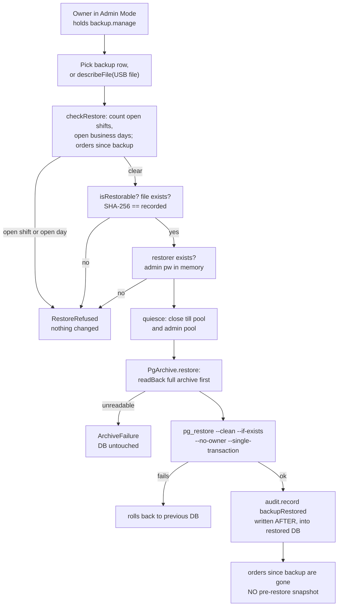

[CODE] `backup_service.dart:424-515`, `pg_archive.dart:231-262`.

Safety properties:

- Permission `backup.manage` (Owner). A restorer (`pos_admin` credentials) is held only while Admin Mode is open (`providers.dart:3124-3131`), although the password is on disk (section 3).
- Guards re-checked immediately before the restore. Blocked while **any** shift or business day is open. The blockers are branch-scoped; other branches on the same server are not considered, yet `--clean` replaces the whole database [CODE: the queries filter `branch_id`]. Status: risk for multi-branch servers.
- Archive read in full before any change. The restore itself is one transaction, so a failed restore leaves the previous DB.
- **No pre-restore snapshot is taken** (grep: `pre-restore`, `safety copy`, `snapshot` found nothing relevant). A successful restore of the wrong or stale file permanently discards everything after it. The UI warns with `ordersSince` and `valueSince`, but nothing saves the current state. The most recent automatic backup might be the only other copy.
- **Downtime.** Pools on the restoring till are closed. Other tills on the LAN are not notified and keep connections. During `--clean` in a single transaction they block or then see the old/new schema. Their behaviour after the swap (cached catalogue, in-memory ticket state) is UNKNOWN.
- The audit entry is written **after** the restore into the new database. If the machine loses power in between, the restore is not recorded (acknowledged in code comments). Because restore replaces `pos_audit_events` with the archive's version, audit rows between the backup and the restore are lost with the orders.
- A restore does not touch `secrets.json`, so the till's passwords must still match the roles in the restored dump (roles are cluster-level, not in a database dump; passwords are therefore not reset).
- Tests: `test/data/pg_archive_restore_test.dart`, `backup_restore_test.dart` (exist, not executed).

### 12.6 Recovering a lost till (client machine)

- A till holds no authoritative data in the "server + client" topology. Reinstall with the `Till only` type (`install-role.json` = `client_terminal`, `xorder-pos.iss:155-162`), then the wizard finds the server. It needs the `pos_till` password, which exists only in `install-credentials.json` on the server (admin-readable) and in the old till's `secrets.json`. The operator reads it on the server and types or copies the 24-character value.
- Cloud mode: a new device token must be issued by claiming a pairing code (`POS-BE-011`). The old token is "killed only by terminal revocation" in the cloud (UNKNOWN server behaviour). Until revoked, a stolen disk gives a working bearer token. The code comment says there is no TTL.
- Unsynced local sales: for a **server-with-DB machine**, they are in the DB. For a cloud single-till where the till machine **is** the DB host, losing the machine loses the unsynced outbox (see 12.7).
- Licence: tied to the installation id (`TerminalIdFingerprint`). A reinstall generates a new id, so the licence must be re-issued or re-activated [CODE: `providers.dart:1648`; server side UNKNOWN].

### 12.7 Recovering a lost server

```mermaid
flowchart TD
  S["Server lost"] --> Q{"Backup .dump available<br/>off-machine?"}
  Q -->|"No: backups were on same disk"| L["Total loss of local data;<br/>cloud holds only what was synced<br/>(outbox rows not delivered are gone)"]
  Q -->|"Yes: USB copy"| R["Run installer on new machine<br/>(fresh credentials generated)"]
  R --> T["New passwords for postgres,<br/>pos_admin, pos_till, pos_backup"]
  T --> U["Wizard: restore from file<br/>describeFile(path) + checksum"]
  U --> V["Every till: update host +<br/>new pos_till password"]
  V --> W["Orders after last backup lost,<br/>unless still in cloud outbox"]
```

- The installer creates new random passwords on a fresh machine, so every client till needs the new `pos_till` password (and `pos_backup` for the nightly copy) typed again. Nothing carries them across.
- `describeFile` accepts an external file, hashes it and relies on `pg_restore`'s own read to reject bad archives (`backup_service.dart:560-600`).
- If the data directory survives but `install-credentials.json` is lost, `provision.ps1` throws (line 150) and there is no password-reset path in the scripts. A technician with the Windows service account can edit `pg_hba.conf` to `trust` and reset, which is not documented in code. [ASSUMED]
- Sales not yet delivered to the cloud at the time of loss are lost. Cloud copies of delivered sales are authoritative only to the extent the backend keeps them (UNKNOWN).
- Setup rerun after restore: `pos_migrate` migrates forward only. Restoring an older dump onto a newer build is handled by the migrator applying pending versions, which has an advisory lock (`migrations.dart:4488`). Downgrade is not supported.

### 12.8 Setup interruption (summary only)

The credentials file is written **before** `initdb` so a half-finished install keeps its passwords. `provision.ps1` is idempotent ("every step looks before it acts"). The wizard persists claim progress in `setup_progress` so a restart between the single-use pairing code and "Open the till" resumes (`setup_progress_store.dart`). The device token is written the moment it is issued (`DeviceTokenVault.accept`). Depth belongs to the wizard audit.

### 12.9 Monitoring and diagnostics

| Mechanism | Present? | Evidence |
|---|---|---|
| Crash handler (`FlutterError.onError`, `runZonedGuarded`, `PlatformDispatcher.onError`) | **No** | grep over `lib/`, empty |
| Remote crash/telemetry (Sentry, Crashlytics) | **No** | grep over `lib/`, `pubspec.yaml` |
| Application log file | **No**; `debugPrint` / `dart:developer log` only | section 8 |
| Installer log | Yes: `%ProgramData%\XOrder POS\logs\provision.log`; Inno `/LOG` in CI | `provision.ps1:47` |
| DB health probe | `PosDatabase.probe()` returns a classified failure | `pos_database.dart:358` |
| Backup status | `pos_backups` table plus the Backup pane; failed copies recorded as rows | `backup_service.dart:_record` |
| Outbox backlog | `cloud_sync.dart` reads oldest pending `enqueued_at` for both outboxes; quarantined rows carry `quarantine_code` | `cloud_sync.dart:229-232` |
| Audit trail | `pos_audit_events` (admin entries, overrides, lockouts, backups, restore) | `admin_session.dart:402-420` |
| Postgres server logs | Default location in `pgdata/log`; no rotation or shipping configured in `provision.ps1` | UNKNOWN |

---

## 13. Dependency risk notes

Direct runtime dependencies (`pubspec.yaml`): `postgres ^3.5.12`, `dio ^5.11.0`, `cryptography ^2.7.0` (pure-Dart PBKDF2/Ed25519, which is slow for PBKDF2 and not constant-time hardened), `crypto`, `win32 ^6.3.0`, `ffi`, `window_manager ^0.5.2`, `file_picker ^12.2.0`, `excel ^4.0.6`, `csv ^8.0.0`, `connectivity_plus`, `path_provider`, `qr`, `menu_bar ^0.5.3`, `uuid`, `intl`, `go_router ^18`.

- Caret ranges plus a lockfile; `pubspec.lock` was not read, per CLAUDE.md. No vulnerability database was queried: no network and no `dart pub outdated`. So advisory status is **UNKNOWN**.
- Parsers of untrusted files: `excel` and `csv` (menu import, `lib/data/import/spreadsheet_reader.dart`) take admin-chosen files. Malformed `.xlsx` may be a zip-bomb vector; limits not assessed.
- `menu_bar` and `window_manager` are lower-assurance community packages with native code on the desktop. Not assessed.
- Flutter pinned in CI to 3.47.0 and PostgreSQL 16.11-1 with a SHA-256 pin (value in a repository variable, not visible here).
- Actions pinned by version tag, not by commit SHA.

---

## 14. Documentation versus code disagreements

| Claim | Where | What the code does |
|---|---|---|
| "The OS keystore and nowhere else: Keychain on macOS, DPAPI on Windows" | `lib/data/config/pos_db_secret_store.dart:1-9` | `FileSecretStore` is the only implementation bound in `main.dart`. No keystore package is in `pubspec.yaml`. |
| "Kept in the OS keystore … Keychain / DPAPI" | `providers.dart:2156-2159`; `providers.dart:671-672` | Same as above. |
| "a file is never an option — a bearer token in `config.json` is a bearer token in a support email" | `device_token_vault.dart:7-10` | Token is stored in `secrets.json`, a file. |
| "`pos_till` … the only one in the keystore"; "The admin credential … is never persisted — `PosDbSecretStore` only ever holds the till's" | `installer_credentials.dart:306-308`; `local_bootstrap.dart:~40` | `pos_admin` and `pos_backup` passwords are also persisted (`adminPasswordKey`, `backupPasswordKey`). |
| "The administrator's password is held in memory for a Management session and never written to disk" | `backup_service.dart:~100` | Contradicted by `providers.dart:3059-3078` (a decision of 12 Sep 2026 reversed the rule). The backup-service comment is stale. |
| `docs/pos/04-flutter-pos-architecture.md:135` ("flutter_secure_storage … DPAPI-backed"), `docs/pos/08-postgres-lan.md:154,296` | docs | Same contradiction. Docs not used as evidence. |
| `docs/pos/production-readiness.md:310` mentions Credential Manager via DPAPI | docs | Not checked in detail; this contradicts the code. |
| `README`/`CLAUDE.md`: "SHA-256 for the terminal fingerprint" | CLAUDE.md | `TerminalIdFingerprint` hashes the random installation id (`providers.dart:1648`). Consistent in effect, but it is not a hardware fingerprint. |
| `installer_credentials.dart` says the file is "locked … *before* `initdb`" | `provision.ps1:130-133` | The file is created first and ACL-restricted immediately after. Only a very small window, but not atomic. |

---

## 15. Risk register

Severity is the auditor's judgement. Status: OPEN unless stated.

| ID | Risk | Severity | Evidence | Status |
|---|---|---|---|---|
| R-01 | All DB and cloud credentials, including the **schema-owning `pos_admin` password**, are stored in plaintext `secrets.json`, with no ACL on Windows. | High | `file_secret_store.dart:106-190,183`; `providers.dart:3075` | OPEN |
| R-02 | 4-digit PIN keyspace makes stored hashes crackable offline. The `pos_till` role, `pos_backup` and every dump expose the hashes. | High | `pin_hash.dart:25,38`; `local_bootstrap.dart` `GRANT SELECT ON … pos_staff` | OPEN |
| R-03 | No lockout on the cashier lock-screen PIN; the Admin Mode counter is in-memory and per terminal. | High | `lock_screen.dart:51-75`; `admin_session.dart:213-220` | OPEN |
| R-04 | LAN database traffic is plaintext in the supported install: no `ssl=on`, `host` rather than `hostssl` rules, and operator-selected `SslMode.disable`. | High | `provision.ps1:159-168`; `pos_database.dart:293` | OPEN |
| R-05 | Audit log is not tamper-evident against the DB owner: triggers can be dropped, no hash chain, and restore replaces the table. The owner credential is on the till disk. | High | `migrations.dart:519-535`; R-01 | OPEN |
| R-06 | Restore takes **no pre-restore snapshot** and discards post-backup orders and audit rows. Open-shift guards are branch-scoped, but the restore is database-wide. | High | `backup_service.dart:424-515`; `pg_archive.dart:231-262` | OPEN |
| R-07 | Backups are unencrypted, on the same disk, and automatic only at day close. No off-site copy. Theft, ransomware or disk loss destroy data and backups together. | High | `backup_service.dart:662-680`; class header | OPEN |
| R-08 | Authorisation is enforced in client Dart code; the DB sees one shared role, so the actor in rows is caller-supplied. A modified client or a direct client with the till password can forge actors. `discount`, `price.override` and `payment.remove` have only UI-level gates. | Medium | `authorization.dart:62-70`; section 7.3 | OPEN |
| R-09 | Cloud till role can write `pos_staff` and the catalogue, so a stolen credential could elevate a staff row. It is mitigated by owner-role triggers and an unverified assumption of server authority. | Medium | `local_bootstrap.dart:876-925` | OPEN |
| R-10 | No cashier idle auto-lock. | Medium | greps in 7.4 | OPEN |
| R-11 | No update/rollback mechanism and no update-signature verification. Installer is signed only when a cert is configured. VC++ redist is downloaded without a hash check. | Medium | `windows-installer.yml`, 9 | OPEN |
| R-12 | Lost `install-credentials.json` with a surviving data dir blocks provisioning, with no scripted recovery. | Medium | `provision.ps1:148-151` | OPEN |
| R-13 | Short race window: the credentials file exists with inherited ACL before `icacls`. The superuser `--pwfile` sits in `%TEMP%` during `initdb`. | Low | `provision.ps1:132-147` | OPEN |
| R-14 | No crash handler, telemetry or application log file. Field failures are invisible. | Medium | section 12.9 | OPEN |
| R-15 | Pool reconnect semantics after a server restart are unverified. There is no retry in `runTx`; the in-flight request fails once. | Medium | `pos_database.dart:274-280,232+` | UNKNOWN |
| R-16 | No page checksums at `initdb`, no WAL archiving or PITR. Silent storage corruption is undetected and data loss equals the interval since the last backup. | Medium | `provision.ps1:141-144` | OPEN |
| R-17 | In-memory un-parked cart is lost on crash; the write-through cadence is untraced. | Low | section 12.1 | UNKNOWN |
| R-18 | `tillGrants` interpolates `role` and `database` into quoted identifiers without re-validation at the call site. | Low | `local_bootstrap.dart:660-661` | OPEN |
| R-19 | `NetworkLog` (debug only) prints pairing codes and licence keys in full, and unredacted string bodies. | Low | `network_log.dart:30-34,104` | ACCEPTED in code (debug) |
| R-20 | Cloud device token has no TTL and persists on disk. It is revocable only server-side (UNKNOWN). | Medium | `device_token_vault.dart:5-8` | UNKNOWN |
| R-21 | Dependency advisories not assessed (no network, no tooling). `excel`/`csv` import parsers handle admin-chosen files. | Low | section 13 | UNKNOWN |
| R-22 | Network printing (TCP 9100) and `winspool` RAW are unauthenticated and cleartext. A settings user can redirect receipts. | Low | `network_printer_ports.dart:108`; `winspool.dart` | OPEN |
| R-23 | Restore does not notify or fence other tills on the LAN. Their post-swap behaviour is untraced. | Medium | `providers.dart:3134-3138` (quiesce only local pools) | UNKNOWN |
| R-24 | The stale comments in section 14 will mislead the next maintainer into assuming a keystore exists. | Low | section 14 | OPEN |

---

## 16. What was searched and not found

`badCertificateCallback`, `SecurityContext`, `HttpOverrides`, `flutter_secure_storage`, `FlutterSecureStorage`, `CryptProtect`, `dpapi`; `lockout`, `attempts` on the cashier path; `inactiv`, `idleTimeout`, `autoLock`, `sessionTimeout` for cashiers; `FlutterError.onError`, `runZonedGuarded`, `PlatformDispatcher`, `sentry`, `crashlytics`; `pre-restore`, `safety copy`, `snapshot` in the backup code; `autoUpdate`, `appcast`, `sparkle`; hash-chain or signature on audit rows; `data-checksums`, `amcheck`, WAL archiving. None found in executable code. Absence is established only for `lib/`, `bin/`, `installer/` and `.github/`.

Not done: no secret-entropy scan, no dependency vulnerability lookup, no Windows ACL inspection, no `scripts/package_macos.sh` review, and no tracing of every screen's handling of a `PosDbException`.


---

<!-- ===== PART 10: GAPS_AND_OPEN_QUESTIONS.md ===== -->

# Gaps, risks and open questions

Consolidated from the topic documents (each finding there carries file:line evidence; IDs below point to them).
All evidence is **[CODE]** (static reading); nothing was executed. Backend/cloud/Vue behaviour is **UNKNOWN**.

## 1. Plan A / Plan B requirement gap matrix

| Requirement | Plan | Status | Gap (evidence in) |
|---|---|---|---|
| POS operates locally without internet | A, B | IMPLEMENTED | Sale commits to local PostgreSQL first (DATABASE_AND_SYNC §7) |
| Local transactions synchronised to cloud | A | PARTIAL | Orders, shifts, cash movements, refunds, customers upload; **stock, purchasing, voided orders do not** (DATABASE_AND_SYNC §0, §5) |
| Cloud authoritative on conflict | A | PARTIAL / not defined | Only *configuration* is cloud-authoritative (bootstrap wipe-and-reseed of catalogue). No transactional conflict resolution exists; server error codes are only classified; 6 codes quarantine, everything else retries forever; quarantined rows have no release path (DATABASE_AND_SYNC §5, §10) |
| Pending local sales protected from cloud overwrite | A | IMPLEMENTED for orders/outbox/shifts/refunds | Bootstrap never touches them. Risk: a catalogue `DELETE` can fail on FK for stocked products and is swallowed → stale menu (D9) |
| Completely local restaurant management | B | PARTIAL | Menu/staff/inventory/purchasing admin exists in-app; no BOM, stocktake, waste, adjustments (FEATURE_INVENTORY_ADMIN) |
| Multiple POS on restaurant LAN | B (and A) | PARTIAL | Shared PostgreSQL, no API, manual host entry, no discovery, one shared DB role, no failover, LAN TLS off by default (MULTI_DEVICE) |
| Automatic local backups | B | PARTIAL | Only after day-close (default on) or manual; same disk; no clock schedule; unencrypted; no off-box copy (OPERATING_MODELS Q10, SECURITY §10) |
| Offline licence activation/renewal by signed file or key | B | **PARTIAL (file) / NOT_IMPLEMENTED (key, renewal)** | Verifier + CLI issuer exist, but **no UI imports a `.xlic`**; typed key is exchanged online (LICENSING) |
| No operational cloud sync | B | IMPLEMENTED | Offline mode builds no cloud client and enqueues nothing |
| Switching plans | A↔B | NOT_IMPLEMENTED | Only Reset + wizard; cloud→offline strands unsent outbox rows and hides the count; offline→cloud does not backfill (OPERATING_MODELS Q4) |
| Licence decides operating model | A, B | PARTIAL | Licence `modes[]` restricts which wizard tiles are offered and vetoes opening a shift; the chosen mode is stored in `config.json` (LICENSING, OPERATING_MODELS Q2-3) |
| Device limit by licence | A, B | PARTIAL | `max_terminals` checked only in child-registration wizard by counting `pos_terminals` rows; no DB constraint, no runtime check, no retire path (MULTI_DEVICE §7) |
| Arabic default, switch in General Settings | UX | PARTIAL | Default is Arabic; switch exists in 3 other places but no screen called General Settings is the home; wizard language step only applies at `complete()`; bar toggle may be overwritten by draft (CURRENT_SETUP_WIZARD) |

## 2. Critical risk register (top items; full list: SECURITY_AND_RECOVERY §15, DATABASE_AND_SYNC §10)

| ID | Category | Risk | Severity |
|---|---|---|---|
| R-DATA-1 | Data loss | Restoring an older backup silently discards sales not yet uploaded; restore only blocks on open shift/business day, not on pending outbox rows (DATABASE_AND_SYNC D3) | High |
| R-DATA-2 | Data loss/dup | A 2xx reply with a non-JSON body (e.g. captive portal) marks an order as delivered (D4) | High |
| R-DATA-3 | Availability | Held/quarantined outbox rows (unknown menu item, unknown tender) have no release path and stay in the pending count forever (D1/D2) | High |
| R-DATA-4 | Data | No lease/backoff/attempt cap on outbox; a crash mid-send re-sends with the same key (safe only if the server dedups on that key — UNKNOWN) | Medium |
| R-DATA-5 | Data | Stock never syncs; refunds/voids do not restock; no recipes → sales and stock can drift (FEATURE_INVENTORY_ADMIN) | Medium |
| R-DATA-6 | Data | Backups live on the same disk as the database, automatic only at day close, unencrypted | High |
| R-DUP-1 | Duplication | Re-running offline wizard re-inserts `pos_terminals` rows (and consumes the device-limit count) | Medium |
| R-SEC-1 | Security | DB password, cloud device token, `pos_admin` and `pos_backup` passwords in plaintext `secrets.json`; no Windows ACL step; comments claim a keystore | High |
| R-SEC-2 | Security | 4-digit PINs (PBKDF2 120k) readable by the shared `pos_till` role → offline-crackable; cashier lock screen has no lockout; no idle auto-lock found | High |
| R-SEC-3 | Security | LAN PostgreSQL traffic plaintext by default (installer never sets `ssl=on`); one shared DB role for all tills; `terminal_id` client-asserted | High |
| R-SEC-4 | Security | Permissions are enforced in Dart on writes only; all Admin-Mode users share one DB credential; reads/export/terminal reset are UI-gated only | Medium |
| R-SEC-5 | Security | Licence: unsigned `licence_check.json` verdict cache can be edited to defeat suspension; clock rollback extends expired file licences; non-release builds trust an unsigned `issuer_public_key` in the licence file; fingerprint is a copyable random UUID | Medium (commercial) |
| R-SEC-6 | Security | Audit log: append-only by grant/trigger, but owner can drop trigger; restore replaces the table; no hash chain | Medium |
| R-AVAIL-1 | Availability | DB host down ⇒ no sales, no parking; no local fallback store, no failover | High (multi-till) |
| R-AVAIL-2 | Availability | Parked tables last-writer-wins, loaded once without refresh; settling a ticket deletes whatever is parked on that table | Medium |
| R-AVAIL-3 | Availability | Possible: an exception in the drain stops the auto-reschedule timer ([CODE], unconfirmed) | Medium |
| R-OPS-1 | Operations | No crash reporting, telemetry, log file, diagnostics screen, or support bundle; no update mechanism; no CI test gate | Medium |
| R-OPS-2 | Operations | App never runs migrations at launch; only wizard/claim/CLI/installer — an app upgrade against an older DB relies on those paths | Medium |

## 3. Documentation vs. code conflicts (do not rely on the docs for these)

See CURRENT_ARCHITECTURE §6 for the table (modes count, keystore claims, fingerprint, `hostssl`, wizard language timing,
cloud back office, licence server URL editability).

## 4. Not verifiable here (UNKNOWN)

* Everything server-side: `/api/pos/*` semantics (duplicate-key handling, price/total mismatch handling, unknown items),
  licence issuance/revocation, device token revocation, pairing, platform reporting, the Vue admin panel.
* Runtime behaviour: no test was executed; DB pool recovery after a PostgreSQL restart; behaviour of other tills after one
  restores a backup; macOS DB provisioning in practice; Android/iOS child-tablet UX; real printer behaviour.
* Dependency advisories; secrets entropy scan.

## 5. Questions for the Product Owner

**Operating model**
1. Must Plan B work with *no internet at all*, ever (air-gapped), including first activation? If yes, the offline
   activation/renewal flow (file import UI, request/response code) is net-new work.
2. Is a maximum offline period (`max_offline_days`) required in Plan A? In Plan B?
3. Is in-place switching between plans required? What must happen to unsent and historical sales?
4. Must the licence *select* the plan, or only *permit* plans (today: permits)?
5. Should "Cloud authoritative" apply to configuration only (today) or also to transactional data? Define, per entity
   (order, payment, refund, shift, stock movement, price, customer), who wins and what is audited when values differ.
   Confirm that pending local sales are never discarded.
6. Cloud-mode back office: is "tills have no back office, use the dashboard" intended (`router.dart:138-160`)?

**Data & sync**
7. Should voids and stock movements sync to the cloud? Who owns inventory in Plan A?
8. Who clears quarantined/held sync rows, and how (UI? support tool)? What should the cashier/manager see?
9. How must the server behave on duplicate keys, price/total mismatch, unknown items? (needs backend owner)
10. Is more than one cloud-mode till on one shared database officially supported (only the main device syncs)?

**Multi-device & availability**
11. Is failover/standby required if the server PC fails? What is the acceptable downtime per outage?
12. Must tables be exclusive to one till? Is live cross-till refresh required?
13. Is per-till DB credentialing or an API layer required, or is a shared role acceptable?
14. Should retired terminals free their licence seat? Should `max_terminals` also bind main devices and cloud mode?

**Backup & recovery**
15. Is an off-box, scheduled, encrypted backup mandatory for Plan B? Who is responsible for the destination?
16. Should restore be refused/warned when unsent sales exist?

**Security**
17. Is plaintext `secrets.json` acceptable, or must the OS credential store (DPAPI/Keychain) be used? Should the admin password be persisted at all?
18. Required PIN length and lockout policy; cashier idle auto-lock?
19. Must LAN database traffic be encrypted by default?
20. Is crash/diagnostic capture (log file, support bundle) required? Any privacy limits?

**Licensing**
21. Does production issue licences from the platform or via the CLI? Is the `features`/`branch_ids`/`max_users` entitlement set meant to be enforced?
22. How strongly must licences resist tampering (clock rollback, copied `config.json`)?

**UX / localisation**
23. Where exactly is "General Settings" (screen/menu) and should language also be chosen on the welcome/first wizard screen?
24. Arabic-Indic or Western digits (today Western only)? Receipt language rules?
25. Should the offline wizard read the installer's credentials file (today only the cloud path does)?

## 6. Recommended discussion order

1. **Define the data-authority policy** (Q5, Q7–Q9): it determines sync design, conflict handling and what "cloud authoritative" is allowed to touch.
2. **Plan B offline licence & renewal** (Q1–Q2, Q21–Q22): net-new flow, blocks Plan B go-to-market.
3. **Backup/restore & recovery policy** (Q15–Q16, R-DATA-1/6): data-loss exposure.
4. **Server/DB availability and LAN security** (Q11–Q14, Q19, R-AVAIL-1, R-SEC-3).
5. **Secrets and PIN/permission model** (Q17–Q18, R-SEC-1/2/4).
6. **Plan switching & device lifecycle** (Q3, Q14, R-DUP-1).
7. **Outbox operations tooling** (Q8, R-DATA-2/3/4): visibility and release path for stuck rows.
8. **Inventory scope** (Q7, R-DATA-5).
9. **UX/localisation decisions** (Q23–Q25) and diagnostics (Q20).

## 7. Addendum — sales-floor gaps and questions (from FEATURE_INVENTORY.md Part 1)

| ID | Gap / risk | Status |
|---|---|---|
| R-SALE-1 | Shift id captured with `ref.read` at provider build and not invalidated on shift open/close → sales/refunds may carry stale or NULL shift id and drop out of Z report / expected cash (runtime unverified) | Suspected defect |
| R-SALE-2 | Parked tickets restored after restart lose tax mode, tax groups, service charges and customer; `TaxConfig ==` ignores those fields | Suspected defect |
| R-SALE-3 | `TicketEngine.setLineNote` drops a line's combo / free-allowance snapshot | Suspected defect |
| R-SALE-4 | Business day is never opened by the app (no caller of `BusinessDayRepository.open`); the day-close blocker for unpaid orders is always 0 | Gap |
| R-SALE-5 | No persisted open-order lifecycle: abandoned/cleared unsent tickets leave no record (audit/loss-prevention gap) | Gap |
| R-SALE-6 | Order upload carries no customer reference; sale-to-customer link stays local | Gap |
| R-SALE-7 | Refunds and voids do not restock; no recipes → inventory drift | Gap |

Further product-owner questions:
26. Is a kitchen ticket / KDS / per-station routing required? (Today: not implemented.)
27. Is delivery (driver, zone, fee, status) in scope? Are merge / transfer / split-bill required?
28. Should the business day open automatically (or on first shift)?
29. Where do named discounts come from (no in-app writer today)? Who may author price overrides?
30. Is ETA e-invoicing signing/submission meant to live in this repo? Should card/wallet payments integrate with a terminal?
31. Should refunds restore stock? Is recipe/BOM-based inventory in v1?
