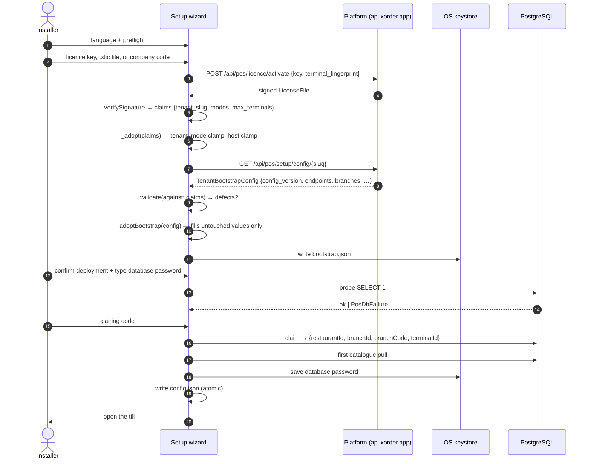
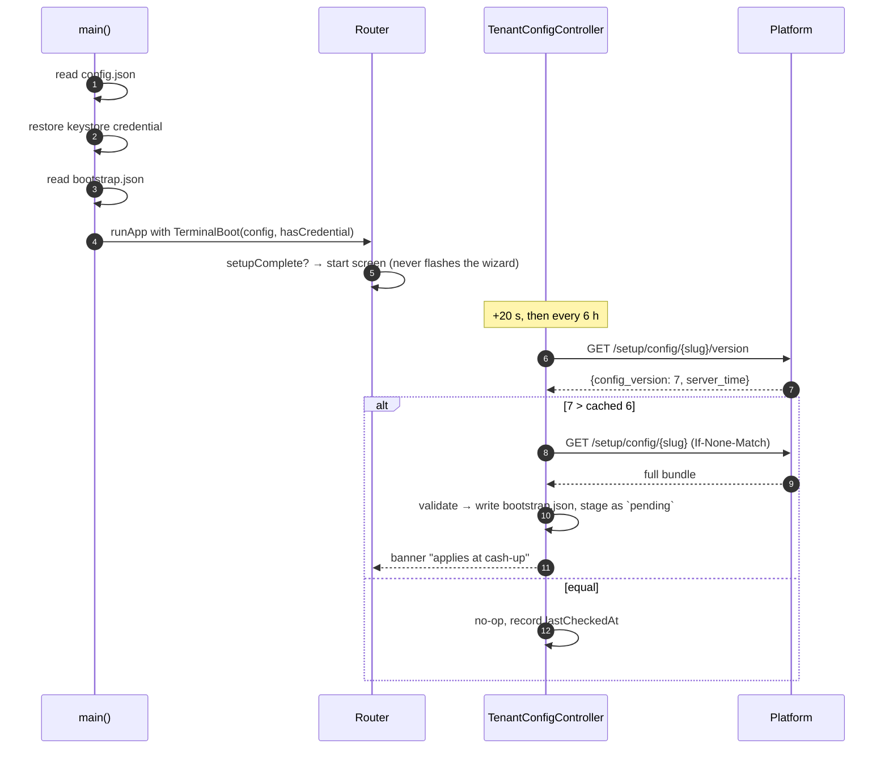
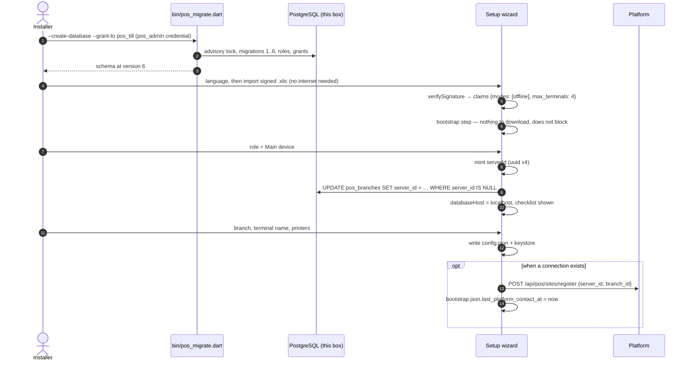

# 10 — Setup Architecture — bootstrap, site identity and recovery

**Status:** `PROPOSED` — design only. No client code has been written for it.
**Code today:** `lib/features/setup/`, `lib/features/licensing/`, `lib/core/config/`, `lib/data/config/`
**Backend:** POS-BE-025 … POS-BE-028, plus amendments to POS-BE-015 / 022 / 023
**Question this answers:** how does a blank machine become a till that can take
money — in both cloud and offline deployments — and how does it stay correct for
the next three years?

---

## 0. What already exists, and what this adds

This document is a **delta**. Most of the setup story is built and tested;
writing it again would be the expensive kind of thoughtless.

| Already built | Where |
|---|---|
| A 10-step first-run wizard with a step rail, per-step gating and disk persistence | `lib/features/setup/` |
| Signed, offline-verifiable licences with grace, warning and pinning | `lib/features/licensing/` |
| Config on disk (atomic write, tolerant read) + secrets in the OS keystore | `lib/data/config/` |
| Immutable `terminalId` and `installationId`, minted once, never reissued | `core/config/terminal_profile.dart` |
| A licence that supplies the tenant, the permitted modes and the seat count | `LicenseClaims` |
| Idempotent money writes and per-branch invoice sequencing, enforced by the database | migration 1 |

| This document adds | Section |
|---|---|
| Cloud bootstrap: fetch a tenant's configuration by slug, validate it, cache it | §6 |
| Configuration versioning and a background refresh that cannot disturb a shift | §7 |
| `ServerId` and an explicit main-device / client-terminal role | §4, §9 |
| Finding the main device on a LAN without typing an IP address | §10 |
| Three additive licence claims: offline window, site pin, claims version | §13 |
| The outbox drain design, and the conflict rules that govern it | §14, §15 |
| Eleven named failure scenarios with defined behaviour | §16 |

**The governing constraint, inherited and non-negotiable:** *never brick a till
mid-service.* Every mechanism below degrades to "the till keeps selling". A
configuration that will not download, a licence server that will not answer, a
cache that will not parse — none of them may stop a restaurant trading.

### Map to the requirement list

| # | Asked for | Section | Status |
|---|---|---|---|
| 1 | Flutter project architecture | §1 | exists |
| 2 | Wizard screens and navigation | §2 | extends |
| 3 | Data models | §3 | extends |
| 4 | Configuration models | §3, §6 | **new** |
| 5 | Terminal registration model | §5 | exists |
| 6 | Local database design | §8 | extends (migration 6) |
| 7 | Cloud config caching | §6 | **new** |
| 8 | Config versioning | §7 | **new** |
| 9 | Offline main-device architecture | §9 | **new** |
| 10 | Client terminal discovery | §10 | **new** |
| 11 | LAN communication | §11 | exists (Topology A) |
| 12 | Security architecture | §12 | extends |
| 13 | Offline certificate / signature | §13 | exists + 3 claims |
| 14 | Device identity | §4 | extends (`ServerId`) |
| 15 | Cloud ↔ local synchronisation | §14 | designed, blocked |
| 16 | Conflict resolution | §15 | **new** |
| 17 | Failure / recovery scenarios | §16 | **new** |
| 18 | Recommended packages | §18 | exists |
| 19 | Recommended backend APIs | §19 | **new** |
| 20 | Folder structure | §20 | extends |
| 21 | Sequence diagrams (six) | §17 | **new** |

---

## 1. Project architecture

Unchanged, and worth restating because everything below depends on it.

```
lib/
  core/      config, l10n, ui tokens, utilities — no feature knows about another
  domain/    entities, the pure TicketEngine, repository *interfaces*
  data/      postgres/ · config/ · fakes/ · hardware/ · network/  — implementations
  features/  setup/ licensing/ sale/ shift/ floor/ admin/ …  {domain,application,presentation}
  app/       providers, router, labels — the only layer that sees both domain and UI
```

Three rules that this design must not break:

**Nothing outside `lib/data/postgres/` imports the PostgreSQL driver.** That is
what makes an `Api…Repository` a swap at one provider rather than a rewrite, and
it is the entire Android migration path (§21, Phase 6).

**Display text never touches domain code.** A verifier decides *what is wrong*
and returns it as data; `app/labels.dart` turns it into an Arabic or English
sentence. Every new failure below therefore arrives as a case class, not a
string.

**Boot state is resolvable synchronously before the first frame.** `main.dart`
reads config and credentials *before* `runApp` so the router never paints the
wizard for one frame on a configured till. Any new gate obeys this or it is not
a gate.

---

## 2. Setup wizard

### The steps

One new step, `bootstrap`, inserted at index 2:

```dart
enum SetupStep {
  language,    // + preflight: what you need before you start
  licence,     // + a third input: company code
  bootstrap,   // NEW — download the tenant's configuration
  deployment,  // + main device / client terminal role
  account, branch, terminal, hardware, money, catalogue, summary;
}
```

**There is no `welcome` step, and there is no mode-choice screen before the
licence.** Both are deliberate.

`SetupStep.language` already *is* the welcome screen: it is where an installer
lands, and it gains a preflight card listing what they will need (a licence key
or file, the database password, the main device's address). Renaming it to
`welcome` buys a worse rail label — "Language" tells an installer what the
screen does, "Welcome" does not — and costs a churn through both string classes.

The cloud/offline choice is `SetupStep.deployment`, and it stays **after**
`licence`. That ordering is load-bearing in two directions and is documented as
such in `setup_state.dart`: the licence carries `tenant_slug`, so it *supplies*
the tenant rather than being checked against a guess; and it carries `modes` and
`max_terminals`, so the deployment step can offer only what the customer bought.
Moving the mode choice earlier resurrects precisely the bug that comment
describes — accepting a choice and rejecting it two screens later.

**Shipped 2026-09-06**, ahead of the `bootstrap` step above. The enum is now
`language, licence, setupType, deployment, account, …`: the mode choice is still
its own step rather than folded into `deployment`, but it sits *after* the
licence, which is the constraint this section exists to state. Two consequences
worth recording, because both reversed an earlier decision:

* **`visibleSteps` no longer hides the licence step for cloud.** It used to, on
  POS-BE-015 §5 — a cloud terminal receives its licence inside the bootstrap
  bundle at registration, so there was nothing to type. That rule became
  circular the moment the licence started deciding the mode: it hid the step on
  the strength of a mode the licence had not been read to determine. The bundle
  still delivers a cloud licence; what it no longer does is excuse a terminal
  from holding one before it picks how to run. The Super Admin issues the
  activation key with the tenant, so an installer on either path has one.
* **The licence is judged on the mode it grants, not on the draft's default.**
  `DeploymentConfig.unconfigured` is cloud, so an offline-only licence read at
  step 2 came back `modeNotLicensed` and stopped the wizard on the very screen
  meant to resolve it — while `_adopt` moved the draft to offline anyway,
  leaving a refusal on screen that no longer described the terminal.
  `SetupController._judgeOnCoveredMode` re-judges **only** that verdict, against
  the adopted config; expiry, tenant, signature and fingerprint stand as given.

The modes themselves are now chosen when the Super Admin creates the tenant —
`RestaurantForm.vue` submits `licence.modes`, which `StoreRestaurantRequest`
already validated and `RestaurantProvisioningService` already honoured. Before
that the form sent nothing and the server fell back to `['cloud']`, so an
offline deployment could not be sold from the creation screen at all.

### Slug-first, reconciled

The requirement is that an operator types a company slug and the application
fetches its configuration. The slug exists to answer one question: *which tenant
is this?* **The licence already answers it** — signed, offline-verifiable, and
issued to exactly one tenant. And POS-BE-015's contract already runs the arrow
the other way: the bootstrap bundle *carries* the licence, so a slug cannot be a
prerequisite for obtaining one.

So the config fetch keys on the slug the **licence supplied**, and in the normal
case the operator types nothing at all.

The genuine slug case — a cloud customer with no licence file, who expects the
platform to hand one down — does not get its own step. It gets a **third input
on the existing licence pane**, beside "type a key" and "paste a file":

> **Company code** → `GET /api/pos/setup/config/{slug}` → install the `licence`
> object from the response exactly as a pasted `.xlic` would be.

Three inputs, one step, one outcome: a licence is installed. The wizard does not
fork, which matters — its own comment says *"a wizard that forks is a wizard
that strands people"*, and the person working through it is often the restaurant
owner rather than a technician.

### Why `bootstrap` sits between `licence` and `deployment`

Because it *fills* the deployment step. The fetch needs only a slug and
`PlatformEndpoint.base` — a build constant, not device configuration — so it can
run the moment the licence lands, with zero typed input. What it returns is the
database host, name, port and user, the platform address, the sync policy, the
branch list and the printer defaults. `deployment` then becomes a
**confirmation with one blank field: the password.**

That is the same demotion `SetupMethod.pairingCode` already performs on `branch`
and `terminal`, and the wizard's own comment blesses it: *"a pairing code
pre-fills the branch and terminal steps, so those screens become confirmations
rather than questions — the same path, with the answers already written in."*

### How the two deployments differ without forking

`SetupStep.bootstrap.canAdvance => true`, unconditionally. Every terminal visits
the step; only what it *does* varies.

| | Cloud, online | Offline, or no internet at setup |
|---|---|---|
| Pane shows | "Configuration downloaded for Mahsoub Grill — 3 branches, version 7" | "No configuration downloaded. You will enter the database address on the next screen." |
| Fills | endpoints, branches, printers, features, money | nothing |
| Blocks the installer | never | never |

A bootstrap that cannot reach the platform **must never strand an installer
standing in a restaurant**. It degrades to the wizard that exists today.

### Precedence — written once so it cannot drift

Three things want to write `DeploymentConfig`, and the order matters:

1. **`_adopt(claims)`** — at the licence step. Sets `tenantSlug`, clamps `mode`
   to a licensed one, forces `databaseHost = localhost` on a one-terminal plan.
2. **`_adoptBootstrap(config)`** — at the bootstrap step. Fills only values the
   operator has not touched. **Never** overrides `mode` (the licence decides
   what is on offer; the operator decides among them) and **never** overrides
   `tenantSlug` (the licence owns it).
3. **Operator edits** on `deployment` — win over both.

`_adoptBootstrap` carries one hard guard: if `config.tenant.slug` does not equal
the licensed slug, the whole bundle is rejected. A bundle for another restaurant
must not be able to repoint a licensed terminal.

---

## 3. Data and configuration models

Three files on disk, three different owners, three different lifetimes. That
split is the design.

| File | Owner | Rewritten | Boot-critical | Contains |
|---|---|---|---|---|
| `config.json` | the operator | once, at setup | **yes** | `SavedTerminalConfig` |
| `licence.xlic` | the platform | on activation / renewal | no | signed `LicenseFile` |
| `bootstrap.json` | the platform | every refresh (~6 h) | no | `TenantBootstrapConfig` |
| OS keystore | the machine | on credential change | yes | DB password, installation id |

```dart
// core/config/terminal_config.dart — exists
class SavedTerminalConfig {
  static const currentVersion = 1;      // does NOT bump; see below
  final DeploymentConfig deployment;
  final TerminalProfile terminal;
  final String languageCode;
  final bool setupComplete;
  bool get isUsable => setupComplete && terminal.isSet && deployment.isConfigured;
}
```

`TerminalProfile` gains two fields, both pure additions:

```dart
final TerminalRole? role;    // 'role'      — see §9
final String? serverId;      // 'server_id' — see §4
```

**`currentVersion` does not bump.** Its own rule is *"bumped when a field's
meaning changes rather than when one is added"*, and nothing here changes a
meaning. But one subtlety must be handled or an in-place upgrade silently
mislabels every client terminal on every site:

> An absent `role` must **not** default to a constant. A v1 config on a client
> terminal has `database_host` pointing at a LAN box; defaulting to `mainDevice`
> would tell it that it owns a database it does not have. Resolve it in
> `SavedTerminalConfig.fromJson`, after both halves have parsed:
>
> ```
> role ??= deployment.isSingleMachine ? mainDevice : clientTerminal
> ```

Nullable in JSON, non-null after assembly.

### The bootstrap bundle

New `lib/core/config/tenant_bootstrap_config.dart` — `TenantBootstrapConfig`
plus `BootstrapTenant`, `BootstrapBranchSummary`, `BootstrapEndpoints`,
`BootstrapPosSettings`, `BootstrapPrinterDefault`, `BootstrapBranding`.
Hand-written `toJson`/`fromJson`, snake_case, tolerant readers — matching
`DeploymentConfig` exactly. **No codegen**; the repo has no `build_runner` and
this is not the feature that should introduce one.

```jsonc
{
  "config_version": 7,
  "last_updated_at": "2026-08-28T09:00:00Z",
  "server_time":     "2026-08-28T09:00:01Z",
  "last_platform_contact_at": "2026-08-28T09:00:01Z",   // client-written, not from the server

  "tenant":   { "id": 42, "slug": "cocoffee", "name": "Cocoffee",
                "tax_registration_number": "…", "currency": "EGP", "exponent": 2,
                "timezone": "Africa/Cairo", "default_language": "ar" },
  "branches": [ { "id": 7, "code": "MAADI", "name": "Maadi",
                  "supported_order_types": ["dine_in", "takeaway"] } ],
  "endpoints":{ "base_url": "https://api.xorder.app",
                "database_host": "192.168.1.10", "database_name": "xorder_pos",
                "database_user": "pos_till", "database_port": 5432, "verify_tls": true },
  "pos":      { "sync_policy": "automatic", "service_charge_percent": 12,
                "rounding": "none", "invoice_prefix_source": "branch_code" },
  "modules":  ["pos", "kds", "delivery"],
  "features": { "pos.split_tender": true, "pos.table_service": true },
  "printers": [ { "role": "receipt", "transport": "network",
                  "host": "192.168.1.50", "port": 9100, "copies": 1 } ],
  "app":      { "lock_after_seconds": 300, "shift_required": true },
  "branding": { "display_name": "…", "logo_url": "…", "accent_hex": "#C8102E" },
  "licence":  { "payload": "…", "signature": "…", "key_id": "v1" }
}
```

**`modules` versus the licence's `features` — state it once or it is
re-litigated in three places.** `modules` is what the tenant was *provisioned*
for; `features` is what they *paid* for. **The licence wins.** A module present
in the bundle but absent from a non-empty `features` set is not enabled.

---

## 4. Device identity

Four of the five identifiers already exist. `ServerId` is the addition.

| Identifier | Field | Type | Minted by | Immutable |
|---|---|---|---|---|
| TenantId | `TerminalProfile.restaurantId` | `int?` | server | yes, per install |
| *(tenant slug)* | `DeploymentConfig.tenantSlug` | `String?` | licence / bundle | **no — deliberately mutable** |
| BranchId | `TerminalProfile.branchId` + `branchCode` | `int?` / `String?` | server | per install |
| TerminalId | `TerminalProfile.terminalId` | uuid v4 | server on claim, else local | **yes** |
| InstallationId | `TerminalProfile.installationId` | uuid v4 | local, once | **yes — the hardest** |
| Display name | `TerminalProfile.terminalName` | `String` | operator | no, and never identity |
| **ServerId** | **new** `TerminalProfile.serverId` | uuid v4 | local, main device only | **yes** |

### Both "not identity" rules are already true — assert them, do not build them

**The slug is not identity.** `tenantSlug` lives on `DeploymentConfig`, which is
mutable and has a `copyWith(clearTenantSlug:)` escape hatch precisely so it can
be forgotten. What stamps every row is `restaurantId`, through
`posWriteContextProvider`. A slug change is therefore a configuration refresh,
not a re-registration — which is exactly what the requirement asks for. Add a
test asserting `posWriteContextProvider` never reads `tenantSlug`.

**The display name is not identity.** `terminalName` appears in
`pos_terminals.name` and on screens; no query filters on it. Add a test, because
this is the kind of invariant that erodes silently over a year of small changes.

### `ServerId`

- **Minted** by the main device, locally, `uuid.v4()`, at the moment
  `TerminalRole.mainDevice` is chosen — the same place and manner `terminalId`
  is minted in `setTerminalName`.
- **Stored** in `TerminalProfile.serverId` → `config.json` (it is not a secret),
  **and published** to `pos_branches.server_id` so client terminals can read it.
  First writer wins:
  `UPDATE pos_branches SET server_id = $1 WHERE id = $2 AND server_id IS NULL`.
- **Deliberately distinct from `installationId`.** `installationId` identifies
  the *box*; `serverId` identifies the *site's database*. A main device whose
  disk dies gets replaced, but the site's identity — what an offline licence
  binds `max_terminals` to — must survive the box, or every hardware failure
  becomes a licence support ticket. `server_installation_id` records which box
  currently hosts it, so "where is it actually running" stays answerable.
- **On a client terminal it is read, never minted.** Copied at setup, re-verified
  on every boot. A mismatch means this terminal is pointed at a *different
  site's database* — a mistyped octet on an estate with two restaurants, or a
  stale DHCP lease that landed on the neighbour's box. New
  `PosDbFailure.serverMismatch`; refuse to open, and name both ids.

### `TerminalReset`

Today `reset()` keeps `terminalId` and `installationId`. It must additionally
keep `serverId` **when `role == mainDevice`** — a reset exists to move a till to
another branch, not to orphan a site's database. On a client terminal `serverId`
is cleared and re-read. Cleared in both cases: `restaurantId`, `branchId`,
`branchCode`, `branchName`, `terminalName`, `provisioned`, `role`, and
`bootstrap.json` — the cache belongs to the tenant being left behind.

### A real gap this exposes

`TerminalProfileController.build()` mints a **fresh** `installationId` whenever
`config.json` is absent. So deleting or corrupting that file silently changes
the licence fingerprint — `sha256('xorder-pos-terminal:$id')` — and a
fingerprint-pinned licence stops matching. The operator is told
`LicenceOtherTerminal`, which are the wrong words for that cause and send them
hunting for the wrong problem.

**Fix:** mirror `installation_id` into the OS keystore under
`pos_terminal_installation_id`, via a `TerminalIdentityStore` sibling to
`PosDbSecretStore` (same Flutter-free contract, so `bin/` can still import the
chain). Resolution order becomes keystore → `config.json` → mint. Now *both*
must be lost before an identity changes.

---

## 5. Terminal registration

Already designed as POS-BE-023 and implemented client-side behind
`ProvisioningRepository`. Two paths, both landing on the same `pos_terminals`
row:

- **Pairing code (default).** The terminal row is created in the dashboard
  first; the till claims it with a short-lived, single-use code. The branch,
  name, `restaurantId`, `branchCode` and `terminalId` all arrive from the
  server, so Super Admin was tracking the till before the machine existed.
- **Manual.** Operator credentials; the till registers itself. **Failure does
  not block setup** — an installer standing in a restaurant with the server down
  must still finish, and the terminal registers at first sync.

The pairing code is the default because the alternative types a staff password
into a machine that lives in a public room and may be stolen. A code that
expires in a day is a much smaller thing to lose.

**The registration outlives the slug.** Registration binds `restaurantId`,
`branchId` and `terminalId`; none of them is derived from `tenantSlug`. Changing
the slug server-side is handled in §16.6 and is explicitly non-destructive.

---

## 6. Local database and the config cache

### Where the cache lives: a second file

New `bootstrap.json`, beside `config.json` and `licence.xlic` in
`getApplicationSupportDirectory()`, via `FileTenantConfigStore` copying
`FileTerminalConfigStore` verbatim — same atomic `.tmp` + rename, same tolerant
read collapsing every parse and IO error to `null`.

**Not embedded in `SavedTerminalConfig`,** despite that file's "one file, one
write" rule. That rule is about *facts an operator chose*: splitting those
creates half-configured states nobody picked. The bootstrap bundle is a server
document with its own version and its own refresh cadence. Embedding it would
make every background refresh rewrite the file that **gates boot** — so a power
cut during a routine 03:00 refresh could put a working till back into the
wizard. Separate file means separate failure domain: a corrupt `bootstrap.json`
reads as `null`, and the terminal boots on `config.json` alone with the branch
list falling back to the database and printer defaults falling back to
discovery. (This amends the comment in `terminal_config.dart` — see §22.2.)

**Not a Postgres table.** The cache's single most valuable field is
`database_host`. It has to be readable *before* the database is.

### Validation on receipt

`TenantBootstrapConfig.validate({against, cached}) → List<BootstrapDefect>` —
pure and unit-testable with no keys and no network, the same posture as
`LicenseVerifier.evaluateClaims`.

| # | Rule | On failure |
|---|---|---|
| 1 | `tenant.slug` equals the installed licence's `tenant_slug` | **hard reject** |
| 2 | `tenant.id` equals the stored `restaurantId`, if there is one | **hard reject** — this is what stops a mistyped slug repointing a live till at another restaurant's data |
| 3 | `config_version` is a positive int, and on refresh `> cached` | reject, keep cache |
| 4 | `branches` non-empty | reject |
| 5 | `database_host` non-empty, `database_port` in 1…65535 | reject |
| 6 | If the host is not private, `verify_tls` must be `true` | **hard reject** — a server must not be able to talk a till into plaintext over the internet |
| 7 | `currency` a 3-letter code, `exponent` in 0…4 | reject — money configuration is not optional |
| 8 | `licence`, if present, parses **and** verifies | accept the bundle **minus** the licence |
| 9 | Unknown keys and unknown `modules[]` entries | ignore — same forward-compatibility bargain `DeploymentConfig.fromJson` already makes with `sync_policy` |

**A bad bundle never overwrites a good cache.** At setup: an error bar, the step
still advances, the operator types the deployment by hand. At refresh: keep the
cached copy, record the defect, show a banner, back off. The till keeps selling
in every one of these cases.

### Migration 6

Appended to `posMigrations`, idempotent like every statement before it:

```sql
ALTER TABLE pos_branches
  ADD COLUMN IF NOT EXISTS server_id                uuid,
  ADD COLUMN IF NOT EXISTS server_installation_id   uuid,
  ADD COLUMN IF NOT EXISTS server_registered_at     timestamptz,
  ADD COLUMN IF NOT EXISTS last_platform_contact_at timestamptz;

CREATE UNIQUE INDEX IF NOT EXISTS pos_branches_server_id_key
  ON pos_branches (server_id) WHERE server_id IS NOT NULL;
```

And in `bin/pos_migrate.dart` `_grant()` — a **column-level** grant, so a till
can claim a site without gaining the ability to rename a branch:

```sql
GRANT UPDATE (server_id, server_installation_id, server_registered_at,
              last_platform_contact_at) ON pos_branches TO "$role";
```

> **Upgrade hazard, and it must be a documented step rather than a discovery.**
> `PosMigrator` runs DDL; `_grant()` runs only from `bin/pos_migrate.dart`. A
> site that upgrades the app without re-running the migrator will fail
> `server_id` writes with a permission error on an otherwise-working till.

---

## 7. Configuration versioning

### `config_version` is primary. The other two are not.

An integer, monotonically increasing per tenant, never reused.

**ETag is transport-coupled** — it dies the moment a bundle arrives by any path
other than HTTP, and this design has three: embedded in a licence activation
response, imported from a file, carried to an islanded site on a USB stick. Keep
it as a bytes-saving `If-None-Match` on the full GET; never let it decide
precedence.

**`last_updated_at` is a clock**, and clock skew is an enumerated failure
(§16.8). Comparing a server's clock against a till whose clock is wrong is how a
stale configuration wins. Keep it for display: *"Configuration last updated
26 Aug, 09:00."*

> **Rule: accept if and only if `incoming.config_version > cached.config_version`.**
> Equal is a no-op. Lower is a regression and is refused (§16.7).

Lightweight check — roughly 80 bytes:

```http
GET /api/pos/setup/config/{slug}/version
→ { "config_version": 7, "last_updated_at": "…", "server_time": "…" }
```

### Startup, given the synchronous constraint

`main.dart` gains exactly one more `await` before `runApp`, in the shape of the
two already there:

```
1. FileTerminalConfigStore.read()      (exists)
2. MutablePosDbCredentials.restore()   (exists)
3. FileTenantConfigStore.read()        NEW
4. runApp(ProviderScope(overrides: [ …existing three…,
     tenantConfigBootProvider.overrideWithValue(cached),   NEW — plain value, default null
     tenantConfigStoreProvider.overrideWithValue(store),   NEW
   ]))
```

**The router never reads the bootstrap cache.** `setupCompleteProvider` is
untouched, and a missing or corrupt cache is *not* an unconfigured terminal.
That is the constraint that keeps the first frame decidable synchronously.

### The background check

A `Notifier`-backed service, not a `FutureProvider` — a `FutureProvider` has no
schedule and refetches on every invalidation.

- `features/setup/domain/tenant_config_repository.dart` — the interface, so
  everything below builds against a fake:
  `Future<TenantConfigFetch> version(String slug)` and
  `fetch(String slug, {int? knownVersion, String? etag})`.
- `features/setup/data/platform_tenant_config_api.dart` — Dio,
  `validateStatus: (_) => true`, non-2xx as data. Copies `PlatformLicenceApi`.
- `features/setup/application/tenant_config_controller.dart` —
  `TenantConfigState { applied, pending, lastCheckedAt, lastError, refreshing, consecutiveFailures }`.

**Triggers:** 20 s after the first frame (never *at* it — it competes with pool
warm-up); every 6 h; on shift close; and a manual button in Management.
**Never on shift open** — that is the critical path of opening a restaurant.

**Backoff:** 30 s → 2 m → 8 m → 30 m → 2 h, capped, reset on success. Never more
than one request in flight. Two consecutive 404s promote to
`BootstrapSlugUnknown` (§16.6).

### A configuration change mid-shift

**Staged, never applied live.** The new bundle is written to `bootstrap.json`
immediately — it is the newest truth and a crash must not lose it — but
`TenantConfigState.applied` does not move. Everything downstream reads
`applied`, not the file. `applied = pending` happens at exactly three moments:
app start, shift close, and an explicit *Apply configuration update*. A banner
says *"New configuration available — applies at cash-up."*

Three carve-outs, stated so nobody reasons about them case by case:

- **`branding` and non-money `app` settings apply live.** A logo cannot corrupt
  a receipt.
- **Everything under `pos`, money and the catalogue waits for shift close.** A
  service charge that changes between ringing an item and settling it produces a
  receipt that does not reconcile.
- **`endpoints` never apply without a restart.** `PosDatabase` caches pools
  keyed on `host:port/db@user#passwordHash`; swapping the host under an open
  transaction is a lost sale. Banner: *"This terminal needs to be restarted to
  use the new database address."*

---

## 8. Local database design

Unchanged from Topology A: PostgreSQL is the primary store in every mode, on the
till for a single-terminal plan and on a shared box for a multi-terminal one.
Migrations are append-only integer versions of inline idempotent SQL, applied
under `pg_advisory_xact_lock` with a `schema_migrations` ledger, run at install
time with an admin credential — never by the till at boot.

Six guarantees are enforced by the database rather than hoped for by the client:
idempotency (`UNIQUE (restaurant_id, client_transaction_id)`), invoice
sequencing (`FOR UPDATE` inside the insert transaction), split tender as rows,
`bigint` minor units, one transaction per settlement, and migration serialising.

This document adds migration 6 only (§6).

---

## 9. Main device and client terminal

### Say plainly what the role is

Under Topology A there is **no bespoke local API tier for the POS, and none
should be invented.** But the role is more than "the box that runs PostgreSQL",
and the decision box in `08-postgres-lan.md` already says so:

> *A shared box still runs the whole `apps/api` stack, so the heartbeat, licence
> refresh, provisioning and the QR menu all still travel over HTTP to the same
> box, which forwards upstream. This is a hybrid, not an abandonment of the API.*

So the "Offline Server" is already sanctioned in substance. What is refused is a
**second**, POS-specific service invented alongside it. Only the money path goes
direct SQL.

| | Main device | Client terminal |
|---|---|---|
| Runs PostgreSQL for the site | yes | no |
| Runs the `apps/api` stack | yes | no |
| `deployment.databaseHost` | `localhost` | LAN address |
| Runs `bin/pos_migrate.dart` | at install | never |
| Touches the `pos_admin` credential | at install only | never |
| `serverId` | mints it, writes `pos_branches` | reads and verifies it |
| **Backups (`pg_dump -Fc`)** | **yes — its real second job** | n/a |
| Licence check-in | for itself only | for itself only |
| Sells | **yes — it is a till too** | yes |
| Drains the outbox | no special privilege (§14) | same |

### Reject the tempting check-in design

"The main device checks in on behalf of the site" makes a dead client terminal
invisible, and POS-BE-022 exists specifically to require per-terminal
`last_seen_at`. **Every terminal heartbeats for itself.**

What the main device *may* host is a shared value:
`pos_branches.last_platform_contact_at`, updated by whichever terminal most
recently reached the platform. `max_offline_days` is then judged against
`max(local, site)`. That is a read of one column, not a tier, and it stops a
client terminal being blocked because only the manager's PC has a working
uplink.

### The model

```dart
// lib/core/config/terminal_role.dart
enum TerminalRole {
  mainDevice('main_device'),
  clientTerminal('client_terminal');
  const TerminalRole(this.wire);
  final String wire;
  static TerminalRole? fromWire(String? v) => …;   // tolerant, like DeploymentMode
}
```

Chosen **inside the existing `deployment` step** as a `_ChoiceTile` pair, gated
on `SetupDraft.allowsSharedDatabase` (`maxTerminals > 1`). On a one-terminal
plan the question is not asked and the role is `mainDevice` — the controller
already forces `databaseHost = localhost` there.

Choosing **client terminal** reveals the host field and the *Find the main
device* button (§10). Choosing **main device** sets `databaseHost = localhost`
and shows a checklist: PostgreSQL installed, migrations run, port 5432 open to
the subnet, static IP or DHCP reservation, backup destination chosen. **No new
step and no fork** — the pane changes, exactly as `SetupMethod` already does two
steps later.

Invariant to assert in tests: `role == mainDevice ⟺ deployment.isSingleMachine`.

---

## 10. Discovery

**Recommendation: manual host entry stays the only *required* path. Add a "Find
the main device" button doing a /24 TCP sweep on port 5432. Do not add mDNS.**

The sweep is roughly forty lines, adds no dependency and no permission surface
beyond what connecting to PostgreSQL already needs, and the pattern is already
proven against real LANs in this codebase — `NetworkPrinterPorts` sweeps 254
hosts in parallel with a 300 ms timeout for printers on port 9100.

mDNS is rejected on evidence already recorded in `08-postgres-lan.md` §9:
`flutter_nsd` on Windows is a socket implementation that raises its own network
dialog, and multicast is the first thing a hardened restaurant switch blocks.
What it buys — name stability — a DHCP reservation buys for free, and §6 of that
document already mandates one. A PostgreSQL-side advertisement is circular: you
need the host in order to read it.

New `lib/data/network/postgres_host_scanner.dart` → `PostgresHostScanner`, with
the same injected interface-list seam that makes `NetworkPrinterPorts` testable.

**Two passes, and the second is what makes it usable.** Pass 1 sweeps the /24 on
5432. Pass 2 attempts a real connection with the typed credential and runs
`SELECT server_id, name FROM pos_branches LIMIT 1` — which is what distinguishes
*our* database from the accounting package's PostgreSQL on the same LAN. Result:
`DiscoveredSite { host, port, serverId, branchName, terminalCount }`.

Because pass 2 needs the password, **the button belongs below the password
field, not above it.**

### The macOS 15+ local-network prompt — now a deliverable

`08-postgres-lan.md` §4 records that a specific error message is needed and is
not built. This design is what forces it.

- The first connection to an RFC 1918 address triggers the system Local Network
  prompt. A /24 sweep triggers it immediately and unmistakably — 254 connections
  at once — which is *better* than discovering it later on a single silent
  connect.
- Denied once, it is silent afterwards and recoverable only through System
  Settings → Privacy & Security → Local Network.
- Add `PosDbFailure.localNetworkDenied`. Detection: every probe on an interface
  holding a valid private IPv4 fails within the timeout; or a single connect
  raises `OSError` `errno 65` / `ENETUNREACH` or `errno 1` / `EPERM` against a
  private address.
- Message, both languages: *"macOS is blocking XOrder POS from reaching devices
  on this network. Open System Settings → Privacy & Security → Local Network,
  turn on XOrder POS, then try again."*
- `NSLocalNetworkUsageDescription` must be added to `macos/Runner/Info.plist` —
  it is not there today. `com.apple.security.network.client` was added
  2026-08-26 and is fine.

Android note, design-only: raw TCP sweeps work without `NEARBY_WIFI_DEVICES`,
but are slow over metered or VPN interfaces. No blocker recorded.

---

## 11. LAN communication

Settled by Topology A and restated for completeness:

| Traffic | Transport | Why |
|---|---|---|
| Orders, payments, shifts, invoice numbers | **direct SQL** to the site's PostgreSQL | the database enforces idempotency and sequencing; a client cannot get them wrong |
| Catalogue, branches, staff, roles, tables | direct SQL | one writer, many readers |
| Heartbeat, licence refresh, provisioning, QR menu | **HTTP** to the site's `apps/api` | already the case; unchanged |
| Printing | raw TCP 9100 (ESC/POS) | `NetworkPrinterPorts` |
| Discovery | TCP sweep on 5432 | §10 |

TLS is required except where `allowsInsecureTransport` permits otherwise, and
that is narrow by construction: loopback always (traffic never reaches an
interface, and demanding TLS would mean every single-till install issuing itself
a certificate to talk to itself), or an explicitly-trusted RFC 1918 host. A
mistyped public hostname can never silently downgrade a till to plaintext.

---

## 12. Security architecture

### The storage split

| Class | Where | Mechanism |
|---|---|---|
| Endpoints, ids, branch, terminal name, role | `config.json` | plain, atomic write |
| Tenant configuration cache | `bootstrap.json` | plain, atomic write |
| Signed licence | `licence.xlic` | signature-protected, not secret |
| **Database password** | OS keystore | `flutter_secure_storage` |
| **Installation id** (new) | OS keystore | as above, mirrored to `config.json` |

Per platform: macOS Keychain (`accountName: io.xorder.pos`, legacy file
keychain, because a Developer ID build has no `application-identifier`
entitlement); Windows DPAPI via the Credential Manager backend; Android Keystore
/ `EncryptedSharedPreferences` when that target is built.

**The database password is deliberately absent from `DeploymentConfig.toJson`** —
it belongs in the keystore, not in a file a support engineer might email. That
rule extends unchanged to everything added here.

### Privilege

The till connects as `pos_till`, which holds `SELECT`/`INSERT` on the POS
tables, `UPDATE` on `pos_invoice_sequences` and `pos_outbox`, `USAGE` on the
sequences, and — new in migration 6 — `UPDATE` on **four named columns** of
`pos_branches`. No `DELETE` and no DDL anywhere. `pos_admin` is used at install
time only and never ships to a till.

### The one rule the bundle must not break

`PlatformEndpoint.base` is a **build constant**, not device configuration,
because an operator who could point licence activation at their own machine
would defeat the one check in the system that must not be operator-configurable.
The bundle now supplies `endpoints.base_url`, which introduces a third category
between build constant and operator input. The rule, written down here so the
distinction does not erode:

> **The bundle may set `DeploymentConfig.baseUrl` — the sync target. It must
> never influence `PlatformEndpoint.base` — licence activation and bootstrap.**

### Threats this design accepts

- **A stolen till yields a `pos_till` credential.** Mitigated by least
  privilege, not by secrecy: no `DELETE`, no DDL, no repricing.
- **A stolen till yields a licence file.** Mitigated by fingerprint pinning.
- **A malicious LAN operator can reach PostgreSQL.** Mitigated by requiring the
  password and by the operator's explicit TLS decision — not by obscurity.
- **An Android client would need that credential on a device that leaves the
  building.** Not mitigated. This is the trigger condition in §21, Phase 6.

---

## 13. The offline certificate

### It already exists, and building a second one is refused

The requirement asks for a signed offline certificate carrying LicenseId,
TenantId, BranchId, ServerId, AllowedTerminalCount, EnabledModules, IssuedAt,
ExpiresAt and LicenseVersion. **The licence already is that document** — signed,
offline-verifiable, and covering seven of those nine fields today:

| Asked for | Existing claim |
|---|---|
| LicenseId | `license_id` |
| TenantId | `tenant_slug` + `tenant_name` |
| BranchId | `branch_ids` — plural, which is strictly better |
| AllowedTerminalCount | `max_terminals` |
| EnabledModules | `features` |
| IssuedAt / ExpiresAt | `issued_at` / `expires_at` |
| ServerId | **new** — `server_id` |
| LicenseVersion | **new** — `license_version` |

Building a separate certificate alongside it contradicts POS-BE-022's own
instruction: *"please do not build a second enforcement path — one signed,
offline-verifiable document deciding all of it is why the licensing design is
simple."* Two documents means two expiry dates to reconcile, two revocation
paths, and a support call that begins "which one is wrong".

**This is a documented disagreement with the requirement as written.** If a
separate certificate is wanted regardless, that is an owner call and the design
changes here, not elsewhere.

### Three additive claims, and no re-signing

| Field | Key | Absent → | Note |
|---|---|---|---|
| `maxOfflineDays` | `max_offline_days` | `null` = unlimited | the server already emits it; the client has simply never read it |
| `licenseVersion` | `license_version` | `1` | claims-schema version, **not** a generation counter |
| `serverId` | `server_id` | `null` = not site-pinned | same semantics as an empty `fingerprints[]` |

**No licence needs re-signing.** The signature covers the payload bytes; this
change only *reads more of them*. Every default reproduces today's behaviour
exactly — the same discipline `fromJson` already applies to `grace_days`,
`warn_days` and `max_terminals`.

**If `license_version > supportedVersion`, do not deny.** Evaluate what you
understand and attach a notice. Refusing would brick a till holding a licence
issued for a newer build, which is the cardinal rule inverted.

### Two new states, four new notices

```dart
// LicenseState
offlineWindowExpired   // max_offline_days elapsed since last platform contact
siteMismatch           // a server_id claim that is not this site's

// LicenceNotice
final class LicenceOfflineCheckInDue    extends LicenceNotice { final int daysLeft; }
final class LicenceOfflineWindowExpired extends LicenceNotice { final int windowDays;
                                                                final DateTime lastSeenAt; }
final class LicenceSiteMismatch         extends LicenceNotice { final String licenceServerId,
                                                                             siteServerId; }
final class LicenceNewerThanApp         extends LicenceNotice { final int licenceVersion; }
```

The entitlement for `offlineWindowExpired` is **byte-identical to `expired`**:
`canOpenShift: false, canSell: true, canChangeConfiguration: false`. That is
precisely what POS-BE-022 asked for in prose — *blocks the next shift, never the
open one* — and it needs no new policy shape.

Cost in l10n: four arms in `LicenceNoticeText`, two in `LicenseStateHeadline`,
and six new getters across `AppStrings` / `EnStrings` / `ArStrings`. Cheap,
because the sealed hierarchy and exhaustive switches make every omission a
compile error rather than an Arabic screen with an English sentence in it.

### Where "last platform contact" lives

`bootstrap.json` → `last_platform_contact_at`. **Not** in the licence file — a
signed artifact is never rewritten — and **not** in `config.json`, which is
boot-critical and must not be rewritten hourly. A third reason the cache is its
own file.

`evaluateClaims` gains two optional parameters, `DateTime?
lastPlatformContactAt` and `String? siteServerId`, both nullable and both
meaning *cannot judge, do not deny*. The function stays pure and exhaustively
testable without keys.

---

## 14. Synchronisation

### Reference data, downstream

Pull, not push. `config_version` for the bundle (§7); the `revision` and
`updated_at` columns migration 5 already added for the catalogue, once
POS-BE-012 lands and `CatalogRepository.load({since})` stops ignoring its
parameter.

### Money, upstream

The outbox already exists and is half-built: migration 4 adds `pos_outbox`, and
a cloud sale claims a row **inside the same transaction that writes the order** —
one commit or neither, because an outbox row lost to a crash between two commits
is money the platform never hears about. `SyncPill` reads the real backlog, so
it survives a restart.

What is missing is the drain. Designed now, shipping dark:

- `SyncRepository` in `lib/domain/repositories/repositories.dart` —
  `claimBatch({limit})`, `markDelivered(id, {remoteRef})`,
  `markFailed(id, {code, message})`.
- `PostgresSyncRepository` reading
  `WHERE delivered_at IS NULL ORDER BY enqueued_at … FOR UPDATE SKIP LOCKED`.
  **`SKIP LOCKED` is exactly why draining is not a main-device privilege** — six
  tills can run the loop concurrently and safely, and no special box has to be
  alive for the site's money to move. Existing grants already cover it.
- `lib/features/sync/application/outbox_drain.dart`, driven by `SyncPolicy`:
  `automatic` → on reachability and every 60 s; `manual` → a button, and always
  offered at shift close, which the enum's own comment already promises.
- Response handling switches on the POS-BE-019 `code`: `SUBSCRIPTION_LAPSED` /
  `POS_FEATURE_DISABLED` → hold and keep retrying with a billing banner;
  `POS_CAPABILITY_MISSING` / `BRANCH_NOT_IN_TENANT` / `VALIDATION_FAILED` →
  quarantine that record and tell the manager. **Any unrecognised code retries
  later and is never discarded.**
- `delivered_at` is set, never deleted.

**Unblocked by:** POS-BE-018 (the endpoint) + POS-BE-007 (server-side
idempotency) + POS-BE-019 (error codes). POS-BE-021 makes a backlog fast but is
not required. Until then everything above ships against a fake and is fully
tested; only `ApiSyncTarget` is missing.

---

## 15. Conflict resolution

**These are two different problems with two different answers, and conflating
them is how a POS loses money.**

### Reference data — last-writer-wins on a monotonic integer

Configuration, catalogue, staff, roles, tables. One writer (the dashboard), many
readers. There is no conflict here, only staleness. Apply if and only if
`incoming.revision > local.revision`; ties are a no-op.

There is genuinely nothing to merge, because a cloud deployment has exactly one
author: the dashboard. **Do not build a merge path for data with one author.**

That instruction is the reason offline authoring (2026-09-06) is gated to
`DeploymentMode.offline` rather than offered everywhere. An offline till is also
single-author — itself — and never receives a bundle, so the two authors never
meet and no merge path exists to be built. A till that authored locally *and*
synced would need one, which is precisely what is not being built.

### Money — idempotent append, never merge

Orders, payments, shifts, cash movements. Many writers, one destination.
Last-writer-wins is meaningless: two sales are not two versions of one fact.

The mechanism already exists and is enforced by the database rather than hoped
for by the client — `UNIQUE (restaurant_id, client_transaction_id)` on
`pos_orders`, one outbox row per order, and `pos_invoice_sequences` locked
`FOR UPDATE` inside the insert transaction so a replay does not consume a
number. The drain resends the same `client_transaction_id`; POS-BE-007 must
return the original id **and** the original invoice number.

**Nothing is ever reconciled by comparing timestamps.**

---

## 16. Failure and recovery

| # | Scenario | Detection | Behaviour |
|---|---|---|---|
| 1 | **Keystore wiped or unavailable** | `hasDatabaseCredential == false` | Wizard, seeded from `config.json`, only the password blank. **Already built.** Gap: `main()` never reads `KeychainPosDbSecretStore.lastFailure`, so "no password stored" and "could not reach the keystore" are indistinguishable today — which is exactly what that field's comment says must not happen. |
| 2 | **`config.json` corrupt** | tolerant read → `null` | Boot to wizard. **New risk:** `installationId` regenerates and a pinned licence stops matching, reported as `LicenceOtherTerminal` — the wrong words. Mitigated by the keystore mirror (§4). |
| 3 | **Licence expires mid-shift** | `licenceEntitlementProvider` at boot and shift boundaries | Shift continues; next shift blocked; cash-up, reprint and export never gated. **Already built.** Add one rule: never re-evaluate on a timer during an open shift. |
| 4 | **Main device down** | `PosDbFailure.tcp` / `.dns` | **The client cannot sell.** This is accepted cost #2 of Topology A and the message says so plainly. Add: name the site from the cached `branch_name` and host; a *Retry* that drops the cached pool (`PosDatabase.invalidateHost()`); the cached bundle still renders the menu, so the operator can see it is the server and not the till. |
| 5 | **Wrong database password** | `PosDbFailure.auth` | A single-field re-entry dialog on the start screen that writes to the keystore. Do not send an operator through eleven wizard steps for one field. |
| 6 | **Slug changed server-side** | two consecutive 404s | **Nothing destructive.** The slug is not identity; the till keeps selling on `restaurantId`. Management banner plus a field for the new slug. Guard: the new bundle's `tenant.id` must equal the stored `restaurantId`. |
| 7 | **Config version regression** | `incoming < cached` | Reject, keep the cache, log. Banner after three consecutive — one is mirror lag, three is a rollback. **Never auto-downgrade**: a downgrade could restore a deleted branch or a withdrawn tender type. Escape hatch: an audited *Accept server configuration (version N)* in Management. |
| 8 | **Clock skew** | `server_time` on both endpoints and the heartbeat | > 5 min → persistent warning. > 24 h → refuse to **open** a shift (an invoice dated a day out is a tax problem), never refuse to sell in an open one. **Never silently correct the clock** — money timestamps come from the till and must stay auditable. A backwards jump counts as no progress for the `max_offline_days` window. |
| 9 | **Seat count exceeded** | claimed `pos_terminals` > `max_terminals` | **Warn, never refuse** — the backend already ruled seat counting advisory. Show it in **Management only**, never on the sale screen or in the wizard: a cashier cannot fix a licensing decision and must not be shown one. |
| 10 | **Schema newer than the client** | `MAX(version)` > `posMigrations.last.version` | **Do not migrate. Do not refuse to boot.** The list is append-only with `IF NOT EXISTS` throughout, so an older client's queries keep working. Record it, show it in Management. Refusing would take a whole site down because one till was not updated — the mixed-fleet risk amplified rather than contained. |
| 11 | **Bootstrap cache corrupt** | tolerant read → `null` | Boots on `config.json` alone; branches fall back to the database, printers to discovery. Never blocks. Refetches on the next scheduled check. |

Two operator-facing gaps this work closes on the way past:

- `SetupController._describe` holds four English sentences inline. On an Arabic
  till they render in English mid-screen — the exact failure that
  `LicenseEntitlement.notice`'s comment cites as the reason notices are data
  rather than sentences. They move to a `PosDbFailureLabel` extension in
  `labels.dart`.
- `KeychainPosDbSecretStore.lastFailure` is documented as read by the boot path
  and is not read at all. Wired in Phase 0.

---

## 17. Sequence diagrams

### 17.1 First cloud setup



Note the ordering at the end: **keystore and disk before the in-memory providers
are marked complete**, so a terminal that cannot save never reports a finished
setup it would lose on exit.

### 17.2 Cloud application startup



### 17.3 Offline main-device setup



### 17.4 Offline client-terminal setup

```mermaid
sequenceDiagram
    autonumber
    actor Op as Installer
    participant W as Setup wizard
    participant S as PostgresHostScanner
    participant DB as Main device PostgreSQL

    Op->>W: import the same signed .xlic
    W->>W: claims.max_terminals = 4 → allowsSharedDatabase
    Op->>W: role = Client terminal
    Op->>W: type the database password
    Op->>W: press "Find the main device"

    S->>S: pass 1 — sweep /24 on :5432, 300 ms each
    S->>DB: pass 2 — connect, SELECT server_id, name FROM pos_branches
    DB-->>S: {server_id, branch_name}
    S-->>W: DiscoveredSite(192.168.1.10, serverId, "Maadi")

    Op->>W: choose the site
    W->>W: databaseHost = 192.168.1.10, store serverId
    W->>DB: probe SELECT 1
    Op->>W: pairing code → branch, terminal id, branch code
    W->>W: write config.json + keystore

    Note over W,DB: every boot: re-read pos_branches.server_id;<br/>mismatch → PosDbFailure.serverMismatch, refuse to open
```

### 17.5 Configuration update

```mermaid
sequenceDiagram
    autonumber
    participant TC as TenantConfigController
    participant P as Platform
    participant F as bootstrap.json
    participant UI as Till

    TC->>P: GET /setup/config/{slug}/version
    P-->>TC: config_version 8 (cached: 7)
    TC->>P: GET /setup/config/{slug}
    P-->>TC: bundle v8
    TC->>TC: validate — slug, tenant.id, version>cached, tls, currency
    alt valid
        TC->>F: write immediately (newest truth; a crash must not lose it)
        TC->>TC: pending = v8 — applied stays v7
        TC-->>UI: banner "New configuration available — applies at cash-up"
        UI->>UI: branding applies live
        Note over UI: shift close → applied = pending
        opt endpoints.database_host changed
            UI-->>UI: "This terminal needs to be restarted"
        end
    else invalid
        TC->>TC: keep the cache, record the defect, back off
        Note over UI: the till keeps selling on v7
    end
```

### 17.6 Offline-to-cloud synchronisation

```mermaid
sequenceDiagram
    autonumber
    participant Till as Till (any, not just main)
    participant DB as PostgreSQL
    participant P as Platform

    Note over Till,DB: at settlement — one transaction or neither
    Till->>DB: BEGIN; bump invoice sequence FOR UPDATE;<br/>insert order + lines + payments; insert pos_outbox; COMMIT

    Note over Till: drain — automatic, or manual at shift close
    Till->>DB: SELECT … WHERE delivered_at IS NULL<br/>FOR UPDATE SKIP LOCKED LIMIT 50
    DB-->>Till: batch (disjoint from every other till's batch)
    Till->>P: POST orders {client_transaction_id, …}
    alt 2xx or duplicate
        P-->>Till: original id + original invoice number
        Till->>DB: UPDATE pos_outbox SET delivered_at = now()
    else SUBSCRIPTION_LAPSED / POS_FEATURE_DISABLED
        Till->>DB: markFailed — hold, keep retrying, billing banner
    else VALIDATION_FAILED / BRANCH_NOT_IN_TENANT
        Till->>DB: markFailed — quarantine, tell the manager
    else unrecognised code
        Till->>DB: markFailed — retry later, never discard
    end
```

---

## 18. Packages

**No new dependencies.** Everything above is buildable with what `pubspec.yaml`
already declares: `dio` (the config API, copying `PlatformLicenceApi`),
`flutter_secure_storage` (the installation-id mirror), `postgres`, `uuid`
(`serverId`), `path_provider` (`bootstrap.json`), `crypto` and `cryptography`
(signature verification), plus `dart:io` sockets for the scanner.

Two declared-but-unused packages are worth a decision, though not by this
document: `sqflite_common_ffi` (pubspec says "retained for the local outbound
queue", which `pos_outbox` in PostgreSQL has now made unnecessary) and
`connectivity_plus` (unused; `ConnectivityProbe` is still a fake).

Rejected: any mDNS package (§10), `freezed` / `json_serializable` (the repo has
no codegen and this is not the feature to introduce it), any local HTTP server
package (§9).

---

## 19. Backend APIs

Detailed wire shapes live in `docs/coordination/POS_TO_BACKEND.md`. Summary:

| Id | Ask | Priority | Blocking |
|---|---|---|---|
| **POS-BE-023** *(amend)* | Add a **pre-auth, redacted** sibling `GET /api/pos/setup/config/{slug}` | HIGH | NO |
| **POS-BE-025** | Version endpoint + conditional fetch + a monotonic `config_version` | HIGH | NO |
| **POS-BE-026** | Site registration and `ServerId` | MEDIUM | NO |
| **POS-BE-027** | Three licence claims — **amends the READY POS-BE-015** | MEDIUM | NO |
| **POS-BE-028** | Terminal display-name update, decoupled from identity | LOW | NO |
| **POS-BE-022** *(amend)* | Specify the heartbeat **response** | HIGH | NO |

**Is the slug endpoint just POS-BE-023 renamed?** Almost — and the difference is
the whole point. `GET /api/pos/bootstrap` requires the device credential, which
does not exist before a terminal has claimed. The slug endpoint must be
reachable by a machine holding nothing at all. Same document, different auth,
different moment in time. So it **extends POS-BE-023** rather than opening a
rival id.

**The single highest-leverage ask in the list is the POS-BE-022 amendment.** One
response body — `{server_time, site_last_contact_at, licence_expires_at,
config_version, terminal_status}` — makes the heartbeat double as the
config-version check *and* the clock-skew probe, deleting an entire polling loop
from the client and a whole endpoint's traffic from the server.

---

## 20. Folder structure

```
lib/core/config/
  tenant_bootstrap_config.dart              NEW   bundle + sub-models + validate()
  terminal_role.dart                        NEW   TerminalRole
  terminal_profile.dart                     CHG   +role +serverId
  terminal_config.dart                      CHG   role default derivation; version unchanged
  platform_endpoint.dart                    CHG   +setupConfig(slug) +setupConfigVersion(slug)
lib/data/config/
  tenant_config_store.dart                  NEW   TenantConfigStore + FileTenantConfigStore
  terminal_identity_store.dart              NEW   installation-id keystore mirror
lib/data/network/
  postgres_host_scanner.dart                NEW   two-pass /24 sweep on 5432
lib/data/postgres/
  postgres_sync_repository.dart             NEW   FOR UPDATE SKIP LOCKED (phase 5)
  migrations.dart                           CHG   PosMigration(6, …)
lib/data/fakes/
  fake_tenant_config_repository.dart        NEW
lib/features/setup/
  domain/setup_state.dart                   CHG   +SetupStep.bootstrap, +role, +bundle
  domain/tenant_config_repository.dart      NEW   the interface
  data/platform_tenant_config_api.dart      NEW   Dio (new dir, mirrors licensing/data/)
  application/setup_controller.dart         CHG   +_adoptBootstrap +setRole +fetchBootstrap
  application/tenant_config_controller.dart NEW   scheduled refresh + staging
  presentation/setup_panes.dart             CHG   _BootstrapPane, role tiles, Find button
lib/features/sync/                          NEW FEATURE (phase 5)
  domain/outbox.dart · application/outbox_drain.dart · presentation/sync_status_card.dart
lib/app/
  providers.dart                            CHG   4 new providers; reset keeps serverId
  labels.dart                               CHG   +PosDbFailureLabel, +6 notice/state arms
bin/pos_migrate.dart                        CHG   column-scoped grants on pos_branches
macos/Runner/Info.plist                     CHG   NSLocalNetworkUsageDescription
docs/pos/10-setup-architecture.md           NEW   this document
```

---

## 21. Phased build plan

Each phase is independently shippable. The unblocked, highest-value work is
first.

### Phase 0 — close the two gaps POS-BE-015 already named · **done, 2026-08-28, except the key**

| | |
|---|---|
| ✅ `max_offline_days` + `license_version` | Parsed tolerantly in `LicenseClaims`, with `supportedVersion` and `isNewerThanApp`. Parsing is genuinely tolerant — a wrongly-typed value falls back to the default rather than throwing, because `claimsOf` turns a throw into `LicenceFileDamaged`, which refuses trade. These are the two claims a newer issuer is most likely to send in an unexpected shape. **The window is parsed, not yet enforced**; enforcement is Phase 3 and needs `last_platform_contact_at` from Phase 2. |
| ✅ `DefaultLicenceService` in release | Already bound. The change-log note claiming otherwise was stale. |
| ✅ `lastFailure` wired into the boot path | `PosDbSecretStore.lastFailure` is now on the contract (still Flutter-free), surfaced as `MutablePosDbCredentials.storeUnavailable` → `TerminalBoot.credentialStoreUnavailable` → a warning above the password field. Routing is unchanged: both causes still go to the wizard. What changed is that the wizard can now tell an installer *this machine cannot keep a password* rather than silently accepting one that will be gone tomorrow. |
| ⛔ **Real Ed25519 public key** | **Blocked, and not blockable from this repository.** `LicenseKeys.currentB64` is the development pair's public half. The issuer owns the release pair: run `php artisan licence:keygen`, embed the public half here *before* anything is signed with it. Release blocker. |

*Tests added:* the *offline window and claims version* group in
`test/features/licensing_test.dart` (7 tests, including a signed fixture proving
no existing licence needs re-signing) and two in `setup_persistence_test.dart`
distinguishing an empty keystore from a broken one. Suite green at 222 passing.

### Phase 1 — site identity · **unblocked locally**
`TerminalRole`, `serverId`, the installation-id keystore mirror,
`PosMigration(6)` and the column-scoped grants.
*Tests:* new `site_identity_test.dart`; extend `setup_persistence_test.dart`
(role round-trips; an absent role on a LAN host reads as `clientTerminal`) and
`postgres_permissions_test.dart` (the till can set `server_id`, cannot set
`name`).
*Server-side visibility needs POS-BE-026.*

### Phase 2 — config cache, versioning and the bootstrap step · **ships against a fake**
Everything in §6 and §7. Real data needs POS-BE-025 and the POS-BE-023
amendment; the entire client half builds and is tested before either exists.
*Tests:* new `tenant_config_test.dart` (validation matrix, version regression,
mid-shift staging); extend `setup_wizard_test.dart` (11 steps, `bootstrap` never
blocks) and `setup_persistence_test.dart` (a corrupt cache still boots the till).

### Phase 3 — offline window and site pinning · **testable today**
Two states, four notices, EN and AR, `evaluateClaims` +2 optional params, the
site last-contact column. Real licences need POS-BE-027; self-signed fixtures
cover it now.
*Tests:* extend `licence_renewal_test.dart` and `start_gate_test.dart` — window
expiry blocks the *next* shift and never the open one.

### Phase 4 — discovery and the macOS local-network message · **unblocked**
`PostgresHostScanner`, `PosDbFailure.localNetworkDenied` and `.serverMismatch`,
`PosDatabase.invalidateHost()`, `NSLocalNetworkUsageDescription`, and moving
`_describe`'s four English sentences into `labels.dart`.
*Tests:* new `host_scanner_test.dart` modelled on `network_printer_test.dart`;
an `integration_test/` case for the permission path.

### Phase 5 — outbox drain · **blocked, ships dark**
`SyncRepository`, `PostgresSyncRepository`, `lib/features/sync/`.
*Tests:* extend `postgres_integration_test.dart` — two concurrent drainers claim
disjoint batches.
*Blocked on POS-BE-018 + 007 + 019.*

### Phase 6 — Android · **design only, nothing built**

> **Trigger condition, recorded now: the first non-desktop client.**

At that moment Topology A stops being defensible, because an Android client
would need the `pos_till` credential on a device that leaves the building —
`08-postgres-lan.md` §12 step 5 already says the A-versus-B decision must be
taken before any non-desktop client exists.

The response is not a redesign. `ApiOrdersRepository` and its siblings are
written against POS-BE-006/007/009 and swapped in at the repository providers,
and the main device serves them from the `apps/api` stack it already runs. **Nothing
in `lib/domain/` or `lib/features/` changes.**

**Preserving that seam is a hard constraint on every phase above: no new code
outside `lib/data/postgres/` may import the PostgreSQL driver.**

---

## 22. Where this contradicts something already decided

Recorded rather than quietly overridden. Each needs an amendment at the source.

1. **`setup_state.dart`'s "one linear path" comment.** The wizard goes from ten
   steps to eleven, including on offline terminals where the new step does
   little. The no-fork rule is honoured, but the wizard is longer. **Owner
   call.**
2. **`terminal_config.dart`'s "one file, one write"** explicitly rejects
   splitting configuration across files. This adds `bootstrap.json`. The
   rationale differs — server-owned, high-frequency and non-boot-critical, as
   against operator-chosen and boot-critical — but that comment must be
   **amended**, not contradicted in silence.
3. **`08-postgres-lan.md` §12 step 5** is a live action item: *decide A versus B
   before any non-desktop client exists.* This document defers the decision with
   a trigger condition instead of taking it. A deliberate deferral of a recorded
   commitment.
4. **`_grant()`'s comment** — *"a credential sitting on a machine in a public
   room should not be able to reprice the food"* — is widened by granting the
   till `UPDATE` on `pos_branches`. Scoped to four named columns, but still a
   widening of an emphatic rule.
5. **Migration 6 does not apply its own grants** (§6). A documented upgrade
   step, not a discovery in the field.
6. **POS-BE-022's "a branch server with no upstream configured is no longer
   offered."** This design requires the wizard to finish on a site with no
   internet at setup time. Reconciled by `max_offline_days` — contact is
   required *eventually*, not at setup — but a strict reading says otherwise.
7. **`PlatformEndpoint`'s comment** on activation never being
   operator-configurable. The bundle introduces a third category between build
   constant and operator input; the governing rule is written down in §12.
8. **The requirement's separate "offline certificate" is refused** in favour of
   three new licence claims (§13). Consistent with POS-BE-022's own instruction
   not to build a second enforcement path — but it was asked for by name.
9. **`SetupStep.licence`'s comment** says the licence is what constrains the
   deployment step. After this change two things do, in a defined order (§2).
   The comment needs extending or the precedence rule will be re-derived
   incorrectly later.
10. **`TerminalReset`'s comment** treats `terminalId` as the single sticky
    exception. `serverId` becomes a second, so resetting a main device does not
    free it to join another site without a manual clear.
11. **The requirement's endpoint path `/setup/config/{slug}`** does not match the
    API's `/api/pos/…` prefix. The prefixed form is recommended.
12. **`start_screen.dart` invalidates `licenceEntitlementProvider` on build.**
    With `offlineWindowExpired` live, licence evaluation stops being a pure
    function of `licence.xlic` + `config.json` and starts depending on
    `bootstrap.json` too.
