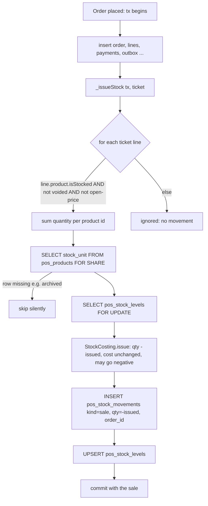

# FEATURE_INVENTORY part 2 — Management / back office

Scope: `lib/features/admin/**`, `lib/features/settings`, `lib/features/history`, `lib/domain/repositories/admin_repositories.dart`,
`lib/data/postgres/postgres_*admin*`, catalog admin, purchasing/stock repositories, reports, backup (summary), diagnostics, audit.
Method: read-only audit of code and SQL in `lib/data/postgres/migrations.dart`. Nothing was executed (no Flutter/Dart/PostgreSQL in the sandbox).

Evidence levels: **[CODE]** read in source; **[ASSUMED]** inferred, not verified; **[OBSERVED]** none (nothing could be run).
Test statements are "test exists (not executed here)". `docs/` and code comments are never used as proof; where they disagree with code this is flagged **DOC≠CODE**.
Status labels: IMPLEMENTED | PARTIAL | NOT_IMPLEMENTED | UNKNOWN.

---

## 0. The five facts that shape everything below

1. **A cloud terminal has no back office at all.** `lib/app/router.dart:138-160` (CB-07): if `mode == cloud` and a `tenantSlug` is set, the `/management` route returns `CloudBackOfficeScreen` — a signpost with the dashboard address (`cloud_back_office_screen.dart:90-107`, `<slug>.<host>/admin`) and a copy button. No pane is reachable. All "on a cloud till this pane is hidden/read-only" logic inside `ManagementScreen` (`_authoringPanes`, `platformAuthoredPointer`, `hiddenBecausePlatformAuthors`, cloud branches of the Sync/Customers/Receipt panes) is therefore only reachable in tests that mount `ManagementScreen` directly, or on a cloud-mode machine with no tenant slug. **DOC≠CODE**: pane doc-comments and `docs/pos/16`/`19` describe cloud-till panes as present-but-restricted; the router makes the whole back office absent for a claimed cloud till. [CODE]
2. **Authorisation is application-level.** Every admin write checks `Authorization.check(by, capability)` inside the Dart repository, but all Admin-Mode users share ONE database credential (the `adminDatabaseUser` role). PostgreSQL itself does not know which person is acting; it only separates "till role" (limited grants) from "admin role". Capability gates in Dart can be bypassed by anything with the admin password (which is stored on disk, see §9). [CODE]
3. **Stock is only decremented at sale for products flagged `is_stocked`, one whole unit per quantity. There is no recipe/BOM, no stocktake, no waste, no adjustment writer, no transfer, and refunds/voids do not restock.** (§3.)
4. **Many "settings" keys have readers but no UI writer** (`pos_settings`: day start, refund policy, cash policy). Only backup keys are written from the UI. No currency picker exists; currency defaults to `EGP`/exponent 2 in code. (§7.)
5. **No crash reporting, no telemetry, no log files, no support bundle, no diagnostics screen.** Only a dev-build HTTP console log. (§10.)

---

## 1. Shell, navigation and Admin Mode (door)

| Feature | Where | Status | Behaviour / limitations | Tests (not executed here) |
|---|---|---|---|---|
| Back-office shell with 10 tabs (Home, Sales, Reports, Menu, Inventory, Purchasing, Finance, People, System, Settings) | `management_screen.dart:262` `BackOfficeTab`; `tabOf` (:296); `ManagementPane` enum :1118; `managementPanesFor` (:~125) | IMPLEMENTED (offline mode) | Nav is the window menu bar (`app.dart` `_managementMenus`), only shown inside Admin Mode. 40-odd panes. Panes filtered by `_paneRequires` (:999) via `admin.can`. | `test/features/back_office_shell_test.dart` (ten tabs in order; every Settings pane under a Settings item; all pages lay out in en/ar; a table-driven check that bar == `managementPanesFor`) |
| Admin Mode door: username + 4-digit PIN + capability `admin.enter` | `admin_session.dart:267` `AdminSessionController.signIn`; `checkStaffPin` :139; UI `admin_sign_in.dart`; shortcut `admin_shortcut.dart` | IMPLEMENTED | Hidden shortcut (default chord; configurable per till via `AdminModeSettings`). Same refusal for wrong PIN / wrong username / no permission. Owner is let in before migration 46 grants `admin.enter` (`_ownerBeforeTheGrant`). Entry, exit, timeout, refusal and lockout each write an audit row. If the audit row cannot be written, entry is refused. | `test/features/admin_session_test.dart`, `admin_entry_test.dart`, `management_gate_test.dart`, `data/admin_enter_migration_test.dart` |
| Lockout | `admin_session.dart:203-212` | PARTIAL | 5 wrong tries -> 30 s, doubling per lockout to 15 min cap; counted per terminal, **in memory only** (restart clears it). Lockout audited only if the username names a real person. | `admin_session_test.dart` groups "too many wrong PINs" |
| Inactivity timeout | `admin_session.dart` `locksAt/isIdle`, `admin_activity_watch.dart`; setting in terminal `config.json` (`AdminModeSettings`) | IMPLEMENTED | Ends session, forgets admin DB credential. Locking the till also ends Admin Mode. | `admin_session_test.dart` "the end of it"; `admin_entry_test.dart` "the timeout" |
| Admin DB credential per session | `providers.dart:2226` `adminDbCredentialProvider`; `adminPosDatabaseProvider` :2242; `adminPasswordProbeProvider` | IMPLEMENTED | Second connection pool as `adminDatabaseUser`; credential held in memory only during session. Loaded from `adminDbSecretStoreProvider` (`providers.dart:3075`, `FileSecretStore` in `secrets.json`). Door also runs pending schema migrations (`schemaUpgraderProvider`). | `admin_session_test.dart` "the back-office database password" |
| Manager gate on the *till* (not Admin Mode) | `supervisor_override.dart:249,293` `SupervisorOverrideDialog`; `Authorization.approve/authorize` (`authorization.dart:~190-300`) | PARTIAL | PIN-only (no username) matched against all active staff (`byPin`, `postgres_admin_repositories.dart:407`). Approval is an in-process `Approval` object, single use, bound to capability and optional subject; approver re-checked at write time. **The "five attempts then the keypad stops" is NOT enforced**: `_used` only changes the message (`supervisor_override.dart:249,272,328-333`); `_canApprove` ignores it; closing/reopening the dialog resets it. No test asserts exhaustion. | `test/features/manager_approval_test.dart` (counts down to "one attempt left"; no lock test), `domain/authorization_test.dart` |
| Cloud-tenant back office | `router.dart:138-160`, `cloud_back_office_screen.dart` | PARTIAL by design | Signpost only (see §0.1). | `test/features/cloud_back_office_test.dart` (only `dashboardAddress()` string building) |

Till-level (non-admin) PIN checks: `PostgresSessionRepository._match` (`postgres_directory_repositories.dart:428`) hashes every active staff row (PBKDF2-HMAC-SHA256, 120 000 iterations, `lib/core/security/pin_hash.dart`) and compares in constant time. **No lockout or rate limit on the lock screen / shift-open sign-in** (searched `lockout|attempts|failed` in `lib/features/lock`, `shift_dialogs.dart`: none). PIN length is fixed at 4 digits (`PinRules`).

---

## 2. Menu / catalogue administration

All catalogue writes are in `PostgresCatalogAdminRepository` (`postgres_catalog_admin_repository.dart`, 2 409 lines), bound only when `mode == offline` and a DB exists (`providers.dart:2458`; returns null otherwise -> panes disappear). Guard `_blocked()` (:70-82): offline only, admin credential held, `catalog.manage` (money/tax/tender/order-type/tables use `settings.manage`). All writes run in a transaction, audited to `pos_audit_events`, and use optimistic `revision` columns (`EditedElsewhere`).

| Feature | Where | DB tables | Permission | Status | Notes | Tests |
|---|---|---|---|---|---|---|
| Categories (create/rename/archive/restore) | `saveCategory`, `archiveCategory`; pane `management_menu_pane.dart` (1 252 lines) | `pos_categories` | `catalog.manage` | IMPLEMENTED | Never deleted. | `data/postgres_catalog_admin_test.dart`, `features/catalog_refusals_test.dart` |
| Items/products (name EN/AR, price, discounted price, SKU, barcode, availability, tax group, stocked flag + stock unit) | `saveProduct` :369, `archiveProduct`; price change audited as `product.repriced` | `pos_products` | `catalog.manage` | IMPLEMENTED | Discount > price refused in Dart only (no SQL check). No images, no cost-price field on a product (cost comes from the stock ledger). | `postgres_catalog_admin_test.dart`, `features/product_tax_group_ui_test.dart` |
| Modifiers / option groups ("Extras" library; size groups, free options, min/max, defaults, scopes: item / category / all) | `saveOptionGroup` :1195, `setProductOptionGroups`, `deleteOptionGroup`, `optionLibrary`; panes `management_extras_pane.dart`, `menu_editor_widgets.dart` | `pos_modifier_groups`, `pos_modifiers`, `pos_product_modifier_groups`, `pos_modifier_group_categories` (+ triggers keeping scope consistent, migration ~4143-4253) | `catalog.manage` | IMPLEMENTED | Rules in `domain/option_group` (`OptionGroupRules`). | `data/option_groups_admin_test.dart`, `domain/option_group_rules_test.dart`, `features/option_groups_ui_test.dart` |
| Combos (groups of real products, price delta per option) | `saveCombo` :2161; `management_combos_pane.dart` | `pos_combos`, `pos_combo_groups`, `pos_combo_options`, `pos_order_line_items` | `catalog.manage` | IMPLEMENTED | Retire by availability, no delete. Combo components are not stock-decremented (§3). | `data/combos_admin_test.dart`, `data/combo_schema_test.dart`, `domain/combo_*_test.dart`, `features/combos_ui_test.dart` |
| Pricing: base + discounted price | in `saveProduct` | `pos_products.price_minor`, `discounted_price_minor` | `catalog.manage` | IMPLEMENTED | Integer minor units. | as above |
| **Per-branch / per-order-type price overrides ("price lists")** | table `pos_product_prices` (migration 17); **read only** in `postgres_catalog_repository.dart:81` (LEFT JOIN) | `pos_product_prices` | n/a | **PARTIAL (read path only)** | Searched `pos_product_prices` across `lib/` and `bin/`: the only non-migration/grant reference is the till's catalogue read. **No writer in the app**, not in the cloud seeder either. Overrides can only be inserted by hand in SQL. No named price lists exist (searched `price.?list`: only migrations text). | `test/data/branch_pricing_test.dart` (tests the read; not executed) |
| Menu import from spreadsheet | `lib/data/import/spreadsheet_reader.dart:21` (`.csv .tsv .txt .xlsx .xlsm`; `.xls` refused with message), pure planner `lib/domain/services/menu_import.dart:184` `MenuImport.read`, writer `importMenu` :198, UI `menu_import_dialog.dart` | `pos_categories`, `pos_products` | `catalog.manage` | IMPLEMENTED | Columns: category, name_en, name_ar, price, sku, barcode, available. Match by SKU, fallback exact name; preview plan; one transaction, one bad row blocks all; never deletes; new categories auto-created; price parsed without `double`. Does not import modifiers, tax group, stock flag, combos. Audit rows tagged `source: import`. | `domain/menu_import_test.dart` (many cases), `features/menu_import_ui_test.dart` |
| Tables / floor plan | `saveTable`, `archiveTable`; `management_floor_pane.dart` | `pos_dining_tables` | `settings.manage` | IMPLEMENTED | Unique label per branch. | `postgres_catalog_admin_test.dart` (assumed; floor overlay in `domain/floor_overlay_test.dart`) [ASSUMED for table writes] |
| Tax groups, default tax config | `saveTaxGroup`, `saveMoneyConfig`; `management_taxes_pane.dart`, `tax_group_dialog.dart` | `pos_tax_groups`, `pos_money_config`, `pos_order_taxes` | `settings.manage` | IMPLEMENTED | Default group cannot be retired; groups not deletable. | `data/tax_groups_admin_test.dart`, `features/tax_group_ui_test.dart`, `tax_groups_wiring_test.dart` |
| Payment methods (tender types) | `saveTenderType`; `management_tenders_pane.dart` | `pos_tender_types` | `settings.manage` | IMPLEMENTED | Retire with `isActive`. | `data/tender_types_schema_test.dart`, `features/tender_types_ui_test.dart` |
| Service charges | `postgres_service_charges_repository.dart`; `management_charges_pane.dart` | `pos_service_charges` | `settings.manage` | IMPLEMENTED | | `data/service_charges_schema_test.dart`, `features/service_charge_ui_test.dart` |
| Order types (4 fixed enum values; rename, requirements, enable) | `saveOrderType`; `management_order_types_pane.dart` | `pos_order_types` | `settings.manage` | PARTIAL | No create/delete by design. | `features/order_types_ui_test.dart` |
| Discounts admin (pos_discounts) | repository `postgres_discounts_repository.dart` (till side) | `pos_discounts`, `pos_discount_targets` | n/a | UNKNOWN | Searched admin panes for a discount-authoring pane: none found. Discounts are read for the sale screen; authoring path not located. [ASSUMED not implemented in back office] | `test/data/discount_schema_test.dart` |

---

## 3. Inventory (verified in SQL and code)

### 3.1 What exists

| Feature | Where | DB tables | Permission | Status | Behaviour / limitations | Tests |
|---|---|---|---|---|---|---|
| Stock items ("stocked rows of `pos_products`") | `postgres_stock_items_repository.dart:21,69`; pane `management_items_pane.dart`, `stock_item_dialog.dart` | `pos_products` (`is_stocked`, `stock_unit`, `category_id` NULL for bought-only) | `purchase.manage` | IMPLEMENTED | A "stock item" is a product row; bought-only items have no category and price 0 so they never appear on the sale grid. A menu product can also be flagged stocked. There is no separate ingredient entity. | `data/stock_items_test.dart` (bought-only item never on menu; unit lock when stock held; DB refuses relabel; audited) |
| Units of measure | `postgres_units_repository.dart`; `management_units_pane.dart`, `unit_dialog.dart`; domain `core/money/quantity.dart` | `pos_units` (seeded per restaurant by trigger `pos_seed_units`) | `purchase.manage` | IMPLEMENTED | Quantities in milli-units (integer). Unit change blocked while stock is held (trigger `pos_stock_level_keeps_unit`, migration 44; `StockUnitGuard`). | `data/units_test.dart`, `features/units_pane_test.dart`, `core/quantity_test.dart` |
| Stock levels view (on hand, unit, average cost, value) | `postgres_stock_levels_repository.dart:30`; pane `management_stock_pane.dart` | `pos_stock_levels` | pane gated `purchase.manage`; **repository read has no check** | IMPLEMENTED (read-only) | Pane is read-only by design. One action: set an *opening cost* for an item with stock but no cost (`OpeningCostDialog`, `setOpeningCost` -> ledger row kind `opening`, qty 0). | `data/stock_levels_test.dart`, `data/opening_cost_test.dart`, `features/stock_pane_test.dart`, `domain/stock_valuation_test.dart` |
| Stock ledger | table `pos_stock_movements` (migration 29, constraints: kind in receipt/sale/waste/adjustment/opening/transfer_in/transfer_out; qty<>0 except `opening`, migration 52) | | | IMPLEMENTED | Each row stores resulting balance and average cost. **Append-only by GRANT only** (till role has SELECT, INSERT; `local_bootstrap.dart:698,1123`). There is **no trigger** (unlike `pos_audit_events` and `pos_backups`). The admin role (schema owner) can UPDATE/DELETE. | `receiving_schema_test.dart` "a movement cannot be edited or deleted": **the test body only counts rows (`count == 1`); it does not attempt an UPDATE/DELETE** — the title overstates what is asserted. |
| Weighted-average costing | `domain/services/stock_costing.dart:44` `StockCosting.receive/issue/costOfGoods` | | | IMPLEMENTED | Issue leaves average unchanged; quantity may go negative. Half-up rounding in `Quantity.costAt`. | `domain/stock_costing_test.dart`, `receiving_schema_test.dart` "the cost after a delivery" |
| Receiving against a purchase order | `postgres_receiving_repository.dart:39` `receive` | `pos_purchase_order_lines.received_milli`, `pos_stock_movements`, `pos_stock_levels`, `pos_purchase_orders.status` | `purchase.manage` | IMPLEMENTED | One transaction, `FOR UPDATE` on position; status derived from lines (partial/received/over-delivery closes); refused on draft/cancelled; unit mismatch refused; lines with no product move no stock. Audited (`stock.received`). | `data/receiving_schema_test.dart` (cost, ledger, order follows goods, unit, refusals incl. cashier, branch isolation, audit) |
| Suppliers | `postgres_suppliers_repository.dart:18,74`; `management_purchasing_pane.dart` (1 044 lines), `supplier_dialog.dart` | `pos_suppliers` | `purchase.manage` | IMPLEMENTED | Retire rather than delete (FK RESTRICT). | `data/suppliers_schema_test.dart`, `domain/supplier_test.dart` |
| Purchase orders | `postgres_purchase_orders_repository.dart:16,165,329`; `purchase_order_dialog.dart` | `pos_purchase_orders`, `pos_purchase_order_lines`, `pos_purchase_sequences` | `purchase.manage` | IMPLEMENTED | Draft -> sent -> partially_received -> received / cancelled, enforced by trigger `pos_purchase_order_moves_forward` (migration ~3965) incl. "no lines, can't send". Numbering per period sequence. | `data/purchase_orders_schema_test.dart`, `domain/purchase_order_test.dart`, `features/purchasing_*_test.dart` |
| Supplier invoices (single total, no lines) | `postgres_supplier_invoices_repository.dart:361 save, :523 voidInvoice` | `pos_supplier_invoices` | `purchase.manage` | IMPLEMENTED | Balance is derived (total - allocated payments), not stored. Void blocked while payments are allocated (trigger `pos_supplier_invoice_void_is_clear`). | `data/supplier_invoices_schema_test.dart`, `domain/supplier_invoice_test.dart`, `features/supplier_ledger_ui_test.dart` |
| Supplier payments (+ link to drawer pay-out) | `:634 pay`, `:908 voidPayment`; `supplier_payment_dialog.dart` | `pos_supplier_payments`, `pos_cash_movements` (via trigger `pos_supplier_payment_drawer_link`), `pos_sync_outbox` (`_enqueueCashMovement`) | `purchase.manage` | IMPLEMENTED | Allocation trigger `pos_supplier_payment_allocation`. | same as above |
| Supplier balances / bills due | `balances`, `unpaid`; `FinanceBillsPane` | derived | `reports.view` + `purchase.manage` | IMPLEMENTED | | `features/finance_bo10_panes_test.dart` |

### 3.2 What does NOT exist (searched)

Searched `lib/` and `bin/` for: `recipe`, `ingredient`, `bill of material`/`bom`, `stocktake`, `stock take`, `'waste'`, `'adjustment'`, `transfer_in`, `reorder`, `par level`. Results:

| Capability | Status | Evidence |
|---|---|---|
| Recipes / BOM / ingredient consumption on sale | **NOT_IMPLEMENTED** | The only hit for "recipe/ingredient" in the orders repository is the doc comment in `_issueStock` itself: "there is no recipe model here, so inferring that a burger consumes one of every component would manufacture stock facts" (`postgres_orders_repository.dart:~716-723`). No table. |
| Stocktake / stock count | **NOT_IMPLEMENTED** | No writer. `management_stock_pane.dart` header says counts/waste/adjustments are "the next wave". |
| Waste / adjustment movements | **NOT_IMPLEMENTED** (schema allows the kinds) | `kind IN (... 'waste','adjustment','transfer_in','transfer_out')` is allowed by the CHECK; the only INSERTs into `pos_stock_movements` are `sale` (orders repo :787), `receipt` (receiving :196) and `opening` (receiving :361). A `waste` reason-code scope exists (`reason_code.dart:47`) but is not tied to stock. |
| Inter-branch transfer | NOT_IMPLEMENTED | same |
| Reorder levels / low-stock alerts | NOT_IMPLEMENTED | no column/query |
| Stock restore on refund / void | **NOT_IMPLEMENTED** | `pos_stock_*` is referenced only by receiving, orders (sale issue), reports, levels read, unit guard. `postgres_refunds_repository.dart` has no stock reference. Refunded/voided sales therefore leave stock decremented. |

### 3.3 What actually decrements stock when an order is sold

`PostgresOrdersRepository._issueStock` (`postgres_orders_repository.dart:725-830`), called from the same transaction that writes the sale (:179). [CODE]

Rules verified in code:
- Quantity decremented = `line.quantity` whole sellable units, in the item's stock unit. A stocked item sold as "1 each" decrements 1 000 milli. There is no conversion from "portion" to a purchase unit.
- Only `line.product` is considered. Modifiers, combo component lines (`pos_order_line_items`) and option groups never move stock.
- **Negative stock is allowed** (no check, comment says deliberately). A sale is never declined for stock reasons.
- Atomic with the sale: a stock failure rolls the sale back [CODE: same `tx`]. Mitigation: a missing product row is skipped to avoid an FK failure killing a legitimate sale.
- Only on the repository that has the stock tables (the local DB). The cloud bundle does not mark products `is_stocked` (seeder `INSERT INTO pos_products` list at `bootstrap_seeder.dart:608` does not include `is_stocked`) [CODE], and stock movements are not sent to the platform (no reference to stock in `lib/data/cloud/*`; searched `stock`).
- Tests: **no test found** that places an order and asserts the `sale` movement (tests insert `sale` movements by hand: `profit_report_test.dart:221-259`; `grep pos_stock_movements test/` -> opening_cost, receiving, profit_report, stock_levels only).

---

## 4. Finance panes

All read-only except supplier payments (Purchasing). Gate `reports.view` (and `purchase.manage` for Bills due). Gating is applied in providers (`reportsAllowedProvider`, `reports_providers.dart:52`; `finance_providers.dart`), **not in the repository** — `PostgresReportsRepository` has no capability check and reads on the till's DB credential. [CODE]

| Pane | Where | Source / basis | Status | Notes | Tests |
|---|---|---|---|---|---|
| Overview, Revenue, Payments, Taxes | `management_finance_panes.dart:138,205,282,410` | `salesReportProvider`, `taxReportProvider`, `paymentLedgerProvider` -> `PostgresReportsRepository` | IMPLEMENTED | Same provider as Reports so figures agree. | `features/finance_panes_test.dart`, `data/finance_reports_test.dart` |
| Expenses | `:1247` `FinanceExpensesPane`; `expenseReportProvider` | = drawer **pay-outs** (`pos_cash_movements`) + **supplier payments** | PARTIAL | **No expense entry entity**: nothing records rent, salaries, utilities (confirmed in `profit_and_loss.dart` header: "Rent and salaries have no entity"). Supplier figures omitted (with explanatory label) when not authoring purchasing / lacking `purchase.manage`. | `data/finance_expenses_test.dart`, `domain/finance_expenses_model_test.dart`, `features/finance_bo10_panes_test.dart` |
| Drawers | `:1357`; `ShiftRepository.openDrawers` | open drawers now | IMPLEMENTED | | `finance_bo10_panes_test.dart` |
| Bills due | `:1452` | supplier ledger | IMPLEMENTED (offline only) | | same |
| Transactions | `:1551` | order history rows + expenses | IMPLEMENTED | Rows scoped by `HistoryScope` (see §5). | same |
| Profit & loss | `:1076`; `domain/profit_and_loss.dart` | sales - tax = revenue; COGS from stock ledger `sale` movements with cost > 0; minus drawer expenses | PARTIAL | COGS only for stocked items with a recorded cost, so gross profit is an **upper bound** (`itemsWithNoCost` caveat); supplier purchases deliberately excluded (counted as stock); caveats printed. | `domain/profit_and_loss_test.dart`, `features/profit_loss_ui_test.dart`, `data/profit_report_test.dart` |
| Settlements (cash-ups) | `management_settlements_pane.dart` | stored shift close counts | IMPLEMENTED (read-only) | | `features/shift_history_panes_test.dart` |

Supplier invoice/payment *entry* is in Purchasing (§3), not Finance.

---

## 5. People: staff, roles, permissions

| Feature | Where | DB | Status | Behaviour | Tests |
|---|---|---|---|---|---|
| Staff directory: create, edit, disable/enable, reset PIN, assign role(s), direct grants/denies | `PostgresStaffDirectoryRepository` (`postgres_admin_repositories.dart:334`), pane `management_staff_pane.dart` (1 574 lines), `staff_grants_dialog.dart` | `pos_staff`, `pos_staff_roles`, `pos_staff_permission_overrides`, `pos_permission_limits` | IMPLEMENTED (offline) | All writes need `staff.manage`. PIN stored as salt+PBKDF2 hash, PIN never audited. Licence seat limit (`UserSeatsExhausted`). Duplicate username refused. Cannot disable/demote the last `staff.manage` holder (`WouldLockEveryoneOut`). Exactly one owner (DB triggers `pos_staff_one_owner_*`, `pos_staff_roles_not_owner`, `pos_staff_overrides_not_owner`). Owner PIN only by owner. On a cloud tenant these writes return `ManagedByPlatform`. No self-service PIN change (stated in `management_user_pane.dart`). | `data/postgres_admin_test.dart` (cashier refused; last manager; ledger records changes; cloud-till refusals), `data/permission_grants_test.dart`, `features/owner_rule_test.dart` |
| Roles CRUD | `PostgresRolesRepository` :116; `management_roles_pane.dart` | `pos_roles` | IMPLEMENTED | System roles owner/manager/supervisor/cashier (`permissions.dart:564-770`) cannot be deleted; owner keeps every capability; cashier role cannot hold any `PosCapability.backOffice` key (`Authorization.validateRole`, `authorization.dart:340`); **no-escalation**: an editor cannot add a capability they lack. | `postgres_admin_test.dart` "roles", `domain/permissions_test.dart` |
| Capability catalogue (28 keys) with risk levels | `lib/domain/models/permissions.dart` | `pos_roles.capabilities text[]` | IMPLEMENTED | `critical` keys (`staff.manage`, `terminal.manage`, `settings.manage`, `backup.manage`, `admin.enter`, `report.export`) are never lendable. | `domain/permissions_test.dart` (asserts every key classified) |
| Numeric limits (discount %, refund ceiling, pay-out ceiling) | `PermissionLimit`, `Authorization.checkWithin` | `pos_permission_limits` | IMPLEMENTED | The approver's ceiling binds an overridden act. | `domain/authorization_test.dart`, `permission_resolver_test.dart` |
| Supervisor override ("lend a permission once") | §1 | none (in-process `Approval`; approver recorded in audit/order events) | PARTIAL | See §1 attempt-limit gap. | `manager_approval_test.dart` |
| Shifts view (read-only) | `management_shifts_pane.dart` | `pos_shifts` | IMPLEMENTED | | `shift_history_test.dart`, `shift_history_panes_test.dart` |
| Customers directory (read-only) | `management_customers_pane.dart` | `pos_customers` | IMPLEMENTED | Gated `reports.view`. | `customers_ui_test.dart`, `customer_directory_test.dart` |

### Is permission enforcement below the UI?
- **Repository layer: yes, for writes.** `Authorization.check(...)` appears in the roles/staff/catalog/units/stock-items/suppliers/PO/receiving/supplier-invoice/receipt-profile/service-charge/backup repositories (grep of `Authorization.(check|authorize)` in `lib/data`: 36 call sites). Tests such as `receiving_schema_test.dart` "a cashier" and `postgres_admin_test.dart` "a cashier cannot edit a role" exercise this.
- **Not enforced in the data layer:** all *reads* in Finance/Reports/Stock levels/Customers/Audit (providers gate `reports.view`; `AuditRepository.recent` has no check); `terminal.manage` (terminal reset and printer pane are UI gates only — `management_screen.dart:1014-1021` comment admits "nothing in the database refuses it"); `report.export` (UI button only).
- **Database level:** no row-level security, no per-user DB role. Admin credential is shared, and its password is on disk (§9). The audit and backup tables have triggers; most others do not.

---

## 6. Reports (local)

Source: `PostgresReportsRepository` (`postgres_reports_repository.dart`, 860 lines), providers `reports_providers.dart`, panes `management_reports_pane.dart` (1 178), `report_breakdown_panes.dart` (1 111), charts `report_charts.dart`.

| Report | Method | Basis | Status | Tests |
|---|---|---|---|---|
| Business summary (tiles, trend, by terminal) | `sales()` :170 | `pos_orders` rows filtered by the **same WHERE as the Sales list** (`PostgresOrderHistoryRepository.filterFor`), filed by business day (`tradingDayJoin`), calendar-day fallback when no business day covers the row; refunds filed by the day/terminal that **issued** them; one REPEATABLE READ, READ ONLY snapshot; throws `StateError` if a row is filed outside the range | IMPLEMENTED | `data/reports_test.dart`, `domain/sales_report_test.dart`, `features/back_office_reports_test.dart` |
| Sales / Items (top-N or full) | `topProducts()` :351 | `pos_order_lines`, kept quantity = quantity - refunded, voided lines excluded | IMPLEMENTED | `data/reports_test.dart`, `back_office_report_breakdowns_test.dart` |
| Payments | `payments()` :785 + `PostgresBranchSalesRepository.paymentTotalsCte` | `pos_order_payments` | IMPLEMENTED | `finance_reports_test.dart` |
| Branches/devices | derived from `terminals` table inside `sales()` | local branch only | PARTIAL | "Branches" is only this branch's terminals (data is one branch DB). |
| Employees | `staffSales()` :552 | `served_by` | IMPLEMENTED | `reports_test.dart` |
| Taxes | `taxes()` :665 | `pos_order_taxes` | IMPLEMENTED | `finance_reports_test.dart`, `domain/tax_lines_test.dart` |
| Profit / COGS | `profit()` :405 | revenue ex-tax per line (pro-rated by order tax ratio, exact for single-rate orders, estimate for mixed) vs `pos_stock_movements` kind=`sale` cost>0 | PARTIAL | Upper-bound caveat; coverage % shown. `data/profit_report_test.dart`, `features/profit_section_test.dart` |
| Home (day vs previous day at the same cut) | `back_office_home.dart:readHomeSales` | local DB, every deployment | IMPLEMENTED | `data/home_sales_test.dart`, `features/back_office_home_test.dart` |
| Z / shift report | in shift feature (other inventory part) | | n/a here | |

Excel export: `lib/core/export/workbook.dart`, `report_export.dart` (529), `history/sales_export.dart`, button `excel_export.dart` (shown only with `report.export`, owner-only by default; Windows/macOS save dialog via `file_picker`). `test/features/excel_export_test.dart`, `profit_export_test.dart`, `data/report_export_migration_test.dart`.

Cloud reporting: **NOT_IMPLEMENTED in the UI.** `BranchSalesApi` (`lib/data/cloud/branch_sales_api.dart:55,66` -> `/api/pos/branch/sales/summary`, `/api/pos/branch/sales`) and `branchSalesSourceProvider` (`branch_sales_providers.dart:57`) exist, but grep shows nothing consumes `branchSalesSourceProvider`/`branchSalesProvider` outside its own file (`management_home_pane.dart:73` only mentions `branchSalesAllowedProvider`; `back_office_home.dart` explicitly reads the local DB instead). Server behaviour: UNKNOWN. Reports are per-branch, single database; no multi-branch consolidation.

---

## 7. Settings

| Setting | Where it lives | Persisted? | Editable in UI? | Status | Evidence / tests |
|---|---|---|---|---|---|
| **Language (en/ar) - a screen exists** | Settings tab > Language pane (`ManagementPane.language`), also inside "General" pane card, also the till's own Settings menu toggle (reachable outside Admin Mode) | Terminal `config.json` via `FileTerminalConfigStore` (`TerminalLocaleController.apply`, `providers.dart:~1860-1904`), per machine, not per restaurant | Yes, no permission gate | IMPLEMENTED | `management_appearance_pane.dart`; `test/app/terminal_preference_persistence_test.dart` (survives a store throwing `Error`), `features/settings_general_test.dart` ("the language is the one the Settings menu switches"). Only `en` and `ar` (`AppStrings.supportedLocales`, `app_strings.dart:12263`). |
| Theme (system/light/dark) | same card | `config.json` | Yes | IMPLEMENTED | `BrightnessController` `providers.dart:~1913-1945` |
| "General" screen | `ManagementPane.receipt` (label General) = company/receipt profile + Appearance card + Backup summary card (`management_screen.dart:1633`) | profile in `pos_receipt_profiles` (branch scoped); appearance in config file | Profile: yes (`settings.manage`, `postgres_receipt_profile_repository.dart`) | IMPLEMENTED | `features/settings_general_test.dart` |
| Receipt profile (trade name, address, phone, tax/commercial registration, activity code, header/footer, ETA fields) | `management_receipt_pane.dart`, `pos_receipt_profiles` | DB | Yes (saves incomplete forms) | IMPLEMENTED | `settings_general_test.dart`, `receipt_print_test.dart` |
| Currency | `Money` defaults `EGP`/2; tables default `'EGP'` (`migrations.dart:57,2512,...`) | n/a | **No picker** (`providers.dart:174` comment: "When currency becomes configurable (SRS §93, Wave D)") | NOT_IMPLEMENTED | Searched `currency` in `lib/features`: display only. |
| Tax | `pos_money_config`, `pos_tax_groups` | DB | Yes offline (`settings.manage`) | IMPLEMENTED | §2. Without a saved config the till falls back to built-in 12% service / 14% VAT and labels slips `deviceConfig` (per `management_taxes_pane.dart` header; not re-verified in `TaxConfig`). |
| Printer & cash drawer | `printer_settings_dialog.dart` (till Settings menu) and `management_printer_pane.dart`; `core/config/printer_config.dart` | `config.json` (name or `host:port`, paper 80 mm = 576 / 58 mm = 384 dots) | Yes, `terminal.manage` (UI gate) | IMPLEMENTED | Transport inferred from name: IP/host:port -> network, otherwise OS printer name (USB/spooler). `features/printer_settings_test.dart`, `printer_pane_test.dart`, `data/network_printer_test.dart`, `spooler_printer_test.dart`. Print queue table `pos_print_jobs` with print-once trigger. |
| Admin Mode chord + timeout | `management_terminal_pane.dart:152+` | `config.json` | Yes | IMPLEMENTED | `admin_session_test.dart` |
| `pos_settings` table keys (day start, refund enabled/window/max/approval threshold/receipt/reason, cash blind close, drawer-open reason, pay-out ceiling) | `domain/models/pos_settings.dart:65-86`; `PostgresSettingsRepository` | DB | **Only `backup.directory` and `backup.on_day_close` have a UI writer** (`management_backup_pane.dart:92,~937`). Others: readers exist (`DayPolicy`, `CashPolicy`, refund policy), no writer found (searched callers of `settingsRepositoryProvider`: one file) | PARTIAL | `test/domain/pos_settings_test.dart`; "the day-close switch writes the policy the pane writes" in `settings_general_test.dart` |
| Numbering (invoice) configurable | `pos_invoice_sequences` | | No | NOT_IMPLEMENTED | doc 16 says the same. |
| About / version | `settings/about_dialog.dart`, `management_about_pane.dart` | | | IMPLEMENTED | |

---

## 8. Device / terminal management

| Feature | Where | Status | Notes |
|---|---|---|---|
| Terminal pane: reset this till (wipes local config, DB address, secrets, setup state; refused while a shift is open; confirmation dialog) | `management_terminal_pane.dart:60-130`, `TerminalReset` (`providers.dart:~2050-2096`) | IMPLEMENTED | `terminal.manage`; UI gate only. A "forced reset" chord exists when the DB is unreachable and requires username+PIN with `terminal.manage` (`app.dart:581`, `showForceResetDialog`). Tests: `features/terminal_pane_test.dart`, `terminal_adoption_test.dart`, `app/terminal_rejected_test.dart`. |
| Terminal registry (list, rename, revoke other tills) | table `pos_terminals` | NOT_IMPLEMENTED in app | No pane lists terminals or can deactivate one. On cloud, pairing codes come from the platform (`/api/dashboard/pos/terminals/{id}/pairing-code`, `cloud_api.dart:146`); platform side UNKNOWN. |
| Sync pane (queue count, last sync, "sync now", problem summary) | `management_sync_pane.dart` | PARTIAL | Cloud half only reachable on a cloud till, which cannot open the back office (§0.1); the offline half just says "no cloud". |
| Licence screen / seats | `lib/features/licensing/**` (other inventory part); `licenceClaimsProvider` used for `max_users` | n/a | |

---

## 9. Backup pane (summary only)

`management_backup_pane.dart` (1 176 lines), `lib/data/backup/backup_service.dart`, `pg_archive.dart`, table `pos_backups` (append-only by trigger `pos_backups_append_only`, migration 37). Take-now, scheduled copy at day close (`backup.on_day_close`), verify, restore (with pre-check), copy-out; `pg_dump`/`pg_restore` binaries must be present (pane lists where it looked). Gate `backup.manage` (owner only), checked in `BackupService` (`backup_service.dart:154,428`) as well as the pane. Banner says a same-disk copy is not off-machine; off-site copying NOT_IMPLEMENTED. Tests: `data/backup_restore_test.dart`, `backup_tools_test.dart`, `domain/backup_test.dart`, `features/backup_pane_test.dart`. Depth: other agent.

Credential note (no secret reproduced): the admin DB password and a backup-role password are kept in `secrets.json` (key names in `FileSecretStore`; `adminDbSecretStoreProvider` doc-comment `providers.dart:3059-3074` states that anyone with the OS account's files has admin DB rights without a PIN). The till DB password and the cloud device token are in the same file. Whether the file is encrypted: not verified here ([ASSUMED] plain JSON; `file_secret_store.dart` writes `jsonEncode(secrets)` at :98).

---

## 10. Error reporting and diagnostics

Searched `lib/` for `FlutterError.onError`, `runZonedGuarded`, `PlatformDispatcher`, `ErrorWidget`, `Sentry`, `crashlytics`, `firebase`, `telemetry`, `package:logging`, `dart:developer`, `.log`, `support bundle`, `diagnos`; and `pubspec.yaml` for logging/crash packages.

| Item | Status | Evidence |
|---|---|---|
| HTTP debug log | PARTIAL | `core/network/network_log.dart:16` `posHttpClient`: adds `NetworkLog` interceptor **only when `!kReleaseMode`**; prints via `debugPrint` (console); masks bearer tokens/PIN/password/token fields; truncates bodies at 2 000 chars. Release builds log nothing. `test/core/network_log_test.dart` (masking, truncation, release = bare client). Pairing code and licence key print in full in dev builds by design. |
| Global error handler / crash reporting | NOT_IMPLEMENTED | `lib/main.dart` has no `runZonedGuarded`/`FlutterError.onError`; no crash package in `pubspec.yaml`. |
| Telemetry / analytics | NOT_IMPLEMENTED | none found. |
| Log files | NOT_IMPLEMENTED | only `writeAsString` calls are config/secret/licence stores. One stray `debugPrint('site licence not shared: ...')` at `providers.dart:1832`. |
| Support bundle / diagnostics screen | NOT_IMPLEMENTED | no such pane; closest are Sync pane problem line, Backup pane tool locator, About dialog, and the schema-upgrade failure banner (`schemaUpgradeFailureProvider`, `providers.dart:2420`). |
| Failed-sync visibility | PARTIAL | outbox `last_error`, `quarantined_at`, `totals_mismatch` columns (`migrations.dart:622-625`); surfaced as a count/"held" in the Sync pane only. |

---

## 11. Audit log

| Aspect | Detail |
|---|---|
| Table | `pos_audit_events` (`migrations.dart:465`): actor id+name, optional `approved_by_*`, action, entity type/id, `before_value`/`after_value` jsonb, reason, `occurred_at`, terminal/shift ids. |
| Append-only | Triggers `pos_audit_events_no_rewrite` (BEFORE UPDATE OR DELETE) and `pos_audit_events_no_truncate` (BEFORE TRUNCATE) raise `restrict_violation` (`migrations.dart:519-538`); till role granted SELECT, INSERT only (`local_bootstrap.dart:845`). Limits: a superuser/table owner can `DROP TRIGGER` or `ALTER TABLE ... DISABLE TRIGGER`; the table is never sent to the cloud (no `audit` reference in the outbox/sync write paths of `lib/data/cloud`; grep hits there are English "auditor" comments). So tamper-evidence = trigger + grants only; no hash chain or off-box copy. [CODE] |
| What is audited | `AuditAction` list (`admin_repositories.dart:371-553`): staff/role/grant changes, PIN reset (no PIN value), admin entered/exited/timed-out/refused/locked-out, catalogue/option/combo/tax/tender/order-type/table saves (price changes as `product.repriced` with old/new), money config, receipt profile, units/stock items/suppliers/PO status/stock received/cost set/supplier invoice+payment, backup taken/restored, shift opened/closed, receipt reprinted. **Sales-side acts (void, refund, discount, line delete) are recorded in their own tables** (`pos_order_line_events`, `pos_refunds`, `pos_order_discounts`) and are not all in `pos_audit_events`. |
| UI | `management_activity_pane.dart`: read-only list of `recent()` = latest 100 rows (default `limit: 100`, `postgres_admin_repositories.dart:1155`); the pane exposes no filter, search or paging although the repository supports `entityType/entityId/staffId`. |
| Tests | `features/management_gate_test.dart` ("Activity pane reads as sentences", money formatting, before/after), `data/postgres_admin_test.dart` ("the ledger": role change records both sides; PIN reset has no PIN; supervisor names both people; refused write leaves no trace), `receiving_schema_test.dart` audit. No test attempts `UPDATE`/`DELETE`/`TRUNCATE` on `pos_audit_events` (searched `append-only` in test/: only titles/comments) — [ASSUMED] covered by DB trigger text. |

---

## 12. Admin functionality the POS expects a separate platform (Vue/Laravel) to own

**All items here are UNKNOWN / not verifiable in this repository.** Source of the expectation: code comments and `docs/pos/16-back-office-scope.md`, `19-back-office-redesign.md`, `docs/coordination/*` (documentation of agreements, not evidence). The sibling repo `xorder-new` and the Vue panel were not available.

| Expected platform-owned area | POS evidence of the expectation | Status here |
|---|---|---|
| Menu/catalogue authoring on cloud (categories, products, modifiers, tables) | `BootstrapSeeder` deletes and re-inserts these tables (`bootstrap_seeder.dart:517-539`, `:654`); POS panes disabled on cloud; `ExtrasView.vue`, `OptionGroupController`, `MenuItemController::syncOptionGroups` cited in comments | UNKNOWN (platform side) |
| Staff identity (names, usernames, PIN hashes, base capabilities, active) on cloud | seeder `INSERT INTO pos_staff` / `UPDATE ... is_active=false` (:465,498); POS staff writes return `ManagedByPlatform` | UNKNOWN |
| Tender types and tax/money config on cloud | seeder :301, :362; `POS-BE-013` | UNKNOWN |
| Suppliers, purchase orders, receiving, supplier invoices/payments, units, stock items on cloud (CB-09 / POS-BE-030: "the platform is the only author", "none of it comes down to the till") | comment block above `_authoringPanes` (`management_screen.dart:137-167`) | UNKNOWN; also note: on cloud the till's stock never reaches the platform |
| Receipt profile authoring on cloud (CB-08) | `ManagementReceiptPane` read-only on cloud; seeder :223 | UNKNOWN |
| Customer records (shared) | `/api/pos/customers` (`cloud_api.dart:186`), seeder :436 | UNKNOWN |
| Terminal pairing/registration, licence activation/renewal, heartbeat | `/api/pos/terminals/claim|register|heartbeat`, `/api/dashboard/pos/terminals/.../pairing-code`, `/api/pos/license/check`, `/api/pos/licence/activate` | The POS call sites exist [CODE]; server behaviour UNKNOWN |
| Branch-level and cross-branch sales reporting | `/api/pos/branch/sales[/summary]` client exists; unused by UI; doc 19 notes cloud Insights is menu analytics, "platform's C3 is unbuilt" | UNKNOWN |
| Accounting, expenses (rent/salaries), payables beyond supplier invoices | doc 16 §3-4 | NOT_IMPLEMENTED locally; platform status UNKNOWN |
| Cost price on products / inventory valuation across branches | doc 16 | local ledger only; platform UNKNOWN |
| User/device management at tenant level (revoking a till, seats) | none in POS beyond local licence claims | UNKNOWN |

---

## 13. Coverage table

| # | Feature | Status | Key evidence | Tested? (exists, not executed) |
|---|---|---|---|---|
| 1 | Admin Mode door (user+PIN+`admin.enter`) | IMPLEMENTED | `admin_session.dart:267` | yes |
| 2 | Admin lockout (5 tries, backoff, 15 min cap) | PARTIAL (memory only, per terminal) | `admin_session.dart:203` | yes |
| 3 | Admin inactivity timeout / exit | IMPLEMENTED | `admin_session.dart` | yes |
| 4 | Supervisor PIN override | PARTIAL (attempt cap not enforced) | `supervisor_override.dart:249-333` | partial (no exhaustion test) |
| 5 | Till PIN sign-in lockout | NOT_IMPLEMENTED | `postgres_directory_repositories.dart:428` | no |
| 6 | Roles/permissions (28 keys, risk, no-escalation) | IMPLEMENTED | `permissions.dart`, `authorization.dart` | yes |
| 7 | Staff CRUD / PIN reset / grants | IMPLEMENTED (offline) | `postgres_admin_repositories.dart:334` | yes (DB tests skip without `POS_PG_HOST`) |
| 8 | Capability enforcement in data layer | PARTIAL (writes yes; reads/terminal/export UI-only; shared DB credential) | grep Authorization in `lib/data` | partial |
| 9 | Categories/products/pricing | IMPLEMENTED (offline) | `postgres_catalog_admin_repository.dart:369` | yes |
| 10 | Option groups / modifiers | IMPLEMENTED | `:1195` | yes |
| 11 | Combos | IMPLEMENTED | `:2161` | yes |
| 12 | Per-branch/per-channel price overrides | PARTIAL (read only, no writer) | `postgres_catalog_repository.dart:81` | read test only |
| 13 | Named price lists | NOT_IMPLEMENTED | grep | no |
| 14 | Spreadsheet menu import | IMPLEMENTED | `spreadsheet_reader.dart`, `menu_import.dart` | yes |
| 15 | Tax groups / money config | IMPLEMENTED (offline) | `management_taxes_pane.dart` | yes |
| 16 | Tenders, service charges, order types, tables | IMPLEMENTED | panes | yes |
| 17 | Stock items + units | IMPLEMENTED | `postgres_stock_items_repository.dart` | yes |
| 18 | Stock levels view + opening cost | IMPLEMENTED (read-only otherwise) | `management_stock_pane.dart` | yes |
| 19 | Stock decrement on sale | PARTIAL (stocked products only, 1:1, no BOM, negative allowed) | `postgres_orders_repository.dart:725` | **no test found** |
| 20 | Recipes / BOM | NOT_IMPLEMENTED | grep | no |
| 21 | Stocktake / waste / adjustment / transfer | NOT_IMPLEMENTED | grep | no |
| 22 | Restock on refund/void | NOT_IMPLEMENTED | grep | no |
| 23 | Suppliers / POs / receiving | IMPLEMENTED (offline) | repos | yes |
| 24 | Supplier invoices / payments / balances | IMPLEMENTED (offline) | repo | yes |
| 25 | Expense entry (rent, salary, etc.) | NOT_IMPLEMENTED (derived expenses only) | `FinanceExpensesPane` | yes |
| 26 | Finance panes (overview, revenue, payments, taxes, drawers, bills, transactions) | IMPLEMENTED | `management_finance_panes.dart` | yes |
| 27 | Profit & loss / COGS | PARTIAL (upper bound) | `profit_and_loss.dart` | yes |
| 28 | Local reports (sales, items, payments, employees, taxes) | IMPLEMENTED | `postgres_reports_repository.dart` | yes |
| 29 | Excel export (`report.export`) | IMPLEMENTED | `excel_export.dart` | yes |
| 30 | Cloud / multi-branch reporting in POS | NOT_IMPLEMENTED (client exists, unused) | `branch_sales_providers.dart:57` | no |
| 31 | Language switch (en/ar) | IMPLEMENTED | Settings > Language / General / till menu | yes |
| 32 | General settings screen (company profile + appearance + backup card) | IMPLEMENTED | `management_screen.dart:1633` | yes |
| 33 | Currency setting | NOT_IMPLEMENTED | `providers.dart:174` | no |
| 34 | Printer settings | IMPLEMENTED | `printer_config.dart` | yes |
| 35 | Policy settings in `pos_settings` (day start, refund, cash) | PARTIAL (readers, no UI writer) | `pos_settings.dart` | read tests |
| 36 | Terminal reset | IMPLEMENTED | `management_terminal_pane.dart` | yes |
| 37 | Terminal registry / revoke | NOT_IMPLEMENTED | - | no |
| 38 | Backup pane | IMPLEMENTED (local only; summary) | `backup_service.dart` | yes |
| 39 | Audit ledger (append-only trigger) | IMPLEMENTED | `migrations.dart:519` | partial |
| 40 | Audit viewer (filter/paging) | PARTIAL (latest 100, no filters) | `management_activity_pane.dart` | partial |
| 41 | Crash reporting / telemetry / log files / diagnostics / support bundle | NOT_IMPLEMENTED | §10 | no |
| 42 | Dev-only HTTP log | PARTIAL | `network_log.dart` | yes |
| 43 | Cloud-till back office | PARTIAL (signpost only) | `router.dart:138-160` | address helper only |
| 44 | Platform-owned admin (Vue/Laravel) | UNKNOWN | §12 | n/a |

---

## 14. Docs-vs-code disagreements found

1. Cloud-till panes (Menu hidden, Receipt read-only, Sync pane cloud half, Customers "same on cloud") are described as live in comments/`docs/pos/16,19`; the router (CB-07) replaces the whole back office with a signpost for a claimed cloud tenant.
2. `supervisor_override.dart:245-248` comment says the keypad stops after five tries; code only changes the message.
3. `receiving_schema_test.dart:223` test name claims a movement "cannot be edited or deleted"; body only counts rows. Append-only for stock is by grants alone, no trigger.
4. `docs/pos/16` §2 scores Settings "no backup settings"; backup settings now exist (`backup.directory`, `backup.on_day_close`). Not otherwise re-verified.
5. `pos_product_prices` is described in migration 17 as per-branch / per-channel pricing and in doc 16 as "per-branch prices ... Done"; no authoring path exists in the app.
